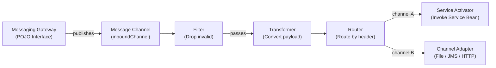
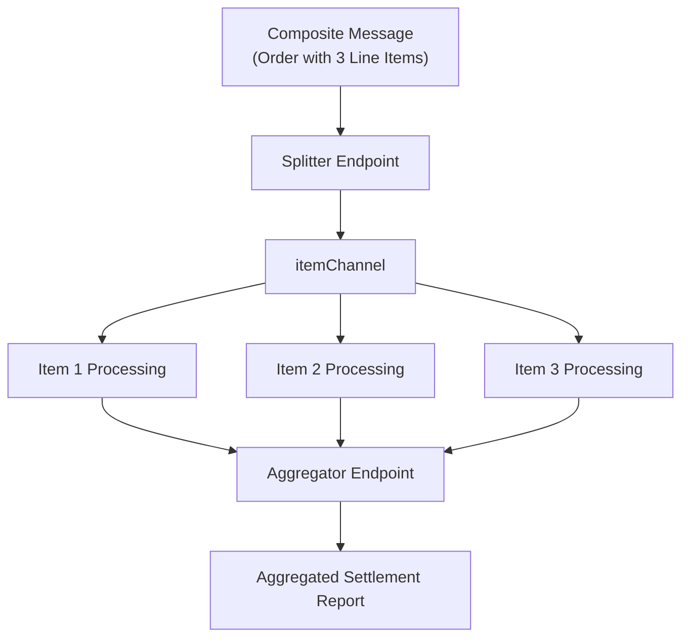
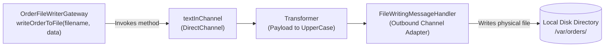

# Book Reading — Chapter 10: Integrating Spring (Enterprise Integration Patterns)

> **Source:** Craig Walls, *Spring in Action (6th Edition)*, Chapter 10: *Integrating Spring* (Section 10.2: *Surveying the Spring Integration Landscape*, pp. 251–266).

---

## 1. Architectural Overview: Enterprise Integration Patterns in Spring

Modern enterprise architectures rarely exist in vacuum. Microservices, legacy mainframes, message brokers, external SaaS platforms, and distributed file systems must continuously exchange data. Without a unified integration framework, developers end up writing bespoke, brittle point-to-point glue code.

Spring Integration implements the canonical **Enterprise Integration Patterns (EIP)** popularized by Gregor Hohpe and Bobby Woolf. The framework models integration flows as **Pipes and Filters**:
- **Messages:** Structured envelopes consisting of a payload (data of any type) and metadata headers (timestamps, routing keys, correlation IDs).
- **Channels (Pipes):** Conduits through which messages travel.
- **Endpoints (Filters):** Functional components that process, transform, split, filter, or route messages as they navigate the pipeline.



---

## 2. Message Channels: The Conduits of Integration (Section 10.2.1)

A **Message Channel** is the fundamental communication pipe connecting producers to consumers. Spring Integration provides multiple channel implementations tailored to specific architectural requirements:

| Channel Type | Concurrency & Dispatch Model | Buffer / Queue Semantics | Transaction Propagation |
| :--- | :--- | :--- | :--- |
| **`DirectChannel`** | Synchronous; consumer is invoked on the **same thread** as the producer. | Zero buffer. Point-to-point (single consumer per message). | **Yes.** Ambient database/JMS transactions span across the channel seamlessly. |
| **`QueueChannel`** | Asynchronous; consumer pulls messages independently. | FIFO in-memory buffer (`BlockingQueue`). Point-to-point. | No. Thread boundary breaks transaction context. |
| **`PriorityChannel`** | Asynchronous; pulled by consumers based on `priority` header. | In-memory priority queue. Point-to-point. | No. |
| **`PublishSubscribeChannel`** | Synchronous or asynchronous broadcast. | Zero buffer. **Broadcast**: every subscriber receives a copy of the message. | Depends on whether an executor is configured. |
| **`RendezvousChannel`** | Synchronous handoff. | Zero buffer. Sender thread blocks until a consumer actively receives the message. | Yes. Synchronizes sender and receiver threads. |
| **`ExecutorChannel`** | Asynchronous; dispatch occurs via a `TaskExecutor`. | Zero buffer. Point-to-point dispatch on a separate thread pool. | No. |
| **`FluxMessageChannel`** | Reactive Streams; based on Project Reactor `Flux`. | Backpressure-aware reactive stream. | Reactive context propagation. |

!!! tip "Channel Selection Rule of Thumb"
    Use `DirectChannel` whenever integration steps must share the sender's thread and ambient transaction boundary. Use `QueueChannel` or `ExecutorChannel` only when components must decouple execution across asynchronous thread pools or buffer bursty traffic.

### Java Configuration Example: Declaring Channels

In Java DSL configuration, channels are created automatically as `DirectChannel` by default. If a specialized channel is needed, it is declared explicitly:

```java
@Configuration
public class IntegrationChannelConfig {

    // FIFO Queued Channel with capacity limit
    @Bean
    public MessageChannel orderQueueChannel() {
        return new QueueChannel(500);
    }

    // Broadcast Channel for auditing/telemetry
    @Bean
    public MessageChannel auditBroadcastChannel() {
        return new PublishSubscribeChannel();
    }
}
```

---

## 3. Core Integration Endpoints (Sections 10.2.2 – 10.2.9)

Spring Integration decomposes complex workflow logic into discrete, decoupled endpoints.

### 3.1 Message Filters (Section 10.2.2)
A **Filter** evaluates messages against a boolean predicate. Messages satisfying the condition proceed downstream; messages failing the criteria are either silently dropped or diverted to a designated discard channel.

```java
@Bean
public IntegrationFlow orderValidationFlow() {
    return IntegrationFlows.from("rawOrdersChannel")
        .<Order, Boolean>filter(order -> order.getAmount().doubleValue() > 0.0,
            filterSpec -> filterSpec.discardChannel("invalidOrdersChannel"))
        .channel("validatedOrdersChannel")
        .get();
}
```

### 3.2 Transformers (Section 10.2.3)
A **Transformer** modifies message payloads or headers. It converts data types (e.g., converting an XML/JSON String into a domain entity, or extracting a specific field).

```java
@Bean
public IntegrationFlow orderEnrichmentFlow() {
    return IntegrationFlows.from("validatedOrdersChannel")
        .<Order, EnrichedOrderDTO>transform(order -> new EnrichedOrderDTO(
            order.getId(),
            order.getCustomerId(),
            order.getAmount(),
            Instant.now()
        ))
        .channel("enrichedOrdersChannel")
        .get();
}
```

### 3.3 Message Routers (Section 10.2.4)
A **Router** directs incoming messages to one of several output channels based on inspection of message headers or payload content:

```java
@Bean
public IntegrationFlow routingFlow() {
    return IntegrationFlows.from("enrichedOrdersChannel")
        .<EnrichedOrderDTO, String>route(
            order -> order.getAmount().doubleValue() >= 10000.0 ? "vipChannel" : "standardChannel"
        )
        .get();
}
```

### 3.4 Splitters & Aggregators (Sections 10.2.5 & 10.2.6)
- **Splitter:** Deconstructs a compound message (e.g., an `Invoice` containing a list of `LineItem` records) into distinct messages sent downstream individually.
- **Aggregator:** Recombines correlated individual messages arriving from disparate channels back into a single composite message using a shared correlation ID and release strategy.



### 3.5 Service Activators (Section 10.2.7)
A **Service Activator** bridges an integration channel to a standard Java bean method. It receives the message payload, invokes a method on a service bean, and optionally publishes the returned value to an output channel.

```java
@Bean
public IntegrationFlow serviceInvocationFlow(PaymentProcessingService paymentService) {
    return IntegrationFlows.from("vipChannel")
        .handle(paymentService, "processHighPriorityPayment")
        .channel("paymentCompletedChannel")
        .get();
}
```

### 3.6 Gateways & Channel Adapters (Sections 10.2.8 & 10.2.9)
- **Messaging Gateway (`@MessagingGateway`):** A clean Java interface that application business code calls directly. The gateway wraps method parameters into a `Message` and publishes it to an inbound channel, completely isolating business logic from Spring Integration APIs.
- **Channel Adapter:** Connects Spring Integration channels to external protocols and physical transports:
  - *Inbound Adapters:* Poll or listen to external systems (file directory, Kafka topic, JMS queue, HTTP endpoint) and produce messages into a channel.
  - *Outbound Adapters:* Consume messages from a channel and write them out to external systems (writing to a file on disk, sending an HTTP POST, publishing to an MQTT broker).

---

## 4. End-to-End Enterprise Flow: Taco Cloud File Writing Flow

To synthesize these components into a production pipeline, Craig Walls demonstrates a complete file-writing integration flow using Spring Integration's fluent **Java DSL**:



### The Declarative Gateway Interface

```java
package tacos.email;

import org.springframework.integration.annotation.Gateway;
import org.springframework.integration.annotation.MessagingGateway;
import org.springframework.integration.file.FileHeaders;
import org.springframework.messaging.handler.annotation.Header;

@MessagingGateway(defaultRequestChannel = "textInChannel")
public interface OrderFileWriterGateway {

    void writeOrderToFile(
        @Header(FileHeaders.FILENAME) String filename,
        String data
    );
}
```

### The Java DSL Flow Definition

```java
package tacos.email;

import org.springframework.context.annotation.Bean;
import org.springframework.context.annotation.Configuration;
import org.springframework.integration.dsl.IntegrationFlow;
import org.springframework.integration.dsl.IntegrationFlows;
import org.springframework.integration.dsl.MessageChannels;
import org.springframework.integration.file.dsl.Files;
import org.springframework.integration.file.support.FileExistsMode;

import java.io.File;

@Configuration
public class OrderFileIntegrationConfig {

    @Bean
    public IntegrationFlow fileWriterFlow() {
        return IntegrationFlows.from(MessageChannels.direct("textInChannel"))
            .<String, String>transform(String::toUpperCase)
            .handle(Files
                .outboundAdapter(new File("/var/orders/processed"))
                .fileExistsMode(FileExistsMode.APPEND)
                .appendNewLine(true))
            .get();
    }
}
```

---

## 5. Architectural Synthesis: AOP vs. Spring Integration

Both Spring AOP and Spring Integration modularize cross-cutting concerns, but they serve complementary enterprise tiers:

- **Spring AOP:** Operates **within a single JVM process** via dynamic proxies. Intercepts method executions on Spring beans to enforce synchronous cross-cutting concerns (auditing, transaction boundaries, latency benchmarking, data masking).
- **Spring Integration:** Operates **across components, subsystems, and external protocols** via message pipelines. Implements asynchronous, decoupled, message-driven data exchanges using pipes and filters.
