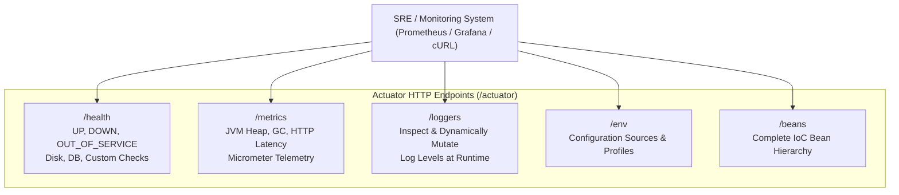

# Book Reading — Chapter 15: Working with Spring Boot Actuator

> **Source:** Craig Walls, *Spring in Action (6th Edition)*, Chapter 15: *Working with Spring Boot Actuator* (Sections 15.1–15.4, pp. 387–422).

---

## 1. Introducing Spring Boot Actuator (Section 15.1)

In production enterprise deployments, deploying a service is merely the beginning of its lifecycle. Site Reliability Engineers (SREs), DevOps pipelines, and Kubernetes orchestrators require continuous, low-overhead insight into runtime behavior:
- Is the database connection pool exhausted?
- Is memory consumption trending toward an `OutOfMemoryError`?
- What configuration properties and active profiles are loaded?
- Can we adjust log verbosity in real time to debug a production incident without restarting the container?

**Spring Boot Actuator** provides production-ready operational telemetry out of the box via HTTP endpoints and JMX MBeans.

```xml
<dependency>
    <groupId>org.springframework.boot</groupId>
    <artifactId>spring-boot-starter-actuator</artifactId>
</dependency>
```

### 1.1 Configuring Base Paths & Exposure Rules
By default, Actuator exposes all web endpoints under the `/actuator` path. This path can be customized:

```properties
management.endpoints.web.base-path=/management
```

For security reasons, Spring Boot exposes **only** the `/actuator/health` endpoint over HTTP by default. All other endpoints (`/actuator/metrics`, `/actuator/beans`, `/actuator/env`, `/actuator/loggers`) are withheld unless explicitly exposed:

```properties
# Expose essential production monitoring endpoints
management.endpoints.web.exposure.include=health,info,metrics,env,beans,loggers

# Or expose all endpoints (Strictly for development environments)
# management.endpoints.web.exposure.include=*
```

!!! warning "Never Expose Wildcard Endpoints in Production"
    Setting `management.endpoints.web.exposure.include=*` exposes sensitive endpoints like `/actuator/env`, `/actuator/beans`, and `/actuator/heapdump` to the network. In production, always list only the specific endpoints required by observability infrastructure (`health,info,metrics,prometheus`).

---

## 2. Consuming Core Actuator Endpoints (Section 15.2)



### 2.1 The `/actuator/health` Endpoint
Orchestrators (Kubernetes liveness and readiness probes) ping `/actuator/health` to determine container lifecycle management. By default, Actuator returns an unadorned summary status:

```json
{"status": "UP"}
```

To enable full component breakdown for internal operations:

```properties
management.endpoint.health.show-details=always
```

With `always`, Actuator outputs the aggregate status alongside granular health checks for databases, disk space, and message brokers:

```json
{
  "status": "UP",
  "components": {
    "db": {
      "status": "UP",
      "details": {
        "database": "H2",
        "validationQuery": "isValid()"
      }
    },
    "diskSpace": {
      "status": "UP",
      "details": {
        "total": 494384795648,
        "free": 128495026176,
        "threshold": 10485760
      }
    }
  }
}
```

### 2.2 Dynamic Log Level Mutation via `/actuator/loggers`
One of Actuator's most valuable operational superpowers is the ability to adjust logging levels at runtime without restarting the application:

```bash
# 1. Query current logging level for a package
curl http://localhost:8080/actuator/loggers/com.luv2code.aopdemo

# Output:
# {"configuredLevel": "INFO", "effectiveLevel": "INFO"}

# 2. Dynamically elevate level to DEBUG to trace a live incident
curl -X POST http://localhost:8080/actuator/loggers/com.luv2code.aopdemo \
     -H "Content-Type: application/json" \
     -d '{"configuredLevel": "DEBUG"}'

# 3. Restore back to INFO once incident is resolved
curl -X POST http://localhost:8080/actuator/loggers/com.luv2code.aopdemo \
     -H "Content-Type: application/json" \
     -d '{"configuredLevel": "INFO"}'
```

### 2.3 Runtime Performance Telemetry via `/actuator/metrics`
Actuator delegates runtime metrics to **Micrometer**, a dimensional instrumentation library that acts as the "SLF4J for metrics". Navigating to `/actuator/metrics` lists all available metric names (JVM memory, garbage collection, HTTP requests, thread pools).

To inspect a specific metric:
```bash
curl http://localhost:8080/actuator/metrics/http.server.requests
```

Returns dimensional data including count, total execution time, max duration, and tags by HTTP method, URI, and status code.

---

## 3. Customizing Actuator (Section 15.3)

Enterprise architectures frequently require domain-specific operational indicators and telemetry.

### 3.1 Defining Custom `HealthIndicator` Components (Section 15.3.2)
To incorporate a downstream service or legacy database check into the aggregate health status, implement the `HealthIndicator` interface:

```java
package tacos.actuator;

import org.springframework.boot.actuate.health.Health;
import org.springframework.boot.actuate.health.HealthIndicator;
import org.springframework.stereotype.Component;

import java.net.HttpURLConnection;
import java.net.URL;

@Component
public class PaymentGatewayHealthIndicator implements HealthIndicator {

    private static final String PAYMENT_GATEWAY_URL = "https://api.payments.internal/ping";

    @Override
    public Health health() {
        try {
            URL url = new URL(PAYMENT_GATEWAY_URL);
            HttpURLConnection connection = (HttpURLConnection) url.openConnection();
            connection.setConnectTimeout(1500);
            connection.setReadTimeout(1500);
            int responseCode = connection.getResponseCode();

            if (responseCode == 200) {
                return Health.up()
                        .withDetail("gateway", "Primary Payment Gateway")
                        .withDetail("latencyMs", 24)
                        .build();
            } else {
                return Health.down()
                        .withDetail("error", "Gateway returned HTTP " + responseCode)
                        .build();
            }
        } catch (Exception ex) {
            return Health.down(ex)
                    .withDetail("failure", "Payment Gateway Unreachable")
                    .build();
        }
    }
}
```

If `PaymentGatewayHealthIndicator` returns `Health.down()`, Actuator transitions the overall status of `/actuator/health` from `UP` to `DOWN` and responds with an HTTP 503 Service Unavailable, alerting Kubernetes to stop routing traffic to this replica.

### 3.2 Registering Custom Domain Metrics via `MeterRegistry` (Section 15.3.3)
To track domain-specific events (e.g., number of tacos created, total payment volume), inject Micrometer's `MeterRegistry`:

```java
package tacos.service;

import io.micrometer.core.instrument.Counter;
import io.micrometer.core.instrument.MeterRegistry;
import org.springframework.stereotype.Service;

@Service
public class OrderServiceImpl implements OrderService {

    private final Counter tacoCounter;
    private final Counter orderRevenueCounter;

    public OrderServiceImpl(MeterRegistry meterRegistry) {
        // Register dimensional counters
        this.tacoCounter = meterRegistry.counter("tacocloud.tacos.created");
        this.orderRevenueCounter = meterRegistry.counter("tacocloud.orders.revenue", "region", "us-east");
    }

    @Override
    public void processOrder(Order order) {
        // Business logic execution
        tacoCounter.increment(order.getTacos().size());
        orderRevenueCounter.increment(order.getTotalAmount().doubleValue());
    }
}
```

These metrics immediately surface under `/actuator/metrics/tacocloud.tacos.created` and can be scraped by Prometheus and rendered in Grafana dashboards.

### 3.3 Authoring Custom Endpoints via `@Endpoint` (Section 15.3.4)
For specialized operational tasks (e.g., resetting an in-memory token cache), developers can build completely custom Actuator endpoints using the `@Endpoint`, `@ReadOperation`, and `@WriteOperation` annotations:

```java
package tacos.actuator;

import org.springframework.boot.actuate.endpoint.annotation.DeleteOperation;
import org.springframework.boot.actuate.endpoint.annotation.Endpoint;
import org.springframework.boot.actuate.endpoint.annotation.ReadOperation;
import org.springframework.boot.actuate.endpoint.annotation.WriteOperation;
import org.springframework.stereotype.Component;

import java.util.Map;
import java.util.concurrent.ConcurrentHashMap;

@Component
@Endpoint(id = "releaseNotes")
public class ReleaseNotesEndpoint {

    private final Map<String, String> notes = new ConcurrentHashMap<>();

    @ReadOperation
    public Map<String, String> getReleaseNotes() {
        return notes;
    }

    @WriteOperation
    public void addReleaseNote(String version, String description) {
        notes.put(version, description);
    }

    @DeleteOperation
    public void purgeNotes() {
        notes.clear();
    }
}
```

---

## 4. Securing Actuator Endpoints (Section 15.4)

Exposing raw environment variables, configuration dumps, heap statistics, and logging levels over an unauthenticated HTTP connection is a severe security vulnerability.

Spring Security integrates seamlessly with Actuator using `EndpointRequest` matchers to enforce defense-in-depth security:

```java
package tacos.security;

import org.springframework.boot.actuate.autoconfigure.security.servlet.EndpointRequest;
import org.springframework.boot.actuate.health.HealthEndpoint;
import org.springframework.boot.actuate.info.InfoEndpoint;
import org.springframework.context.annotation.Bean;
import org.springframework.context.annotation.Configuration;
import org.springframework.security.config.Customizer;
import org.springframework.security.config.annotation.web.builders.HttpSecurity;
import org.springframework.security.web.SecurityFilterChain;

@Configuration
public class ActuatorSecurityConfig {

    @Bean
    public SecurityFilterChain actuatorSecurityFilterChain(HttpSecurity http) throws Exception {
        http
            .securityMatcher(EndpointRequest.toAnyEndpoint())
            .authorizeHttpRequests(authorize -> authorize
                // 1. Permit unauthenticated access to health and info for container probes
                .requestMatchers(EndpointRequest.to(HealthEndpoint.class, InfoEndpoint.class)).permitAll()
                // 2. Restrict all other operational endpoints to ADMIN role
                .requestMatchers(EndpointRequest.toAnyEndpoint()).hasRole("ADMIN")
            )
            .httpBasic(Customizer.withDefaults())
            .csrf(csrf -> csrf.disable());

        return http.build();
    }
}
```

### Key Security Principles

!!! important "Health Endpoint Defense-in-Depth"
    Always configure `management.endpoint.health.show-details=when-authorized` or `never` for unauthenticated callers. While container orchestrators (such as Kubernetes liveness/readiness probes) require public access to `/actuator/health` to confirm process availability, exposing internal database URLs, disk space thresholds, and exception traces to anonymous consumers constitutes a high-severity information disclosure vulnerability.

1. **Public Health Probe:** `/actuator/health` must remain publicly accessible to container orchestrators, but `management.endpoint.health.show-details` should be set to `when-authorized` or `never` for untrusted callers to prevent leaking internal database hostnames.
2. **Restricted Admin Access:** Endpoints that reveal sensitive configuration (`/env`, `/beans`) or permit runtime state mutation (`/loggers`, custom write operations) must strictly require administrative credentials.
