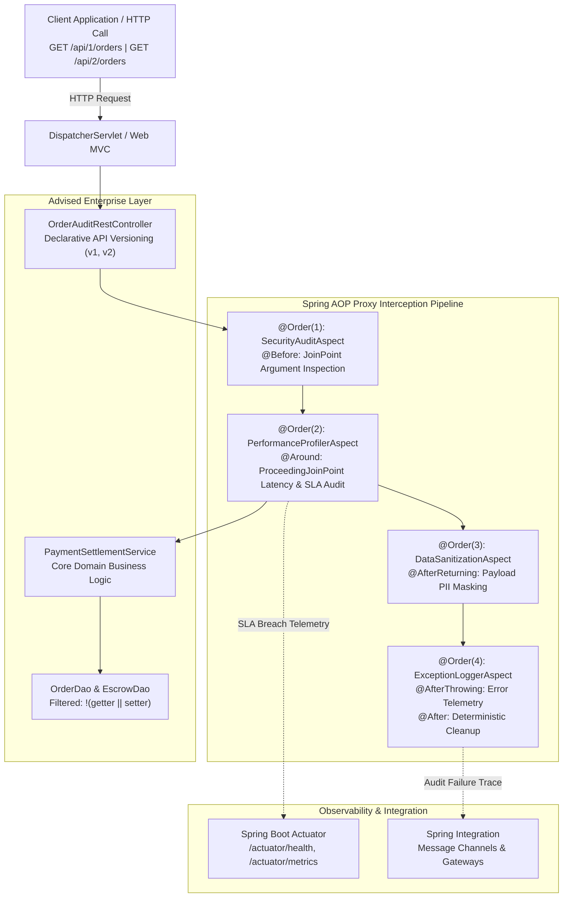

# Week 10 — Aspect-Oriented Programming (AOP), Production Telemetry & Spring Boot 4 Updates

## Goal

Decouple cross-cutting technical concerns such as security auditing, high-precision performance profiling, distributed exception logging, and payload data sanitization—from core business and persistence tiers using Spring AOP runtime dynamic proxies. 
Master pointcut expression grammar, reusable pointcut catalogs, Boolean composition (`&&`, `||`, `!`), aspect precedence management via `@Order`, and the complete taxonomy of advice types (`@Before`, `@AfterReturning`, `@AfterThrowing`, `@After`, and `@Around`). 
Navigate advanced proxy pitfalls including the internal self-invocation bypass, explore enterprise messaging integration patterns, production observability with Spring Boot Actuator, and the architectural modernization of Spring Boot 4 and Spring Framework 7 featuring declarative URL path-segment API versioning.

---

## :material-calendar: Week 10 Schedule

| Topic | Modules / Sections | Key Annotations / Concepts |
| :--- | :--- | :--- |
| **AOP Foundations & Pointcut Expressions** | Modules 01–09 | `@Aspect`, `@Component`, `execution(...)`, return type wildcards, parameter matching `()`, `(*)`, `(..)` |
| **Reusable Pointcut Catalogs & Composition** | Modules 10–13 | `@Pointcut`, Boolean operators (`&&`, `||`, `!`), getter/setter noise filtering, architectural pointcut catalogs |
| **Aspect Precedence & JoinPoint Introspection** | Modules 14–15 | `@Order(int)`, precedence hierarchy, `JoinPoint`, `MethodSignature`, argument extraction and type safety |
| **Post-Processing & Exception Advice Types** | Modules 16–19 | `@AfterReturning(returning=...)`, result mutation, `@AfterThrowing(throwing=...)`, `@After` finally cleanup |
| **The Master Advice: Execution Profiling** | Modules 20–22 | `@Around`, `ProceedingJoinPoint`, `proceed()`, latency profiling, SLA violation alerting, exception re-throwing |
| **Three-Tier Enterprise AOP Logging** | Module 23 | Controller, Service, and DAO cross-layer logging in Spring MVC applications without business intrusion |
| **Spring Boot 4 & Modern API Versioning** | Module 11 | Java 21 baseline, Jakarta EE 11, `spring.mvc.apiversion.use.path-segment=1`, `@GetMapping(version="1")` |
| **Book Reading — Ch 10: Integrating Spring** | Ch 10 (pp. 251–266) | Message channels, filters, transformers, routers, splitters, service activators, Java DSL flows |
| **Book Reading — Ch 15: Spring Boot Actuator** | Ch 15 (pp. 387–422) | `/actuator` endpoints, `HealthIndicator`, Micrometer `MeterRegistry`, custom endpoints, security rules |

---

## :material-sitemap: Architectural Progression

---

## :material-folder-open: Week 10 Content

-   :material-note-text:{ .lg .middle } **Topic Notes — Part 1: Core AOP Architecture, Dynamic Proxies, Pointcut Grammar & Precedence**

    ---

    The cross-cutting concern dilemma, canonical AOP terminology (Aspect, Advice, Join Point, Pointcut, Weaving), Spring AOP runtime dynamic proxies vs AspectJ bytecode weaving, JDK dynamic proxies vs CGLIB subclasses, pointcut expression grammar and parameter wildcards, reusable pointcut catalogs (`@Pointcut`), getter/setter noise filtering, aspect precedence ordering (`@Order`), and `JoinPoint` method signature and argument extraction.

    [:octicons-arrow-right-24: Topic Notes Part 1](topic-notes-part1.md)

-   :material-note-text:{ .lg .middle } **Topic Notes — Part 2: Advice Types Deep-Dive, Profiling, Self-Invocation & Spring Boot 4**

    ---

    Taxonomy of all five advice types, data post-processing and modification via `@AfterReturning`, exception interception and propagation rules under `@AfterThrowing`, deterministic cleanup with `@After`, execution profiling and SLA alert thresholds using `@Around` with `ProceedingJoinPoint`, three-tier enterprise logging, the internal self-invocation proxy bypass trap and its remedies, and Spring Boot 4 / Spring Framework 7 declarative URL path-segment API versioning.

    [:octicons-arrow-right-24: Topic Notes Part 2](topic-notes-part2.md)

-   :material-book-open-page-variant:{ .lg .middle } **Book Reading — Chapter 10: Integrating Spring (Enterprise Integration Patterns)**

    ---

    Craig Walls' *Spring in Action (6th Edition)* Chapter 10 (Section 10.2, pp. 251–266). Surveying the Spring Integration landscape: message channels (`PublishSubscribeChannel`, `QueueChannel`, `PriorityChannel`, `DirectChannel`, `ExecutorChannel`, `FluxMessageChannel`), message filters, payload transformers, dynamic message routers, splitters, aggregators, service activators, channel adapters, gateways, and declarative Java DSL flows.

    [:octicons-arrow-right-24: Book Reading Ch 10](book-reading-ch10.md)

-   :material-book-open-page-variant:{ .lg .middle } **Book Reading — Chapter 15: Working with Spring Boot Actuator**

    ---

    Craig Walls' *Spring in Action (6th Edition)* Chapter 15 (Sections 15.1–15.4, pp. 387–422). Production observability: Actuator endpoint exposure, inspecting health (`/actuator/health`), environment variables, beans, and runtime loggers, registering custom metrics via Micrometer's `MeterRegistry`, authoring custom `HealthIndicator` beans, implementing custom `@Endpoint` components, and securing operational endpoints with Spring Security.

    [:octicons-arrow-right-24: Book Reading Ch 15](book-reading-ch15.md)

-   :material-laptop:{ .lg .middle } **Lab Guide: Automated Cross-Layer Security Audit & Execution Profiler**

    ---

    Production lab specification: constructing an automated auditing, profiling, and sanitization system across Controller, Service, and Data tiers. Includes `@Order(1)` through `@Order(4)` aspect hierarchy, getter/setter exclusion, SLA latency threshold alerts, PII data masking, Spring Boot 4 dual-version REST endpoints (`v1` and `v2`), and full JUnit 5 integration verification suite.

    [:octicons-arrow-right-24: Week 10 Lab Guide](lab-guide.md)

-   :material-clipboard-check-outline:{ .lg .middle } **Week 10 Summary & Architectural Reference**

    ---

    Comprehensive summary and quick-reference cheatsheet: AOP terminology matrix, complete interception lifecycle sequence diagram, pointcut expression pattern cheat-sheet, aspect ordering precedence rules, advice comparison matrix, the self-invocation trap decision tree, and modern Spring Boot 4 API versioning configuration guide.

    [:octicons-arrow-right-24: Week 10 Summary](summary.md)

---

## :material-checkbox-marked-outline: Learning Objectives Checklist

- [ ] Articulate the architectural drawbacks of code tangling and code scattering in enterprise architectures.
- [ ] Contrast Spring AOP runtime dynamic proxying with AspectJ compile-time and load-time bytecode weaving.
- [ ] Differentiate JDK dynamic proxies (interface-based) from CGLIB proxies (subclass-based) and understand Spring Boot's proxying defaults.
- [ ] Construct precise AspectJ pointcut expressions using return type, method name, package, and parameter wildcards (`*`, `..`).
- [ ] Author centralized, reusable pointcut catalogs with `@Pointcut` and compose expressions using `&&`, `||`, and `!`.
- [ ] Eliminate boilerplate noise by filtering getter and setter methods from data tier pointcuts.
- [ ] Control multi-aspect execution ordering using `@Order` and explain advice entry and exit precedence.
- [ ] Extract method signatures and argument arrays safely using `JoinPoint` and handle downcasting defensively.
- [ ] Post-process and sanitize returned collections and domain payloads using `@AfterReturning`.
- [ ] Intercept exceptions using `@AfterThrowing` while preserving transparent upstream exception propagation.
- [ ] Guarantee cleanup operations with `@After` advice irrespective of method execution success or failure.
- [ ] Surround method execution with `@Around` advice, measure execution duration, and trigger SLA latency violation alerts.
- [ ] Diagnose and resolve the Spring AOP self-invocation trap using architectural decoupling or self-injection.
- [ ] Implement declarative URL path-segment API versioning in Spring Boot 4 using `spring.mvc.apiversion.use.path-segment=1` and `@GetMapping(version="...")`.
- [ ] Configure Spring Integration channels, filters, transformers, and service activators using the Java DSL.
- [ ] Expose, customize, and secure Spring Boot Actuator endpoints for enterprise production observability.
