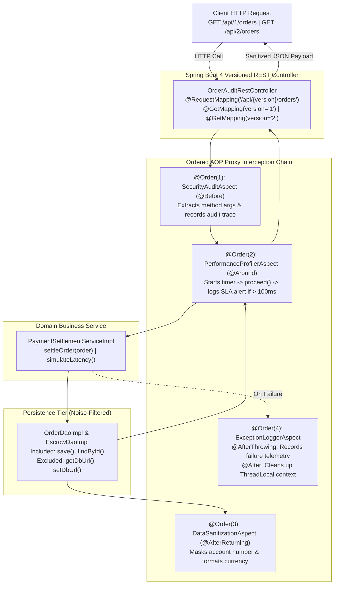

# Week 10 Lab Guide — Automated Cross-Layer Security Audit & Execution Profiler

## 1. Laboratory Overview & Engineering Context

In enterprise backends, services and persistence tiers must uphold rigorous non-functional guarantees: security auditing, execution latency benchmarking, data sanitization, and failure telemetry. Embedding these concerns directly into business classes violates the Single Responsibility Principle and scatters duplicate code across the codebase.

This laboratory establishes an enterprise-grade auditing, profiling, and sanitization framework using **Spring AOP runtime dynamic proxies** across the Web Controller, Business Service, and Data Access tiers, while adopting modern **Spring Boot 4 / Spring Framework 7 declarative URL path-segment API versioning**.

!!! important "Complete Lab Implementation Repository"
    All source code, configurations, database scripts, and automated test suites for this laboratory are maintained in the official GitHub repository:  
    [:material-github: 7amo10/Spring-Labs — Week-10-AOP-Security-Audit-Execution-Profiler](https://github.com/7amo10/Spring-Labs/tree/main/Week-10-AOP-Security-Audit-Execution-Profiler)

---

## 2. Technical Requirements & Architectural Matrix

The framework enforces four distinct aspect tiers with strict execution precedence via `@Order(1)` through `@Order(4)`:

| Aspect Class | Precedence | Advice Type | Target Join Points | Architectural Responsibility |
| :--- | :--- | :--- | :--- | :--- |
| **`SecurityAuditAspect`** | `@Order(1)` | `@Before` | `ArchitecturePointcuts.forAppFlow()` | Inspects `JoinPoint` arguments, verifies security tags, and records invocation metadata into a thread-safe `AuditRegistry`. |
| **`PerformanceProfilerAspect`** | `@Order(2)` | `@Around` | `ArchitecturePointcuts.forServicePackage()` | Benchmarks method execution duration via `ProceedingJoinPoint`. If execution exceeds $100\,\text{ms}$, emits an SLA latency breach alert. |
| **`DataSanitizationAspect`** | `@Order(3)` | `@AfterReturning` | `ArchitecturePointcuts.forDaoPackageNoGetterSetter()` | Post-processes returned domain entities in-place: masks account numbers (`****-****-****-1234`) and normalizes ISO currency strings. |
| **`ExceptionLoggerAspect`** | `@Order(4)` | `@AfterThrowing` | `ArchitecturePointcuts.forAppFlow()` | Intercepts uncaught runtime exceptions, records error telemetry, and verifies that the exception is safely re-thrown to upstream callers. |
| **`ExceptionLoggerAspect`** | `@Order(4)` | `@After` | `ArchitecturePointcuts.forAppFlow()` | Executes deterministic cleanup logic (clearing thread-local buffers) regardless of invocation outcome. |

---

## 3. End-to-End Interception & Routing Pipeline



---

## 4. Step-by-Step Implementation Guide

### Step 1: Maven Dependencies & Spring Boot 4 Versioning Setup
Configure `pom.xml` with Spring Boot starters for AOP, Web MVC, and Actuator:

```xml
<dependencies>
    <!-- Spring AOP with AspectJ Weaver -->
    <dependency>
        <groupId>org.springframework.boot</groupId>
        <artifactId>spring-boot-starter-aop</artifactId>
    </dependency>

    <!-- Spring Web MVC -->
    <dependency>
        <groupId>org.springframework.boot</groupId>
        <artifactId>spring-boot-starter-web</artifactId>
    </dependency>

    <!-- Spring Boot Actuator for Production Telemetry -->
    <dependency>
        <groupId>org.springframework.boot</groupId>
        <artifactId>spring-boot-starter-actuator</artifactId>
    </dependency>

    <dependency>
        <groupId>org.springframework.boot</groupId>
        <artifactId>spring-boot-starter-test</artifactId>
        <scope>test</scope>
    </dependency>
</dependencies>
```

In `src/main/resources/application.properties`, enable Spring Boot 4 declarative URL path-segment API versioning:

```properties
spring.application.name=Week-10-AOP-Security-Audit-Execution-Profiler

# Spring Boot 4 / Spring Framework 7 URL Path-Segment API Versioning
# Segment 1 indicates that /api/{version}/... will treat segment 1 as version token
spring.mvc.apiversion.use.path-segment=1

# Expose Actuator Telemetry
management.endpoints.web.exposure.include=health,info,metrics
management.endpoint.health.show-details=always
```

---

### Step 2: The Reusable Pointcut Catalog (`ArchitecturePointcuts.java`)

To eliminate inline pointcut string duplication and filter out getter and setter noise, centralize pointcut definitions into a dedicated catalog class:

```java
package com.luv2code.aoplab.aspect;

import org.aspectj.lang.annotation.Aspect;
import org.aspectj.lang.annotation.Pointcut;

@Aspect
public class ArchitecturePointcuts {

    // 1. Controller Tier Pointcut
    @Pointcut("execution(* com.luv2code.aoplab.rest.*.*(..))")
    public void forControllerPackage() {}

    // 2. Service Tier Pointcut
    @Pointcut("execution(* com.luv2code.aoplab.service.*.*(..))")
    public void forServicePackage() {}

    // 3. DAO Tier Pointcut
    @Pointcut("execution(* com.luv2code.aoplab.dao.*.*(..))")
    public void forDaoPackage() {}

    // 4. Accessor Noise Filtering Pointcuts
    @Pointcut("execution(* com.luv2code.aoplab.dao.*.get*(..))")
    public void getter() {}

    @Pointcut("execution(* com.luv2code.aoplab.dao.*.set*(..))")
    public void setter() {}

    // 5. Filtered DAO Pointcut: Include DAO, EXCLUDE getters and setters
    @Pointcut("forDaoPackage() && !(getter() || setter())")
    public void forDaoPackageNoGetterSetter() {}

    // 6. Unified Application Flow Pointcut
    @Pointcut("forControllerPackage() || forServicePackage() || forDaoPackageNoGetterSetter()")
    public void forAppFlow() {}
}
```

---

### Step 3: Thread-Safe Telemetry Buffer (`AuditRegistry.java`)

Create a thread-safe registry to capture advice execution traces, ordering sequences, and SLA breach warnings for empirical test verification:

```java
package com.luv2code.aoplab.telemetry;

import org.springframework.stereotype.Component;

import java.util.List;
import java.util.concurrent.CopyOnWriteArrayList;

@Component
public class AuditRegistry {

    private final List<String> auditLogs = new CopyOnWriteArrayList<>();
    private final List<String> executionOrder = new CopyOnWriteArrayList<>();
    private final List<String> slaAlerts = new CopyOnWriteArrayList<>();

    public void recordAudit(String entry) {
        auditLogs.add(entry);
    }

    public void recordOrder(String aspectName) {
        executionOrder.add(aspectName);
    }

    public void recordSlaAlert(String alert) {
        slaAlerts.add(alert);
    }

    public List<String> getAuditLogs() { return auditLogs; }
    public List<String> getExecutionOrder() { return executionOrder; }
    public List<String> getSlaAlerts() { return slaAlerts; }

    public void clear() {
        auditLogs.clear();
        executionOrder.clear();
        slaAlerts.clear();
    }
}
```

---

### Step 4: The Four Ordered Aspects

#### `@Order(1)`: `SecurityAuditAspect.java` (`@Before`)
```java
package com.luv2code.aoplab.aspect;

import com.luv2code.aoplab.telemetry.AuditRegistry;
import org.aspectj.lang.JoinPoint;
import org.aspectj.lang.annotation.Aspect;
import org.aspectj.lang.annotation.Before;
import org.aspectj.lang.reflect.MethodSignature;
import org.springframework.core.annotation.Order;
import org.springframework.stereotype.Component;

@Aspect
@Component
@Order(1)
public class SecurityAuditAspect {

    private final AuditRegistry auditRegistry;

    public SecurityAuditAspect(AuditRegistry auditRegistry) {
        this.auditRegistry = auditRegistry;
    }

    @Before("com.luv2code.aoplab.aspect.ArchitecturePointcuts.forAppFlow()")
    public void auditMethodInvocation(JoinPoint joinPoint) {
        auditRegistry.recordOrder("SecurityAuditAspect");

        MethodSignature signature = (MethodSignature) joinPoint.getSignature();
        String methodDesc = signature.toShortString();

        Object[] args = joinPoint.getArgs();
        StringBuilder argsDesc = new StringBuilder();
        for (Object arg : args) {
            argsDesc.append(arg != null ? arg.toString() : "null").append("; ");
        }

        auditRegistry.recordAudit("AUDIT_ENTER: " + methodDesc + " | ARGS: [" + argsDesc.toString().trim() + "]");
    }
}
```

#### `@Order(2)`: `PerformanceProfilerAspect.java` (`@Around`)
```java
package com.luv2code.aoplab.aspect;

import com.luv2code.aoplab.telemetry.AuditRegistry;
import org.aspectj.lang.ProceedingJoinPoint;
import org.aspectj.lang.annotation.Around;
import org.aspectj.lang.annotation.Aspect;
import org.springframework.core.annotation.Order;
import org.springframework.stereotype.Component;

@Aspect
@Component
@Order(2)
public class PerformanceProfilerAspect {

    private static final long SLA_THRESHOLD_MS = 100L;
    private final AuditRegistry auditRegistry;

    public PerformanceProfilerAspect(AuditRegistry auditRegistry) {
        this.auditRegistry = auditRegistry;
    }

    @Around("com.luv2code.aoplab.aspect.ArchitecturePointcuts.forServicePackage()")
    public Object profileExecutionTime(ProceedingJoinPoint proceedingJoinPoint) throws Throwable {
        auditRegistry.recordOrder("PerformanceProfilerAspect_ENTER");

        long start = System.currentTimeMillis();
        Object result;

        try {
            result = proceedingJoinPoint.proceed();
        } finally {
            long duration = System.currentTimeMillis() - start;
            String methodName = proceedingJoinPoint.getSignature().toShortString();

            if (duration > SLA_THRESHOLD_MS) {
                String alert = "SLA BREACH: " + methodName + " exceeded threshold (" + duration + "ms > " + SLA_THRESHOLD_MS + "ms)";
                auditRegistry.recordSlaAlert(alert);
            }

            auditRegistry.recordOrder("PerformanceProfilerAspect_EXIT");
        }

        return result;
    }
}
```

#### `@Order(3)`: `DataSanitizationAspect.java` (`@AfterReturning`)
```java
package com.luv2code.aoplab.aspect;

import com.luv2code.aoplab.entity.OrderTransaction;
import com.luv2code.aoplab.telemetry.AuditRegistry;
import org.aspectj.lang.JoinPoint;
import org.aspectj.lang.annotation.AfterReturning;
import org.aspectj.lang.annotation.Aspect;
import org.springframework.core.annotation.Order;
import org.springframework.stereotype.Component;

import java.util.List;

@Aspect
@Component
@Order(3)
public class DataSanitizationAspect {

    private final AuditRegistry auditRegistry;

    public DataSanitizationAspect(AuditRegistry auditRegistry) {
        this.auditRegistry = auditRegistry;
    }

    @AfterReturning(
        pointcut = "com.luv2code.aoplab.aspect.ArchitecturePointcuts.forDaoPackageNoGetterSetter()",
        returning = "result"
    )
    public void sanitizeOrderPayloads(JoinPoint joinPoint, Object result) {
        auditRegistry.recordOrder("DataSanitizationAspect");

        if (result instanceof OrderTransaction order) {
            maskSensitiveOrder(order);
        } else if (result instanceof List<?> list) {
            for (Object item : list) {
                if (item instanceof OrderTransaction order) {
                    maskSensitiveOrder(order);
                }
            }
        }
    }

    private void maskSensitiveOrder(OrderTransaction order) {
        if (order.getAccountNumber() != null && order.getAccountNumber().length() >= 4) {
            String raw = order.getAccountNumber();
            String masked = "****-****-****-" + raw.substring(raw.length() - 4);
            order.setAccountNumber(masked);
        }
        if (order.getCurrency() != null) {
            order.setCurrency(order.getCurrency().trim().toUpperCase());
        }
    }
}
```

#### `@Order(4)`: `ExceptionLoggerAspect.java` (`@AfterThrowing` & `@After`)
```java
package com.luv2code.aoplab.aspect;

import com.luv2code.aoplab.telemetry.AuditRegistry;
import org.aspectj.lang.JoinPoint;
import org.aspectj.lang.annotation.After;
import org.aspectj.lang.annotation.AfterThrowing;
import org.aspectj.lang.annotation.Aspect;
import org.springframework.core.annotation.Order;
import org.springframework.stereotype.Component;

@Aspect
@Component
@Order(4)
public class ExceptionLoggerAspect {

    private final AuditRegistry auditRegistry;

    public ExceptionLoggerAspect(AuditRegistry auditRegistry) {
        this.auditRegistry = auditRegistry;
    }

    @AfterThrowing(
        pointcut = "com.luv2code.aoplab.aspect.ArchitecturePointcuts.forAppFlow()",
        throwing = "theExc"
    )
    public void logFailureTelemetry(JoinPoint joinPoint, Throwable theExc) {
        auditRegistry.recordOrder("ExceptionLoggerAspect_THROWING");
        String method = joinPoint.getSignature().toShortString();
        auditRegistry.recordAudit("EXCEPTION_INTERCEPTED: " + method + " | ERROR: " + theExc.getMessage());
    }

    @After("com.luv2code.aoplab.aspect.ArchitecturePointcuts.forAppFlow()")
    public void deterministicCleanup(JoinPoint joinPoint) {
        auditRegistry.recordOrder("ExceptionLoggerAspect_AFTER_FINALLY");
        String method = joinPoint.getSignature().toShortString();
        auditRegistry.recordAudit("CLEANUP_FINALLY: " + method);
    }
}
```

---

### Step 5: Spring Boot 4 Versioned REST Controller (`OrderAuditRestController.java`)

```java
package com.luv2code.aoplab.rest;

import com.luv2code.aoplab.entity.OrderTransaction;
import com.luv2code.aoplab.service.PaymentSettlementService;
import org.springframework.web.bind.annotation.*;

import java.util.List;
import java.util.Map;

@RestController
@RequestMapping("/api/{version}/orders")
public class OrderAuditRestController {

    private final PaymentSettlementService paymentService;

    public OrderAuditRestController(PaymentSettlementService paymentService) {
        this.paymentService = paymentService;
    }

    // Serves: GET /api/1/orders (Legacy Summary Representation)
    @GetMapping(version = "1")
    public Map<String, Object> getOrdersSummaryV1() {
        List<OrderTransaction> orders = paymentService.findAllOrders();
        return Map.of(
            "apiVersion", "v1.0",
            "totalCount", orders.size(),
            "status", "LEGACY_COMPATIBLE"
        );
    }

    // Serves: GET /api/2/orders (Modern Enriched Telemetry Representation)
    @GetMapping(version = "2")
    public Map<String, Object> getOrdersEnrichedV2() {
        List<OrderTransaction> orders = paymentService.findAllOrders();
        return Map.of(
            "apiVersion", "v2.0",
            "orders", orders,
            "telemetryStatus", "ACTIVE"
        );
    }

    // Serves: POST /api/2/orders (Order Processing with Latency Simulation)
    @PostMapping(version = "2")
    public OrderTransaction processOrderV2(
        @RequestBody OrderTransaction order,
        @RequestParam(defaultValue = "false") boolean simulateDelay
    ) {
        return paymentService.settleOrder(order, simulateDelay);
    }
}
```

---

## 5. Verification & Empirical Validation

Execute the automated test suite from the terminal:

```bash
mvn clean test
```

### The 8 Automated Test Invariants Verified
1. **Argument Extraction Test:** Verifies `@Before` advice extracts parameters and binds them to `AuditRegistry`.
2. **Noise Filtering Test:** Invoking `orderDao.getDbUrl()` or `orderDao.setDbUrl()` leaves `AuditRegistry` untouched, proving getter/setter exclusion.
3. **Aspect Precedence Test:** Verifies that on method entry, `@Order(1)` executes before `@Order(2)`, which executes before `@Order(4)`.
4. **SLA Duration Alerting Test:** Simulating a 120 ms latency triggers an `SLA BREACH` entry in `AuditRegistry`.
5. **In-Place Data Sanitization Test:** Account number `1111222233334444` is mutated to `****-****-****-4444` upon return from the DAO tier.
6. **Exception Interception & Propagation Test:** When a service throws a `PaymentGatewayException`, `@AfterThrowing` records the error, but the exception still propagates cleanly to the caller.
7. **Deterministic Cleanup Test:** Verifies `@After` runs unconditionally even after an exception is thrown.
8. **Spring Boot 4 Versioning Test:** `MockMvc` requests to `/api/1/orders` return the `v1.0` summary payload, `/api/2/orders` returns the `v2.0` enriched payload, and requests to `/api/99/orders` are rejected with HTTP 400.
