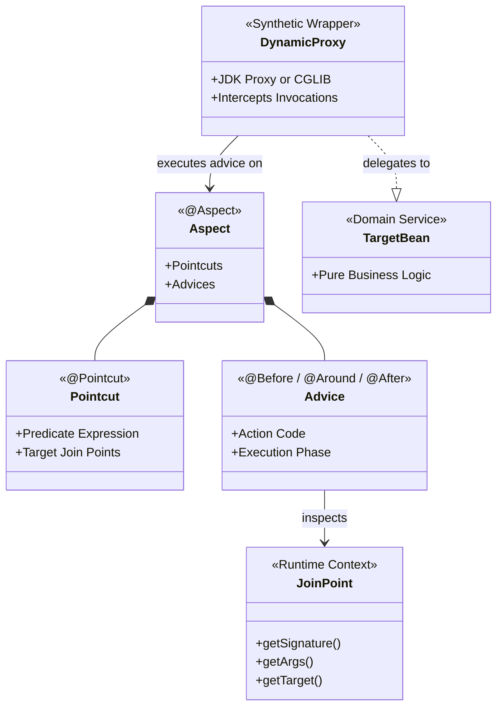
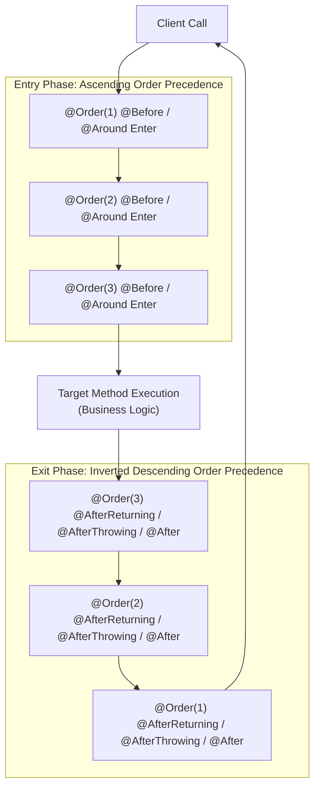
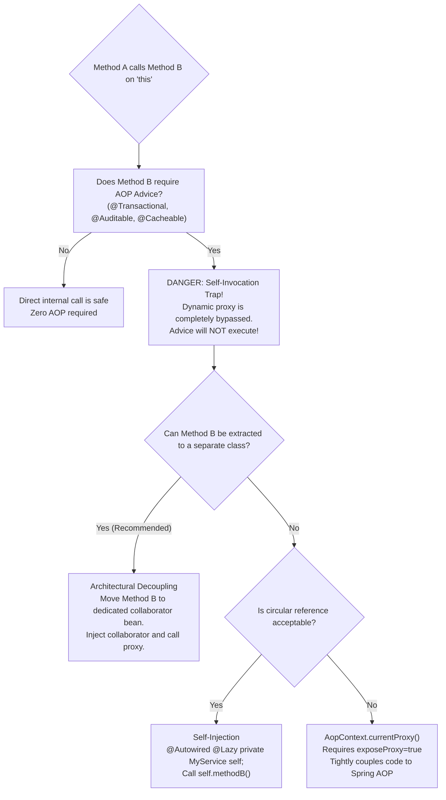

# Week 10 Summary & Architectural Reference

## 1. Core AOP Conceptual Matrix



| Term | Formal Definition | Spring AOP Reality | AspectJ Reality |
| :--- | :--- | :--- | :--- |
| **Aspect** | Modular unit encapsulating a cross-cutting concern. | A Java class annotated with `@Aspect` and registered as a Spring bean (`@Component`). | Aspect module defined in `.aj` file or class with `@Aspect`. |
| **Join Point** | Candidate point in execution where advice can be woven. | **Method execution only** on Spring-managed beans. | Method calls, executions, constructor calls, field reads/writes, exception handlers. |
| **Pointcut** | Predicate expression matching specific Join Points. | Evaluated at runtime via reflection against target method signatures. | Evaluated at compile-time or load-time bytecode weaving. |
| **Advice** | Action executed at a matched Join Point. | Interceptor method annotated with `@Before`, `@AfterReturning`, `@AfterThrowing`, `@After`, or `@Around`. | Inlined bytecode instructions woven directly into class files. |
| **Target Object** | The advised underlying business bean. | The raw domain bean wrapped inside a synthetic dynamic proxy. | The unmodified bytecode class receiving woven instructions. |
| **Weaving** | Linking aspects with target types. | **Runtime proxy creation** in the `ApplicationContext`. | **Compile-time**, post-compile, or load-time bytecode modification. |

---

## 2. Advice Execution Lifecycle & Precedence Matrix



!!! important "The Inverted Advice Precedence Rule"
    On method entry (`@Before`, `@Around` entry), advice executes in **ascending order**: `@Order(1)` precedes `@Order(2)`. On method exit (`@AfterReturning`, `@AfterThrowing`, `@After`, `@Around` exit), the execution order is **strictly inverted**: `@Order(2)` completes before `@Order(1)`.

### Detailed Advice Comparison

| Advice Type | Annotation | Triggers When? | Has Return Value? | Has Exception? | Can Suppress Exception? | Can Replace Return Value? |
| :--- | :--- | :--- | :--- | :--- | :--- | :--- |
| **Before** | `@Before` | Before target method enters. | No | No | No | No |
| **After Returning** | `@AfterReturning` | After normal completion (no exception). | **Yes** (`returning=...`) | No | No | No (can only mutate mutable objects) |
| **After Throwing** | `@AfterThrowing` | Immediately after exception thrown. | No | **Yes** (`throwing=...`) | **No** (always rethrows to caller) | No |
| **After (Finally)** | `@After` | Unconditionally upon exit (success or error). | No | No | No | No |
| **Around** | `@Around` | Wraps entire invocation. | **Yes** (captured from `proceed()`) | **Yes** (via `catch` block) | **Yes** (by returning fallback) | **Yes** (can return entirely new object) |

---

## 3. Pointcut Expression Grammar Cheatsheet

### Pointcut Designator: `execution(...)`
```
execution(modifiers-pattern? return-type-pattern declaring-type-pattern?method-name-pattern(param-pattern) throws-pattern?)
```

| Token / Pattern | Syntax Example | Meaning |
| :--- | :--- | :--- |
| **Any Return Type** | `execution(* *(..))` | Matches methods returning `void`, primitive types, or any object reference. |
| **Specific Return Type** | `execution(java.util.List *(..))` | Matches only methods returning `java.util.List`. |
| **Method Name Prefix** | `execution(* add*(..))` | Matches any method whose name begins with `add` (`addAccount`, `addOrder`). |
| **Specific Class** | `execution(* com.luv2code.dao.AccountDAO.*(..))` | Matches all methods defined specifically inside `AccountDAO`. |
| **Entire Package** | `execution(* com.luv2code.dao.*.*(..))` | Matches any method in any class directly within `com.luv2code.dao`. |
| **Package & Subpackages** | `execution(* com.luv2code..*.*(..))` | Matches any method in `com.luv2code` and **all subpackages** recursively. |
| **Zero Arguments** | `execution(* *())` | Matches methods taking zero arguments. |
| **Single Argument (Any)** | `execution(* *(*))` | Matches methods taking **exactly one** argument of any type. |
| **Any Arguments** | `execution(* *(..))` | Matches methods taking zero, one, or many arguments of any type. |
| **Specific First Param** | `execution(* *(com.luv2code.Account, ..))` | First argument must be `Account`; subsequent arguments can be anything. |

### Boolean Composition & Noise Filtering

```java
// Match DAO package, EXCLUDING getter and setter noise
@Pointcut("execution(* com.luv2code.dao.*.*(..))")
public void forDaoPackage() {}

@Pointcut("execution(* com.luv2code.dao.*.get*(..))")
public void getter() {}

@Pointcut("execution(* com.luv2code.dao.*.set*(..))")
public void setter() {}

// Combined Pointcut
@Pointcut("forDaoPackage() && !(getter() || setter())")
public void forDaoPackageNoGetterSetter() {}
```

---

## 4. The Self-Invocation Decision Tree



!!! caution "The Self-Invocation Trap"
    Calling `this.internalMethod()` inside an advised bean directly targets the raw object instance, **bypassing the dynamic proxy**. As a result, `@Transactional`, `@Async`, `@Cacheable`, and custom AOP advices on the internal method are never executed. Always use architectural decoupling (extracting to a collaborator bean) to guarantee proxy interception.

---

## 5. Spring Boot 4 / Spring 7 API Versioning Summary

```properties
# application.properties
spring.application.name=demo
spring.mvc.apiversion.use.path-segment=1
```

```java
@RestController
@RequestMapping("/api/{version}/orders")
public class OrderRestController {

    // Matches: GET /api/1/orders
    @GetMapping(version = "1")
    public OrderSummaryV1 getOrdersV1() { ... }

    // Matches: GET /api/2/orders
    @GetMapping(version = "2")
    public OrderEnrichedV2 getOrdersV2() { ... }
}
```

- **Path-Segment Mapping:** URL path segment `1` maps to `{version}`.
- **Declarative Routes:** Method-level `version` attribute handles version dispatching natively.
- **Automated Validation:** Requesting an invalid version triggers HTTP 400 Bad Request automatically.

---

## 6. Spring Boot Actuator Production Checklist

- [ ] Include starter: `spring-boot-starter-actuator`.
- [ ] Expose required endpoints selectively: `management.endpoints.web.exposure.include=health,info,metrics,loggers`.
- [ ] Restrict sensitive health details: `management.endpoint.health.show-details=when-authorized` or `never` for public probes.
- [ ] Implement custom `HealthIndicator` for external databases, payment gateways, and messaging clusters.
- [ ] Instrument domain metrics with Micrometer's `MeterRegistry` (`Counter`, `Timer`, `Gauge`).
- [ ] Secure operational endpoints with Spring Security: permit unauthenticated access to `/actuator/health` and `/actuator/info` for orchestrator probes, while locking `/actuator/**` behind `hasRole('ADMIN')`.
