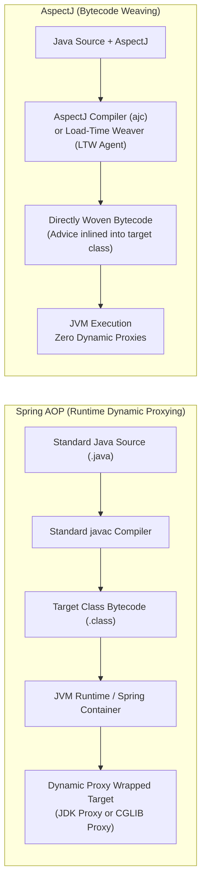
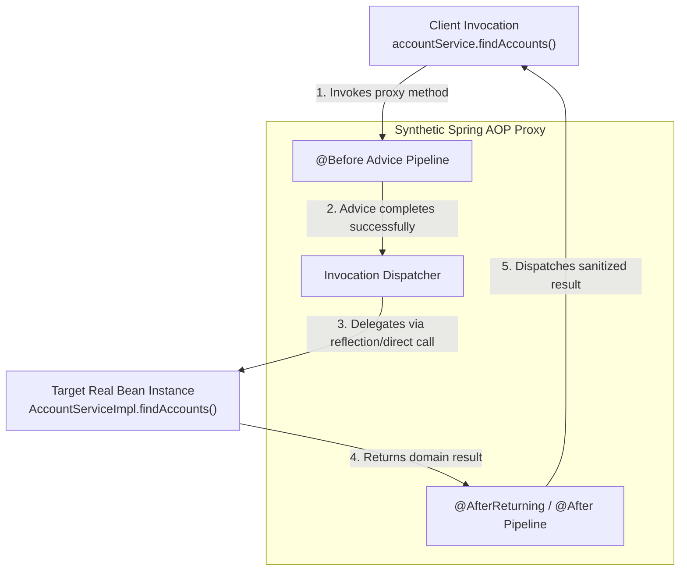
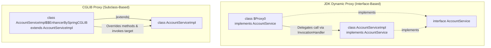
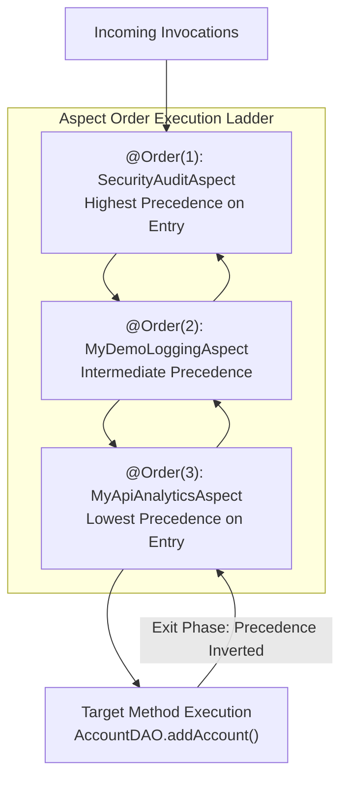

# Topic Notes — Part 1: Core AOP Architecture, Dynamic Proxies, Pointcut Grammar & Aspect Precedence

## 1. The Cross-Cutting Concern Dilemma

In enterprise software engineering, business components are designed to implement functional capabilities: transferring funds, updating inventory, computing payroll, or processing customer orders. However, these core domain operations do not execute in isolation. They require non-functional, infrastructural guarantees:

- **Security Auditing:** Recording who executed the operation, at what timestamp, and with what arguments.
- **Transaction Management:** Demarcating ACID transaction boundaries across data access operations.
- **Execution Profiling & Telemetry:** Measuring millisecond-level execution latencies to identify system bottlenecks and enforce Service Level Agreements (SLAs).
- **Error Tracking & Telemetry:** Logging unexpected runtime exceptions to centralized observability platforms.
- **Data Sanitization:** Masking Personally Identifiable Information (PII) before returning data to consumers.

When secondary infrastructural concerns are written directly within business logic, systems suffer from two fatal architectural pathologies:

1. **Code Tangling:** Business logic becomes tightly intertwined with infrastructural code. A method whose core responsibility is to calculate an account balance ends up dedicating 80% of its lines to security token validation, stopwatch timing, database retry logic, and exception logging. This violates the **Single Responsibility Principle (SRP)**.
2. **Code Scattering:** The exact same cross-cutting code is duplicated across dozens or hundreds of disparate service classes, controllers, and repositories. When the logging framework, metric tag format, or security inspection mechanism changes, engineers must modify hundreds of unrelated files, creating severe maintenance fragility.

```mermaid
flowchart TD
    subgraph MonolithicTangled["Tangled & Scattered Architecture (Without AOP)"]
        direction TB
        M1["AccountService.transferFunds()<br/>- Check Security Token<br/>- Begin DB Transaction<br/>- Start Latency Stopwatch<br/>- Core Business Logic<br/>- Log Execution Result<br/>- Commit / Rollback<br/>- End Latency Stopwatch"]
        M2["OrderService.placeOrder()<br/>- Check Security Token<br/>- Begin DB Transaction<br/>- Start Latency Stopwatch<br/>- Core Business Logic<br/>- Log Execution Result<br/>- Commit / Rollback<br/>- End Latency Stopwatch"]
        M3["CustomerService.updateProfile()<br/>- Check Security Token<br/>- Begin DB Transaction<br/>- Start Latency Stopwatch<br/>- Core Business Logic<br/>- Log Execution Result<br/>- Commit / Rollback<br/>- End Latency Stopwatch"]
    end

    subgraph AOPArchitecture["Decoupled Aspect-Oriented Architecture (With Spring AOP)"]
        direction TB
        ASP_SEC["SecurityAuditAspect<br/>(@Before)"]
        ASP_TIME["PerformanceProfilerAspect<br/>(@Around)"]
        ASP_TX["TransactionAspect<br/>(@Transactional)"]
        
        SVC1["AccountService<br/>Pure Business Logic"]
        SVC2["OrderService<br/>Pure Business Logic"]
        SVC3["CustomerService<br/>Pure Business Logic"]
    end

    ASP_SEC -.->|"Weaved at Join Points"| SVC1
    ASP_SEC -.->|"Weaved at Join Points"| SVC2
    ASP_SEC -.->|"Weaved at Join Points"| SVC3

    ASP_TIME -.->|"Weaved at Join Points"| SVC1
    ASP_TIME -.->|"Weaved at Join Points"| SVC2
    ASP_TIME -.->|"Weaved at Join Points"| SVC3

    ASP_TX -.->|"Weaved at Join Points"| SVC1
    ASP_TX -.->|"Weaved at Join Points"| SVC2
    ASP_TX -.->|"Weaved at Join Points"| SVC3
```



Aspect-Oriented Programming (AOP) addresses this fundamental challenge by providing a modular mechanism to encapsulate cross-cutting concerns into dedicated classes called **Aspects**, which are declaratively applied across target business components without modifying their source code.

---

## 2. Core AOP Concepts & Canonical Terminology

To architect enterprise applications using AOP, engineers must master the standard terminology codified by the AOP Alliance and the AspectJ specification:

| Term | Formal Definition | Enterprise Analogy / Reality |
| :--- | :--- | :--- |
| **Aspect** | A modular encapsulation of a cross-cutting concern comprising Pointcuts and Advice. | A dedicated security, auditing, or caching module implemented as a standard class annotated with `@Aspect` and `@Component`. |
| **Join Point** | A specific candidate point in the execution flow of an application where an aspect can be plugged in. | In Spring AOP, **always represents a method execution** on a Spring-managed bean. |
| **Advice** | The action taken by an aspect at a particular Join Point. | The actual code that runs (e.g., measuring duration, writing to an audit database, masking a string). Types include `@Before`, `@AfterReturning`, `@AfterThrowing`, `@After`, and `@Around`. |
| **Pointcut** | A predicate expression that matches one or more Join Points where advice must be applied. | The filtering query (e.g., "apply this advice to all `public` methods in `com.company.service.*` whose names start with `save`"). |
| **Target Object** | The underlying business object being advised by one or more aspects. | Your domain service (e.g., `AccountServiceImpl`), which remains completely decoupled from and unaware of the aspects advising it. |
| **AOP Proxy** | An intermediate synthetic object created by the AOP framework to intercept method calls to the target object. | A dynamic wrapper (JDK Dynamic Proxy or CGLIB proxy) that intercepts the invocation, executes advice, and delegates to the target object. |
| **Weaving** | The process of linking aspects with target application types to produce advised proxy objects. | Done at **runtime** by Spring AOP when instantiating beans in the `ApplicationContext`. |

!!! note "Join Points in Spring AOP vs AspectJ"
    In full AspectJ, a **Join Point** can be a method call, method execution, constructor call, field access (read/write), or exception handler block. In **Spring AOP**, join points are strictly limited to **method executions** on Spring IoC beans.

---

## 3. Architectural Comparison: Spring AOP vs. AspectJ

A frequent design question in high-scale architectures is whether to utilize Spring AOP or full AspectJ. The two systems share common annotation syntax (`@Aspect`, `@Pointcut`, `@Before`, etc.) but operate on fundamentally different execution and weaving models:



### Detailed Structural Comparison

| Architectural Dimension | Spring AOP | Full AspectJ |
| :--- | :--- | :--- |
| **Primary Philosophy** | Lightweight, zero-tooling proxy framework integrated with Spring IoC. | Comprehensive, industrial-grade AOP language extension. |
| **Weaving Mechanism** | **Runtime dynamic proxying** via JDK Dynamic Proxies or CGLIB. | **Bytecode weaving**: Compile-time (CTW), Post-compile (binary weaving), or Load-time (LTW via Java agent). |
| **Join Point Support** | **Method execution only** on Spring-managed beans. | Method calls, method executions, constructor calls, field access, static initializers, object pre-initialization. |
| **Target Objects** | Must be Spring beans managed by the `ApplicationContext`. | Any Java object, including POJOs instantiated with `new`, domain entities, and third-party libraries. |
| **Build & Tooling Overhead** | None. Standard Maven/Gradle build with standard `javac`. | Requires AspectJ compiler (`ajc`) or JVM `-javaagent:weaver.jar` startup arguments. |
| **Performance Profile** | Slight runtime overhead due to proxy method dispatch and reflection. | Near-zero overhead; advice is woven directly into class bytecode. |
| **Self-Invocation Handling** | **Bypassed:** Calling an internal method on `this` does not route through proxy. | **Intercepted:** Bytecode weaving captures all invocations, including internal calls. |

!!! tip "Architectural Decision: When to Choose Spring AOP vs AspectJ"
    For 95% of enterprise requirements (REST audit logging, service latency profiling, transaction management, declarative caching), **Spring AOP** is the superior architectural choice due to its simplicity, lack of complex compiler plugins, and native integration with the Spring lifecycle. AspectJ is reserved for domain entity interception, field-level access tracking, or ultra-low-latency profiling where proxy dispatch overhead is unacceptable.

---

## 4. Dynamic Proxy Mechanics: JDK Dynamic Proxies vs. CGLIB

Spring AOP implements interception using the **Proxy Design Pattern**. When a client injects a dependency on an advised bean, Spring does not inject the raw target instance; instead, it injects an auto-generated proxy object that intercepts calls, evaluates pointcuts, executes advice pipelines, and forwards execution to the target:



Spring AOP utilizes two distinct proxy generation mechanisms under the hood:

### 1. JDK Dynamic Proxies (`java.lang.reflect.Proxy`)
- **Requirement:** The target class must implement at least one interface (e.g., `AccountService` implemented by `AccountServiceImpl`).
- **Mechanism:** The JDK reflection mechanism generates a dynamic class at runtime implementing the specified interface(s). An `InvocationHandler` intercepts method invocations and dispatches them through the advice chain.
- **Limitation:** Injected references must be typed to the **interface**, not the concrete implementation class; otherwise, a `BeanNotOfRequiredTypeException` is thrown.

### 2. CGLIB Proxies (`org.springframework.cglib.proxy.Enhancer`)
- **Requirement:** The target class must not be declared `final`, and advised methods must not be `final` or `private`.
- **Mechanism:** CGLIB generates dynamic bytecode subclasses of the target class at runtime. The proxy overrides the target's non-final methods and routes calls through an `MethodInterceptor`.
- **Advantage:** Works seamlessly with concrete classes without requiring interfaces. References can be typed directly to the concrete class.



### Spring Boot Proxying Defaults

In modern Spring Boot (version 2.x and 3.x/4.x), the configuration property `spring.aop.proxy-target-class` defaults to `true`:

```properties
# Default in Spring Boot 2.x / 3.x / 4.x
spring.aop.proxy-target-class=true
```

This means **Spring Boot defaults to CGLIB class-based proxies for all advised beans**, even when the bean implements an interface. This avoids typing errors when developers inject concrete classes into tests or controllers.

!!! warning "The Final Class and Method Hazard in CGLIB Proxies"
    Because CGLIB generates runtime subclasses, **final classes cannot be proxied**, and **final methods cannot be advised**. If a method is declared `final`, Spring AOP will silently bypass advice on that method without raising a runtime error!

---

## 5. Pointcut Expression Language Grammar & Wildcards

Pointcut expressions dictate where advice should be woven into the application. Spring AOP uses AspectJ's pointcut expression language, primarily focusing on the `execution` pointcut designator.

### The Canonical `execution` Syntax Structure

```
execution(modifiers-pattern? return-type-pattern declaring-type-pattern?method-name-pattern(param-pattern) throws-pattern?)
```

1. **`modifiers-pattern?`** *(Optional)*: Visibility modifiers such as `public` or `protected`. If omitted, any visibility matches.
2. **`return-type-pattern`** *(Mandatory)*: The return type of the method (e.g., `void`, `java.util.List`, `com.luv2code.aopdemo.Account`), or `*` to match any return type.
3. **`declaring-type-pattern?`** *(Optional)*: The fully qualified package and class name holding the method (e.g., `com.luv2code.aopdemo.dao.AccountDAO.`).
4. **`method-name-pattern`** *(Mandatory)*: The method name (e.g., `addAccount`), with support for wildcards (e.g., `add*`, `*`).
5. **`param-pattern`** *(Mandatory)*: The method parameter signature enclosed in parentheses:
   - `()`: Matches a method with zero arguments.
   - `(*)`: Matches a method with **exactly one argument** of any type.
   - `(..)`: Matches a method with **zero or more arguments** of any type.
   - `(com.luv2code.aopdemo.Account)`: Matches a method with exactly one argument of type `Account`.
   - `(com.luv2code.aopdemo.Account, ..)`: Matches a method whose first argument is `Account`, followed by zero or more arguments of any type.
6. **`throws-pattern?`** *(Optional)*: Matches methods declaring specific thrown exception types.

### Pointcut Expression Evolution 

Let us examine how pointcut expressions progress from rigid, specific matchers to flexible enterprise patterns based on the source repository:

#### 1. Match Exact Method in Any Class (Module 02)
Matches any method named `addAccount()` regardless of class, return type, or package, provided it takes zero arguments:
```java
@Before("execution(public void addAccount())")
public void beforeAddAccountAdvice() {
    System.out.println("Executing @Before advice on addAccount()");
}
```

#### 2. Match Method in Specific Interface / Class (Module 03)
Restricts interception exclusively to `addAccount()` defined within `AccountDAO`:
```java
@Before("execution(public void com.luv2code.aopdemo.dao.AccountDAO.addAccount())")
public void beforeAccountDaoAddAccountAdvice() {
    System.out.println("Executing @Before advice on AccountDAO.addAccount()");
}
```

#### 3. Match Method Names by Wildcard Prefix (Module 04)
Matches any method whose name begins with `add`, such as `addAccount()`, `addOrder()`, or `addMember()`:
```java
@Before("execution(public void add*())")
public void beforeAnyAddMethodAdvice() {
    System.out.println("Executing @Before advice on add*() method");
}
```

#### 4. Match Any Return Type (Module 05)
Replaces the strict `void` return type with `*`, matching methods returning `void`, `boolean`, `Account`, etc.:
```java
@Before("execution(* add*())")
public void beforeAnyReturnAddMethodAdvice() {
    System.out.println("Executing @Before advice matching any return type");
}
```

#### 5. Match Method Parameter Types (Modules 06, 07, 08)
Matching parameters requires fully qualified class names unless types are in the same package or primitive:

```java
// Match method taking single Account argument
@Before("execution(* add*(com.luv2code.aopdemo.Account))")
public void beforeWithAccountParam() { ... }

// Match method taking Account as first param, plus additional parameters
@Before("execution(* add*(com.luv2code.aopdemo.Account, ..))")
public void beforeWithAccountAndMoreParams() { ... }

// Match method taking ANY parameters (0, 1, or many of any type)
@Before("execution(* add*(..))")
public void beforeWithAnyParams() { ... }
```

#### 6. Match Any Method in an Entire Package (Module 09)
The standard enterprise pattern for sweeping layer-wide interception across all classes and methods in a package:
```java
// execution(* com.luv2code.aopdemo.dao.*.*(..))
// 1. Any return type (*)
// 2. In package com.luv2code.aopdemo.dao
// 3. Any class (*)
// 4. Any method (*)
// 5. Any argument list (..)
@Before("execution(* com.luv2code.aopdemo.dao.*.*(..))")
public void beforeDaoPackageAdvice() {
    System.out.println("Executing advice on any DAO method execution");
}
```

---

## 6. Reusable Pointcuts (`@Pointcut`) & Boolean Composition

Embedding string pointcut expressions repeatedly across multiple advice annotations causes severe maintainability issues. If a package path or method naming convention changes, every annotation must be manually searched and updated.

Spring AOP allows developers to declare **reusable pointcuts** using the `@Pointcut` annotation applied to empty dummy methods.

### Defining Pointcut Declarations (Module 10)

```java
package com.luv2code.aopdemo.aspect;

import org.aspectj.lang.annotation.Aspect;
import org.aspectj.lang.annotation.Pointcut;

@Aspect
public class MyPointcutDeclarations {

    // Pointcut signature for all methods in the DAO package
    @Pointcut("execution(* com.luv2code.aopdemo.dao.*.*(..))")
    public void forDaoPackage() {}
}
```

The method `forDaoPackage()` acts as a symbolic identifier that can be referenced by advice:

```java
@Before("forDaoPackage()")
public void beforeDaoMethods() {
    System.out.println("Executing advice referencing declared pointcut");
}
```

### Combining Expressions with Boolean Operators (Modules 12 & 13)

Pointcuts can be composed using standard Boolean logic:

- `&&`: Logical **AND** (both conditions must match).
- `||`: Logical **OR** (either condition matches).
- `!`: Logical **NOT** (negates the expression).

#### The Enterprise Noise-Filtering Pattern
In persistence tiers, DAOs and entities frequently contain accessor methods (`getName()`, `setLevel()`). Logging or profiling every getter and setter invocation generates catastrophic log volume and performance drag without delivering operational insight.

To filter out this noise, architects define granular pointcuts and combine them using `&& !`:

```java
package com.luv2code.aopdemo.aspect;

import org.aspectj.lang.annotation.Aspect;
import org.aspectj.lang.annotation.Pointcut;

@Aspect
public class LuvAopExpressions {

    // 1. Match all methods in DAO package
    @Pointcut("execution(* com.luv2code.aopdemo.dao.*.*(..))")
    public void forDaoPackage() {}

    // 2. Match all getter methods
    @Pointcut("execution(* com.luv2code.aopdemo.dao.*.get*(..))")
    public void getter() {}

    // 3. Match all setter methods
    @Pointcut("execution(* com.luv2code.aopdemo.dao.*.set*(..))")
    public void setter() {}

    // 4. Combined: Include DAO package, EXCLUDE getters and setters
    @Pointcut("forDaoPackage() && !(getter() || setter())")
    public void forDaoPackageNoGetterSetter() {}
}
```

### Externalizing Pointcuts into Architectural Catalogs (Module 11)

When pointcuts are declared `public` inside a dedicated aspect class (such as `LuvAopExpressions`), any aspect in the application can reference them using their fully qualified method signature:

```java
@Aspect
@Component
public class MyDemoLoggingAspect {

    @Before("com.luv2code.aopdemo.aspect.LuvAopExpressions.forDaoPackageNoGetterSetter()")
    public void beforeAddAccountAdvice() {
        System.out.println("Executing clean advice on non-getter/setter DAO calls");
    }
}
```

---

## 7. Aspect Precedence & Ordering (`@Order`)

When multiple aspects advise the exact same join point, Spring AOP does not guarantee the execution order of advice by default. The order of aspect execution is undefined unless explicitly configured.

```
Without @Order:
JoinPoint: AccountDAO.addAccount()
Invoked Aspects: SecurityAspect, LoggingAspect, AnalyticsAspect (Random/Non-deterministic order!)
```

This unpredictability can be dangerous in enterprise systems. For example, security authorization and credential validation **must** execute before transaction demarcation and logging, which in turn must execute before performance profiling.

### Controlling Precedence with `@Order` (Module 14)

To enforce execution order:

1. Deconstruct large monolithic aspects into **separate classes** adhering to the Single Responsibility Principle.
2. Annotate each aspect class with `@Order(int)` from `org.springframework.core.annotation.Order`.



### Order Value Rules
- **Lower numbers have higher precedence** on entry (`@Before` and entering `@Around`).
- The aspect with `@Order(1)` executes **before** `@Order(2)`.
- Negative numbers are valid and have higher precedence than positive numbers (e.g., `@Order(-10)` runs before `@Order(0)`).
- On method return/exit (`@AfterReturning`, `@After`, exiting `@Around`), the order is **strictly reversed**: `@Order(3)` completes before `@Order(2)`, which completes before `@Order(1)`.

```java
@Aspect
@Component
@Order(1)
public class MyCloudLogAsyncAspect {

    @Before("com.luv2code.aopdemo.aspect.LuvAopExpressions.forDaoPackageNoGetterSetter()")
    public void logToCloud() {
        System.out.println("=====>>> [Order 1] Logging to cloud infrastructure");
    }
}

@Aspect
@Component
@Order(2)
public class MyDemoLoggingAspect {

    @Before("com.luv2code.aopdemo.aspect.LuvAopExpressions.forDaoPackageNoGetterSetter()")
    public void beforeAddAccountAdvice() {
        System.out.println("=====>>> [Order 2] Executing standard local logging");
    }
}

@Aspect
@Component
@Order(3)
public class MyApiAnalyticsAspect {

    @Before("com.luv2code.aopdemo.aspect.LuvAopExpressions.forDaoPackageNoGetterSetter()")
    public void performApiAnalytics() {
        System.out.println("=====>>> [Order 3] Performing API analytics telemetry");
    }
}
```

!!! important "Class-Level Precedence vs Method-Level Ordering"
    The `@Order` annotation is evaluated at the **class level**, not the method level. You cannot place `@Order` on individual `@Before` methods within the same aspect class to order them. If advice methods within the same class advise the same join point, their relative order is completely undefined. Always place distinct concerns into separate aspect classes.

---

## 8. Extracting Execution Metadata via `JoinPoint`

Advices frequently need access to contextual information regarding the target method: its name, declaring class, return type, and actual runtime arguments passed by the caller.

Spring AOP passes an instance of `org.aspectj.lang.JoinPoint` as the first parameter to any advice method (or `ProceedingJoinPoint` for `@Around` advice).

### Introspecting Method Signatures (Module 15)

```java
@Before("com.luv2code.aopdemo.aspect.LuvAopExpressions.forDaoPackageNoGetterSetter()")
public void beforeMethodInspection(JoinPoint theJoinPoint) {

    // 1. Extract MethodSignature
    MethodSignature methodSignature = (MethodSignature) theJoinPoint.getSignature();
    
    System.out.println("Method Name: " + methodSignature.getName());
    System.out.println("Declaring Type: " + methodSignature.getDeclaringTypeName());
    System.out.println("Return Type: " + methodSignature.getReturnType().getSimpleName());
    System.out.println("Full Signature: " + methodSignature);
}
```

### Accessing & Type-Checking Arguments

Calling `theJoinPoint.getArgs()` returns an array of `Object[]` containing the runtime arguments passed to the method:

```java
@Before("com.luv2code.aopdemo.aspect.LuvAopExpressions.forDaoPackageNoGetterSetter()")
public void beforeInspectArguments(JoinPoint theJoinPoint) {

    // 2. Extract arguments array
    Object[] args = theJoinPoint.getArgs();

    for (Object tempArg : args) {
        if (tempArg == null) {
            System.out.println("Arg: null");
            continue;
        }

        System.out.println("Arg Value: " + tempArg);

        // Pattern-matching instanceof (Java 16+)
        if (tempArg instanceof Account theAccount) {
            System.out.println("Account Owner: " + theAccount.getName());
            System.out.println("Account Level: " + theAccount.getLevel());
        }
    }
}
```

!!! caution "The Argument Mutation Hazard in @Before Advice"
    In `@Before` advice, the array returned by `theJoinPoint.getArgs()` reflects the references passed to the target method. If an aspect mutates mutable objects within the `args` array (e.g., `account.setName("MUTATED")`), those mutations will directly affect the target method execution. Unless your deliberate architectural intention is input transformation, treat arguments as read-only.
