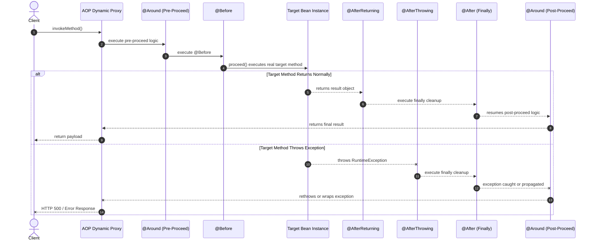
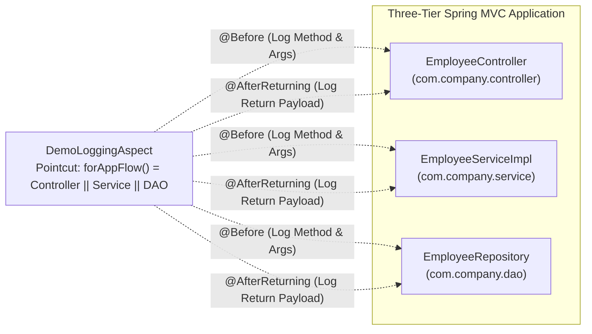
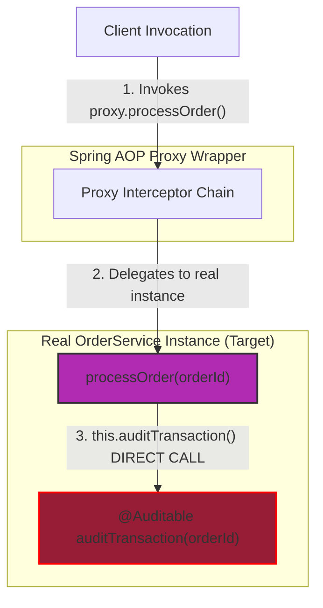

# Topic Notes — Part 2: Advice Types Deep-Dive, Execution Profiling, The Self-Invocation Trap & Spring Boot 4

## 1. Comprehensive Advice Taxonomy & Lifecycle

In Spring AOP, **Advice** defines both *what* action is executed and *when* it is executed relative to the target method invocation. Spring supports five distinct advice types:

| Advice Type | Annotation | Execution Trigger | Can Modify Return Value? | Can Swallow Exceptions? | Typical Architectural Use Cases |
| :--- | :--- | :--- | :--- | :--- | :--- |
| **Before** | `@Before` | Before target method enters. | No | No (can only abort by throwing exception) | Security token checks, input parameter validation, audit logging. |
| **After Returning** | `@AfterReturning` | After target method returns successfully without throwing an exception. | Yes (by mutating object state, cannot replace reference) | No | Post-processing payloads, PII masking, cache hydration. |
| **After Throwing** | `@AfterThrowing` | Immediately after target method throws an uncaught exception. | No | **No** (exception is always propagated to caller) | Centralized error telemetry, alert dispatching, audit failure recording. |
| **After (Finally)** | `@After` | Regardless of method outcome (success or uncaught exception). | No | No | Deterministic resource cleanup, clearing `ThreadLocal` tokens. |
| **Around** | `@Around` | Completely surrounds target method invocation. | **Yes** (can replace returned reference entirely) | **Yes** (can catch and suppress or rethrow exceptions) | Latency benchmarking, SLA breach alerts, caching proxies, distributed retries. |

### The Advice Interception Pipeline

When multiple advice types advise the same target method, they form a nested try-catch-finally interceptor stack:



---

## 2. In-Depth Advice Types

### 2.1 `@AfterReturning` Advice: Result Interception & Post-Processing (Modules 16 & 17)

`@AfterReturning` executes exclusively when the target method completes **without throwing an exception**. It provides programmatic access to the value returned by the target method via the `returning` parameter attribute:

```java
@AfterReturning(
        pointcut = "execution(* com.luv2code.aopdemo.dao.AccountDAO.findAccounts(..))",
        returning = "result")
public void afterReturningFindAccountsAdvice(JoinPoint theJoinPoint, List<Account> result) {

    String method = theJoinPoint.getSignature().toShortString();
    System.out.println("=====>>> Executing @AfterReturning on method: " + method);
    System.out.println("=====>>> Result returned from target: " + result);

    // Post-process domain data in-place
    convertAccountNamesToUpperCase(result);

    System.out.println("=====>>> Sanitized/Modified result: " + result);
}

private void convertAccountNamesToUpperCase(List<Account> result) {
    for (Account account : result) {
        String upperName = account.getName().toUpperCase();
        account.setName(upperName);
    }
}
```

#### Binding Rules & Type Matching
1. The string value assigned to `returning = "result"` **must match** the advice method parameter name (`List<Account> result`).
2. Spring AOP restricts invocation based on argument type: the advice will only execute if the returned object can be assigned to `List<Account>`. If the target method returns a different type, the advice is silently skipped.

!!! warning "Reference Replacement Limitation in @AfterReturning"
    While `@AfterReturning` allows you to **mutate** the internal state of mutable objects (such as calling setters on domain objects or modifying collection elements), it **cannot replace the returned reference itself**. If you attempt to assign `result = new ArrayList<>()`, that local variable reassignment has no effect on what the caller receives. To replace a returned object reference entirely, you must use `@Around` advice.

---

### 2.2 `@AfterThrowing` Advice: Intercepting Failures (Module 18)

`@AfterThrowing` executes when a target method terminates abruptly by throwing an exception:

```java
@AfterThrowing(
        pointcut = "execution(* com.luv2code.aopdemo.dao.AccountDAO.findAccounts(..))",
        throwing = "theExc")
public void afterThrowingFindAccountsAdvice(JoinPoint theJoinPoint, Throwable theExc) {

    String method = theJoinPoint.getSignature().toShortString();
    System.err.println("=====>>> Executing @AfterThrowing on method: " + method);
    System.err.println("=====>>> The intercepted exception is: " + theExc.getMessage());

    // Telemetry, audit trail, alerting
    auditFailureTelemetry(method, theExc);
}
```

#### Critical Exception Propagation Semantics
A pervasive misconception among junior developers is that `@AfterThrowing` acts as a catch block that swallows exceptions. 

**`@AfterThrowing` DOES NOT suppress or swallow exceptions.** 

The caught exception is passed to your advice method for telemetry, logging, or metric dispatching, but once the advice finishes executing, Spring AOP **automatically re-throws the exception up the call stack to the original caller**. If you need to suppress an exception and provide a fallback response, you **must** use `@Around` advice.

---

### 2.3 `@After` (Finally) Advice: Deterministic Resource Cleanup (Module 19)

`@After` advice executes regardless of whether the advised method succeeds or throws an exception. It conceptually corresponds to the `finally` block of a Java `try-catch-finally` construct:

```java
@After("execution(* com.luv2code.aopdemo.dao.AccountDAO.findAccounts(..))")
public void afterFinallyFindAccountsAdvice(JoinPoint theJoinPoint) {

    String method = theJoinPoint.getSignature().toShortString();
    System.out.println("=====>>> Executing @After (finally) on method: " + method);

    // Guaranteed deterministic cleanup
    SecurityContextHolder.clearContext();
    AuditContext.reset();
}
```

#### Architectural Constraints
- `@After` advice **does not have access** to the returned value (because it may have thrown an exception).
- `@After` advice **does not have access** to the thrown exception (use `@AfterThrowing` for that).
- In modern Spring 5.2.7+ / Spring Boot 2.3+, `@After` advice executes **after** `@AfterReturning` and `@AfterThrowing` advice on the exit path.

---

### 2.4 The Master Advice: `@Around` & Execution Profiling (Modules 20, 21, 22)

`@Around` is the most powerful and versatile advice type. It completely wraps the target method invocation, placing the aspect in absolute control over:

1. Whether the target method executes at all.
2. What arguments are passed to the target method.
3. How long the execution takes (latency measurement).
4. How exceptions are handled (suppressed vs rethrown).
5. What return value is dispatched back to the caller.

#### The `ProceedingJoinPoint` Contract
Advice annotated with `@Around` must declare a parameter of type `ProceedingJoinPoint` (a sub-interface of `JoinPoint`). Invoking `proceed()` executes the next interceptor in the chain or the actual target method.

```java
@Around("execution(* com.luv2code.aopdemo.service.*.getFortune(..))")
public Object aroundGetFortune(ProceedingJoinPoint theProceedingJoinPoint) throws Throwable {

    String method = theProceedingJoinPoint.getSignature().toShortString();
    System.out.println("=====>>> Executing @Around on method: " + method);

    // 1. Capture start timestamp
    long begin = System.currentTimeMillis();

    Object result = null;

    try {
        // 2. Delegate to target invocation
        result = theProceedingJoinPoint.proceed();
    } catch (Exception exc) {
        System.err.println("Target method threw: " + exc.getMessage());
        
        // Strategy A: Rethrow exception to caller (Module 22)
        throw exc;
        
        // Strategy B: Suppress exception and provide fallback (Module 21)
        // result = "Degraded Service: Default Fortune";
    }

    // 3. Capture end timestamp and calculate latency
    long end = System.currentTimeMillis();
    long duration = end - begin;

    System.out.println("=====> Method Duration: " + duration + " ms");

    // 4. Return computed or modified result
    return result;
}
```

!!! caution "The Omitted proceed() and Null Return Trap in @Around Advice"
    If an `@Around` advice method omits the call to `theProceedingJoinPoint.proceed()`, the underlying target method **will never execute**. Furthermore, if the target method returns a value and the `@Around` advice returns `null` or `void`, the caller receives `null`, potentially causing sudden `NullPointerException` errors in client code.

---

## 3. Enterprise Three-Tier AOP Logging Pipeline (Module 23)

In enterprise Spring MVC applications, logging must trace requests seamlessly across the **Web Controller**, **Business Service**, and **Data Access Object (DAO)** tiers without inserting boilerplate log statements into domain logic.

Here is the standard three-tier enterprise logging aspect:



### Complete Implementation: `DemoLoggingAspect.java`

```java
package com.luv2code.springboot.thymeleafdemo.aspect;

import org.aspectj.lang.JoinPoint;
import org.aspectj.lang.annotation.AfterReturning;
import org.aspectj.lang.annotation.Aspect;
import org.aspectj.lang.annotation.Before;
import org.aspectj.lang.annotation.Pointcut;
import org.springframework.stereotype.Component;

import java.util.logging.Logger;

@Aspect
@Component
public class DemoLoggingAspect {

    private final Logger myLogger = Logger.getLogger(getClass().getName());

    // 1. Declare Pointcuts for each distinct architectural tier
    @Pointcut("execution(* com.luv2code.springboot.thymeleafdemo.controller.*.*(..))")
    private void forControllerPackage() {}

    @Pointcut("execution(* com.luv2code.springboot.thymeleafdemo.service.*.*(..))")
    private void forServicePackage() {}

    @Pointcut("execution(* com.luv2code.springboot.thymeleafdemo.dao.*.*(..))")
    private void forDaoPackage() {}

    // 2. Compose into a single unified App Flow pointcut
    @Pointcut("forControllerPackage() || forServicePackage() || forDaoPackage()")
    private void forAppFlow() {}

    // 3. Advise method entries across all tiers
    @Before("forAppFlow()")
    public void before(JoinPoint theJoinPoint) {
        String theMethod = theJoinPoint.getSignature().toShortString();
        myLogger.info("=====>> in @Before: calling method: " + theMethod);

        Object[] args = theJoinPoint.getArgs();
        for (Object tempArg : args) {
            myLogger.info("=====>> argument: " + tempArg);
        }
    }

    // 4. Advise successful returns across all tiers
    @AfterReturning(pointcut = "forAppFlow()", returning = "theResult")
    public void afterReturning(JoinPoint theJoinPoint, Object theResult) {
        String theMethod = theJoinPoint.getSignature().toShortString();
        myLogger.info("=====>> in @AfterReturning: from method: " + theMethod);
        myLogger.info("=====>> result: " + theResult);
    }
}
```

---

## 4. The Self-Invocation Proxy Trap (Internal Calls)

One of the most dangerous and elusive bugs in Spring enterprise systems is the **Self-Invocation Trap**.

### The Failure Anatomy

Consider a service where a public method calls an internal annotated method on the same class:

```java
@Service
public class OrderService {

    public void processOrder(Long orderId) {
        System.out.println("Processing order: " + orderId);
        
        // INTERNAL CALL ON 'this'
        this.auditTransaction(orderId);
    }

    @Auditable // Advised by an AOP Aspect
    public void auditTransaction(Long orderId) {
        System.out.println("Auditing transaction for order: " + orderId);
    }
}
```

When an external client calls `orderService.processOrder(101L)`, the `auditTransaction` advice **fails to execute entirely**.

### Why This Happens

Spring AOP relies on **runtime dynamic proxies**. When an external client invokes a bean method, it interacts with the synthetic proxy wrapper. The proxy executes advice and forwards execution to the target bean.

However, once execution enters `processOrder()`, any subsequent invocation formatted as `this.auditTransaction(...)` resolves against the raw Java `this` reference. **The call never passes back out to the proxy!**



Because Step 3 bypasses the proxy, no pointcuts are matched and no advice is applied. This identical failure mode affects `@Transactional`, `@Cacheable`, `@Async`, and custom `@Aspect` annotations.

### The Three Architectural Solutions

#### 1. Architectural Decoupling (Recommended / Clean Architecture)
Refactor the internal method into a dedicated collaborator bean. This honors the Single Responsibility Principle and guarantees that invocations pass through the Spring proxy:

```java
@Service
public class OrderService {

    private final AuditService auditService;

    public OrderService(AuditService auditService) {
        this.auditService = auditService;
    }

    public void processOrder(Long orderId) {
        System.out.println("Processing order: " + orderId);
        // External call to injected collaborator proxy
        auditService.auditTransaction(orderId);
    }
}
```

#### 2. Self-Injection via `ObjectProvider` or `@Lazy`
Inject the proxy of the bean into itself:

```java
@Service
public class OrderService {

    @Lazy
    @Autowired
    private OrderService self;

    public void processOrder(Long orderId) {
        System.out.println("Processing order: " + orderId);
        // Explicitly invoke method through the injected proxy
        self.auditTransaction(orderId);
    }

    @Auditable
    public void auditTransaction(Long orderId) { ... }
}
```

#### 3. `AopContext.currentProxy()`
Expose the proxy to the current execution thread via configuration:

```java
@EnableAspectJAutoProxy(exposeProxy = true)
@Configuration
public class AopConfig {}
```

Then invoke through `AopContext`:
```java
((OrderService) AopContext.currentProxy()).auditTransaction(orderId);
```

!!! tip "Architectural Recommendation for Self-Invocation"
    Always prefer **Architectural Decoupling (Option 1)**. Option 2 introduces circular proxy references, and Option 3 tightly couples domain classes to Spring AOP internal APIs.

---

## 5. Spring Boot 4 & Spring Framework 7 Paradigm Shift

As the Spring ecosystem transitions into **Spring Boot 4** and **Spring Framework 7**, modern enterprise applications benefit from substantial architectural modernization:

- **Baseline Requirements:** Java 17 minimum baseline, with full first-class optimization for **Java 21 LTS** (including Virtual Threads / Project Loom native scheduling).
- **Enterprise Specification:** Full alignment with **Jakarta EE 11** (`jakarta.*` namespace).
- **Declarative URL Path-Segment API Versioning:** Native, out-of-the-box routing by API version.

### Modern Declarative URL Path-Segment API Versioning (Module 11)

In prior Spring Boot versions, routing REST requests by URL path version (e.g., `/api/1/hello` vs `/api/2/hello`) required either:

- Hardcoding the version into each `@RequestMapping` (e.g., `@RequestMapping("/api/v1/hello")`), leading to duplication.
- Writing custom `RequestMappingHandlerMapping` beans and custom request condition matchers.

Spring Boot 4 introduces native, property-driven path-segment versioning.

#### 1. Configuration (`application.properties`)
Specify which URL path segment represents the version identifier (segment index 1 corresponds to `{version}` following the host/root):

```properties
spring.application.name=demo

# Enable path-segment API versioning where segment 1 is the version token
spring.mvc.apiversion.use.path-segment=1
```

#### 2. Declarative Controller Version Mapping
Define the generic parameterized route at class level, and declare specific versions on individual `@GetMapping` or `@PostMapping` handler methods using the `version` attribute:

```java
package com.luv2code.apiversioning.demo.rest;

import org.springframework.web.bind.annotation.GetMapping;
import org.springframework.web.bind.annotation.RequestMapping;
import org.springframework.web.bind.annotation.RestController;

@RestController
@RequestMapping("/api/{version}/hello")
public class HelloWorldRestController {

    // Serves: GET /api/1/hello
    @GetMapping(version = "1")
    public String helloV1() {
        return "Hello World from API v1";
    }

    // Serves: GET /api/2/hello
    @GetMapping(version = "2")
    public String helloV2() {
        return "Howdy World from API v2";
    }

    // Serves: GET /api/3/hello
    @GetMapping(version = "3")
    public String helloV3() {
        return "Hey Hey World from API v3";
    }
}
```

#### Architectural Advantages
1. **Zero Boilerplate:** No custom reflection handlers, filters, or routing interceptors required.
2. **Deterministic Route Resolution:** If a client requests an unsupported version (e.g., `GET /api/99/hello`), Spring Boot automatically rejects the request with an HTTP 400 Bad Request or 404 Not Found before controller dispatch occurs.
3. **Seamless Evolution:** Deprecating or upgrading microservice endpoints is governed cleanly at the method annotation level.
