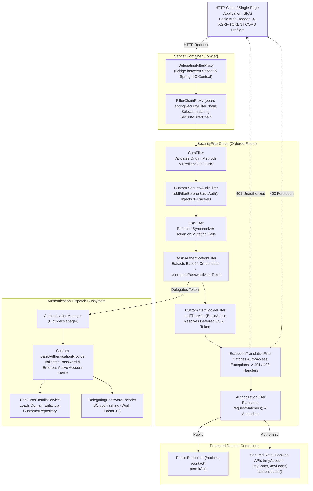

# Week 11 — Enterprise Spring Security: Filter Chains, Custom Providers, RBAC, CORS & CSRF

## Goal

Master the runtime architecture of Spring Security 6/7 from first principles. Deconstruct the servlet container filter dispatch cycle (`DelegatingFilterProxy`, `FilterChainProxy`), architect custom `AuthenticationProvider` implementations to enforce domain authentication policies, inject custom servlet filters at exact pipeline positions, implement adaptive cryptographic password management with `DelegatingPasswordEncoder` and `CompromisedPasswordChecker`, and establish production-grade defenses against Cross-Origin Resource Sharing (CORS) and Cross-Site Request Forgery (CSRF) vulnerabilities across Single-Page Application (SPA) architectures.

---

## :material-calendar: Week 11 Schedule

| Section / Topic | Focus Areas | Key Components / Annotations |
| :--- | :--- | :--- |
| **Section 1: Filter Chain Architecture & Internals** | Servlet filter dispatch, default security behavior, CIA triad | `DelegatingFilterProxy`, `FilterChainProxy`, `SecurityFilterChain`, `AuthenticationManager` |
| **Section 2: Granular Request Authorization** | Custom security configuration, route matching, fail-secure rules | `authorizeHttpRequests`, `requestMatchers()`, `authenticated()`, `permitAll()`, `denyAll()` |
| **Section 3: In-Memory Identity Management** | User management abstractions, contracts, in-memory provisioning | `UserDetailsService`, `UserDetailsManager`, `UserDetails`, `InMemoryUserDetailsManager` |
| **Section 4: Database Authentication with JPA** | JDBC schema limitations, custom entity mapping, user registration | `CustomerRepository`, `EazyBankUserDetailsService`, `SimpleGrantedAuthority`, `@PostMapping("/register")` |
| **Section 5: Cryptographic Password Management** | Hashing vs encryption, rainbow tables, adaptive work factors, breach screening | `PasswordEncoder`, `BCryptPasswordEncoder`, `DelegatingPasswordEncoder`, `CompromisedPasswordChecker` |
| **Section 6: Custom AuthenticationProvider Architecture** | Decoupling auth logic from user loading, domain validation, profiles | `AuthenticationProvider`, `ProviderManager`, `UsernamePasswordAuthenticationToken`, `@Profile` |
| **Section 7: Exception Handling & Session Management** | Uniform JSON API error responses, session fixation, concurrency, telemetry | `AuthenticationEntryPoint`, `AccessDeniedHandler`, `sessionFixation()`, `AuthenticationEvents` |
| **Section 8: CORS & CSRF Defense-in-Depth** | Same-Origin Policy, preflight OPTIONS, Synchronizer Token, deferred CSRF | `CorsConfigurationSource`, `CookieCsrfTokenRepository`, `CsrfTokenRequestAttributeHandler`, `CsrfCookieFilter` |
| **Enterprise Practical Lab** | Multi-tiered banking security perimeter with custom provider & audit filter | `BankSecurityConfig`, `BankUsernamePasswordAuthProvider`, `SecurityAuditFilter`, `CsrfCookieFilter` |
| **Executive Architectural Summary** | Terminology matrix, filter order ladder, CORS/CSRF decision tree, cheatsheet | Full Week 11 reference matrix and verification checklist |

---

## :material-sitemap: Architectural Progression

---

## :material-folder-open: Week 11 Content

-   :material-shield-key:{ .lg .middle } **Section 1: Security Filter Chain Architecture & Internals**

    ---

    Core security goals (CIA triad, AAA), default auto-configuration behavior, the servlet filter bridge (`DelegatingFilterProxy`), `FilterChainProxy`, standard security filter sequence, and the end-to-end authentication dispatch lifecycle.

    [:octicons-arrow-right-24: Read Section 1](section-1-security-filter-chain-architecture.md)

-   :material-routes:{ .lg .middle } **Section 2: Granular Request Authorization & Route Matching**

    ---

    Replacing `WebSecurityConfigurerAdapter` with modern component-based `SecurityFilterChain` beans, configuring `authorizeHttpRequests`, route isolation (`requestMatchers()`), fail-secure postures (`denyAll()`), and basic auth integration.

    [:octicons-arrow-right-24: Read Section 2](section-2-granular-request-authorization.md)

-   :material-account-multiple:{ .lg .middle } **Section 3: In-Memory Identity Management & Contracts**

    ---

    The `UserDetailsService` and `UserDetailsManager` interface contracts, the `UserDetails` lifecycle methods, in-memory credential provisioning with `InMemoryUserDetailsManager`, and the plain-text password encoding hazard.

    [:octicons-arrow-right-24: Read Section 3](section-3-in-memory-identity-management.md)

-   :material-database:{ .lg .middle } **Section 4: Database Authentication with Spring Data JPA**

    ---

    Limitations of default JDBC schemas in enterprise applications, designing custom `Customer` JPA entities, implementing custom `UserDetailsService`, role and authority mapping, and customer registration REST endpoints.

    [:octicons-arrow-right-24: Read Section 4](section-4-database-authentication-spring-data-jpa.md)

-   :material-lock-check:{ .lg .middle } **Section 5: Cryptographic Password Management & Breach Screening**

    ---

    Encoding vs encryption vs hashing, rainbow table attacks, cryptographic salts, adaptive work factor tuning, `BCryptPasswordEncoder`, `DelegatingPasswordEncoder` prefixes, and Spring Security 6.3+ `CompromisedPasswordChecker`.

    [:octicons-arrow-right-24: Read Section 5](section-5-cryptographic-password-management.md)

-   :material-cog-transfer:{ .lg .middle } **Section 6: Custom AuthenticationProvider Architecture**

    ---

    Decoupling authentication logic from identity loading, `ProviderManager` orchestration, implementing custom `AuthenticationProvider` to enforce active account checks, and multi-environment provisioning via `@Profile`.

    [:octicons-arrow-right-24: Read Section 6](section-6-custom-authentication-providers.md)

-   :material-alert-circle-outline:{ .lg .middle } **Section 7: Exception Handling, Events & Session Management**

    ---

    Custom `AuthenticationEntryPoint` (401) and `AccessDeniedHandler` (403) emitting uniform JSON payloads, session fixation protection, concurrent session control, and asynchronous security telemetry event listeners.

    [:octicons-arrow-right-24: Read Section 7](section-7-exception-handling-session-management.md)

-   :material-earth:{ .lg .middle } **Section 8: CORS & CSRF Defense-in-Depth for SPAs**

    ---

    Browser Same-Origin Policy, preflight `OPTIONS` requests, configuring `CorsConfigurationSource`, CSRF threat vectors, Synchronizer Token Pattern, deferred token resolution in Spring Security 6, and custom `CsrfCookieFilter`.

    [:octicons-arrow-right-24: Read Section 8](section-8-cors-csrf-defense-in-depth.md)

-   :material-laptop:{ .lg .middle } **Lab Guide: Enterprise Banking Security Perimeter**

    ---

    Complete laboratory specification for ApexBank: securing retail banking assets, custom authentication provider, deferred CSRF filter, custom 401/403 handlers, security audit filters, and full JUnit 5 integration verification suite.

    [:octicons-arrow-right-24: Week 11 Lab Guide](lab-guide.md)

-   :material-clipboard-check-outline:{ .lg .middle } **Week 11 Summary & Architectural Reference**

    ---

    Comprehensive summary and quick-reference cheatsheet: core terminology matrix, filter chain ordering ladder, password hashing taxonomy, CORS/CSRF decision tree, and production security verification checklist.

    [:octicons-arrow-right-24: Week 11 Summary](summary.md)

---

## :material-checkbox-marked-outline: Learning Objectives Checklist

- [ ] Articulate the core security goals (Confidentiality, Integrity, Availability, Authentication, Authorization, Non-Repudiation).
- [ ] Explain the runtime servlet bridge mechanism of `DelegatingFilterProxy` and `FilterChainProxy`.
- [ ] Construct custom `SecurityFilterChain` beans using modern Lambda DSL without deprecated adapters.
- [ ] Configure granular route authorization using `requestMatchers()` to separate public assets from secured banking APIs.
- [ ] Contrast `UserDetailsService` (read-only query) with `UserDetailsManager` (full CRUD lifecycle operations).
- [ ] Implement custom JPA-backed identity loading using `CustomerRepository` and custom `UserDetails` mapping.
- [ ] Differentiate encoding, encryption, and hashing; explain how cryptographic salt and work factors neutralize rainbow tables.
- [ ] Implement `DelegatingPasswordEncoder` supporting multi-algorithm prefixes (`{bcrypt}`, `{argon2}`) and zero-downtime hashing migration.
- [ ] Screen compromised user passwords using Spring Security 6.3+ `CompromisedPasswordChecker`.
- [ ] Author custom `AuthenticationProvider` implementations to enforce business rules (e.g., active account status) during authentication.
- [ ] Implement custom `AuthenticationEntryPoint` and `AccessDeniedHandler` components emitting uniform JSON API error envelopes.
- [ ] Harden applications against session fixation and configure concurrent login limits via `sessionManagement()`.
- [ ] Configure `CorsConfigurationSource` to handle browser preflight `OPTIONS` requests from Single-Page Applications (Angular/React).
- [ ] Explain CSRF threat vectors and resolve deferred tokens in Spring Security 6 using `CookieCsrfTokenRepository` and `CsrfCookieFilter`.
