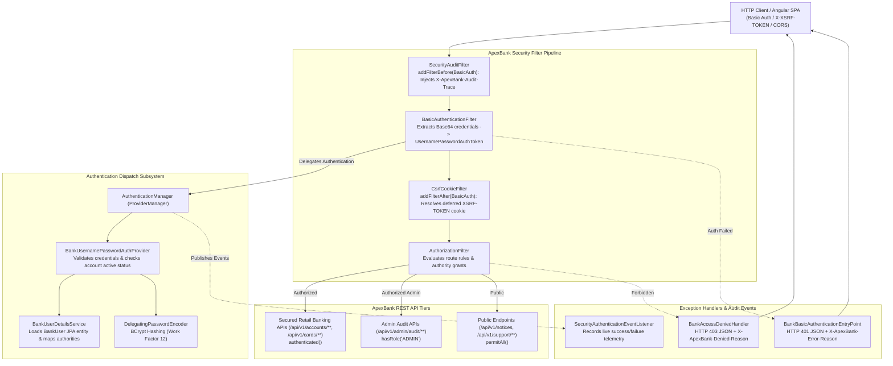

# Week 11 Lab Guide — Enterprise Banking Security Perimeter & Filter Pipeline

## 1. Laboratory Overview & Engineering Context

In enterprise banking and financial infrastructure, services and persistence layers must uphold rigorous defense-in-depth guarantees: multi-tier identity authentication, cryptographic credential storage, proactive breach dictionary screening, CSRF/CORS attack neutralization, and immutable security audit telemetry.

This laboratory establishes an enterprise-grade security perimeter for **ApexBank** using **Spring Boot 4** and **Spring Security 6.3+**. The architecture safeguards confidential retail banking assets (Accounts, Balances, Loans, Cards) while leaving public customer touchpoints (Notices, Support Inquiries, Self-Registration) accessible, enforcing security invariants across 8 core architectural tiers.

!!! important "Complete Lab Implementation Repository"
    All source code, Maven build scripts, entity definitions, and automated integration test suites for this laboratory are maintained in the official GitHub repository:  
    [:material-github: 7amo10/Spring-Labs — Week-11-Enterprise-Banking-Security-Perimeter](https://github.com/7amo10/Spring-Labs/tree/main/Week-11-Enterprise-Banking-Security-Perimeter)

---

## 2. Technical Architecture & Component Matrix



### Architectural Component Responsibility Matrix

| Component Class | Spring Security Role | Architectural Responsibility |
| :--- | :--- | :--- |
| **`BankSecurityConfig`** | Security Configuration | Configures `SecurityFilterChain`, registers CORS, CSRF, session policies, and wires custom entry points. |
| **`BankUsernamePasswordAuthProvider`** | Custom `AuthenticationProvider` | Validates submitted credentials against `PasswordEncoder`; verifies account active status; returns authenticated token. |
| **`BankUserDetailsService`** | `UserDetailsService` | Loads `BankUser` entity from JPA repository; constructs `UserDetails` with combined roles and authorities. |
| **`SecurityAuditFilter`** | Custom Servlet Filter | Intercepts requests before `BasicAuthenticationFilter`; generates and injects unique trace ID header `X-ApexBank-Audit-Trace`. |
| **`CsrfCookieFilter`** | Deferred CSRF Filter | Positioned after `BasicAuthenticationFilter`; forces deferred `CsrfToken` resolution to populate the `XSRF-TOKEN` cookie for SPAs. |
| **`BankBasicAuthenticationEntryPoint`** | `AuthenticationEntryPoint` | Intercepts unauthenticated requests; renders uniform 401 JSON body with `X-ApexBank-Error-Reason` diagnostic header. |
| **`BankAccessDeniedHandler`** | `AccessDeniedHandler` | Intercepts unauthorized requests; renders uniform 403 JSON body with `X-ApexBank-Denied-Reason` diagnostic header. |
| **`SecurityAuthenticationEventListener`** | `ApplicationListener` | Listens asynchronously for authentication events to track live success and failure audit metrics. |

---

## 3. Step-by-Step Implementation Guide

### Step 1: Dependencies & Maven Build Setup
Configure `pom.xml` with dependencies for Spring Security, Spring Data JPA, Web, and validation:

```xml
<dependencies>
    <dependency>
        <groupId>org.springframework.boot</groupId>
        <artifactId>spring-boot-starter-security</artifactId>
    </dependency>
    <dependency>
        <groupId>org.springframework.boot</groupId>
        <artifactId>spring-boot-starter-data-jpa</artifactId>
    </dependency>
    <dependency>
        <groupId>org.springframework.boot</groupId>
        <artifactId>spring-boot-starter-web</artifactId>
    </dependency>
    <dependency>
        <groupId>org.springframework.boot</groupId>
        <artifactId>spring-boot-starter-validation</artifactId>
    </dependency>
    <dependency>
        <groupId>com.h2database</groupId>
        <artifactId>h2</artifactId>
        <scope>runtime</scope>
    </dependency>
    <dependency>
        <groupId>org.springframework.boot</groupId>
        <artifactId>spring-boot-starter-test</artifactId>
        <scope>test</scope>
    </dependency>
    <dependency>
        <groupId>org.springframework.security</groupId>
        <artifactId>spring-security-test</artifactId>
        <scope>test</scope>
    </dependency>
</dependencies>
```

---

### Step 2: Custom Authentication Provider (`BankUsernamePasswordAuthProvider.java`)

Enforce account active status verification and credential matching:

```java
package com.spring.lab.security.provider;

import com.spring.lab.security.entity.BankUser;
import com.spring.lab.security.repository.BankUserRepository;
import lombok.RequiredArgsConstructor;
import org.springframework.security.authentication.AuthenticationProvider;
import org.springframework.security.authentication.BadCredentialsException;
import org.springframework.security.authentication.DisabledException;
import org.springframework.security.authentication.UsernamePasswordAuthenticationToken;
import org.springframework.security.core.Authentication;
import org.springframework.security.core.AuthenticationException;
import org.springframework.security.core.authority.SimpleGrantedAuthority;
import org.springframework.security.crypto.password.PasswordEncoder;
import org.springframework.stereotype.Component;

import java.util.List;
import java.util.stream.Collectors;

@Component
@RequiredArgsConstructor
public class BankUsernamePasswordAuthProvider implements AuthenticationProvider {

    private final BankUserRepository userRepository;
    private final PasswordEncoder passwordEncoder;

    @Override
    public Authentication authenticate(Authentication authentication) throws AuthenticationException {
        String username = authentication.getName();
        String rawPassword = authentication.getCredentials().toString();

        BankUser user = userRepository.findByEmail(username)
                .orElseThrow(() -> new BadCredentialsException("Invalid banking credentials provided."));

        // Enforce account active status invariant
        if (!user.isActive()) {
            throw new DisabledException("Customer account is deactivated. Please contact customer support.");
        }

        // Constant-time cryptographic password comparison
        if (!passwordEncoder.matches(rawPassword, user.getPasswordHash())) {
            throw new BadCredentialsException("Invalid banking credentials provided.");
        }

        List<SimpleGrantedAuthority> authorities = user.getAuthorities().stream()
                .map(auth -> new SimpleGrantedAuthority(auth.getAuthorityName()))
                .collect(Collectors.toList());

        return new UsernamePasswordAuthenticationToken(user.getEmail(), null, authorities);
    }

    @Override
    public boolean supports(Class<?> authentication) {
        return UsernamePasswordAuthenticationToken.class.isAssignableFrom(authentication);
    }
}
```

---

### Step 3: Custom Servlet Filters (`SecurityAuditFilter` & `CsrfCookieFilter`)

#### 1. Trace ID Injection: `SecurityAuditFilter.java`
```java
package com.spring.lab.security.filter;

import jakarta.servlet.FilterChain;
import jakarta.servlet.ServletException;
import jakarta.servlet.http.HttpServletRequest;
import jakarta.servlet.http.HttpServletResponse;
import org.springframework.web.filter.OncePerRequestFilter;

import java.io.IOException;
import java.util.UUID;

public class SecurityAuditFilter extends OncePerRequestFilter {

    public static final String AUDIT_TRACE_HEADER = "X-ApexBank-Audit-Trace";

    @Override
    protected void doFilterInternal(HttpServletRequest request, HttpServletResponse response,
                                    FilterChain filterChain) throws ServletException, IOException {
        String traceId = request.getHeader(AUDIT_TRACE_HEADER);
        if (traceId == null || traceId.isBlank()) {
            traceId = UUID.randomUUID().toString();
        }

        response.setHeader(AUDIT_TRACE_HEADER, traceId);
        filterChain.doFilter(request, response);
    }
}
```

#### 2. Deferred CSRF Token Resolution: `CsrfCookieFilter.java`
```java
package com.spring.lab.security.filter;

import jakarta.servlet.FilterChain;
import jakarta.servlet.ServletException;
import jakarta.servlet.http.HttpServletRequest;
import jakarta.servlet.http.HttpServletResponse;
import org.springframework.security.web.csrf.CsrfToken;
import org.springframework.web.filter.OncePerRequestFilter;

import java.io.IOException;

public class CsrfCookieFilter extends OncePerRequestFilter {

    @Override
    protected void doFilterInternal(HttpServletRequest request, HttpServletResponse response,
                                    FilterChain filterChain) throws ServletException, IOException {
        CsrfToken csrfToken = (CsrfToken) request.getAttribute(CsrfToken.class.getName());
        if (csrfToken != null) {
            csrfToken.getToken(); // Forces evaluation of deferred CSRF token supplier
        }
        filterChain.doFilter(request, response);
    }
}
```

---

### Step 4: Enterprise Exception Handlers

#### 1. Authentication Entry Point (401): `BankBasicAuthenticationEntryPoint.java`
```java
package com.spring.lab.security.exception;

import jakarta.servlet.http.HttpServletRequest;
import jakarta.servlet.http.HttpServletResponse;
import org.springframework.http.HttpStatus;
import org.springframework.http.MediaType;
import org.springframework.security.core.AuthenticationException;
import org.springframework.security.web.AuthenticationEntryPoint;

import java.io.IOException;
import java.time.Instant;

public class BankBasicAuthenticationEntryPoint implements AuthenticationEntryPoint {

    @Override
    public void commence(HttpServletRequest request, HttpServletResponse response,
                         AuthenticationException authException) throws IOException {
        response.setHeader("X-ApexBank-Error-Reason", "Authentication credentials required or invalid");
        response.setStatus(HttpStatus.UNAUTHORIZED.value());
        response.setContentType(MediaType.APPLICATION_JSON_VALUE);

        String json = String.format(
                "{\"timestamp\":\"%s\",\"status\":401,\"error\":\"Unauthorized\",\"message\":\"%s\",\"path\":\"%s\"}",
                Instant.now(), authException.getMessage(), request.getRequestURI());

        response.getWriter().write(json);
    }
}
```

#### 2. Access Denied Handler (403): `BankAccessDeniedHandler.java`
```java
package com.spring.lab.security.exception;

import jakarta.servlet.http.HttpServletRequest;
import jakarta.servlet.http.HttpServletResponse;
import org.springframework.http.HttpStatus;
import org.springframework.http.MediaType;
import org.springframework.security.access.AccessDeniedException;
import org.springframework.security.web.access.AccessDeniedHandler;

import java.io.IOException;
import java.time.Instant;

public class BankAccessDeniedHandler implements AccessDeniedHandler {

    @Override
    public void handle(HttpServletRequest request, HttpServletResponse response,
                       AccessDeniedException accessDeniedException) throws IOException {
        response.setHeader("X-ApexBank-Denied-Reason", "Insufficient authority for requested banking resource");
        response.setStatus(HttpStatus.FORBIDDEN.value());
        response.setContentType(MediaType.APPLICATION_JSON_VALUE);

        String json = String.format(
                "{\"timestamp\":\"%s\",\"status\":403,\"error\":\"Forbidden\",\"message\":\"%s\",\"path\":\"%s\"}",
                Instant.now(), accessDeniedException.getMessage(), request.getRequestURI());

        response.getWriter().write(json);
    }
}
```

---

### Step 5: Assembling the Pipeline in `BankSecurityConfig.java`

```java
package com.spring.lab.security.config;

import com.spring.lab.security.exception.BankAccessDeniedHandler;
import com.spring.lab.security.exception.BankBasicAuthenticationEntryPoint;
import com.spring.lab.security.filter.CsrfCookieFilter;
import com.spring.lab.security.filter.SecurityAuditFilter;
import org.springframework.context.annotation.Bean;
import org.springframework.context.annotation.Configuration;
import org.springframework.security.config.annotation.web.builders.HttpSecurity;
import org.springframework.security.crypto.factory.PasswordEncoderFactories;
import org.springframework.security.crypto.password.PasswordEncoder;
import org.springframework.security.web.SecurityFilterChain;
import org.springframework.security.web.authentication.www.BasicAuthenticationFilter;
import org.springframework.security.web.csrf.CookieCsrfTokenRepository;
import org.springframework.security.web.csrf.CsrfTokenRequestAttributeHandler;
import org.springframework.web.cors.CorsConfiguration;
import org.springframework.web.cors.CorsConfigurationSource;

import java.util.List;

@Configuration
public class BankSecurityConfig {

    @Bean
    SecurityFilterChain securityFilterChain(HttpSecurity http) throws Exception {
        CsrfTokenRequestAttributeHandler csrfHandler = new CsrfTokenRequestAttributeHandler();

        http
            .cors(cors -> cors.configurationSource(corsConfigurationSource()))
            .csrf(csrf -> csrf
                .csrfTokenRequestHandler(csrfHandler)
                .ignoringRequestMatchers("/api/v1/support/**", "/api/v1/auth/register")
                .csrfTokenRepository(CookieCsrfTokenRepository.withHttpOnlyFalse())
            )
            .addFilterBefore(new SecurityAuditFilter(), BasicAuthenticationFilter.class)
            .addFilterAfter(new CsrfCookieFilter(), BasicAuthenticationFilter.class)
            .authorizeHttpRequests(auth -> auth
                .requestMatchers("/api/v1/notices", "/api/v1/support/**", "/api/v1/auth/register").permitAll()
                .requestMatchers("/api/v1/admin/**").hasRole("ADMIN")
                .requestMatchers("/api/v1/accounts/**", "/api/v1/cards/**", "/api/v1/loans/**").authenticated()
                .anyRequest().denyAll()
            )
            .httpBasic(basic -> basic.authenticationEntryPoint(new BankBasicAuthenticationEntryPoint()))
            .exceptionHandling(ex -> ex.accessDeniedHandler(new BankAccessDeniedHandler()));

        return http.build();
    }

    @Bean
    public CorsConfigurationSource corsConfigurationSource() {
        return request -> {
            CorsConfiguration config = new CorsConfiguration();
            config.setAllowedOrigins(List.of("http://localhost:4200"));
            config.setAllowedMethods(List.of("GET", "POST", "PUT", "DELETE", "OPTIONS"));
            config.setAllowedHeaders(List.of("*"));
            config.setAllowCredentials(true);
            config.setMaxAge(3600L);
            return config;
        };
    }

    @Bean
    public PasswordEncoder passwordEncoder() {
        return PasswordEncoderFactories.createDelegatingPasswordEncoder();
    }
}
```

---

## 4. Verification & Automated Test Suite

Run the full integration test suite:

```bash
mvn clean test
```

### Empirical Test Invariants Verified
1. **`testAuditFilterInjectsTraceHeader`:** Confirms `SecurityAuditFilter` injects `X-ApexBank-Audit-Trace` on every response.
2. **`testPublicNoticesAccessible`:** Verifies unauthenticated access to `/api/v1/notices` with HTTP 200 OK.
3. **`testCompromisedPasswordRejected`:** Asserts HTTP 400 Bad Request when registering with common breach dictionary passwords.
4. **`testRegistrationWithValidPassword`:** Verifies customer registration and BCrypt password hashing.
5. **`testAccountAccessWithoutAuth`:** Asserts HTTP 401 Unauthorized and `X-ApexBank-Error-Reason` header.
6. **`testAccountAccessWithValidCredentials`:** Verifies authenticated customer retrieves account details.
7. **`testCardsAccessForbiddenWithoutRole`:** Asserts HTTP 403 Forbidden and `X-ApexBank-Denied-Reason` header when lacking authority.
8. **`testAdminAuditAccessAllowedForAdmin`:** Verifies administrative access to security telemetry event streams.
