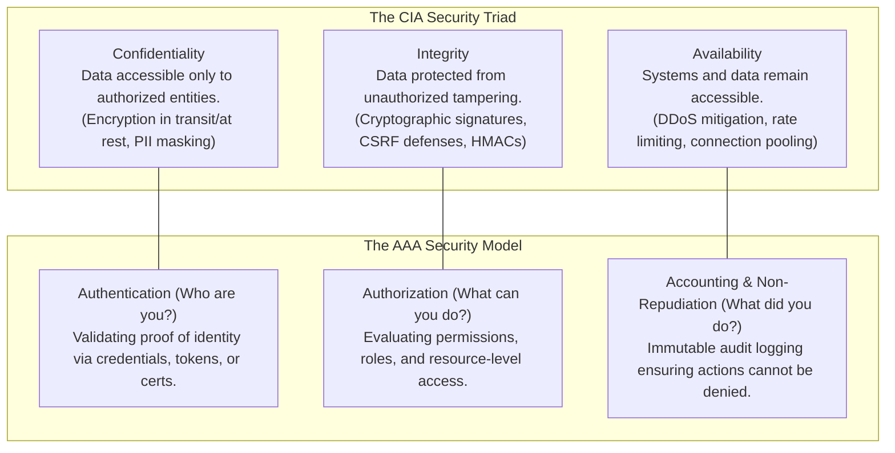
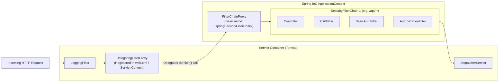
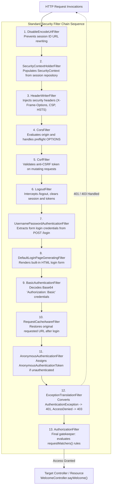
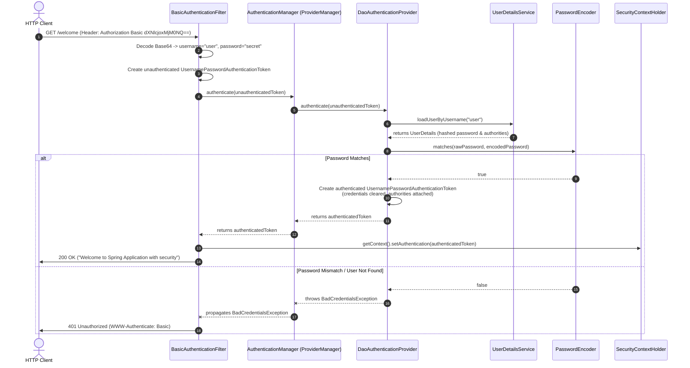

# Section 1: Security Filter Chain Architecture & Internals

## 1. Enterprise Security Fundamentals: The CIA Triad & AAA Framework

In enterprise software engineering, securing backend systems requires more than simple username/password prompts. Security architecture is built upon formal defense-in-depth frameworks:



When engineers add `spring-boot-starter-security` to a Spring Boot project, the framework instantly establishes an automated security perimeter around every HTTP endpoint:

```xml
<dependency>
    <groupId>org.springframework.boot</groupId>
    <artifactId>spring-boot-starter-security</artifactId>
</dependency>
```

### Default Auto-Configuration Behavior
Out of the box, without writing a single line of custom code, Spring Boot's `SecurityAutoConfiguration` activates:

1. **Universal Route Protection:** Every HTTP endpoint in the application requires authentication.
2. **Default In-Memory User:** A single user named `user` is provisioned by `UserDetailsServiceAutoConfiguration`.
3. **Generated Password:** A cryptographically random UUID password is generated on startup and logged to the console:
   ```text
   Using generated security password: 9f8a3c4b-12d4-4e56-8a9b-0c1d2e3f4a5b
   ```
4. **Dual Authentication Entrypoints:** Both an auto-generated HTML login page (`/login`) via `DefaultLoginPageGeneratingFilter` and HTTP Basic Authentication headers are active.
5. **CSRF Protection:** Enabled by default on all HTTP mutating methods (POST, PUT, DELETE, PATCH).

---

## 2. The Servlet Bridge: `DelegatingFilterProxy` & `FilterChainProxy`

Spring Security is fundamentally built upon the standard Java EE / Jakarta EE **Servlet Filter specification**. However, a fundamental architectural dilemma exists between the Servlet container and the Spring framework:

- The **Servlet Container (Tomcat / Jetty)** manages its own filter lifecycle (`init`, `doFilter`, `destroy`) outside the Spring `ApplicationContext`.
- Spring beans (such as `UserDetailsService`, `PasswordEncoder`, repositories) live inside the Spring **IoC Container** and support dependency injection.

How does a standard Servlet container filter leverage Spring beans to perform authentication and authorization?

Spring resolves this impedance mismatch using the **`DelegatingFilterProxy`**:



### 1. `DelegatingFilterProxy`
`DelegatingFilterProxy` is a standard `jakarta.servlet.Filter` registered with the servlet container. When an HTTP request enters, `DelegatingFilterProxy` does not execute security checks itself. Instead, it looks up a Spring bean named `springSecurityFilterChain` from the `WebApplicationContext` and delegates the `doFilter()` invocation to that bean.

### 2. `FilterChainProxy`
The bean named `springSecurityFilterChain` is an instance of `FilterChainProxy`. It is the central orchestration hub of Spring Security. `FilterChainProxy` holds a collection of `SecurityFilterChain` instances and determines which chain should process the current request based on URL pattern matchers.

!!! note "Why FilterChainProxy is Essential"
    By routing requests through `FilterChainProxy` instead of registering security filters directly with the servlet container, Spring Security achieves:
    
    1. **Dynamic Chain Selection:** Multiple distinct `SecurityFilterChain` beans can exist for different paths (e.g., stateless `/api/**` vs session-based `/web/**`).
    2. **Unified Security Context Management:** Guarantees that `SecurityContextHolder` is reset and cleared after every request, preventing cross-request identity leakage.
    3. **Bypass Optimization:** Allows requests matching `WebSecurity.ignoring()` to bypass security processing entirely without overhead.

---

## 3. Anatomy of the `SecurityFilterChain`

A `SecurityFilterChain` is a defined sequence of servlet filters ordered by strict precedence. Each filter encapsulates a distinct responsibility in the security lifecycle:



!!! tip "Filter Ordering Guarantees"
    Filters in Spring Security must execute in exact sequence. For example, `CorsFilter` must execute before `CsrfFilter` and authentication filters so preflight `OPTIONS` requests are never rejected for lacking authentication or CSRF tokens. Similarly, `ExceptionTranslationFilter` must sit above `AuthorizationFilter` to catch security exceptions and translate them into standard HTTP responses.

---

## 4. The End-to-End Authentication Architecture

When an incoming request presents credentials (e.g., HTTP Basic Authorization header or POST form data), Spring Security executes a multi-tiered dispatch protocol:



### Detailed Component Roles in Authentication

#### 1. `Authentication` Token Contract
The `Authentication` interface represents both an authentication request and an authenticated principal. It defines:

- **`getPrincipal()`**: The identity of the user (e.g., username or `UserDetails` object).
- **`getCredentials()`**: The secret proof of identity (e.g., password or token). Once authenticated, credentials are erased to prevent heap exposure.
- **`getAuthorities()`**: A collection of `GrantedAuthority` objects (roles and permissions).
- **`isAuthenticated()`**: Boolean flag indicating whether credentials have been verified.

#### 2. `AuthenticationManager` & `ProviderManager`
`AuthenticationManager` is the core strategy interface for authentication:
```java
public interface AuthenticationManager {
    Authentication authenticate(Authentication authentication)
            throws AuthenticationException;
}
```
The standard implementation is **`ProviderManager`**, which delegates authentication to a chain of configured `AuthenticationProvider` instances.

#### 3. `AuthenticationProvider`
The component responsible for executing actual authentication logic. It supports:

- `authenticate(Authentication)`: Validates credentials.
- `supports(Class<?>)`: Declares which token type it can authenticate (e.g., `UsernamePasswordAuthenticationToken.class`).

#### 4. `SecurityContextHolder` & `SecurityContext`
The storage hub for authentication metadata. By default, `SecurityContextHolder` stores the `SecurityContext` in a `ThreadLocal`, ensuring thread-isolated security context access throughout the request lifecycle:
```java
// Accessing authenticated user anywhere in the execution thread:
Authentication auth = SecurityContextHolder.getContext().getAuthentication();
String currentUsername = auth.getName();
```

!!! caution "ThreadLocal & Thread-Pool Caching Hazards"
    Because `SecurityContextHolder` uses `ThreadLocal` storage by default, asynchronous threads (e.g., `@Async`, `CompletableFuture`, or custom `ExecutorService` pools) will not inherit the security context unless explicitly configured with `SecurityContextHolder.MODE_INHERITABLETHREADLOCAL` or using `DelegatingSecurityContextExecutor`. At the end of every HTTP request, `FilterChainProxy` cleans the `ThreadLocal` to prevent identity leaks across pooled threads.
