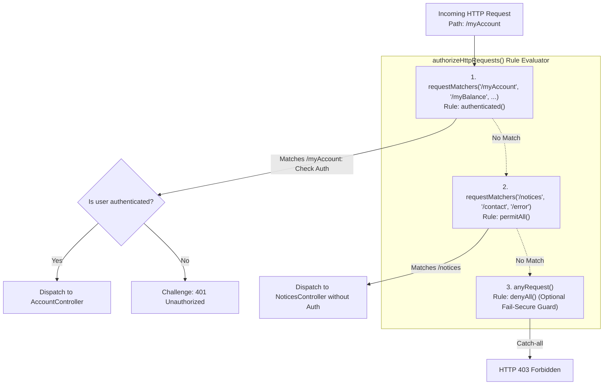
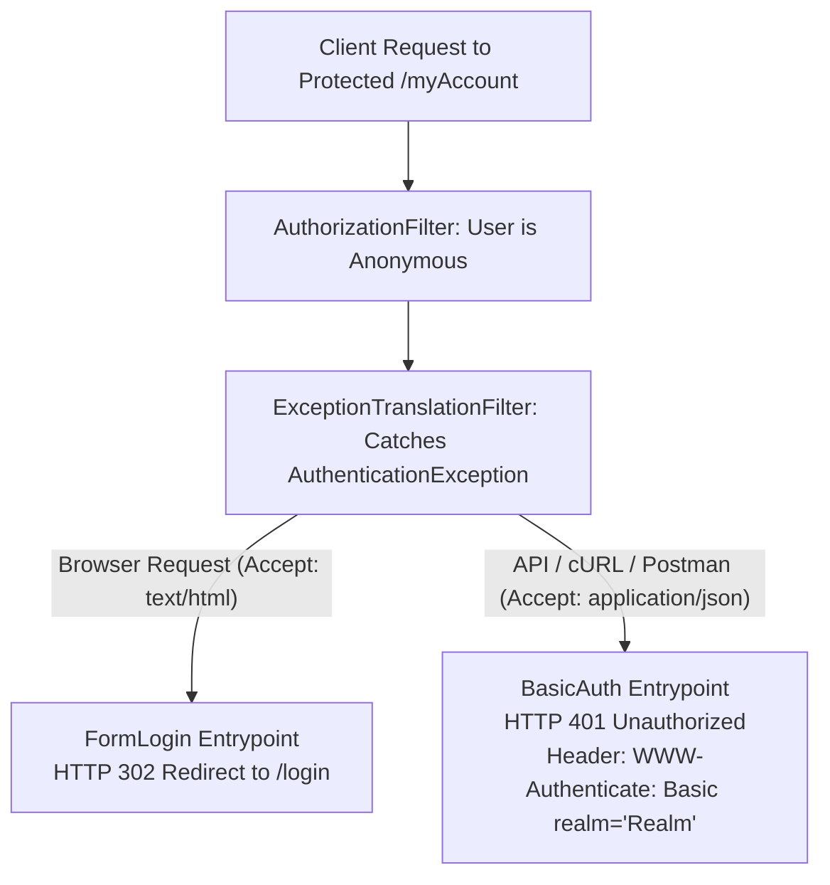

# Section 2: Granular Request Authorization & Route Matching

## 1. Architectural Evolution: Component-Based Security Configuration

In legacy Spring Security (prior to version 5.7), configuring security required extending `WebSecurityConfigurerAdapter` and overriding the `configure(HttpSecurity http)` method:

```java
// DEPRECATED LEGACY PATTERN (Spring Security 5.x and earlier)
@Configuration
public class LegacySecurityConfig extends WebSecurityConfigurerAdapter {
    @Override
    protected void configure(HttpSecurity http) throws Exception {
        http.authorizeRequests().anyRequest().authenticated();
    }
}
```

In modern **Spring Security 6 and 7** (Spring Boot 3 and 4), `WebSecurityConfigurerAdapter` has been completely deprecated and removed. Spring Security adopted a **component-based configuration model** where engineers register a `@Bean` of type `SecurityFilterChain`:

```java
@Configuration
public class ProjectSecurityConfig {

    @Bean
    SecurityFilterChain defaultSecurityFilterChain(HttpSecurity http) throws Exception {
        http.authorizeHttpRequests((requests) -> requests
                .requestMatchers("/myAccount", "/myBalance", "/myLoans", "/myCards").authenticated()
                .requestMatchers("/notices", "/contact", "/error").permitAll());
        http.formLogin(withDefaults());
        http.httpBasic(withDefaults());
        return http.build();
    }
}
```

### Why Spring Adopted the Component-Based Model
1. **Elimination of Monolithic Inheritance:** Developers are not forced to inherit hundreds of internal adapter methods.
2. **First-Class Bean Lifecycle:** The `SecurityFilterChain` bean can be conditioned with `@Profile`, `@Order`, or customized based on injected collaborator beans.
3. **Multi-Chain Cleanliness:** Multiple `SecurityFilterChain` beans can be declared within the same or separate configuration classes cleanly, each targeted at specific URL slices (e.g., public API vs back-office portal).

---

## 2. Route Authorization Grammar: `authorizeHttpRequests`

The heart of web endpoint security in Spring Security is the `authorizeHttpRequests()` configuration block using modern **Lambda DSL**:



### Route Authorization Directives

| Rule Method | Architectural Semantic | Typical Enterprise Use Cases |
| :--- | :--- | :--- |
| **`authenticated()`** | Request requires a fully authenticated principal (anonymous tokens are rejected). | Confidential customer APIs (`/myAccount`, `/myLoans`, `/myCards`, `/myBalance`). |
| **`permitAll()`** | All requests are granted access without checking authentication status. | Public notices, marketing pages, contact forms, OpenAPI docs (`/notices`, `/contact`, `/swagger-ui/**`). |
| **`denyAll()`** | Every request matching this path is rejected unconditionally (HTTP 403). | Decommissioned endpoints, administrative debugging routes in production. |
| **`hasRole("ROLE")`** | Requires principal to possess authority prefixed with `ROLE_` (e.g., `ROLE_ADMIN`). | Administrative portals (`/admin/**`). |
| **`hasAuthority("AUTH")`** | Evaluates raw atomic permission string without prefix (e.g., `VIEW_BALANCE`). | Granular permission-based authorization. |

!!! warning "Order Matters in requestMatchers"
    Route rules are evaluated **top-to-bottom in the order they are defined**. The first matching rule wins!
    
    ```java
    // SECURITY ANTI-PATTERN: Ordering Bug!
    http.authorizeHttpRequests(requests -> requests
        .requestMatchers("/**").permitAll() // Matches EVERYTHING first!
        .requestMatchers("/api/admin/**").hasRole("ADMIN") // DEAD CODE! Never reached!
    );
    ```
    Always declare specific, highly-restrictive paths first, followed by coarse-grained and catch-all rules.

---

## 3. Dissecting `permitAll()` vs `anyRequest().denyAll()`

During architecture reviews, junior engineers often confuse `permitAll()` with bypassing Spring Security entirely.

### What `permitAll()` Actually Does
When a path is marked `permitAll()`:

1. The request **still traverses the entire `SecurityFilterChain`**.
2. Filters like `SecurityContextHolderFilter`, `HeaderWriterFilter`, `CorsFilter`, and `CsrfFilter` execute normally.
3. If the client voluntarily sends an `Authorization: Basic` header, Spring Security **authenticates the user** and populates the `SecurityContextHolder`.
4. Only when the request reaches the final `AuthorizationFilter`, the filter skips the credential requirement and permits execution.

### The Fail-Secure Posture: `anyRequest().denyAll()`
In zero-trust enterprise banking environments, security policies require that any new endpoint added to a controller must be inaccessible by default until an explicit security rule is written:

```java
@Bean
SecurityFilterChain failSecureFilterChain(HttpSecurity http) throws Exception {
    http.authorizeHttpRequests(requests -> requests
        // Explicitly allowed public endpoints
        .requestMatchers("/notices", "/contact", "/error").permitAll()
        // Explicitly allowed customer endpoints
        .requestMatchers("/myAccount", "/myBalance", "/myLoans", "/myCards").authenticated()
        // Fail-Secure: Everything else is strictly denied
        .anyRequest().denyAll()
    );
    http.formLogin(withDefaults());
    http.httpBasic(withDefaults());
    return http.build();
}
```

If an engineer accidentally exposes a new `/myInvestments` endpoint and forgets to configure its security rule, `anyRequest().denyAll()` blocks all access with an HTTP 403 Forbidden, preventing accidental public exposure.

---

## 4. Dual Entrypoints: Form Login vs HTTP Basic Authentication

The EazyBank security configuration enables two distinct client interaction models:

```java
http.formLogin(withDefaults());
http.httpBasic(withDefaults());
```



### 1. HTTP Basic Authentication (`httpBasic`)
- **Transport Mechanism:** Client supplies header:
  ```http
  Authorization: Basic <Base64(username:password)>
  ```
- **Example:** For username `user` and password `12345`:
  ```bash
  echo -n "user:12345" | base64
  # Output: dXNlcjoxMjM0NQ==
  ```
  Request header:
  ```http
  Authorization: Basic dXNlcjoxMjM0NQ==
  ```
- **Response to Unauthenticated Request:** HTTP 401 Unauthorized with header `WWW-Authenticate: Basic realm="Realm"`.
- **Architectural Fit:** REST clients, microservice-to-microservice internal calls, automated test runners.

### 2. Form Login (`formLogin`)
- **Transport Mechanism:** Browser-oriented login form. Submits credentials as `application/x-www-form-urlencoded` POST to `/login`.
- **Session Handling:** Upon successful authentication, creates an HTTP session (`JSESSIONID` cookie) and redirects to the originally requested resource via `RequestCacheAwareFilter`.
- **Architectural Fit:** Web portals rendered server-side (Thymeleaf / JSP).

---

## 5. Domain Controller Architecture

In Section 2, the EazyBank application establishes six dedicated domain controllers to demonstrate authorization partitioning:

### Protected Banking Endpoints (`authenticated()`)
- `AccountController` (`GET /myAccount`): Fetches bank account details.
- `BalanceController` (`GET /myBalance`): Returns available and ledger balances.
- `CardsController` (`GET /myCards`): Retrieves outstanding credit card balances.
- `LoansController` (`GET /myLoans`): Returns loan repayment schedules.

```java
package com.eazybytes.controller;

import org.springframework.web.bind.annotation.GetMapping;
import org.springframework.web.bind.annotation.RestController;

@RestController
public class AccountController {

    @GetMapping("/myAccount")
    public String getAccountDetails() {
        return "Here are the account details from the DB";
    }
}
```

### Public Information Endpoints (`permitAll()`)
- `NoticesController` (`GET /notices`): Bank public notices and bulletins.
- `ContactController` (`GET /contact`): Customer support inquiry form.

```java
package com.eazybytes.controller;

import org.springframework.web.bind.annotation.GetMapping;
import org.springframework.web.bind.annotation.RestController;

@RestController
public class NoticesController {

    @GetMapping("/notices")
    public String getNotices() {
        return "Here are the notices details from the DB";
    }
}
```

When an unauthenticated client requests `GET /notices`, the response is immediate HTTP 200 OK. When requesting `GET /myAccount` without valid credentials, Spring Security intervenes and issues an HTTP 401 Unauthorized challenge.
