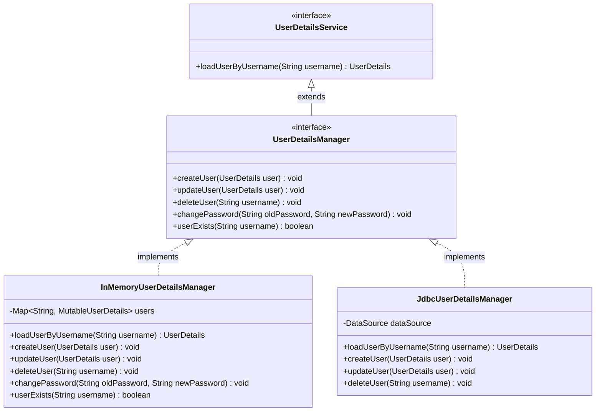
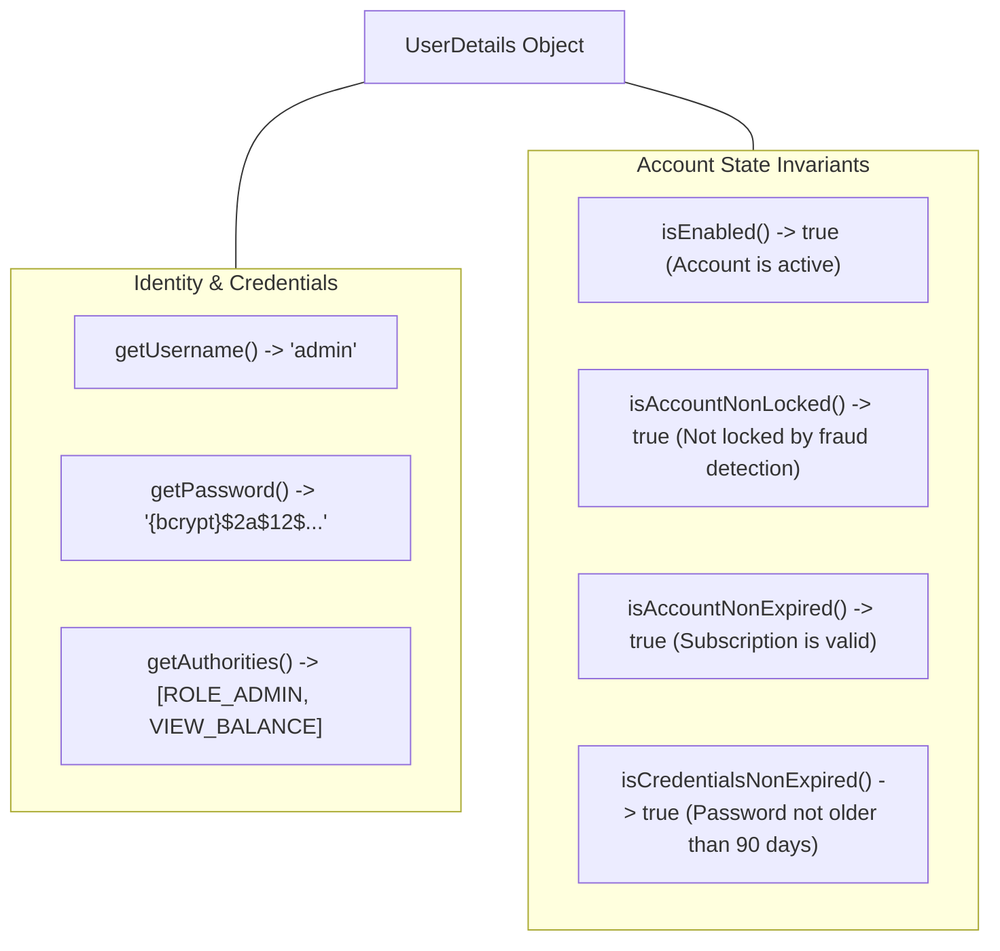
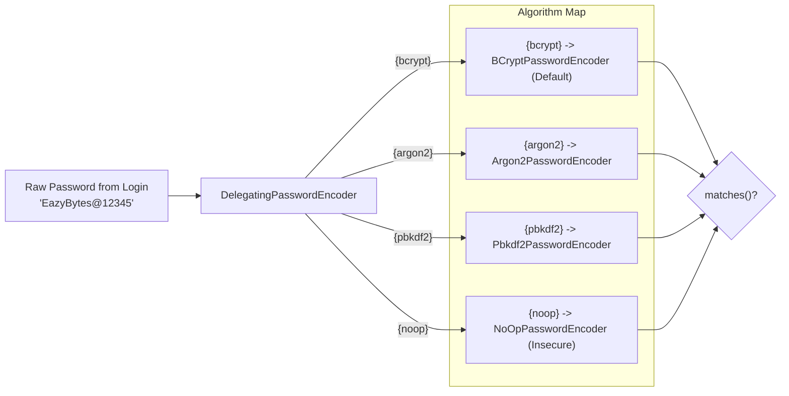
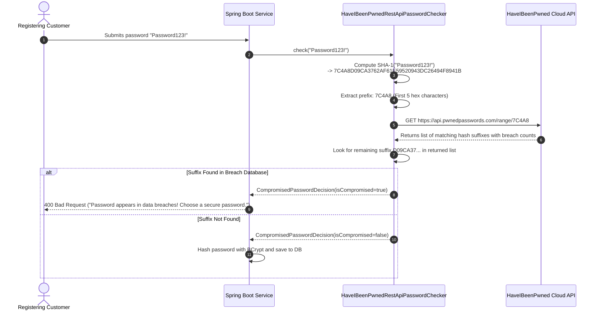

# Section 3: In-Memory Identity Management & Contracts

## 1. Identity Abstractions: `UserDetailsService` vs `UserDetailsManager`

In Spring Security, the retrieval and lifecycle management of user credentials are decoupled through two core interfaces:



### The Architectural Distinction

| Interface | Method Signatures | Architectural Responsibility |
| :--- | :--- | :--- |
| **`UserDetailsService`** | `loadUserByUsername(String username)` | **Read-Only Query Contract.** Responsible solely for locating a user identity by username and constructing a `UserDetails` representation for authentication. |
| **`UserDetailsManager`** | `createUser()`, `updateUser()`, `deleteUser()`, `changePassword()`, `userExists()` | **Full Identity Lifecycle (CRUD).** Extends `UserDetailsService` with write capabilities for managing user records in an underlying store. |

!!! tip "Design Principle: Interface Segregation"
    When building custom security architectures where user registration or profile updates are handled by domain services (e.g., standard Spring Data JPA services), your custom security bean only needs to implement **`UserDetailsService`**. Avoid implementing `UserDetailsManager` unless you specifically intend to delegate administrative user mutation tasks to Spring Security's internal workflows.

---

## 2. The `UserDetails` Contract & Account State Flags

The `UserDetails` interface is the canonical representation of an application user in Spring Security. It encapsulates credentials, authorities, and critical security flags:

```java
public interface UserDetails extends Serializable {
    Collection<? extends GrantedAuthority> getAuthorities();
    String getPassword();
    String getUsername();
    boolean isAccountNonExpired();
    boolean isAccountNonLocked();
    boolean isCredentialsNonExpired();
    boolean isEnabled();
}
```



### Account Invariant Evaluation
During the authentication dispatch in `DaoAuthenticationProvider`:

1. If `isEnabled()` returns `false`, a `DisabledException` is thrown.
2. If `isAccountNonLocked()` returns `false`, a `LockedException` is thrown.
3. If `isAccountNonExpired()` returns `false`, an `AccountExpiredException` is thrown.
4. If `isCredentialsNonExpired()` returns `false`, a `CredentialsExpiredException` is thrown.

All four exceptions inherit from `AccountStatusException`, preventing access before password verification even takes place.

---

## 3. Provisioning Users via `InMemoryUserDetailsManager`

In local development, prototyping, and automated unit testing, managing users in memory avoids database dependencies. Spring provides `InMemoryUserDetailsManager`:

```java
@Bean
public UserDetailsService userDetailsService() {
    UserDetails user = User.withUsername("user")
            .password("{noop}EazyBytes@12345")
            .authorities("read")
            .build();

    UserDetails admin = User.withUsername("admin")
            .password("{bcrypt}$2a$12$88.f6upbBvy0okEa7OfHFuorV29qeK.sVbB9VQ6J6dWM1bW6Qef8m")
            .authorities("admin")
            .build();

    return new InMemoryUserDetailsManager(user, admin);
}
```

### The `User.withUsername()` Builder
Spring Security provides the `User.UserBuilder` fluent API to construct immutable `UserDetails` instances. Notice the password prefixes:

- `{noop}EazyBytes@12345`: Informs the delegating encoder that this password is plain text (no operation).
- `{bcrypt}$2a$12$...`: Informs the delegating encoder that this hash is computed using BCrypt with work factor 12.

---

## 4. The Delegating Password Encoder

Why do passwords require prefix identifiers like `{noop}` or `{bcrypt}`?

If you register a plain text password without a prefix and without declaring a `PasswordEncoder` bean:
```java
UserDetails user = User.withUsername("user").password("12345").build();
```
Upon login, Spring Security crashes with:
```text
java.lang.IllegalArgumentException: There is no PasswordEncoder mapped for the id "null"
```

This fail-safe behavior was introduced in Spring Security 5 to eradicate plain text passwords in enterprise applications.

```java
@Bean
public PasswordEncoder passwordEncoder() {
    return PasswordEncoderFactories.createDelegatingPasswordEncoder();
}
```

`PasswordEncoderFactories.createDelegatingPasswordEncoder()` constructs a `DelegatingPasswordEncoder` whose default encoding algorithm is **BCrypt**:



### Zero-Downtime Cryptographic Migration
The delegating encoder pattern allows enterprise systems to migrate historical passwords seamlessly. If an application historically used `{pbkdf2}` and transitions to `{bcrypt}`:

1. Existing `{pbkdf2}` hashes continue to authenticate successfully.
2. When an existing user logs in, the application can detect that the algorithm is outdated via `passwordEncoder.upgradeEncoding(storedHash)` and re-encode the raw password using `{bcrypt}` without forcing an outage or mass password reset.

---

## 5. Compromised Password Screening (Spring Security 6.3+)

A major security enhancement introduced in **Spring Security 6.3** is the **`CompromisedPasswordChecker`**:

```java
@Bean
public CompromisedPasswordChecker compromisedPasswordChecker() {
    return new HaveIBeenPwnedRestApiPasswordChecker();
}
```

### How `HaveIBeenPwnedRestApiPasswordChecker` Works
Instead of sending user passwords over the internet, this component implements the **$k$-Anonymity Mathematical Model**:



!!! important "Privacy Guarantee of k-Anonymity"
    The full password or full hash is **never transmitted** to the external API. Only the first 5 hexadecimal characters of the SHA-1 hash are sent. The external service returns hundreds of possible suffix hashes, and the comparison is performed entirely inside your application memory.
