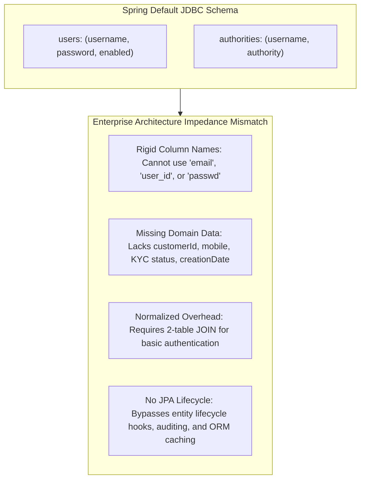
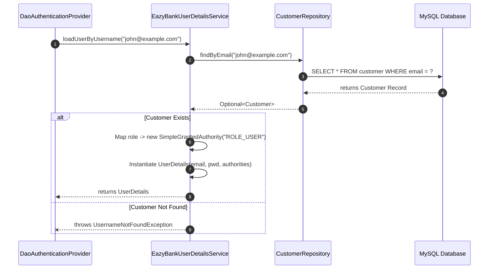

# Section 4: Database Authentication with MySQL & Spring Data JPA

## 1. Limitations of Spring Security's Default JDBC Schema

Spring Security ships with a built-in SQL schema designed for `JdbcUserDetailsManager`:

```sql
-- Standard Spring Security 6/7 JDBC Schema
CREATE TABLE users (
    username VARCHAR(50) NOT NULL PRIMARY KEY,
    password VARCHAR(500) NOT NULL,
    enabled BOOLEAN NOT NULL
);

CREATE TABLE authorities (
    username VARCHAR(50) NOT NULL,
    authority VARCHAR(50) NOT NULL,
    CONSTRAINT fk_authorities_users FOREIGN KEY (username) REFERENCES users(username)
);
CREATE UNIQUE INDEX ix_auth_username ON authorities (username, authority);
```

While functional for basic applications, this schema exhibits critical shortcomings in enterprise software engineering:



To build modern enterprise backends, architects bypass `JdbcUserDetailsManager` and implement custom, JPA-backed identity stores using Spring Data JPA.

---

## 2. Domain Identity Modeling with Jakarta Persistence

In the EazyBank banking system, the user identity is modeled as a primary business entity: `Customer`:

```java
package com.eazybytes.model;

import jakarta.persistence.*;
import lombok.Getter;
import lombok.Setter;

@Entity
@Table(name = "customer")
@Getter
@Setter
public class Customer {

    @Id
    @GeneratedValue(strategy = GenerationType.IDENTITY)
    private long id;

    @Column(nullable = false, unique = true)
    private String email;

    @Column(nullable = false)
    private String pwd;

    @Column(nullable = false)
    private String role;
}
```

### The Spring Data JPA Repository Contract
Data access is managed through a clean `CustomerRepository` interface extending `CrudRepository` or `JpaRepository`:

```java
package com.eazybytes.repository;

import com.eazybytes.model.Customer;
import org.springframework.data.repository.CrudRepository;
import org.springframework.stereotype.Repository;

import java.util.Optional;

@Repository
public interface CustomerRepository extends CrudRepository<Customer, Long> {

    // Derived Query Method for Email-Based Identity Lookup
    Optional<Customer> findByEmail(String email);
}
```

---

## 3. Custom `UserDetailsService` Implementation

To connect the JPA persistence tier with Spring Security's authentication subsystem, implement `UserDetailsService`:

```java
package com.eazybytes.config;

import com.eazybytes.model.Customer;
import com.eazybytes.repository.CustomerRepository;
import lombok.RequiredArgsConstructor;
import org.springframework.security.core.GrantedAuthority;
import org.springframework.security.core.authority.SimpleGrantedAuthority;
import org.springframework.security.core.userdetails.User;
import org.springframework.security.core.userdetails.UserDetails;
import org.springframework.security.core.userdetails.UserDetailsService;
import org.springframework.security.core.userdetails.UsernameNotFoundException;
import org.springframework.stereotype.Service;

import java.util.List;

@Service
@RequiredArgsConstructor
public class EazyBankUserDetailsService implements UserDetailsService {

    private final CustomerRepository customerRepository;

    @Override
    public UserDetails loadUserByUsername(String username) throws UsernameNotFoundException {
        Customer customer = customerRepository.findByEmail(username)
                .orElseThrow(() -> new UsernameNotFoundException(
                        "User details not found for the user: " + username));

        List<GrantedAuthority> authorities = List.of(
                new SimpleGrantedAuthority(customer.getRole()));

        return new User(customer.getEmail(), customer.getPwd(), authorities);
    }
}
```



!!! important "Exception Contract Compliance"
    The `UserDetailsService` contract mandates throwing `UsernameNotFoundException` when a user cannot be located. **Never return `null`**. Returning `null` violates the contract and leads to unexpected `NullPointerException` errors deeper inside `DaoAuthenticationProvider`.

---

## 4. Customer Registration Workflow

With the database tier established, customer onboarding is exposed through a REST controller (`UserController`):

```java
package com.eazybytes.controller;

import com.eazybytes.model.Customer;
import com.eazybytes.repository.CustomerRepository;
import lombok.RequiredArgsConstructor;
import org.springframework.http.HttpStatus;
import org.springframework.http.ResponseEntity;
import org.springframework.security.crypto.password.PasswordEncoder;
import org.springframework.web.bind.annotation.PostMapping;
import org.springframework.web.bind.annotation.RequestBody;
import org.springframework.web.bind.annotation.RestController;

@RestController
@RequiredArgsConstructor
public class UserController {

    private final CustomerRepository customerRepository;
    private final PasswordEncoder passwordEncoder;

    @PostMapping("/register")
    public ResponseEntity<String> registerUser(@RequestBody Customer customer) {
        try {
            // 1. Hash raw password with salt before persistence
            String hashPwd = passwordEncoder.encode(customer.getPwd());
            customer.setPwd(hashPwd);

            // 2. Persist customer to relational store
            Customer savedCustomer = customerRepository.save(customer);

            if (savedCustomer.getId() > 0) {
                return ResponseEntity.status(HttpStatus.CREATED)
                        .body("Given user details are successfully registered");
            } else {
                return ResponseEntity.status(HttpStatus.BAD_REQUEST)
                        .body("User registration failed");
            }
        } catch (Exception ex) {
            return ResponseEntity.status(HttpStatus.INTERNAL_SERVER_ERROR)
                    .body("An exception occurred: " + ex.getMessage());
        }
    }
}
```

### Route Configuration in `ProjectSecurityConfig`
Because registration is performed by prospective customers who do not yet have credentials, `/register` must be opened in `ProjectSecurityConfig`:

```java
http.authorizeHttpRequests((requests) -> requests
        .requestMatchers("/myAccount", "/myBalance", "/myLoans", "/myCards").authenticated()
        .requestMatchers("/notices", "/contact", "/error", "/register").permitAll());
```

!!! caution "CSRF Consideration for Registration Endpoints"
    In default Spring Security configurations, `/register` is an HTTP `POST` endpoint and will be rejected with **HTTP 403 Forbidden** if CSRF protection is active and no CSRF token is provided. For standalone REST APIs, engineers temporarily disable CSRF during testing (`csrf -> csrf.disable()`), or implement proper CSRF token exchange workflows as detailed in Section 8.
