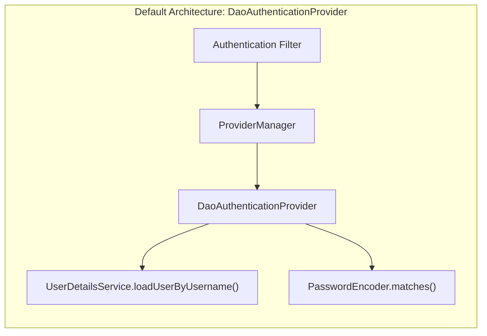
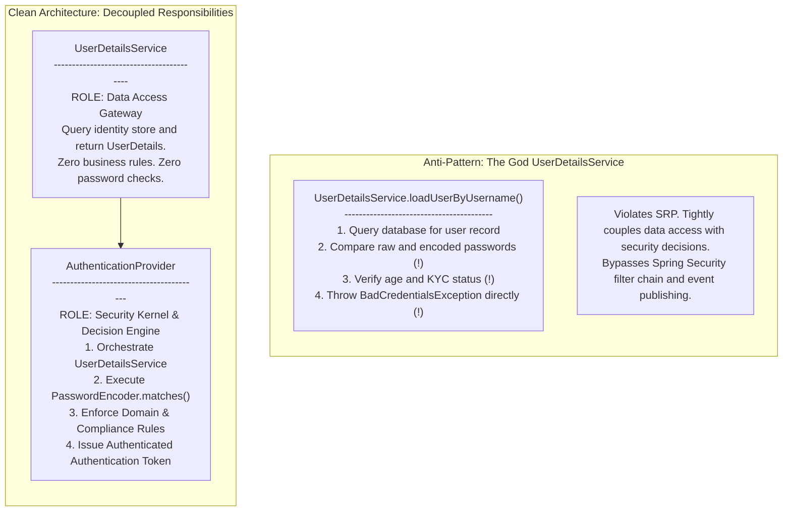
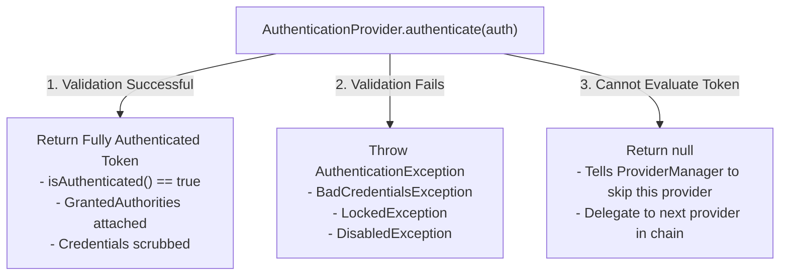
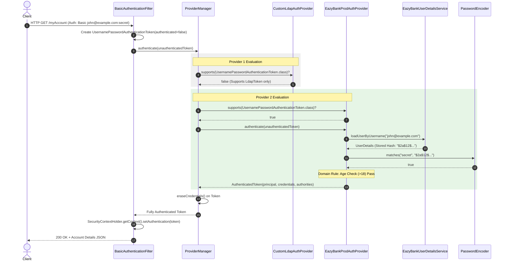
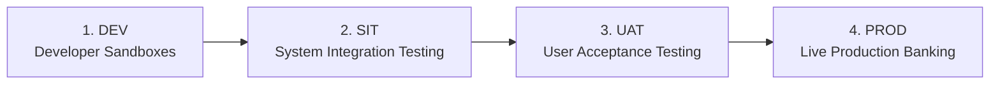

# Section 6: Custom AuthenticationProvider Architecture & Environment-Aware Security

## 1. Architectural Problem Statement: The Limits of Default `DaoAuthenticationProvider`

In basic Spring Security architectures, developers rely entirely on the framework's built-in `DaoAuthenticationProvider`. By providing a custom `UserDetailsService` and a `PasswordEncoder` bean, `DaoAuthenticationProvider` automatically bridges the gap: it loads the user from the database, compares passwords, and issues an authenticated token.



While sufficient for straightforward username-and-password scenarios, enterprise production systems quickly outgrow `DaoAuthenticationProvider`. 

### 1.1 Enterprise Scenarios Requiring Custom `AuthenticationProvider` Implementations

1. **Custom Domain Rules & Business Validation:**
   Enterprise systems frequently require evaluating business conditions during the authentication handshake itself. For example:
   - Verifying that a retail banking customer is at least 18 years of age before allowing account access.
   - Checking customer KYC (Know Your Customer) compliance tiers.
   - Enforcing regional banking regulatory constraints (e.g., cross-border IP access restrictions).
   - Validating branch operational hours for teller-level users.
2. **Multi-Factor Authentication (MFA) & Step-Up Challenges:**
   Authenticating against non-password credentials (e.g., SMS OTPs, TOTP time-based tokens, cryptographic hardware security keys, or FIDO2/WebAuthn biometrics) requires a provider tailored to inspect and validate auxiliary token payloads.
3. **Heterogeneous Authentication Directories:**
   Large enterprises rarely store all identities in a single relational table. An enterprise application might authenticate internal employees against corporate **Active Directory via LDAP**, retail customers against **MySQL via Spring Data JPA**, and external partners via **OAuth2/JWT** or Mutual TLS (mTLS). Each credential mechanism requires a dedicated `AuthenticationProvider`.
4. **Integration with Legacy / Proprietary Security Services:**
   Connecting to mainframe RACF, Kerberos key distribution centers, legacy JAAS (Java Authentication and Authorization Service) modules, or third-party enterprise identity providers (PingFederate, Okta, SiteMinder).
5. **Environment-Specific Authentication Behavior (Testing vs. Production):**
   In modern CI/CD pipelines and QA testing environments (SIT, UAT), automated test suites (Selenium, Cypress, JMeter) and manual QA teams must execute thousands of test cases across test accounts without managing complex production-grade BCrypt passwords for every dummy user. Custom providers conditioned on Spring Profiles allow flexible test workflows without compromising production security.

---

## 2. Decoupling Principles: Identity Loading vs. Authentication Decisions

A foundational design principle in enterprise security architecture is the **Single Responsibility Principle (SRP)** applied to authentication subsystems: separating **data retrieval** from **decision making**.



### 2.1 The Two Distinct Responsibilities

- **`UserDetailsService` as a Pure Data Gateway:**
  Its sole purpose is querying an underlying datastore (PostgreSQL, MySQL, MongoDB, LDAP) and translating raw entity records into Spring Security's standardized `UserDetails` contract. It must remain stateless and agnostic of how authentication validation occurs.
- **`AuthenticationProvider` as the Authentication Decision Engine:**
  The provider extracts user-submitted credentials from the incoming unauthenticated `Authentication` request, invokes `UserDetailsService` to obtain ground truth, invokes `PasswordEncoder` for constant-time cryptographic verification, executes business and regulatory checks, and constructs the final authenticated `Authentication` token.

### 2.2 Architectural Comparison Matrix

| Dimension | `UserDetailsService` | `AuthenticationProvider` |
| :--- | :--- | :--- |
| **Primary Responsibility** | Identity data retrieval and model translation. | Credential verification, domain checks, and token creation. |
| **Input** | `String username` | Unauthenticated `Authentication` token. |
| **Output** | `UserDetails` (identity snapshot). | Fully authenticated `Authentication` token. |
| **Password Matching** | **Never.** Should not access `PasswordEncoder`. | **Mandatory.** Evaluates `PasswordEncoder.matches()`. |
| **Domain Validations** | None. Pure data access. | Validates age, KYC status, account locks, multi-factor tokens. |
| **Failure Mechanism** | Throws `UsernameNotFoundException`. | Throws `BadCredentialsException`, `LockedException`, etc. |
| **Orchestration** | Invoked by `AuthenticationProvider`. | Invoked by `ProviderManager`. |

---

## 3. The `AuthenticationProvider` Interface Contract Deep Dive

The `org.springframework.security.authentication.AuthenticationProvider` interface defines two essential methods:

```java
package org.springframework.security.authentication;

import org.springframework.security.core.Authentication;
import org.springframework.security.core.AuthenticationException;

public interface AuthenticationProvider {

    /**
     * Performs authentication with the same contract as
     * AuthenticationManager.authenticate(Authentication).
     */
    Authentication authenticate(Authentication authentication)
            throws AuthenticationException;

    /**
     * Returns true if this AuthenticationProvider supports the indicated
     * Authentication object.
     */
    boolean supports(Class<?> authentication);
}
```

### 3.1 The `authenticate(Authentication authentication)` Method

#### Input: The Unauthenticated Token
The incoming `authentication` parameter is typically an unauthenticated instance created by a security filter (e.g., `UsernamePasswordAuthenticationToken` produced by `BasicAuthenticationFilter` or `UsernamePasswordAuthenticationFilter`):

- `authentication.getName()`: Returns the presented principal (e.g., username or email).
- `authentication.getCredentials()`: Returns the presented credential (e.g., raw plaintext password string or char array).
- `authentication.isAuthenticated()`: Returns `false`.
- `authentication.getAuthorities()`: Returns an empty collection.

#### Output Possibilities: The Three Return Contracts
An `AuthenticationProvider` implementation must conform to one of three explicit return behaviors:



1. **Successful Authentication:** Return a fully populated, immutable `Authentication` token (e.g., `new UsernamePasswordAuthenticationToken(username, credentials, authorities)`) where `isAuthenticated()` is `true` and the user's granted roles and permissions are attached.
2. **Authentication Failure:** Throw an appropriate subclass of `AuthenticationException` (e.g., `BadCredentialsException("Invalid password!")`, `LockedException`, `DisabledException`). Throwing an exception immediately halts authentication for that request and triggers authentication failure handling.
3. **Cannot Evaluate (`return null`):** If the provider determines that it cannot evaluate the request (e.g., missing specific request headers or domain criteria), it returns `null`. This signals `ProviderManager` to bypass this provider and attempt authentication with the next registered provider in the chain.

### 3.2 The `supports(Class<?> authentication)` Method

Before `ProviderManager` calls `authenticate()`, it first queries `supports(authentication.getClass())`:
```java
@Override
public boolean supports(Class<?> authentication) {
    return (UsernamePasswordAuthenticationToken.class.isAssignableFrom(authentication));
}
```

- Declares whether this provider is capable of processing the specific token class.
- Uses `Class.isAssignableFrom()` to accommodate subclasses of the expected token.
- If `supports()` returns `false`, `ProviderManager` immediately skips this provider without executing any authentication logic.

---

## 4. Orchestration Topology: `ProviderManager` & Multi-Provider Chaining

Spring Security implements `AuthenticationManager` via the **`ProviderManager`** class. `ProviderManager` acts as an orchestrator, maintaining an ordered list of `AuthenticationProvider` instances.



### 4.1 Multi-Provider Chaining & Parent Manager Fallback
If an application defines multiple providers supporting the same token type:

1. `ProviderManager` iterates through its list of providers sequentially.
2. If Provider A throws an `AuthenticationException`, `ProviderManager` records the exception and continues down the list unless the exception indicates a hard stop.
3. If all local providers return `null` or fail, `ProviderManager` delegates to its optional **parent `AuthenticationManager`**.
4. If neither local providers nor the parent manager can authenticate the request, `ProviderManager` rethrows the last encountered `AuthenticationException` (typically `BadCredentialsException`).

### 4.2 Automatic Credential Scrubbing (`eraseCredentials`)
Notice that after `ProviderManager` receives an authenticated token from a provider, it automatically inspects whether the token implements `org.springframework.security.core.CredentialsContainer`.

- `UsernamePasswordAuthenticationToken` implements `CredentialsContainer`.
- `ProviderManager` calls `token.eraseCredentials()`, which overwrites the password field with `null`.
- This ensures that plaintext user passwords do not linger in heap memory inside the `SecurityContext` throughout the remaining request lifecycle.

---

## 5. Implementing Custom AuthenticationProviders in Spring Boot

To demonstrate enterprise custom provider architecture, we implement the production-grade authentication provider for EazyBank: `EazyBankProdUsernamePwdAuthenticationProvider`.

### 5.1 Production Provider: `EazyBankProdUsernamePwdAuthenticationProvider`

```java
package com.eazybytes.config;

import lombok.RequiredArgsConstructor;
import org.springframework.context.annotation.Profile;
import org.springframework.security.authentication.AuthenticationProvider;
import org.springframework.security.authentication.BadCredentialsException;
import org.springframework.security.authentication.UsernamePasswordAuthenticationToken;
import org.springframework.security.core.Authentication;
import org.springframework.security.core.AuthenticationException;
import org.springframework.security.core.userdetails.UserDetails;
import org.springframework.security.core.userdetails.UserDetailsService;
import org.springframework.security.crypto.password.PasswordEncoder;
import org.springframework.stereotype.Component;

/**
 * Production AuthenticationProvider enforcing cryptographic password matching
 * and domain-level business constraints.
 */
@Component
@Profile("prod")
@RequiredArgsConstructor
public class EazyBankProdUsernamePwdAuthenticationProvider implements AuthenticationProvider {

    private final UserDetailsService userDetailsService;
    private final PasswordEncoder passwordEncoder;

    @Override
    public Authentication authenticate(Authentication authentication) throws AuthenticationException {
        // Step 1: Extract presented username and raw credentials from unauthenticated token
        String username = authentication.getName();
        String presentedPassword = authentication.getCredentials().toString();

        // Step 2: Load user details from the database identity store
        UserDetails userDetails = userDetailsService.loadUserByUsername(username);

        // Step 3: Constant-time cryptographic password verification
        if (passwordEncoder.matches(presentedPassword, userDetails.getPassword())) {
            
            // Step 4: Enforce custom enterprise domain validations
            // (e.g., verifying user age, checking KYC verification status, checking active status)
            // Example: if (customer.getAge() < 18) throw new AgeRequirementException("Underage user");

            // Step 5: Construct and return fully-authenticated token with granted authorities
            return new UsernamePasswordAuthenticationToken(
                    username, 
                    presentedPassword, 
                    userDetails.getAuthorities()
            );
        } else {
            // Step 6: Reject invalid password
            throw new BadCredentialsException("Invalid password!");
        }
    }

    @Override
    public boolean supports(Class<?> authentication) {
        // Declare support strictly for UsernamePasswordAuthenticationToken
        return (UsernamePasswordAuthenticationToken.class.isAssignableFrom(authentication));
    }
}
```

### 5.2 Step-by-Step Code Walkthrough

1. **Spring Component Discovery (`@Component`):**
   By annotating the class with `@Component`, Spring Boot's security auto-configuration automatically detects this bean and registers it into `ProviderManager`. No manual XML or Java configuration wiring is required.
2. **Constructor Dependency Injection (`@RequiredArgsConstructor`):**
   Injects the `UserDetailsService` (our `EazyBankUserDetailsService`) and the `PasswordEncoder` (`DelegatingPasswordEncoder` configured in `ProjectSecurityProdConfig`).
3. **Identity Loading:**
   `userDetailsService.loadUserByUsername(username)` executes the JPA query:
   ```sql
   SELECT c FROM Customer c WHERE c.email = ?
   ```
   If the user does not exist in the database, `UsernameNotFoundException` is thrown and propagates as an authentication failure.
4. **Cryptographic Hash Verification:**
   `passwordEncoder.matches(presentedPassword, userDetails.getPassword())` extracts the salt and work factor from the database hash string and executes constant-time verification.
5. **Domain Validation Hook:**
   This is where custom enterprise logic lives. Unlike `DaoAuthenticationProvider`, which only checks standard flags (`isAccountNonLocked`, `isEnabled`), our custom provider can query customer age, verify transaction limits, check branch codes, or validate two-factor session tokens.
6. **Token Issuance:**
   The 3-argument constructor `new UsernamePasswordAuthenticationToken(principal, credentials, authorities)` creates an authenticated token marked `authenticated = true`.

---

## 6. Environment-Driven Authentication with Spring Boot Profiles

In an enterprise banking ecosystem, applications migrate through multiple development environments before reaching production:



### 6.1 The QA & Test Automation Dilemma
In lower environments (DEV, SIT, UAT):

- Test automation suites (Selenium, Cypress, Playwright, REST Assured) execute hundreds of regression tests across diverse test accounts (`qa_user_1`, `qa_user_2`, `auditor_test`, `loan_officer_test`).
- QA engineers cannot realistically remember or synchronize production-grade BCrypt passwords for every dummy account.
- BCrypt cost factors (e.g., cost 12 requiring ~200 ms per hash) introduce significant latency when executing thousands of automated integration tests in CI/CD pipelines.

### 6.2 The Solution: Profile-Conditioned Providers (`@Profile`)
Using Spring Boot profiles, we conditionally activate different authentication behavior based on the active runtime environment:

- **`prod` Profile:** Enforces strict BCrypt cryptographic verification via `EazyBankProdUsernamePwdAuthenticationProvider`.
- **`!prod` Profile (Default / Lower Environments):** Activates `EazyBankUsernamePwdAuthenticationProvider`, which verifies that the user exists in the database but accepts any password, allowing automated testing pipelines to authenticate seamlessly.

### 6.3 Non-Production Testing Provider: `EazyBankUsernamePwdAuthenticationProvider`

```java
package com.eazybytes.config;

import lombok.RequiredArgsConstructor;
import org.springframework.context.annotation.Profile;
import org.springframework.security.authentication.AuthenticationProvider;
import org.springframework.security.authentication.UsernamePasswordAuthenticationToken;
import org.springframework.security.core.Authentication;
import org.springframework.security.core.AuthenticationException;
import org.springframework.security.core.userdetails.UserDetails;
import org.springframework.security.core.userdetails.UserDetailsService;
import org.springframework.security.crypto.password.PasswordEncoder;
import org.springframework.stereotype.Component;

/**
 * Non-Production AuthenticationProvider active in all environments EXCEPT prod (!prod).
 * Verifies that the account exists in the database, but accepts any password
 * to streamline QA and automated CI/CD testing.
 */
@Component
@Profile("!prod")
@RequiredArgsConstructor
public class EazyBankUsernamePwdAuthenticationProvider implements AuthenticationProvider {

    private final UserDetailsService userDetailsService;
    private final PasswordEncoder passwordEncoder;

    @Override
    public Authentication authenticate(Authentication authentication) throws AuthenticationException {
        String username = authentication.getName();
        String pwd = authentication.getCredentials().toString();

        // 1. Ensure user exists in the database (Identity check remains active!)
        UserDetails userDetails = userDetailsService.loadUserByUsername(username);

        // 2. In non-prod environments, bypass password matching
        // Any password provided for a valid database user is accepted
        return new UsernamePasswordAuthenticationToken(
                username, 
                pwd, 
                userDetails.getAuthorities()
        );
    }

    @Override
    public boolean supports(Class<?> authentication) {
        return (UsernamePasswordAuthenticationToken.class.isAssignableFrom(authentication));
    }
}
```

!!! tip "Security Boundary in Lower Environments"
    Notice that even in `!prod`, `userDetailsService.loadUserByUsername(username)` is still called. This ensures that QA cannot authenticate with non-existent accounts; the user account must still be legitimately seeded in the test database.

---

### 6.4 Environment Configuration Profiles

Spring Boot manages environment settings through dedicated property files:

#### 1. Base / Non-Prod Configuration (`application.properties`)
```properties
spring.application.name=${SPRING_APP_NAME:eazybankbackend}

# Verbose Security Logging for local debugging
logging.level.org.springframework.security=${SPRING_SECURITY_LOG_LEVEL:TRACE}

# Import production profile configuration definitions
spring.config.import=application_prod.properties

# Active Profile: default (non-prod)
spring.profiles.active=default

# Database DataSource configuration
spring.datasource.url=jdbc:mysql://${DATABASE_HOST:localhost}:${DATABASE_PORT:3306}/${DATABASE_NAME:eazybank}
spring.datasource.username=${DATABASE_USERNAME:root}
spring.datasource.password=${DATABASE_PASSWORD:root}

# Verbose SQL logging for developer visibility
spring.jpa.show-sql=${JPA_SHOW_SQL:true}
spring.jpa.properties.hibernate.format_sql=${HIBERNATE_FORMAT_SQL:true}

logging.pattern.console=${LOGPATTERN_CONSOLE:%green(%d{HH:mm:ss.SSS}) %blue(%-5level) %red([%thread]) %yellow(%logger{15}) - %msg%n}
```

#### 2. Production Configuration (`application_prod.properties`)
```properties
# Activate this property configuration block strictly when profile 'prod' is active
spring.config.activate.on-profile=prod

spring.application.name=${SPRING_APP_NAME:eazybankbackend}

# Strict minimal error logging to avoid leaking internal system details
logging.level.org.springframework.security=${SPRING_SECURITY_LOG_LEVEL:ERROR}

spring.datasource.url=jdbc:mysql://${DATABASE_HOST:localhost}:${DATABASE_PORT:3306}/${DATABASE_NAME:eazybank}
spring.datasource.username=${DATABASE_USERNAME:root}
spring.datasource.password=${DATABASE_PASSWORD:root}

# SQL logging disabled in production for performance and security
spring.jpa.show-sql=${JPA_SHOW_SQL:false}
spring.jpa.properties.hibernate.format_sql=${HIBERNATE_FORMAT_SQL:false}

logging.pattern.console=${LOGPATTERN_CONSOLE:%green(%d{HH:mm:ss.SSS}) %blue(%-5level) %red([%thread]) %yellow(%logger{15}) - %msg%n}
```

---

### 6.5 Profile-Specific Security Configurations

To keep production and non-production beans cleanly segregated, the security configurations are also partitioned using `@Profile`:

#### Production Configuration (`ProjectSecurityProdConfig.java`)
```java
package com.eazybytes.config;

import org.springframework.context.annotation.Bean;
import org.springframework.context.annotation.Configuration;
import org.springframework.context.annotation.Profile;
import org.springframework.security.authentication.password.CompromisedPasswordChecker;
import org.springframework.security.config.annotation.web.builders.HttpSecurity;
import org.springframework.security.crypto.factory.PasswordEncoderFactories;
import org.springframework.security.crypto.password.PasswordEncoder;
import org.springframework.security.web.SecurityFilterChain;
import org.springframework.security.web.authentication.password.HaveIBeenPwnedRestApiPasswordChecker;

import static org.springframework.security.config.Customizer.withDefaults;

@Configuration
@Profile("prod")
public class ProjectSecurityProdConfig {

    @Bean
    SecurityFilterChain defaultSecurityFilterChain(HttpSecurity http) throws Exception {
        http.csrf(csrfConfig -> csrfConfig.disable())
                .authorizeHttpRequests((requests) -> requests
                        .requestMatchers("/myAccount", "/myBalance", "/myLoans", "/myCards").authenticated()
                        .requestMatchers("/notices", "/contact", "/error", "/register").permitAll());
        http.formLogin(withDefaults());
        http.httpBasic(withDefaults());
        return http.build();
    }

    @Bean
    public PasswordEncoder passwordEncoder() {
        return PasswordEncoderFactories.createDelegatingPasswordEncoder();
    }

    @Bean
    public CompromisedPasswordChecker compromisedPasswordChecker() {
        return new HaveIBeenPwnedRestApiPasswordChecker();
    }
}
```

#### Non-Production Configuration (`ProjectSecurityConfig.java`)
```java
package com.eazybytes.config;

import org.springframework.context.annotation.Bean;
import org.springframework.context.annotation.Configuration;
import org.springframework.context.annotation.Profile;
import org.springframework.security.authentication.password.CompromisedPasswordChecker;
import org.springframework.security.config.annotation.web.builders.HttpSecurity;
import org.springframework.security.crypto.factory.PasswordEncoderFactories;
import org.springframework.security.crypto.password.PasswordEncoder;
import org.springframework.security.web.SecurityFilterChain;
import org.springframework.security.web.authentication.password.HaveIBeenPwnedRestApiPasswordChecker;

import static org.springframework.security.config.Customizer.withDefaults;

@Configuration
@Profile("!prod")
public class ProjectSecurityConfig {

    @Bean
    SecurityFilterChain defaultSecurityFilterChain(HttpSecurity http) throws Exception {
        http.csrf(csrfConfig -> csrfConfig.disable())
                .authorizeHttpRequests((requests) -> requests
                        .requestMatchers("/myAccount", "/myBalance", "/myLoans", "/myCards").authenticated()
                        .requestMatchers("/notices", "/contact", "/error", "/register").permitAll());
        http.formLogin(withDefaults());
        http.httpBasic(withDefaults());
        return http.build();
    }

    @Bean
    public PasswordEncoder passwordEncoder() {
        return PasswordEncoderFactories.createDelegatingPasswordEncoder();
    }

    @Bean
    public CompromisedPasswordChecker compromisedPasswordChecker() {
        return new HaveIBeenPwnedRestApiPasswordChecker();
    }
}
```

---

## 7. End-to-End Runtime Execution Trace & Debugger Walkthrough

To observe the profile-conditioned provider dispatch at runtime, let us trace three authentication scenarios using Postman and the debugger (corresponding to Lecture 48).

### 7.1 Scenario A: Non-Production Profile (`spring.profiles.active=default`)

1. **Application Launch:** The startup log confirms:
   ```text
   The following 1 profile is active: "default"
   ```
2. **Client Request:** Postman dispatches a `GET /myAccount` request with HTTP Basic credentials:
   - Username: `smith@example.com`
   - Password: `arbitraryPassword123` (or even an empty password string `""`).
3. **Execution Trace:**
   - `BasicAuthenticationFilter` extracts credentials and calls `ProviderManager.authenticate()`.
   - `ProviderManager` finds `EazyBankUsernamePwdAuthenticationProvider` (because `@Profile("!prod")` matches `default`).
   - `EazyBankUsernamePwdAuthenticationProvider.authenticate()` executes.
   - It queries `userDetailsService.loadUserByUsername("smith@example.com")`, finding the record in MySQL.
   - Password comparison is bypassed.
   - A fully authenticated token is returned.
4. **Client Response:** `200 OK` with customer account payload.

### 7.2 Scenario B: Production Profile with Invalid Password (`spring.profiles.active=prod`)

1. **Profile Activation:** The application is started with `-Dspring.profiles.active=prod`. The log confirms:
   ```text
   The following 1 profile is active: "prod"
   ```
2. **Client Request:** Postman dispatches `GET /myAccount` with:
   - Username: `smith@example.com`
   - Password: `WrongPassword123`
3. **Execution Trace:**
   - `ProviderManager` invokes `EazyBankProdUsernamePwdAuthenticationProvider`.
   - `loadUserByUsername("smith@example.com")` retrieves the customer entity with stored hash `{bcrypt}$2a$10$...`.
   - `passwordEncoder.matches("WrongPassword123", storedHash)` executes Blowfish verification and returns `false`.
   - The provider throws `new BadCredentialsException("Invalid password!")`.
4. **Client Response:** `401 Unauthorized` with `WWW-Authenticate: Basic realm="Realm"` challenge.

### 7.3 Scenario C: Production Profile with Valid Password

1. **Client Request:** Postman dispatches `GET /myAccount` with:
   - Username: `smith@example.com`
   - Password: `EazyBytes@12345`
2. **Execution Trace:**
   - `EazyBankProdUsernamePwdAuthenticationProvider` invokes `passwordEncoder.matches()`.
   - Hashes match!
   - Domain rules pass.
   - Authenticated `UsernamePasswordAuthenticationToken` returned with authority `admin`.
   - `ProviderManager` scrubs raw password via `eraseCredentials()`.
   - `SecurityContextHolder` stores the authenticated session.
3. **Client Response:** `200 OK` with JSON payload.

---

## 8. Production Hardening Checklist for Security Architects

### 8.1 Defensive Exception Handling: Preventing User Enumeration Attacks
When writing a custom `AuthenticationProvider`, a common vulnerability is leaking whether an account exists:

```java
// VULNERABLE IMPLEMENTATION: User Enumeration Leak
try {
    UserDetails user = userDetailsService.loadUserByUsername(username);
} catch (UsernameNotFoundException ex) {
    throw new BadCredentialsException("Username does not exist!"); // LEAKS ACCOUNT EXISTENCE!
}
if (!passwordEncoder.matches(pwd, user.getPassword())) {
    throw new BadCredentialsException("Incorrect password!"); // LEAKS THAT USER EXISTS!
}
```

An attacker can use this difference to scan for valid employee emails across your organization.
**The Enterprise Remedy:**
Always return a generic error message regardless of whether the username was missing or the password was incorrect:
```java
throw new BadCredentialsException("Invalid username or password.");
```
Furthermore, `DaoAuthenticationProvider` mitigates timing-based user enumeration by computing a dummy password hash even when a user is not found, ensuring that the response latency is identical for both missing users and invalid passwords.

### 8.2 Account Status Flag Checks
When implementing a custom `AuthenticationProvider`, do not forget to enforce the standard `UserDetails` account status flags before issuing an authenticated token:

```java
if (!userDetails.isAccountNonLocked()) {
    throw new LockedException("User account is locked due to excessive failed attempts.");
}
if (!userDetails.isEnabled()) {
    throw new DisabledException("User account is disabled. Please contact administrator.");
}
if (!userDetails.isAccountNonExpired()) {
    throw new AccountExpiredException("User account has expired.");
}
if (!userDetails.isCredentialsNonExpired()) {
    throw new CredentialsExpiredException("Password has expired. Please reset your password.");
}
```

### 8.3 Production Isolation Safeguards
To ensure non-production providers can never accidentally activate in a production environment:

1. **Fail-Safe Profile Validation:** Add an application startup check verifying that `!prod` profile beans cannot initialize when production environment flags are detected:
   ```java
   @PostConstruct
   public void validateEnvironment() {
       if (Arrays.asList(environment.getActiveProfiles()).contains("prod") && 
           Arrays.asList(environment.getActiveProfiles()).contains("default")) {
           throw new IllegalStateException("Conflicting active profiles: 'prod' and 'default' cannot coexist!");
       }
   }
   ```
2. **Docker / Kubernetes Container Isolation:** Never package non-production test classes into production container images. Separate test authentication helpers into dedicated test-jar dependencies or conditional Maven profiles.
