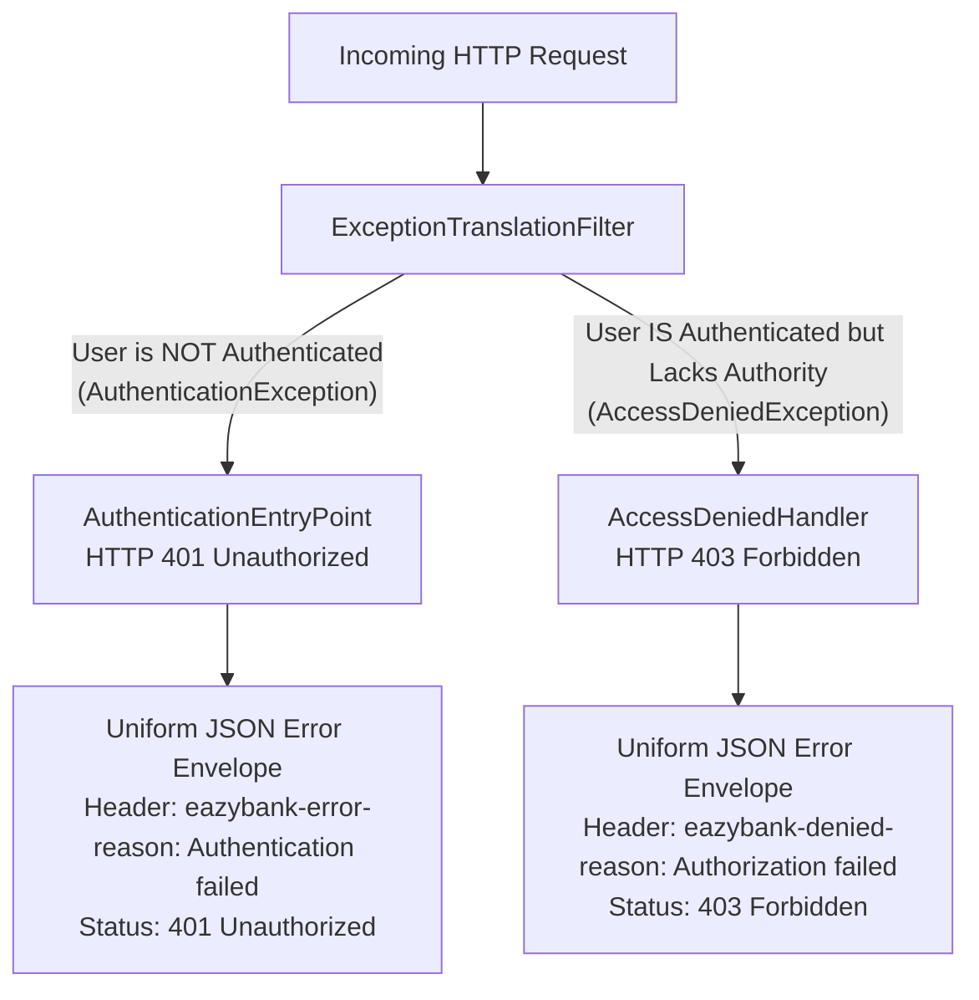
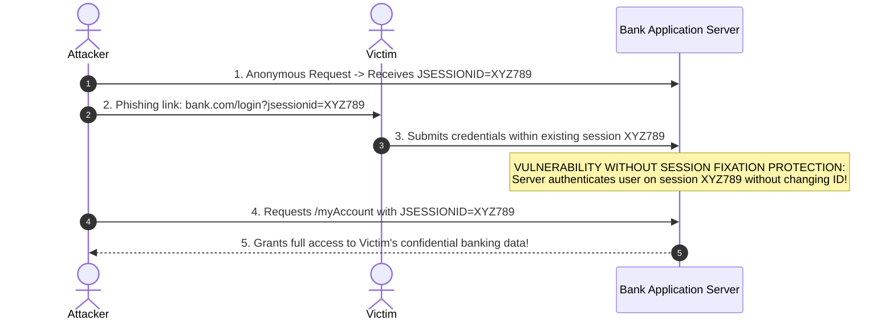
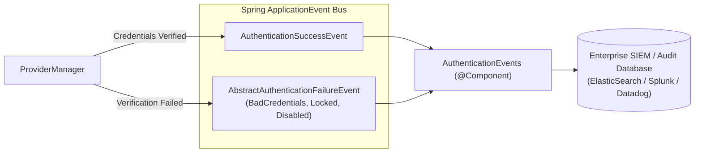
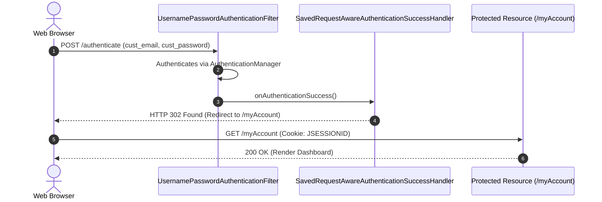

# Section 7: Exception Handling, Events, Session Security & Context Architecture

## 1. Transport Layer Security (TLS) & HTTPS Enforcement 

In enterprise web architectures, all application security rests upon the integrity of the transport layer. Transmitting credentials, authorization tokens, or session identifiers over unencrypted HTTP exposes the application to eavesdropping, packet sniffing, and man-in-the-middle (MITM) attacks.

Spring Security provides declarative mechanisms to enforce HTTPS across incoming HTTP traffic:

```java
@Bean
SecurityFilterChain securityFilterChain(HttpSecurity http) throws Exception {
    http
        // Enforce HTTPS across all incoming requests
        .redirectToHttps(https -> https
            .httpsRedirectWhen(request -> request.getHeader("X-Forwarded-Proto") != null 
                    ? request.getHeader("X-Forwarded-Proto").equals("http") 
                    : !request.isSecure())
        );
    return http.build();
}
```

### Local Development vs Production SSL/TLS
In local development environments without SSL certificates, HTTPS redirection can be disabled explicitly:
```java
// Disabled for local development / testing profiles
http.redirectToHttps(https -> https.disable());
```
In production, Spring Boot enables HTTPS via `application.properties` with an embedded keystore:
```properties
server.port=8443
server.ssl.key-store=classpath:keystore.p12
server.ssl.key-store-password=changeit
server.ssl.key-store-type=PKCS12
server.ssl.key-alias=apexbank
```

---

## 2. Enterprise Exception Translation: 401 Unauthorized vs 403 Forbidden

In standard RESTful web services, Spring Security's default exception handling causes severe integration issues with frontends and mobile clients:

- For unauthenticated requests, it often issues an HTTP 302 Redirect to `/login` with an HTML body, breaking JSON parsers.
- For unauthorized requests, it outputs a generic HTML error page or blank HTTP 403 response without diagnostic codes.

Spring Security encapsulates security exception handling within **`ExceptionTranslationFilter`**, which delegates to two distinct strategy interfaces:



### 2.1 Custom `AuthenticationEntryPoint` (HTTP 401 Unauthorized)
`AuthenticationEntryPoint` is triggered when an unauthenticated client attempts to access a protected resource without valid credentials or with invalid credentials:

```java
package com.eazybytes.exceptionhandling;

import jakarta.servlet.ServletException;
import jakarta.servlet.http.HttpServletRequest;
import jakarta.servlet.http.HttpServletResponse;
import org.springframework.http.HttpStatus;
import org.springframework.security.core.AuthenticationException;
import org.springframework.security.web.AuthenticationEntryPoint;

import java.io.IOException;
import java.time.LocalDateTime;

public class CustomBasicAuthenticationEntryPoint implements AuthenticationEntryPoint {

    @Override
    public void commence(HttpServletRequest request, HttpServletResponse response,
                         AuthenticationException authException) throws IOException, ServletException {
        LocalDateTime currentTimeStamp = LocalDateTime.now();
        String message = (authException != null && authException.getMessage() != null)
                ? authException.getMessage() : "Unauthorized";
        String path = request.getRequestURI();

        // 1. Diagnostic custom security header
        response.setHeader("eazybank-error-reason", "Authentication failed");
        response.setStatus(HttpStatus.UNAUTHORIZED.value());
        response.setContentType("application/json;charset=UTF-8");

        // 2. Structured JSON error envelope
        String jsonResponse = String.format(
                "{\"timestamp\": \"%s\", \"status\": %d, \"error\": \"%s\", \"message\": \"%s\", \"path\": \"%s\"}",
                currentTimeStamp, HttpStatus.UNAUTHORIZED.value(),
                HttpStatus.UNAUTHORIZED.getReasonPhrase(), message, path);

        response.getWriter().write(jsonResponse);
    }
}
```

### 2.2 Custom `AccessDeniedHandler` (HTTP 403 Forbidden)
`AccessDeniedHandler` is invoked when an authenticated user attempts to access an endpoint for which they lack the required roles or permissions:

```java
package com.eazybytes.exceptionhandling;

import jakarta.servlet.ServletException;
import jakarta.servlet.http.HttpServletRequest;
import jakarta.servlet.http.HttpServletResponse;
import org.springframework.http.HttpStatus;
import org.springframework.security.access.AccessDeniedException;
import org.springframework.security.web.access.AccessDeniedHandler;

import java.io.IOException;
import java.time.LocalDateTime;

public class CustomAccessDeniedHandler implements AccessDeniedHandler {

    @Override
    public void handle(HttpServletRequest request, HttpServletResponse response,
                       AccessDeniedException accessDeniedException) throws IOException, ServletException {
        LocalDateTime currentTimeStamp = LocalDateTime.now();
        String message = (accessDeniedException != null && accessDeniedException.getMessage() != null)
                ? accessDeniedException.getMessage() : "Authorization failed";
        String path = request.getRequestURI();

        // 1. Diagnostic custom security header
        response.setHeader("eazybank-denied-reason", "Authorization failed");
        response.setStatus(HttpStatus.FORBIDDEN.value());
        response.setContentType("application/json;charset=UTF-8");

        // 2. Structured JSON error envelope
        String jsonResponse = String.format(
                "{\"timestamp\": \"%s\", \"status\": %d, \"error\": \"%s\", \"message\": \"%s\", \"path\": \"%s\"}",
                currentTimeStamp, HttpStatus.FORBIDDEN.value(),
                HttpStatus.FORBIDDEN.getReasonPhrase(), message, path);

        response.getWriter().write(jsonResponse);
    }
}
```

### 2.3 Registration in `SecurityFilterChain`
Both handlers can be configured explicitly on `httpBasic()` and on the global `exceptionHandling()` DSL:

```java
@Bean
SecurityFilterChain defaultSecurityFilterChain(HttpSecurity http) throws Exception {
    http
        .httpBasic(hbc -> hbc.authenticationEntryPoint(new CustomBasicAuthenticationEntryPoint()))
        .exceptionHandling(ehc -> ehc
            .authenticationEntryPoint(new CustomBasicAuthenticationEntryPoint())
            .accessDeniedHandler(new CustomAccessDeniedHandler())
        );
    return http.build();
}
```

---

## 3. Session Management Architecture & Attack Mitigations

In stateful applications, user authentication is stored in the servlet container's `HttpSession`. Session management encompasses timeout enforcement, session fixation defense, and concurrent session limits.

### 3.1 Session Fixation: The Attack & Countermeasures
In a **Session Fixation** attack, an adversary tricks a user into authenticating within an already existing session ID controlled by the attacker:



#### Spring Security Fixation Defense
To neutralize this vector, Spring Security generates a completely new session ID upon authentication:

```java
http.sessionManagement(sm -> sm
    .sessionFixation(sf -> sf.changeSessionId())
);
```

| Fixation Policy | Technical Mechanic | Enterprise Evaluation |
| :--- | :--- | :--- |
| **`changeSessionId()`** | Calls Servlet 3.1+ `HttpServletRequest.changeSessionId()`. Retains existing session attributes but assigns a new ID. | **Default & Recommended.** Zero overhead, optimal performance. |
| **`migrateSession()`** | Creates a new `HttpSession` and copies attributes from the old session. | Used on legacy Servlet < 3.1 containers. |
| **`newSession()`** | Creates an empty new session, discarding all existing attributes. | Used in high-security military/banking where pre-auth attributes must be purged. |
| **`none()`** | Leaves the session ID unchanged. | **STRICTLY PROHIBITED.** Leaves application vulnerable to session fixation. |

---

### 3.2 Session Hijacking vs Session Fixation
Engineers must distinguish Session Fixation from **Session Hijacking**:

- **Session Fixation:** The attacker sets the victim's session ID *before* login.
- **Session Hijacking:** The attacker steals an active session ID *after* login (via XSS, insecure network packet sniffing, or physical device access).

#### Defense-in-Depth for Session Hijacking

1. **Enforce HTTPS (TLS):** Prevents network sniffing of `JSESSIONID` cookies.
2. **`Secure` Cookie Flag:** Browser transmits cookie only over HTTPS.
3. **`HttpOnly` Cookie Flag:** Blocks JavaScript (`document.cookie`) from accessing session tokens, neutralizing Cross-Site Scripting (XSS) session theft.
4. **`SameSite=Strict` Cookie Flag:** Prevents browser from sending session cookies on cross-origin requests, thwarting CSRF.

```properties
# application.properties
server.servlet.session.cookie.http-only=true
server.servlet.session.cookie.secure=true
server.servlet.session.cookie.same-site=strict
server.servlet.session.timeout=15m
```

---

### 3.3 Concurrent Session Control & Invalidation
To prevent credential sharing and limit the window of opportunity for stolen sessions, Spring Security provides concurrent session controls:

```java
http.sessionManagement(smc -> smc
    .invalidSessionUrl("/invalidSession")
    .maximumSessions(1)
    .maxSessionsPreventsLogin(true)
);
```

- **`maximumSessions(1)`:** Restricts each account to at most 1 active concurrent session.
- **`maxSessionsPreventsLogin(true)`:** When user `admin` is logged in, a second login attempt from another browser is **rejected** with an authentication error.
- **`maxSessionsPreventsLogin(false)`:** The second login succeeds, but the first user's session is invalidated; the next request from the first session redirects to `invalidSessionUrl("/invalidSession")`.

!!! important "The Mandatory HttpSessionEventPublisher Bean"
    For `maximumSessions()` to track active sessions accurately, you **must register** a `HttpSessionEventPublisher` bean. This listener informs Spring Security's `SessionRegistry` whenever sessions are created or destroyed by Tomcat:
    ```java
    @Bean
    public HttpSessionEventPublisher httpSessionEventPublisher() {
        return new HttpSessionEventPublisher();
    }
    ```

---

### 3.4 Session Creation Policies (`SessionCreationPolicy`)

```java
http.sessionManagement(sm -> sm
    .sessionCreationPolicy(SessionCreationPolicy.IF_REQUIRED)
);
```

| Policy | Behavior | Production Architectural Context |
| :--- | :--- | :--- |
| **`ALWAYS`** | Guarantees an `HttpSession` is created if one does not exist. | Legacy stateful monolithic web applications. |
| **`IF_REQUIRED`** | **Default.** Creates session only if Spring Security needs to store context. | Standard Spring MVC form login applications. |
| **`NEVER`** | Spring Security will never create a session, but will use an existing one if present. | Hybrid proxy systems. |
| **`STATELESS`** | Strictly **no session** created or used. `SecurityContext` is not stored in `HttpSession`. | **Stateless REST APIs & JWT Architectures.** Every request must present credentials/tokens. |

---

## 4. Security Event Telemetry & Audit Logging 

Regulated financial platforms (PCI-DSS, SOC 2, ISO 27001) mandate comprehensive audit logging for all authentication events. Spring Security integrates natively with Spring Framework's **`ApplicationEvent`** publishing system.



### Implementing `AuthenticationEvents.java`

```java
package com.eazybytes.events;

import lombok.extern.slf4j.Slf4j;
import org.springframework.context.event.EventListener;
import org.springframework.security.authentication.event.AbstractAuthenticationFailureEvent;
import org.springframework.security.authentication.event.AuthenticationSuccessEvent;
import org.springframework.stereotype.Component;

@Component
@Slf4j
public class AuthenticationEvents {

    @EventListener
    public void onSuccess(AuthenticationSuccessEvent successEvent) {
        log.info("AUTHENTICATION_SUCCESS: User '{}' logged in successfully. Authorities: {}",
                successEvent.getAuthentication().getName(),
                successEvent.getAuthentication().getAuthorities());
    }

    @EventListener
    public void onFailure(AbstractAuthenticationFailureEvent failureEvent) {
        log.error("AUTHENTICATION_FAILURE: Login failed for user '{}' due to: {}",
                failureEvent.getAuthentication().getName(),
                failureEvent.getException().getMessage());
    }
}
```

### Granular Failure Subclasses
`AbstractAuthenticationFailureEvent` provides fine-grained event types:

- **`AuthenticationFailureBadCredentialsEvent`:** Incorrect password submitted.
- **`AuthenticationFailureLockedEvent`:** Attempted login to a locked account.
- **`AuthenticationFailureDisabledEvent`:** Attempted login to a deactivated account.
- **`AuthenticationFailureExpiredEvent`:** Credentials expired.

---

## 5. Form Login & Logout Lifecycle Customization

In monolithic Spring MVC applications with server-side views (Thymeleaf, JSP), user authentication and session termination are managed through custom login and logout flows.

### 5.1 Customizing Form Login

```java
http.formLogin(fl -> fl
    .loginPage("/login")                      // Custom login page URL
    .loginProcessingUrl("/authenticate")      // Form action URL handled by UsernamePasswordAuthenticationFilter
    .usernameParameter("cust_email")          // Custom username parameter name
    .passwordParameter("cust_password")       // Custom password parameter name
    .defaultSuccessUrl("/myAccount", true)    // Landing page on success (true forces redirect)
    .failureUrl("/login?error=true")          // Destination on authentication failure
    .permitAll()                              // Login page must be publicly accessible!
);
```



### 5.2 Customizing Logout

Logging out requires terminating the security context, invalidating the session, and clearing browser cookies:

```java
http.logout(lo -> lo
    .logoutUrl("/logout")                     // URL triggering logout (POST recommended)
    .logoutSuccessUrl("/login?logout=true")   // Destination after logout
    .invalidateHttpSession(true)              // Invalidate servlet session
    .clearAuthentication(true)                // Erase Authentication from SecurityContext
    .deleteCookies("JSESSIONID", "XSRF-TOKEN")// Purge cookies from browser
    .permitAll()
);
```

!!! tip "Security Best Practice: POST for Logout"
    Always trigger `/logout` via HTTP `POST` with CSRF protection enabled. Using HTTP `GET` for logout creates a vulnerability where attackers can embed `` on malicious pages to trigger silent denial of service (forced logouts) on victims.

---

## 6. `SecurityContext` & `SecurityContextHolder` Architecture 

The `SecurityContext` holds the `Authentication` token of the currently authenticated principal. It is managed by `SecurityContextHolder`.

### Storage Strategies (`SecurityContextHolderStrategy`)

Spring Security configures storage strategies via the system property `spring.security.strategy`:

```java
SecurityContextHolder.setStrategyName(SecurityContextHolder.MODE_THREADLOCAL);
```

| Strategy Mode | Storage Mechanism | Architectural Use Case |
| :--- | :--- | :--- |
| **`MODE_THREADLOCAL`** | Standard `ThreadLocal` variable per thread. | **Default.** Optimal for traditional Servlet applications where each HTTP request runs on a dedicated thread. |
| **`MODE_INHERITABLETHREADLOCAL`** | `InheritableThreadLocal` variable. Child threads inherit context from parent thread. | Multi-threaded asynchronous tasks spawned directly by parent thread. |
| **`MODE_GLOBAL`** | Static class-level variable shared across all JVM threads. | Standalone desktop applications (Swing / JavaFX) where all threads represent the same single user. |

### Spring Security 6 Explicit Save Optimization: `requireExplicitSave`
In Spring Security 5, `SecurityContextPersistenceFilter` implicitly wrote the `SecurityContext` back to the `HttpSession` at the conclusion of every request, even if the security context was never modified.

In **Spring Security 6**, the new `SecurityContextHolderFilter` delegates to `SecurityContextRepository`. To optimize performance:
```java
http.securityContext(context -> context.requireExplicitSave(false));
```
When `requireExplicitSave` is `true` (modern default), custom filters or authentication mechanisms that modify the `SecurityContext` programmatically must explicitly call:
```java
securityContextRepository.saveContext(context, request, response);
```

---

## 7. The 5 Patterns for Accessing Authenticated Identity in Code

How should enterprise developers extract the currently authenticated user in controllers, services, and business components? There are 5 primary architectural patterns:

### Pattern 1: Static Access via `SecurityContextHolder` (Global Scope)
Usable anywhere in the execution thread (Controllers, Services, Repositories, Helpers):

```java
@Service
public class AccountServiceImpl implements AccountService {

    public String getCurrentUserEmail() {
        Authentication auth = SecurityContextHolder.getContext().getAuthentication();
        if (auth != null && auth.isAuthenticated()) {
            return auth.getName(); // Returns principal identifier (e.g. email)
        }
        throw new AccessDeniedException("No authenticated principal found in SecurityContext.");
    }
}
```

### Pattern 2: Method Parameter Injection (`Authentication`)
Spring MVC automatically resolves the current `Authentication` bean into controller handler parameters:

```java
@GetMapping("/myAccount")
public String getAccount(Authentication authentication) {
    String username = authentication.getName();
    Collection<? extends GrantedAuthority> authorities = authentication.getAuthorities();
    return "Account details for: " + username;
}
```

### Pattern 3: Method Parameter Injection (`Principal`)
Standard Java EE / Jakarta EE contract (`java.security.Principal`), decoupling code from Spring Security APIs:

```java
@GetMapping("/myProfile")
public String getProfile(Principal principal) {
    return "Current user: " + principal.getName();
}
```

### Pattern 4: The `@AuthenticationPrincipal` Annotation (Recommended)
Injects the principal object (`UserDetails` or domain entity) directly, eliminating manual casting:

```java
@GetMapping("/customerDetails")
public CustomerDTO getCustomerDetails(@AuthenticationPrincipal UserDetails userDetails) {
    return new CustomerDTO(userDetails.getUsername(), userDetails.getAuthorities());
}
```

If your custom `UserDetailsService` returns a custom domain class (e.g., `BankCustomerDetails`), `@AuthenticationPrincipal` injects that custom class directly:
```java
@GetMapping("/bankingTier")
public String getTier(@AuthenticationPrincipal BankCustomerDetails customer) {
    return "Welcome " + customer.getFullName() + " | Account ID: " + customer.getAccountId();
}
```

### Pattern 5: Servlet API Injection (`HttpServletRequest`)
Utilizing standard Servlet 3.0+ API methods on injected `HttpServletRequest`:

```java
@GetMapping("/checkRole")
public String checkAdmin(HttpServletRequest request) {
    Principal principal = request.getUserPrincipal();
    boolean isAdmin = request.isUserInRole("ADMIN");
    return "User: " + principal.getName() + " | Is Admin: " + isAdmin;
}
```

### Architectural Comparison of Identity Access Patterns

| Pattern | API Coupling | Testability | Layer Applicability | Recommended Use |
| :--- | :--- | :--- | :--- | :--- |
| **`SecurityContextHolder`** | Tightly coupled to Spring Security static API. | Requires static mocking (`mockStatic`) in unit tests. | Anywhere in JVM thread (Services, DAOs). | Background service logic where controller injection is impossible. |
| **`Authentication` Param** | Coupled to Spring Security. | High (pass mock `Authentication` object). | Controllers only. | When accessing authorities and token metadata simultaneously. |
| **`Principal` Param** | Standards-compliant (`java.security`). | High. | Controllers only. | Portable code requiring only username. |
| **`@AuthenticationPrincipal`** | Clean Spring MVC annotation. | Very High (pass mock `UserDetails` / POJO). | Controllers only. | **Clean Architecture Standard.** Injects typed domain user directly. |
| **`HttpServletRequest`** | Coupled to Servlet API. | Moderate. | Controllers only. | Legacy Servlet migrations. |
