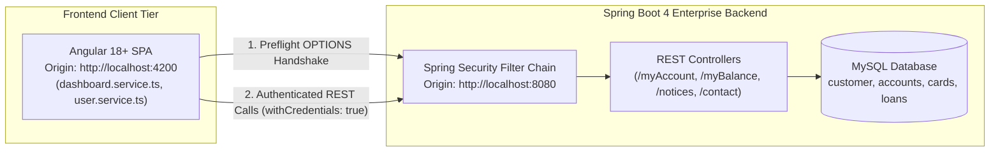
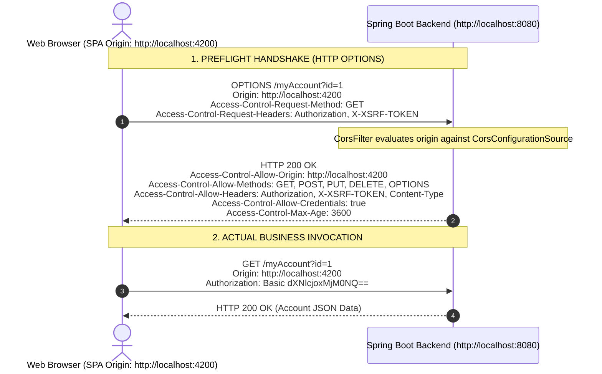
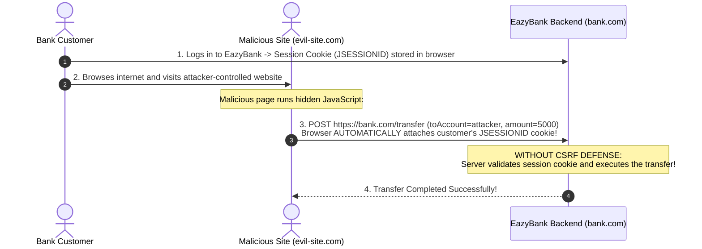
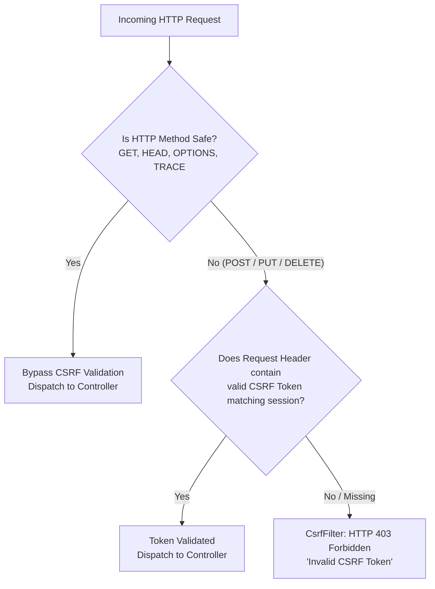
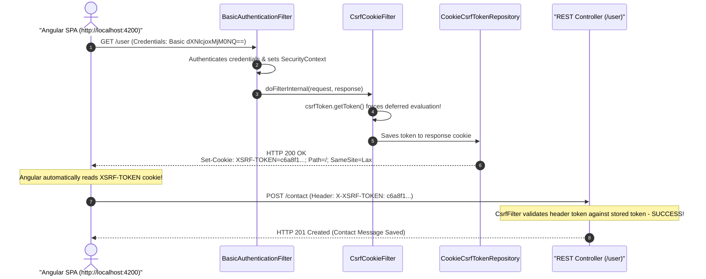

# Section 8: CORS & CSRF Defense-in-Depth for Single-Page Applications

## 1. Enterprise Architecture: Decoupled Single-Page Applications (SPA) & REST Backends 

In modern enterprise systems, user interfaces are rarely rendered server-side by the monolithic backend. Instead, architectures decouple into:

- **Client Frontend:** Single-Page Applications (Angular, React, Vue) served from dedicated static hosting or CDNs (e.g., `http://localhost:4200` in development).
- **Resource Server / Backend:** Spring Boot microservices providing RESTful endpoints (e.g., `http://localhost:8080`).



### The Angular Client Configuration: `withCredentials`
Because the frontend and backend run on disparate origins, the browser isolates network requests. By default, browser `fetch` and `XMLHttpRequest` calls **strip ambient cookies and authorization headers** across origins.

In Angular, the client must explicitly enable credential forwarding:
```typescript
// Angular dashboard.service.ts
return this.http.get<Account[]>(`${environment.rootUrl}/myAccount?id=${id}`, {
    withCredentials: true // Mandatory: instructs browser to include JSESSIONID & Basic Auth
});
```

### Expanded Banking Domain Entities & Endpoints
In Section 8, the EazyBank schema expands to support complete retail banking operations:

- **`AccountController` (`GET /myAccount?id=X`):** Returns primary checking/savings account details.
- **`BalanceController` (`GET /myBalance?id=X`):** Returns historical transactions and account balance.
- **`CardsController` (`GET /myCards?id=X`):** Returns outstanding card balances and credit limits.
- **`LoansController` (`GET /myLoans?id=X`):** Returns active loan repayments and outstanding amounts.
- **`NoticesController` (`GET /notices`):** Returns active public bank bulletins with HTTP caching (`CacheControl.maxAge(60, TimeUnit.SECONDS)`).
- **`ContactController` (`POST /contact`):** Ingests customer support inquiries, generating a unique tracking identifier (`SR123456789`).

```java
@RestController
@RequiredArgsConstructor
public class NoticesController {

    private final NoticeRepository noticeRepository;

    @GetMapping("/notices")
    public ResponseEntity<List<Notice>> getNotices() {
        List<Notice> notices = noticeRepository.findAllActiveNotices();
        return ResponseEntity.ok()
                // HTTP 1.1 Cache-Control Header
                .cacheControl(CacheControl.maxAge(60, TimeUnit.SECONDS))
                .body(notices);
    }
}
```

---

## 2. Browser Security Foundations: The Same-Origin Policy (SOP) 

When developers first connect an Angular SPA (`http://localhost:4200`) to a Spring Boot backend (`http://localhost:8080`), browser developer tools immediately display the classic cross-origin error:

```text
Access to XMLHttpRequest at 'http://localhost:8080/myAccount?id=1' from origin 'http://localhost:4200' 
has been blocked by CORS policy: No 'Access-Control-Allow-Origin' header is present on the requested resource.
```

To understand this error, engineers must master the browser's **Same-Origin Policy (SOP)**.

### The Origin Tuple: Scheme + Host + Port
An Origin is defined strictly by three components:
$$\text{Origin} = \langle \text{Scheme}, \text{Host}, \text{Port} \rangle$$

```text
http://localhost:4200
\__/   \_______/ \__/
 |         |       |
Scheme    Host    Port
```

Two requests share the *same origin* if and only if all three components match identically:

| Target Resource URL (Compared to `http://bank.com:8080`) | Classification | Reason |
| :--- | :--- | :--- |
| `http://bank.com:8080/api/v1/accounts` | **Same Origin** | Protocol, host, and port match. |
| `https://bank.com:8080/api/v1/accounts` | **Cross-Origin** | Protocol mismatch (`http` vs `https`). |
| `http://api.bank.com:8080/api/v1/accounts` | **Cross-Origin** | Host mismatch (`bank.com` vs `api.bank.com`). |
| `http://bank.com:9090/api/v1/accounts` | **Cross-Origin** | Port mismatch (`8080` vs `9090`). |
| `http://localhost:4200` vs `http://localhost:8080` | **Cross-Origin** | Port mismatch (`4200` vs `8080`). |

### Why Browsers Enforce SOP
The Same-Origin Policy is the cornerstone of web application security. It prevents a malicious script executing on `evil-site.com` from issuing asynchronous requests to `mybank.com/api/balance` and reading the customer's private account balance. Under SOP, while `evil-site.com` can *send* requests, the browser **strictly blocks it from reading the response** unless the server explicitly permits it via CORS.

---

## 3. Cross-Origin Resource Sharing (CORS) Mechanics 

**CORS** is a standardized W3C mechanism that enables servers to selectively relax SOP restrictions for trusted external origins.

### Simple Requests vs Preflight `OPTIONS` Handshakes
Browsers classify cross-origin HTTP calls into two categories:

1. **Simple Requests:** Uses standard methods (`GET`, `HEAD`, `POST`) with standard headers (`Accept`, `Content-Type: application/x-www-form-urlencoded`). The browser sends the request directly with an `Origin` header.
2. **Preflighted Requests (Non-Simple):** Any request using:
   - Methods other than GET/POST (e.g., `PUT`, `DELETE`, `PATCH`).
   - Custom HTTP headers (e.g., `Authorization`, `X-XSRF-TOKEN`).
   - Content types other than form data (e.g., `application/json`).

Because modern REST APIs use `application/json` and `Authorization` headers, **every modern SPA request triggers a preflight handshake**:



### Architectural Approaches to Resolve CORS

| Approach | Architecture | Trade-offs & Production Suitability |
| :--- | :--- | :--- |
| **1. Reverse Proxy / Gateway** | Nginx, Envoy, or Spring Cloud Gateway routes both frontend (`/`) and backend (`/api`) under the identical origin. | **Ideal for Production.** Completely eliminates cross-origin browser restrictions. |
| **2. Controller `@CrossOrigin`** | Placing `@CrossOrigin(origins = "...")` on individual controllers or methods. | **Anti-Pattern for Enterprise.** Scattered annotations across dozens of controllers; preflight errors often slip through filters. |
| **3. Global Security CORS** | Declaring a global `CorsConfigurationSource` inside the `SecurityFilterChain`. | **Recommended Architecture.** Centralized, consistent, and executes at the very front of the security pipeline before auth filters. |

### Global Spring Security CORS Implementation

```java
@Configuration
public class ProjectSecurityConfig {

    @Bean
    SecurityFilterChain defaultSecurityFilterChain(HttpSecurity http) throws Exception {
        http
            .cors(corsConfig -> corsConfig.configurationSource(new CorsConfigurationSource() {
                @Override
                public CorsConfiguration getCorsConfiguration(HttpServletRequest request) {
                    CorsConfiguration config = new CorsConfiguration();
                    
                    // 1. Whitelist trusted frontend origin
                    config.setAllowedOrigins(Collections.singletonList("http://localhost:4200"));
                    
                    // 2. Allow all HTTP verbs (GET, POST, PUT, DELETE, OPTIONS)
                    config.setAllowedMethods(Collections.singletonList("*"));
                    
                    // 3. Allow ambient credentials (cookies, authorization headers)
                    config.setAllowCredentials(true);
                    
                    // 4. Permit incoming headers sent by Angular
                    config.setAllowedHeaders(Collections.singletonList("*"));
                    
                    // 5. Cache preflight OPTIONS response for 1 hour (3600 seconds)
                    config.setMaxAge(3600L);
                    
                    return config;
                }
            }));
        return http.build();
    }
}
```

!!! caution "The AllowCredentials Wildcard Security Violation"
    If `config.setAllowCredentials(true)` is enabled, the W3C CORS specification **strictly forbids setting the allowed origin to wildcard (`*`)**:
    ```java
    // SECURITY BUG: Browser will reject response!
    config.setAllowCredentials(true);
    config.setAllowedOrigins(List.of("*")); // FORBIDDEN!
    ```
    When credentials (cookies/auth headers) are allowed, the browser mandates an explicit, non-wildcard origin (`http://localhost:4200` or production domain URLs).

---

## 4. Cross-Site Request Forgery (CSRF): Threat Vector & Vulnerability Anatomy 

Engineers must understand the fundamental difference between CORS and CSRF:

- **CORS** is a browser mechanism that *protects data from being read* by unauthorized origins.
- **CSRF** is an active attack vector that *executes unauthorized mutations* on behalf of an authenticated user.

### Anatomy of a CSRF Exploit



### Why CSRF Works
Browsers are designed to automatically attach all cookies belonging to `bank.com` to **every outgoing HTTP request** sent to `bank.com`, regardless of whether the request originated from `bank.com` or `evil-site.com`. The bank's server validates the incoming `JSESSIONID` cookie and assumes the authenticated customer intended the transaction.

---

## 5. The Synchronizer Token Pattern 

To defeat CSRF, Spring Security implements the **Synchronizer Token Pattern**. The server generates a unique, cryptographically random, unpredictable token per user session:

$$\text{CSRF Token} = \text{CryptographicRandomNonce()}$$

1. The server delivers this token to the authenticated frontend application.
2. For all **state-mutating HTTP requests** (`POST`, `PUT`, `DELETE`, `PATCH`), the client must read this token and transmit it back in a custom HTTP header (`X-XSRF-TOKEN` or `X-CSRF-TOKEN`).
3. Under the Same-Origin Policy, third-party sites (`evil-site.com`) are **strictly blocked from reading cookies or headers** from `bank.com`. Consequently, an attacker cannot discover or forge the CSRF token.
4. When a mutating request arrives, Spring Security's `CsrfFilter` compares the header token with the session token. If the token is missing or mismatched, the request is terminated with **HTTP 403 Forbidden**.

### Safe vs Mutating HTTP Verbs

- **Safe (Read-Only) Methods:** `GET`, `HEAD`, `OPTIONS`, `TRACE` do not modify server state and are **exempt** from CSRF validation.
- **Mutating (State-Changing) Methods:** `POST`, `PUT`, `DELETE`, `PATCH` **strictly mandate** CSRF token validation.



---

## 6. Frontend SPA Adoption: Angular's `HttpClientXsrfModule` 

Single-Page Applications require an automated mechanism to read and transmit CSRF tokens without requiring developers to manually attach headers to every single HTTP call.

Angular provides automated CSRF protection through its `HttpClientXsrfModule`:

1. When Angular initializes, it inspects browser cookies for a cookie named **`XSRF-TOKEN`**.
2. For every mutating HTTP request (`POST`, `PUT`, `DELETE`, `PATCH`), Angular's HTTP interceptor extracts the value of the `XSRF-TOKEN` cookie and automatically appends it as an HTTP request header named **`X-XSRF-TOKEN`**.
3. Because the cookie was written by the backend domain, Angular (running in the user's browser) can read it, but malicious external sites cannot.

---

## 7. The Spring Security 6 Deferred CSRF Token Trap & `CsrfCookieFilter` 

In **Spring Security 6**, the framework introduced an optimization called **Deferred CSRF Tokens**:

```java
// Spring Security 6 Default Token Handler
CsrfTokenRequestAttributeHandler csrfHandler = new CsrfTokenRequestAttributeHandler();
```

To reduce overhead on read-only requests, Spring Security 6 **defers the generation and storage of the CSRF token** until an application component explicitly asks for it (e.g., in a Thymeleaf template evaluating `${_csrf.token}`).

### The Fatal SPA Trap
In a pure Single-Page Application (Angular/React), the frontend communicates strictly via REST APIs. The very first request is typically an unauthenticated or authenticated `GET` call (e.g., `GET /notices` or `GET /user`).

**Because a standard REST `GET` endpoint never explicitly accesses the deferred CSRF token attribute, Spring Security 6 never resolves the token, and NEVER writes the `XSRF-TOKEN` cookie!**

When the user subsequently clicks "Submit" to send a `POST /contact` or `POST /transfer`, Angular finds no `XSRF-TOKEN` cookie, sends no `X-XSRF-TOKEN` header, and the request fails with **HTTP 403 Forbidden**!

### The Architectural Solution: `CsrfCookieFilter`

To resolve this issue, we construct a custom servlet filter extending `OncePerRequestFilter`. The filter intercepts incoming requests and invokes `csrfToken.getToken()`, forcing evaluation of the deferred supplier and triggering `CookieCsrfTokenRepository` to commit the `XSRF-TOKEN` cookie to the HTTP response:

```java
package com.eazybytes.filter;

import jakarta.servlet.FilterChain;
import jakarta.servlet.ServletException;
import jakarta.servlet.http.HttpServletRequest;
import jakarta.servlet.http.HttpServletResponse;
import org.springframework.security.web.csrf.CsrfToken;
import org.springframework.web.filter.OncePerRequestFilter;

import java.io.IOException;

public class CsrfCookieFilter extends OncePerRequestFilter {

    @Override
    protected void doFilterInternal(HttpServletRequest request, HttpServletResponse response,
                                    FilterChain filterChain) throws ServletException, IOException {
        // 1. Retrieve the deferred CsrfToken from request attributes
        CsrfToken csrfToken = (CsrfToken) request.getAttribute(CsrfToken.class.getName());

        // 2. Calling getToken() forces the deferred supplier to evaluate,
        // causing CookieCsrfTokenRepository to append Set-Cookie: XSRF-TOKEN=...
        if (csrfToken != null) {
            csrfToken.getToken();
        }

        // 3. Continue downstream filter chain execution
        filterChain.doFilter(request, response);
    }
}
```

### Complete Spring Security 6/7 CSRF Configuration

```java
@Configuration
public class ProjectSecurityConfig {

    @Bean
    SecurityFilterChain defaultSecurityFilterChain(HttpSecurity http) throws Exception {
        CsrfTokenRequestAttributeHandler csrfTokenRequestAttributeHandler =
                new CsrfTokenRequestAttributeHandler();

        http
            .securityContext(context -> context.requireExplicitSave(false))
            .sessionManagement(session -> session.sessionCreationPolicy(SessionCreationPolicy.ALWAYS))
            .csrf(csrfConfig -> csrfConfig
                .csrfTokenRequestHandler(csrfTokenRequestAttributeHandler)
                // Exempt public ingestion endpoints that don't rely on ambient browser cookies
                .ignoringRequestMatchers("/contact", "/register")
                // Store token in cookie with HttpOnly=false so Angular can read it
                .csrfTokenRepository(CookieCsrfTokenRepository.withHttpOnlyFalse())
            )
            // Position CsrfCookieFilter directly after BasicAuthenticationFilter
            .addFilterAfter(new CsrfCookieFilter(), BasicAuthenticationFilter.class);

        return http.build();
    }
}
```



!!! important "CookieCsrfTokenRepository.withHttpOnlyFalse() Rationale"
    By default, browser security best practices dictate setting `HttpOnly` on sensitive session identifiers (`JSESSIONID`) to prevent Cross-Site Scripting (XSS) attacks from stealing sessions. However, the CSRF token **must be accessible to client-side JavaScript** so Angular's `HttpClientXsrfModule` can read it and inject it into the `X-XSRF-TOKEN` header. Therefore, `CookieCsrfTokenRepository.withHttpOnlyFalse()` is an essential requirement for Single-Page Application architectures.
