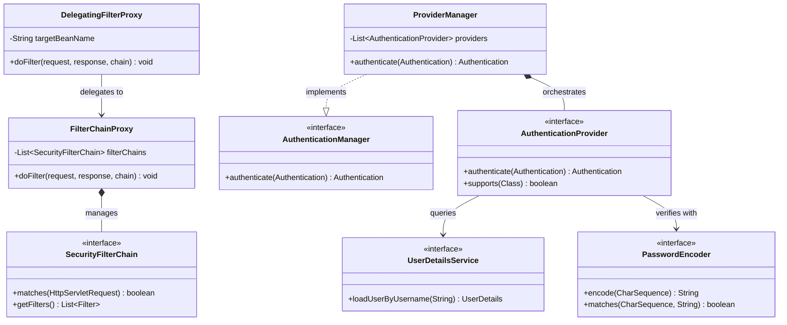
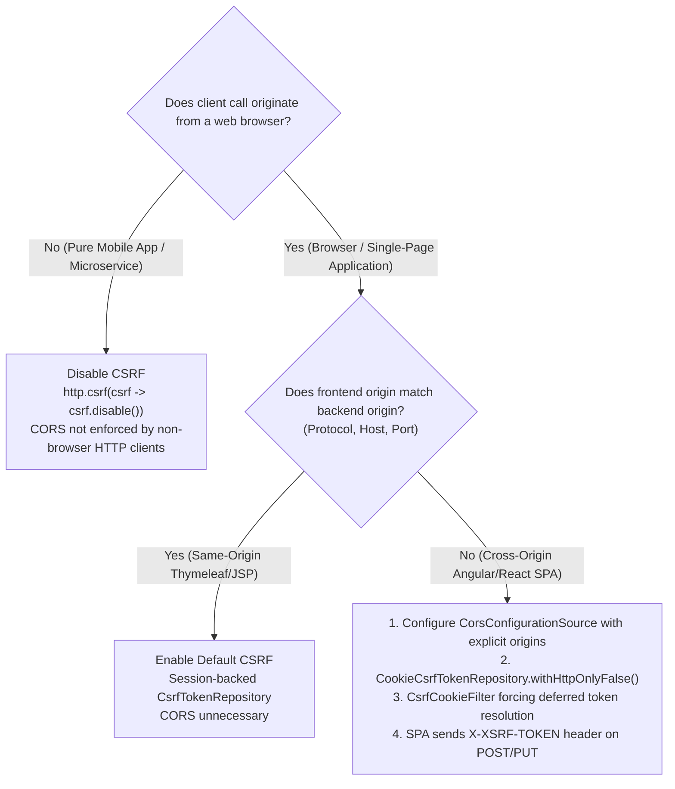
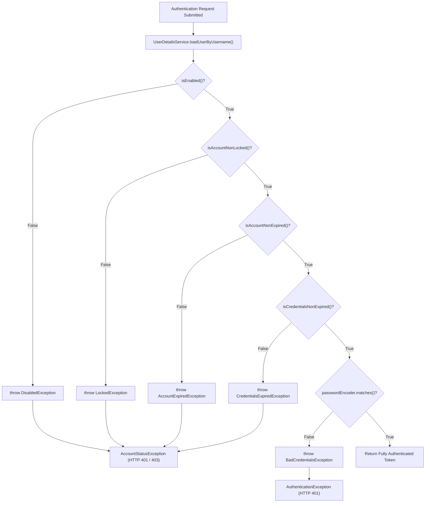

# Week 11 Summary & Architectural Reference

## 1. Core Spring Security Architecture Matrix



| Component | Layer / Scope | Primary Architectural Responsibility |
| :--- | :--- | :--- |
| **`DelegatingFilterProxy`** | Servlet Container | Standard Servlet Filter that acts as the physical bridge, delegating execution to the Spring bean `springSecurityFilterChain`. |
| **`FilterChainProxy`** | Spring IoC Container | The master orchestrator holding all `SecurityFilterChain` beans, selecting matching chains, and managing `SecurityContext` cleanup. |
| **`SecurityFilterChain`** | Spring Security | An ordered collection of security filters evaluated against specific URL patterns. |
| **`AuthenticationManager`** | Authentication Engine | Main strategy interface for authentication; standard implementation is `ProviderManager`. |
| **`AuthenticationProvider`** | Authentication Logic | Executes credential verification, active account status checks, and returns fully authenticated tokens. |
| **`UserDetailsService`** | Data Access Adapter | Read-only query contract for retrieving user account metadata by username/email. |
| **`PasswordEncoder`** | Cryptography | One-way salted adaptive hashing and constant-time comparison of passwords. |
| **`SecurityContextHolder`** | Thread-Isolated Context | Stores the current `SecurityContext` and `Authentication` token using `ThreadLocal` storage. |

---

## 2. Standard Filter Chain Ordering Ladder

Filters must execute in a strictly defined architectural order:

```mermaid
flowchart TD
    subgraph PERIMETER["1. Transport & Perimeter Guards"]
        direction TB
        F1["DisableEncodeUrlFilter<br/>Index: 100 | Prevents URL Session ID Rewriting"]
        F2["SecurityContextHolderFilter<br/>Index: 300 | Populates SecurityContext from Repository"]
        F3["HeaderWriterFilter<br/>Index: 500 | Injects HSTS, CSP, X-Frame-Options"]
        F4["CorsFilter<br/>Index: 600 | Evaluates Origin & Preflight OPTIONS Handshake"]
        F1 --> F2
        F2 --> F3
        F3 --> F4
    end

    subgraph MUTATION_AUTH["2. Tampering Defenses & Authentication"]
        direction TB
        F5["CsrfFilter<br/>Index: 700 | Validates Synchronizer Token on Mutating Calls"]
        F6["LogoutFilter<br/>Index: 800 | Intercepts /logout & Invalidates Session"]
        F7["Custom Audit Filter (e.g. SecurityAuditFilter)<br/>addFilterBefore(BasicAuth) | Injects Trace ID Header"]
        F8["UsernamePasswordAuthenticationFilter<br/>Index: 1100 | Processes Form Login Credentials"]
        F9["BasicAuthenticationFilter<br/>Index: 1500 | Decodes Base64 Authorization Header"]
        F10["Custom CsrfCookieFilter<br/>addFilterAfter(BasicAuth) | Resolves Deferred CSRF Token"]
        F5 --> F6
        F6 --> F7
        F7 --> F8
        F8 --> F9
        F9 --> F10
    end

    subgraph CONTEXT_GATES["3. Context Restoration & Gatekeepers"]
        direction TB
        F11["RequestCacheAwareFilter<br/>Index: 1600 | Restores Cached Request After Auth"]
        F12["SecurityContextHolderAwareRequestFilter<br/>Index: 1700 | Wraps Request with Servlet API Methods"]
        F13["AnonymousAuthenticationFilter<br/>Index: 1800 | Injects AnonymousAuthenticationToken"]
        F14["SessionManagementFilter<br/>Index: 1900 | Handles Session Fixation & Max Concurrency"]
        F15["ExceptionTranslationFilter<br/>Index: 2000 | Converts Exceptions -> 401/403 Responses"]
        F16["AuthorizationFilter<br/>Index: 2100 | Final Gatekeeper Evaluating requestMatchers()"]
        F11 --> F12
        F12 --> F13
        F13 --> F14
        F14 --> F15
        F15 --> F16
    end

    F4 --> F5
    F10 --> F11
    F16 --> TARGET["Target Controller / Endpoint<br/>(Business Logic Dispatched)"]
```



!!! important "Filter Injection Methods via HttpSecurity"
    When inserting custom filters, always specify their explicit position relative to standard filters:
    - `addFilterBefore(customFilter, TargetFilter.class)`: Runs *before* the target (e.g., injecting trace IDs before authentication).
    - `addFilterAfter(customFilter, TargetFilter.class)`: Runs *after* the target (e.g., resolving deferred CSRF tokens after basic auth).
    - `addFilterAt(customFilter, TargetFilter.class)`: Replaces or runs at the identical ordering index.

---

## 3. Cryptographic Password Storage Reference

```text
$2a$12$88.f6upbBvy0okEa7OfHFuorV29qeK.sVbB9VQ6J6dWM1bW6Qef8m
 \_/ \_/ \____________________/ \_____________________________/
  |   |             |                          |
 Alg Cost     Salt (22 chars)            Hash (31 chars)
```

| Algorithm Prefix | Implementation | Key Properties | Recommended Work Factor |
| :--- | :--- | :--- | :--- |
| **`{bcrypt}`** | `BCryptPasswordEncoder` | Blowfish-based adaptive key stretching with 128-bit salt. | **12** (4,096 rounds, ~100ms CPU latency). |
| **`{argon2}`** | `Argon2PasswordEncoder` | Memory-hard hashing algorithm resistant to GPU/ASIC attacks. | $m=65536, t=3, p=1$. |
| **`{pbkdf2}`** | `Pbkdf2PasswordEncoder` | NIST-approved HMAC key derivation function. | 310,000 iterations. |
| **`{noop}`** | `NoOpPasswordEncoder` | Plain text (zero encryption/hashing). | **PROHIBITED IN PRODUCTION.** |

---

## 4. CORS & CSRF Decision Tree



!!! caution "CSRF Synchronizer Token Contract"
    - **Safe HTTP Methods (Read-Only):** `GET`, `HEAD`, `TRACE`, `OPTIONS` are exempt from CSRF checks.
    - **Mutating HTTP Methods (State Changes):** `POST`, `PUT`, `DELETE`, `PATCH` strictly require a valid `X-XSRF-TOKEN` header. Missing or mismatched tokens result in immediate **HTTP 403 Forbidden**.

---

## 5. Account State Flags & Exception Hierarchy



---

## 6. Enterprise Production Security Hardening Checklist

- [ ] Remove `WebSecurityConfigurerAdapter` and register standalone `SecurityFilterChain` beans.
- [ ] Enforce fail-secure routing with explicit `anyRequest().denyAll()` or `authenticated()` catch-all rules.
- [ ] Centralize credential hashing with `PasswordEncoderFactories.createDelegatingPasswordEncoder()`.
- [ ] Set BCrypt work factor to $\ge 12$ in production environments.
- [ ] Integrate `CompromisedPasswordChecker` (via `HaveIBeenPwnedRestApiPasswordChecker`) to screen registrations.
- [ ] Decouple authentication business logic into custom `AuthenticationProvider` beans.
- [ ] Configure `CookieCsrfTokenRepository.withHttpOnlyFalse()` and `CsrfCookieFilter` for SPA frontends.
- [ ] Restrict CORS allowed origins to explicit whitelisted frontend domains; never use `*` with `allowCredentials(true)`.
- [ ] Enable session fixation protection using `.sessionFixation(sf -> sf.changeSessionId())`.
- [ ] Configure concurrent login restrictions via `.maximumSessions(1).maxSessionsPreventsLogin(true)`.
- [ ] Implement custom `AuthenticationEntryPoint` (401) and `AccessDeniedHandler` (403) returning structured JSON envelopes.
- [ ] Capture asynchronous authentication telemetry with `@EventListener` on `AuthenticationEvents`.
