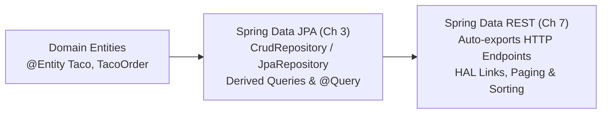

# Book Reading — Spring in Action (6th Ed), Chapters 3 & 7

---

## Executive Overview

This study module covers two interconnected sections from Craig Walls' *Spring in Action (6th Edition)*:
1. **Chapter 3 (Sections 3.2.2–3.2.4, pp. 78–93)**: Transitioning from imperative JDBC to declarative repository interfaces via **Spring Data JPA**, establishing derived method naming grammar, and embedding custom JPQL queries with `@Query`.
2. **Chapter 7 (Section 7.2, pp. 174–180)**: Automating hypermedia-driven HTTP APIs via **Spring Data REST**, dissecting HATEOAS HAL JSON wire representations, overriding collection paths, and applying client-controlled paging and sorting.



---

## 1. Chapter 3: Persisting Data with Spring Data JPA

### 1.1 Declaring Spring Data JPA Repositories

In Chapter 3, Craig Walls demonstrates replacing manual JDBC queries (`JdbcTemplate`) with declarative Spring Data interfaces. By extending `CrudRepository` or `JpaRepository`, Spring Data provides basic persistence operations without authoring an implementation class:

```java
package tacos.data;

import org.springframework.data.repository.CrudRepository;
import tacos.TacoOrder;

public interface OrderRepository extends CrudRepository<TacoOrder, Long> {
    // Basic CRUD operations inherited automatically
}
```

Behind the scenes, Spring Data constructs a dynamic proxy at application startup that intercepts invocations and executes low-level persistence operations against the underlying Jakarta Persistence `EntityManager`.

### 1.2 Customizing Repositories: Derived Query Methods

When standard CRUD methods are insufficient, Spring Data allows developers to declare custom read operations without writing JPQL or SQL. Spring parses the method signature according to an internal Domain-Specific Language (DSL).

```java
public interface OrderRepository extends CrudRepository<TacoOrder, Long> {

    // 1. Simple equality filter
    List<TacoOrder> findByDeliveryZip(String deliveryZip);

    // 2. Conjunction over date range
    List<TacoOrder> readOrdersByDeliveryZipAndPlacedAtBetween(
            String deliveryZip, Date startDate, Date endDate);

    // 3. String matching operations
    List<TacoOrder> findByDeliveryToAndDeliveryCityAllIgnoreCase(
            String deliveryTo, String deliveryCity);

    // 4. Ordering directives
    List<TacoOrder> findByDeliveryCityOrderByDeliveryTo(String city);
}
```

#### Verb Equivalency:
Spring Data treats various read verbs synonymously:
- `findBy...`
- `readBy...`
- `getBy...`
- `queryBy...`

Any characters between the action verb and `By` are considered descriptive and ignored by the parser. For example, `readOrdersByDeliveryZip(...)` is functionally identical to `findByDeliveryZip(...)`.

### 1.3 Grammar Operators Reference Matrix

| Keyword | Example | Equivalent JPQL Clause |
| :--- | :--- | :--- |
| `And` | `findByDeliveryZipAndPlacedAt` | `WHERE o.deliveryZip = ?1 AND o.placedAt = ?2` |
| `Or` | `findByDeliveryCityOrDeliveryZip` | `WHERE o.deliveryCity = ?1 OR o.deliveryZip = ?2` |
| `Between` | `findByPlacedAtBetween` | `WHERE o.placedAt BETWEEN ?1 AND ?2` |
| `LessThan` / `GreaterThan` | `findByPlacedAtLessThan` | `WHERE o.placedAt < ?1` |
| `Like` | `findByDeliveryToLike` | `WHERE o.deliveryTo LIKE ?1` |
| `IgnoreCase` | `findByDeliveryCityIgnoreCase` | `WHERE UPPER(o.deliveryCity) = UPPER(?1)` |
| `OrderBy...Asc/Desc` | `findByDeliveryCityOrderByPlacedAtDesc`| `ORDER BY o.placedAt DESC` |

### 1.4 Custom Queries with `@Query`

When query logic becomes too complex for derived method names (such as multi-table subqueries or domain calculations), the `@Query` annotation enables direct JPQL definition:

```java
@Query("SELECT o FROM TacoOrder o WHERE o.deliveryCity = 'Seattle'")
List<TacoOrder> readOrdersDeliveredInSeattle();
```

Craig Walls highlights that `@Query` frees the developer from constraints of method naming conventions: the method can be named whatever best communicates business intent, while the explicit query string dictates database execution.

---

## 2. Chapter 7: Enabling Data-Backed Services with Spring Data REST

### 2.1 The Philosophy of Spring Data REST

Craig Walls introduces Spring Data REST as a member of the Spring Data umbrella that automatically generates RESTful API endpoints for any repository managed by Spring Data.

Instead of writing:
- An `@Entity`
- A `JpaRepository` interface
- A `@Service` layer class
- A `@RestController` class with `@GetMapping`, `@PostMapping`, `@PutMapping`, `@DeleteMapping`

Spring Data REST allows the developer to define **only the `@Entity` and the repository interface**. The framework provides the entire HTTP communication layer automatically.

### 2.2 Adding Spring Data REST

```xml
<dependency>
    <groupId>org.springframework.boot</groupId>
    <artifactId>spring-boot-starter-data-rest</artifactId>
</dependency>
```

By adding this starter, any Spring Data repository interface (such as `OrderRepository` or `TacoRepository`) immediately exposes full CRUD endpoints.

### 2.3 Hypermedia Wire Representation (HAL)

Spring Data REST does not return raw JSON arrays. It returns hypermedia-rich documents conforming to the **HAL (Hypertext Application Language)** format.

For example, performing `GET /tacos` returns:

```json
{
  "_embedded": {
    "tacos": [
      {
        "name": "Carnitas Taco",
        "createdAt": "2026-05-10T14:30:00",
        "_links": {
          "self": {
            "href": "http://localhost:8080/tacos/1"
          },
          "taco": {
            "href": "http://localhost:8080/tacos/1"
          },
          "ingredients": {
            "href": "http://localhost:8080/tacos/1/ingredients"
          }
        }
      }
    ]
  },
  "_links": {
    "self": {
      "href": "http://localhost:8080/tacos"
    }
  }
}
```

Notice the hypermedia links:
- `self`: Direct link to this specific resource.
- `ingredients`: Hypermedia link traversing the relational `@ManyToMany` association between `Taco` and its `Ingredient` entities without having to write separate sub-resource endpoints!

### 2.4 Customizing Base Paths & Collection Relations

By default, Spring Data REST exposes endpoints at the root context path (`/`). To avoid polluting the root namespace and cleanly segregate REST endpoints from static web resources or MVC controllers, configure `application.properties`:

```properties
spring.data.rest.base-path=/api
```

All repositories are now hosted under `/api` (e.g., `/api/tacos`, `/api/orders`).

#### Overriding Paths with `@RepositoryRestResource`:
Spring Data REST pluralizes entity class names (e.g., `Taco` becomes `/api/tacos`). In irregular pluralizations or custom branding scenarios, override the relation and path:

```java
@RepositoryRestResource(collectionResourceRel = "orders", path = "order-history")
public interface OrderRepository extends CrudRepository<TacoOrder, Long> {
}
```

The resource is now available at `/api/order-history`.

### 2.5 Paging and Sorting Out-of-the-Box

Spring Data REST automatically incorporates pagination parameters into collection requests:

- `page`: Zero-based page index (defaults to `0`).
- `size`: Number of records per page (defaults to `20`).
- `sort`: Property name and direction (e.g., `sort=createdAt,desc`).

Request:
```
GET /api/tacos?page=0&size=5&sort=createdAt,desc
```

The response includes hypermedia navigation links (`first`, `prev`, `next`, `last`) inside `_links` alongside pagination metadata in the `page` property block.

---

## 3. Key Takeaways & Practical Architectural Guidance

1. **Repository Abstraction Depth**: Spring Data JPA proxies eliminate up to 70% of boilerplate persistence code while preserving type-safe compile-time and startup validations.
2. **Derived Query Boundaries**: Derived query methods are optimal for queries with 1 to 3 criteria. Once a method name exceeds four conditions, shift immediately to explicit `@Query` annotations to maintain readable code.
3. **Spring Data REST Use Cases**: Spring Data REST is ideal for rapid prototyping and internal back-office administration systems. In high-concurrency public APIs, custom `@RestController` endpoints with dedicated DTO models remain preferable to prevent unintended database schema leakage.
