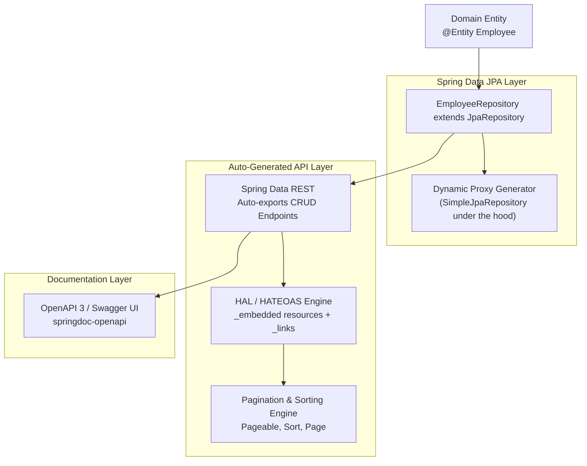

# Week 5 — Spring Data JPA, Automated Repositories & Spring Data REST

## Goal

Eliminate boilerplate persistence and controller code by mastering Spring Data JPA dynamic proxy repositories. Learn how derived query methods are parsed and compiled into type-safe queries, auto-generate hypermedia-compliant HATEOAS REST endpoints with Spring Data REST, configure pagination and sorting, and integrate OpenAPI 3 / Swagger UI for automated interactive documentation.

---

## :material-calendar: Week 5 Schedule

| Topic | Modules / Sections | Key Annotations / Concepts |
| :--- | :--- | :--- |
| **Spring Data JPA Repositories** | Module 16 | `JpaRepository<Employee, Integer>`, runtime dynamic proxies, built-in CRUD operations |
| **Derived Query Methods & Custom JPQL** | Companion Reading Ch 3 | Method naming parser grammar (`findByLastName`), `@Query`, `@Param` |
| **Spring Data REST & Hypermedia** | Module 17 | `spring-boot-starter-data-rest`, HAL format, `_embedded`, `_links`, HATEOAS architecture |
| **Paging, Sorting & Custom Configurations** | Module 18 | `spring.data.rest.base-path`, `default-page-size`, `?page=0&size=5`, `?sort=lastName,desc`, `@RepositoryRestResource` |
| **Automated Documentation with OpenAPI** | Modules 50–51 | `springdoc-openapi-starter-webmvc-ui`, Swagger UI (`/swagger-ui.html`), `/v3/api-docs` |

---

## :material-sitemap: Architectural Progression

---

## :material-folder-open: Week 5 Content

-   :material-note-text:{ .lg .middle } **Topic Notes (Comprehensive)**

    ---

    Refactoring custom DAOs to `JpaRepository`, dynamic proxy mechanics, derived query method parsing, Spring Data REST auto-endpoints, HAL hypermedia format, pagination, sorting, and OpenAPI 3 Swagger UI integration.

    [:octicons-arrow-right-24: Topic Notes](topic-notes.md)

-   :material-book-open-variant:{ .lg .middle } **Book Reading — Spring in Action Ch 3 & Ch 7**

    ---

    Craig Walls on Spring Data JPA derived queries, custom `@Query` JPQL, aggregate persistence, and enabling hypermedia data-backed services via Spring Data REST.

    [:octicons-arrow-right-24: Book Reading](book-reading.md)

-   :material-flask:{ .lg .middle } **Lab Guide — Automated Paginated Fleet Management Service**

    ---

    Construct an automated vehicle asset and employee tracking REST engine utilizing `JpaRepository`, Spring Data REST, custom base paths, and interactive Swagger UI documentation.

    [:octicons-arrow-right-24: Lab Guide](lab-guide.md)

-   :material-clipboard-check:{ .lg .middle } **Summary & Architecture Reference**

    ---

    Annotation matrix, Spring Data derived query keywords reference, Spring Data REST configuration cheat sheet, and 3-way persistence comparison (DAO vs JPA vs REST).

    [:octicons-arrow-right-24: Summary](summary.md)

---

## :material-progress-check: Progress Tracker

- [ ] **Topic Notes:** Refactoring DAOs, Spring Data JPA dynamic proxies, Spring Data REST, and Swagger UI
- [ ] **Book Reading:** Spring in Action Ch 3 (pp. 78–93) & Ch 7 (pp. 174–180)
- [ ] **Lab Guide:** Automated Paginated Fleet Management Service implementation and verification
- [ ] **Summary:** Annotation reference, derived keywords, and architectural cheat sheets reviewed
