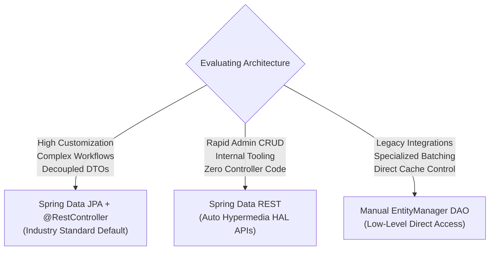

# Summary & Architecture Reference — Week 5: Spring Data JPA, Automated Repositories & Spring Data REST

---

## 1. Annotation Reference Matrix

| Annotation | Package / Module | Target | Architectural Purpose | Low-Level Mechanism / Lifecycle Impact | Common Pitfall |
| :--- | :--- | :--- | :--- | :--- | :--- |
| `@RepositoryRestResource` | `org.springframework.data.rest.core.annotation` | Interface | Customizes Spring Data REST collection resource path and relation names. | Overrides default English pluralization rules in the HAL export registry at runtime. | Confusing `path` with `collectionResourceRel` or creating path collisions with custom `@RestController` routes. |
| `@Query` | `org.springframework.data.jpa.repository` | Method | Defines an explicit JPQL or Native SQL query bound to a repository method. | Bypasses method name derivation; evaluated and compiled into an AST at container startup. | Referencing table and column names instead of entity and field names when `nativeQuery = false`. |
| `@Param` | `org.springframework.data.repository.query` | Parameter | Binds method parameters to named parameters (`:paramName`) inside `@Query`. | Injects named parameter mappings into Spring Data's `ParameterAccessor`. | Parameter name mismatch between `:domain` in the query and `@Param("domain")` on the method parameter. |
| `@Operation` | `io.swagger.v3.oas.annotations` | Method | Provides metadata (summary, description, responses) for OpenAPI generation. | Scanned by `springdoc-openapi` to augment the generated `/v3/api-docs` contract. | Hardcoding sensitive internal system details in public documentation descriptions. |
| `@Hidden` | `io.swagger.v3.oas.annotations` | Method / Class | Excludes internal or administrative endpoints from Swagger documentation. | Instructs `OpenAPIService` to omit the targeted route from the public schema. | Exposing internal maintenance endpoints to external consumers. |

---

## 2. Spring Data Derived Query Keywords Reference

Spring Data compiles derived method signatures into JPQL using a defined set of keywords:

| Keyword | Method Name Pattern | Emitted JPQL WHERE Clause |
| :--- | :--- | :--- |
| `And` | `findByLastNameAndFirstName` | `WHERE e.lastName = ?1 AND e.firstName = ?2` |
| `Or` | `findByLastNameOrEmail` | `WHERE e.lastName = ?1 OR e.email = ?2` |
| `Between` | `findByPlacedAtBetween` | `WHERE e.placedAt BETWEEN ?1 AND ?2` |
| `LessThan` / `GreaterThan` | `findByAgeLessThan` | `WHERE e.age < ?1` |
| `Like` | `findByLastNameLike` | `WHERE e.lastName LIKE ?1` |
| `StartingWith` | `findByLastNameStartingWith` | `WHERE e.lastName LIKE ?1 (appends %)` |
| `EndingWith` | `findByEmailEndingWith` | `WHERE e.email LIKE ?1 (prepends %)` |
| `Containing` | `findByEmailContaining` | `WHERE e.email LIKE ?1 (wraps with %)` |
| `IgnoreCase` | `findByLastNameIgnoreCase` | `WHERE UPPER(e.lastName) = UPPER(?1)` |
| `OrderBy...Asc/Desc` | `findAllByOrderByLastNameAsc` | `ORDER BY e.lastName ASC` |
| `In` | `findByDepartmentIn` | `WHERE e.department IN (?1)` |
| `IsNull` / `IsNotNull` | `findByEmailIsNull` | `WHERE e.email IS NULL` |

---

## 3. Spring Data REST Configuration Cheat Sheet

Configured in `src/main/resources/application.properties`:

| Configuration Key | Default Value | Purpose | Recommended Value |
| :--- | :--- | :--- | :--- |
| `spring.data.rest.base-path` | `""` (root `/`) | Root URI prefix under which all auto-generated endpoints are hosted | `/api` or `/magic-api` |
| `spring.data.rest.default-page-size` | `20` | Default number of records returned in collection queries | `20` or `30` |
| `spring.data.rest.max-page-size` | `1000` | Upper bound for the `?size=` parameter to prevent denial-of-service via huge payloads | `100` |
| `spring.data.rest.page-param-name` | `page` | Name of the URL query parameter governing zero-based page index | `page` |
| `spring.data.rest.limit-param-name` | `size` | Name of the URL query parameter governing page slice capacity | `size` |
| `spring.data.rest.sort-param-name` | `sort` | Name of the URL query parameter governing property sorting | `sort` |

---

## 4. Architectural Comparison: 3 Persistence Paradigms

| Dimension | Manual DAO Pattern (Week 3) | Spring Data JPA + Controller | Spring Data REST (Week 5) |
| :--- | :--- | :--- | :--- |
| **Code Footprint** | Interface + Impl + Service + Controller | Repository Interface + Service + Controller | **Repository Interface Only** |
| **Boilerplate CRUD** | High (must write JPQL manually) | **Zero** (inherited from `JpaRepository`) | **Zero** (all layers auto-generated) |
| **Wire Protocol** | Arbitrary JSON / Custom DTOs | Arbitrary JSON / Custom DTOs | Strict HATEOAS HAL (`_embedded`, `_links`) |
| **Paging & Sorting** | Manual offset/limit calculation | Programmatic via `Pageable` | Automatic via query parameters (`?page=`, `?sort=`) |
| **Schema Exposure** | Isolated via custom response DTOs | Isolated via custom response DTOs | Directly exposes entity property model |
| **Best Used For** | Specialized native SQL / legacy code | **Enterprise Microservices & Core APIs** | Rapid prototyping, internal portals |

---

## 5. OpenAPI 3 / Swagger UI Endpoints Reference

When `springdoc-openapi-starter-webmvc-ui` is active:

- **Interactive UI Console**: `http://localhost:8080/swagger-ui.html`
- **Redirected UI Dashboard**: `http://localhost:8080/swagger-ui/index.html`
- **OpenAPI 3.0 JSON Contract**: `http://localhost:8080/v3/api-docs`
- **OpenAPI 3.0 YAML Contract**: `http://localhost:8080/v3/api-docs.yaml`

---

## 6. Prerequisites for Week 6: Stateless REST Security

With rapid data access and RESTful endpoints operational, the next architectural imperative is **securing these resources**:

1. **The Servlet Filter Chain**: Understanding how requests are intercepted before reaching `@RestController` or Spring Data endpoints.
2. **Authentication vs Authorization**: Verifying user identity (`Who are you?`) versus role-based access control (`What are you permitted to do?`).
3. **Stateless HTTP Basic**: Why CSRF tokens are disabled for stateless REST APIs, and how base64 credentials travel over HTTPS.
4. **BCrypt Password Hashing**: Preventing credential compromise through salted cryptographic work-factor hashes.
5. **JDBC Database Security**: Storing user credentials and authority mappings in relational database tables.
