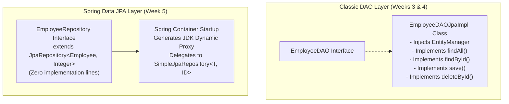
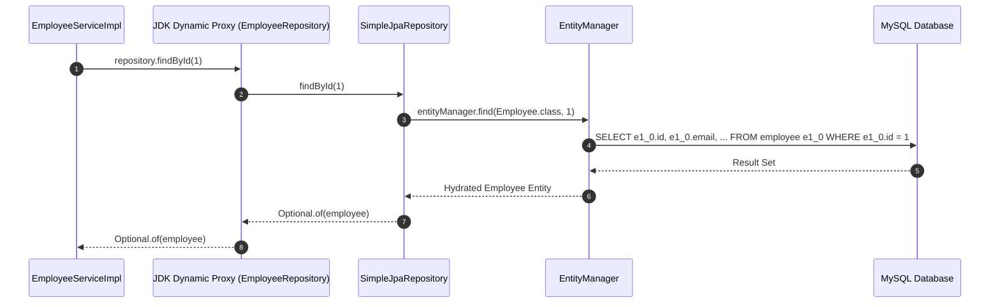
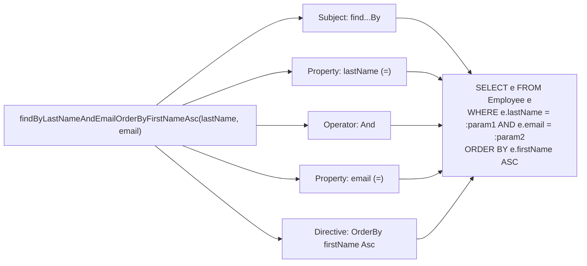
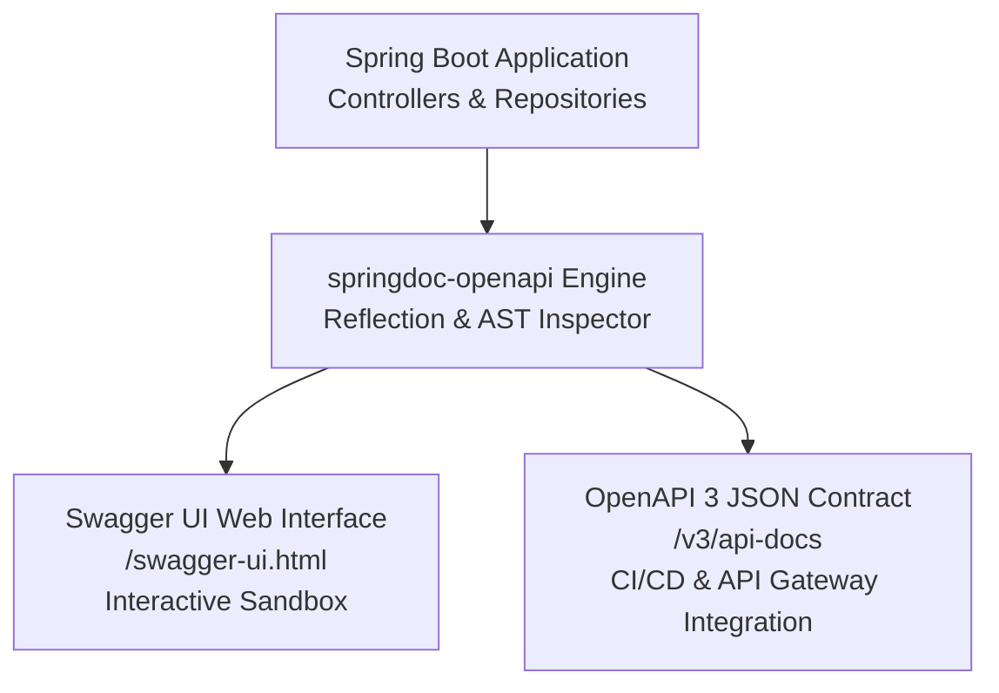

# Topic Notes — Spring Data JPA, Automated Repositories & Spring Data REST

---

## 1. The Evolution: From Imperative DAOs to Spring Data JPA

In Weeks 3 and 4, we constructed a classic enterprise Data Access Object (DAO) layer using `EntityManager` and `TypedQuery`. While this pattern offers complete control over query construction and transaction management, it creates substantial architectural friction: for an application with 50 domain entities, an engineering team must write and maintain 50 DAO interfaces, 50 implementation classes, and hundreds of repetitive boilerplate CRUD methods.

Spring Data JPA eliminates this boilerplate through **Interface-Driven Persistence**.



### 1.1 The `JpaRepository` Interface

To migrate an entity to Spring Data JPA, declare an interface extending `JpaRepository<T, ID>`:

```java
package com.luv2code.springboot.cruddemo.dao;

import com.luv2code.springboot.cruddemo.entity.Employee;
import org.springframework.data.jpa.repository.JpaRepository;

public interface EmployeeRepository extends JpaRepository<Employee, Integer> {
    // No implementation code required
}
```

The interface parameterization requires two generic types:
1. `T`: The managed `@Entity` domain class (`Employee`).
2. `ID`: The type of the entity's primary key identifier (`Integer`).

### 1.2 Internal Runtime Mechanics: `SimpleJpaRepository`

How does an interface with zero lines of implementation execute database queries?

During container initialization:
1. Spring Data scans the classpath for interfaces extending `Repository`.
2. It constructs a `RepositoryFactoryBeanSupport` that generates a **JDK Dynamic Proxy** for each interface.
3. Method calls on the proxy delegate to a default implementation class: `org.springframework.data.jpa.repository.support.SimpleJpaRepository`.
4. `SimpleJpaRepository` contains the underlying `EntityManager` calls (`persist()`, `merge()`, `find()`, `remove()`, and JPQL `CriteriaQuery` builders) that we previously authored by hand.



### 1.3 Core Methods Inherited Out of the Box

Extending `JpaRepository` inherits methods from `ListCrudRepository`, `ListPagingAndSortingRepository`, and `QueryByExampleExecutor`:

| Method | Return Type | Low-Level JPA Operation | Description |
| :--- | :--- | :--- | :--- |
| `findAll()` | `List<T>` | `entityManager.createQuery("SELECT e FROM ...")` | Retrieves all entity records as a typed List |
| `findById(ID id)` | `Optional<T>` | `entityManager.find(entityClass, id)` | Retrieves an entity wrapped in a Java 8 `Optional` |
| `save(T entity)` | `T` | `entityManager.persist()` or `merge()` | Persists transient entities or updates detached entities |
| `deleteById(ID id)` | `void` | `find()` followed by `entityManager.remove()` | Deletes the targeted record by primary key |
| `count()` | `long` | `SELECT COUNT(e) FROM ...` | Returns the total count of entity records |
| `existsById(ID id)` | `boolean` | `SELECT COUNT(e) > 0 WHERE id = ...` | Evaluates entity existence without full hydration |

### 1.4 Refactoring the Business Service Tier

Because `findById()` returns `Optional<T>`, the service implementation unwraps the result safely, eliminating explicit null checks:

```java
package com.luv2code.springboot.cruddemo.service;

import com.luv2code.springboot.cruddemo.dao.EmployeeRepository;
import com.luv2code.springboot.cruddemo.entity.Employee;
import org.springframework.beans.factory.annotation.Autowired;
import org.springframework.stereotype.Service;
import java.util.List;
import java.util.Optional;

@Service
public class EmployeeServiceImpl implements EmployeeService {

    private final EmployeeRepository employeeRepository;

    @Autowired
    public EmployeeServiceImpl(EmployeeRepository theEmployeeRepository) {
        this.employeeRepository = theEmployeeRepository;
    }

    @Override
    public List<Employee> findAll() {
        return employeeRepository.findAll();
    }

    @Override
    public Employee findById(int theId) {
        Optional<Employee> result = employeeRepository.findById(theId);

        Employee theEmployee = null;
        if (result.isPresent()) {
            theEmployee = result.get();
        } else {
            throw new RuntimeException("Did not find employee id - " + theId);
        }

        return theEmployee;
    }

    @Override
    public Employee save(Employee theEmployee) {
        return employeeRepository.save(theEmployee);
    }

    @Override
    public void deleteById(int theId) {
        employeeRepository.deleteById(theId);
    }
}
```

!!! tip "Idiomatic Optional Handling"
    In modern Java, replace the imperative `if (result.isPresent())` block with functional style:
    ```java
    return employeeRepository.findById(theId)
            .orElseThrow(() -> new RuntimeException("Did not find employee id - " + theId));
    ```

!!! note "What Happened to `@Transactional` in the Service?"
    `SimpleJpaRepository` is annotated with `@Transactional(readOnly = true)` at the class level, and individual mutating methods (`save`, `delete`) declare `@Transactional`. However, enterprise best practice dictates retaining `@Transactional` on your custom `@Service` methods whenever a workflow coordinates multiple repository calls, ensuring atomic commit or rollback.

---

## 2. Derived Query Methods & Query Creation Mechanics

Beyond standard CRUD, applications require queries filtered by specific business attributes. Spring Data JPA provides a **Query Derivation Mechanism** that parses repository method names directly into JPQL queries.

### 2.1 Grammar of Derived Method Names

A derived query method consists of two structural segments:
1. **The Subject**: Defines the action (`find...By`, `read...By`, `get...By`, `count...By`, `delete...By`).
2. **The Predicate**: Defines criteria matching entity property names combined with relational operators.



### 2.2 Common Derived Keyword Patterns

```java
public interface EmployeeRepository extends JpaRepository<Employee, Integer> {

    // 1. Exact match on single property
    List<Employee> findByLastName(String lastName);

    // 2. Conjunction (AND)
    List<Employee> findByFirstNameAndLastName(String firstName, String lastName);

    // 3. Disjunction (OR)
    List<Employee> findByLastNameOrEmail(String lastName, String email);

    // 4. Pattern matching (LIKE)
    List<Employee> findByEmailEndingWith(String domain);

    // 5. Case-insensitive matching
    List<Employee> findByLastNameIgnoreCase(String lastName);

    // 6. Relational ordering
    List<Employee> findAllByOrderByLastNameAsc();
}
```

### 2.3 Startup Verification: Fail-Fast Safety

!!! important "Compile-Time vs Startup Verification"
    Spring Data validates derived method names against entity property names during the **ApplicationContext initialization phase**. If an engineer creates a method named `findBySurname(String s)` but the `Employee` entity defines `lastName`, Spring Boot will fail to start, throwing a `PropertyReferenceException`. This fail-fast mechanism prevents malformed query strings from reaching production.

### 2.4 Custom JPQL with `@Query`

When queries require complex joins or multiple conditions that make method names unreadable, use the `@Query` annotation:

```java
public interface EmployeeRepository extends JpaRepository<Employee, Integer> {

    @Query("SELECT e FROM Employee e WHERE e.email LIKE %:domain% ORDER BY e.lastName DESC")
    List<Employee> findByCorporateDomain(@Param("domain") String domain);

    @Query("SELECT e FROM Employee e WHERE e.firstName = :firstName AND e.lastName = :lastName")
    Optional<Employee> findExactMatch(@Param("firstName") String firstName, 
                                      @Param("lastName") String lastName);
}
```

---

## 3. Rapid Hypermedia APIs via Spring Data REST

For standard resource models, writing repetitive `@RestController` and `@Service` tiers is unnecessary. **Spring Data REST** analyzes the application's `JpaRepository` interfaces and automatically publishes complete, production-grade RESTful web services.

### 3.1 Maven Build Configuration

Add the starter dependency to `pom.xml`:

```xml
<dependency>
    <groupId>org.springframework.boot</groupId>
    <artifactId>spring-boot-starter-data-rest</artifactId>
</dependency>
```

With this single dependency added, Spring Data REST automatically discovers `EmployeeRepository` and exposes the following endpoints:

| HTTP Verb | Path | Action | Status Code |
| :--- | :--- | :--- | :--- |
| `GET` | `/employees` | Retrieve paginated list of employees | `200 OK` |
| `GET` | `/employees/{id}` | Retrieve single employee by identifier | `200 OK` / `404 Not Found` |
| `POST` | `/employees` | Create a new employee resource | `201 Created` |
| `PUT` | `/employees/{id}` | Replace existing employee resource | `200 OK` / `204 No Content` |
| `PATCH` | `/employees/{id}` | Partially update employee properties | `200 OK` / `204 No Content` |
| `DELETE` | `/employees/{id}` | Remove employee resource | `204 No Content` |

### 3.2 Pluralization Mechanics

Spring Data REST applies standard English pluralization to the entity name to construct the collection URI:
- `Employee` → `/employees`
- `Student` → `/students`
- `Order` → `/orders`

### 3.3 The HAL (Hypertext Application Language) Wire Format

Spring Data REST adheres to Level 3 of the Richardson Maturity Model (**HATEOAS**) using the HAL specification (`application/hal+json`). Responses contain data alongside navigational hypermedia links:

```json
{
  "_embedded": {
    "employees": [
      {
        "firstName": "Leslie",
        "lastName": "Andrews",
        "email": "leslie@luv2code.com",
        "_links": {
          "self": {
            "href": "http://localhost:8080/employees/1"
          },
          "employee": {
            "href": "http://localhost:8080/employees/1"
          }
        }
      },
      {
        "firstName": "Emma",
        "lastName": "Baumgarten",
        "email": "emma@luv2code.com",
        "_links": {
          "self": {
            "href": "http://localhost:8080/employees/2"
          },
          "employee": {
            "href": "http://localhost:8080/employees/2"
          }
        }
      }
    ]
  },
  "_links": {
    "self": {
      "href": "http://localhost:8080/employees{?page,size,sort}",
      "templated": true
    },
    "profile": {
      "href": "http://localhost:8080/profile/employees"
    }
  },
  "page": {
    "size": 20,
    "totalElements": 5,
    "totalPages": 1,
    "number": 0
  }
}
```

Components of the HAL response:
- `_embedded`: Houses the array of resource representations.
- `_links`: Provides URI links to access the resource itself (`self`), related sub-resources, or collection templates.
- `page`: Communicates pagination metadata (page size, total records, total pages, current zero-based page index).

---

## 4. Advanced Spring Data REST Configurations

### 4.1 Global Property Customizations

In `src/main/resources/application.properties`:

```properties
# 1. Mount all auto-generated endpoints under a common base URI
spring.data.rest.base-path=/magic-api

# 2. Adjust default page size (default is 20)
spring.data.rest.default-page-size=30

# 3. Limit maximum page size requested by clients to prevent memory exhaustion
spring.data.rest.max-page-size=100
```

With `spring.data.rest.base-path=/magic-api`, the endpoints become:
`http://localhost:8080/magic-api/employees`

### 4.2 Overriding Collection Path: `@RepositoryRestResource`

If Spring's default pluralization produces an undesirable path or collides with legacy naming conventions, customize it using `@RepositoryRestResource`:

```java
package com.luv2code.springboot.cruddemo.dao;

import com.luv2code.springboot.cruddemo.entity.Employee;
import org.springframework.data.jpa.repository.JpaRepository;
import org.springframework.data.rest.core.annotation.RepositoryRestResource;

@RepositoryRestResource(path = "members")
public interface EmployeeRepository extends JpaRepository<Employee, Integer> {
    // Endpoints are now published at /magic-api/members
}
```

### 4.3 Pagination & Sorting Queries

Spring Data REST natively processes query parameters for paging and sorting without any developer code:

#### Pagination:
- **First Page (size 2)**: `GET /magic-api/employees?page=0&size=2`
- **Second Page (size 2)**: `GET /magic-api/employees?page=1&size=2`

The response includes navigational links (`first`, `prev`, `next`, `last`) in `_links`, enabling client-side hypermedia navigation:

```json
"_links": {
  "first": { "href": "http://localhost:8080/magic-api/employees?page=0&size=2" },
  "prev":  { "href": "http://localhost:8080/magic-api/employees?page=0&size=2" },
  "self":  { "href": "http://localhost:8080/magic-api/employees?page=1&size=2" },
  "next":  { "href": "http://localhost:8080/magic-api/employees?page=2&size=2" },
  "last":  { "href": "http://localhost:8080/magic-api/employees?page=2&size=2" }
}
```

#### Sorting:
- **Sort by Last Name Ascending**: `GET /magic-api/employees?sort=lastName`
- **Sort by Last Name Descending**: `GET /magic-api/employees?sort=lastName,desc`
- **Multi-Property Sort**: `GET /magic-api/employees?sort=lastName,desc&sort=firstName,asc`

---

## 5. Automated API Documentation: OpenAPI 3 & Swagger UI

Manual documentation (Word documents, static wikis) inevitably drifts from actual code. The industry standard is **Code-First Automated Documentation** via the OpenAPI 3 specification.

### 5.1 Maven Dependency

Spring Boot 3 uses the `springdoc-openapi` library:

```xml
<dependency>
    <groupId>org.springdoc</groupId>
    <artifactId>springdoc-openapi-starter-webmvc-ui</artifactId>
    <version>3.0.1</version>
</dependency>
```

### 5.2 Key Documentation Endpoints

Upon application startup, `springdoc-openapi` inspects all Spring MVC `@RestController` and Spring Data REST endpoints, compiling their schemas, parameter models, and response codes dynamically:

1. **Interactive Swagger UI**:
   - `http://localhost:8080/swagger-ui.html`
   - Automatically redirects to `http://localhost:8080/swagger-ui/index.html`.
   - Generates an interactive web sandbox where developers and QA engineers can execute live HTTP requests (`GET`, `POST`, `PUT`, `DELETE`) directly from the browser.
2. **Raw OpenAPI JSON Metadata**:
   - `http://localhost:8080/v3/api-docs`
   - Produces the machine-readable OpenAPI 3.0 compliant JSON schema, consumable by API gateways (Kong, Apigee), SDK generators, or Postman importers.
3. **OpenAPI YAML Format**:
   - `http://localhost:8080/v3/api-docs.yaml`



---

## 6. Architectural Decision Matrix: When to Use Which Pattern

As an enterprise software engineer, choosing the correct persistence and API abstraction requires balancing development velocity against business flexibility:

| Dimension | Option A: Custom DAO + Service + Controller (Week 4) | Option B: Spring Data JPA + Service + Controller | Option C: Spring Data REST (Week 5) |
| :--- | :--- | :--- | :--- |
| **Development Speed** | Slowest (write DAO, service, and controller) | Moderate (only write service and controller) | **Instant** (declare repository interface only) |
| **Custom Business Logic** | **Maximum control** over EntityManager and transactions | **High control** inside Service tier methods | Limited (requires event handlers or interceptors) |
| **Payload Customization** | Flexible custom DTOs via Jackson | Flexible custom DTOs via Jackson | Rigid (entity-centric HAL JSON) |
| **Security & Auditing** | Fine-grained method/endpoint security | Fine-grained security on service methods | Applied at repository level via `@PreAuthorize` |
| **Production Recommendation** | Legacy integration or complex reporting queries | **Standard default for enterprise microservices** | Internal tooling, prototypes, or admin CRUD portals |

!!! caution "Production Warning: Spring Data REST & Encapsulation"
    Directly exposing domain entities over HTTP via Spring Data REST can inadvertently leak internal database schemas, column names, and relational links to outside callers. In public-facing microservices, the recommended architectural approach is **Option B**: utilize Spring Data JPA for data access, but insulate the external contract through explicit DTOs mapped inside a dedicated `@RestController`.
