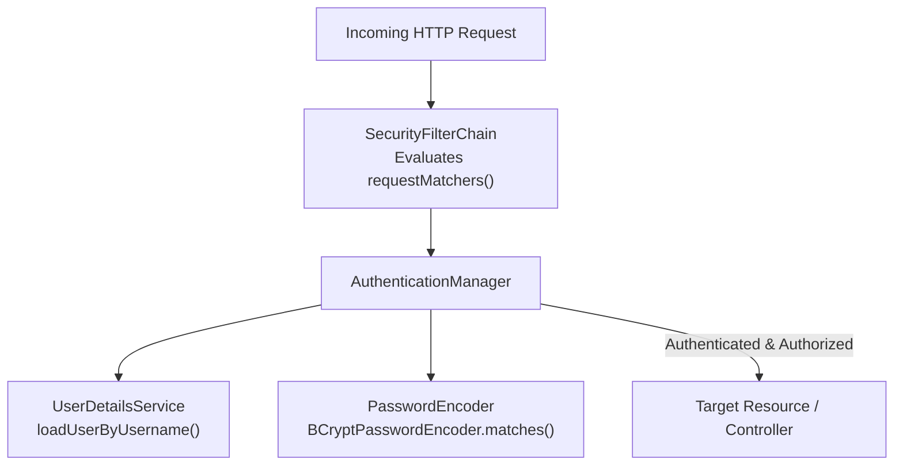
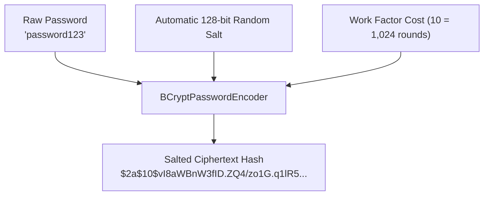

# Book Reading — Spring in Action (6th Ed), Chapter 5: Securing Spring

---

## Executive Overview

Chapter 5 of *Spring in Action (6th Edition)* by Craig Walls provides the architectural foundation for securing Spring applications. Walls explores the core abstractions of the Spring Security framework: the mechanics of auto-configuration, decoupling user identity retrieval via `UserDetailsService`, safeguarding credentials with `PasswordEncoder` (specifically `BCryptPasswordEncoder`), and configuring the `SecurityFilterChain` bean to enforce fine-grained access rules across web endpoints.



---

## 1. Enabling Spring Security & Auto-Configuration

The foundation of Spring Security begins with a single starter dependency in `pom.xml`:

```xml
<dependency>
    <groupId>org.springframework.boot</groupId>
    <artifactId>spring-boot-starter-security</artifactId>
</dependency>
```

Upon introducing this starter, Spring Boot activates an extensive suite of auto-configuration routines:
1. **Perimeter Lockout**: Every request path in the application context requires authentication.
2. **Ephemeral Credentials**: An in-memory user named `user` is generated alongside a randomly generated UUID password printed to the console log at startup.
3. **Default Challenge Handlers**: Browser requests trigger auto-generated HTML login forms; API requests receive an HTTP Basic challenge.

While suitable for initial bootstrapping, enterprise applications immediately replace this behavior with custom security configuration beans.

---

## 2. Decoupled User Storage: The `UserDetailsService`

Craig Walls highlights a critical design principle: Spring Security strictly separates the **retrieval of user account records** from the **verification of authentication credentials**.

The contract responsible for loading user records is `UserDetailsService`:

```java
public interface UserDetailsService {
    UserDetails loadUserByUsername(String username) throws UsernameNotFoundException;
}
```

The returned `UserDetails` interface encapsulates identity metadata:
- `getUsername()` and `getPassword()`
- `getAuthorities()`: The collection of granted roles or permissions
- Account state flags: `isAccountNonExpired()`, `isAccountNonLocked()`, `isCredentialsNonExpired()`, `isEnabled()`

### 2.1 In-Memory User Store (`InMemoryUserDetailsManager`)

For integration testing and local development, Spring provides `InMemoryUserDetailsManager`. Walls illustrates defining users with `User.builder()`:

```java
@Bean
public UserDetailsService userDetailsService(PasswordEncoder encoder) {
    List<UserDetails> usersList = new ArrayList<>();

    usersList.add(User.builder()
        .username("buzz")
        .password(encoder.encode("password"))
        .roles("USER")
        .build());

    usersList.add(User.builder()
        .username("woody")
        .password(encoder.encode("password"))
        .roles("USER", "ADMIN")
        .build());

    return new InMemoryUserDetailsManager(usersList);
}
```

### 2.2 Relational Database User Store (`JdbcUserDetailsManager`)

In production environments, users reside in a relational database. Craig Walls demonstrates using `JdbcUserDetailsManager` backed by a `DataSource`. Spring Security provides standard default queries against the `users` and `authorities` tables, but also exposes setters to adapt legacy relational schemas:

```java
@Bean
public UserDetailsManager userDetailsManager(DataSource dataSource) {
    JdbcUserDetailsManager manager = new JdbcUserDetailsManager(dataSource);
    
    // Custom SQL mapping
    manager.setUsersByUsernameQuery(
        "select username, password, enabled from users where username=?");
    manager.setAuthoritiesByUsernameQuery(
        "select username, authority from authorities where username=?");
        
    return manager;
}
```

### 2.3 Custom Domain User Store with Spring Data JPA

When user entities maintain custom business domain properties (e.g., street addresses, phone numbers, loyalty tiers), Walls advises implementing `UserDetailsService` directly atop a Spring Data JPA repository:

```java
@Service
public class UserRepositoryUserDetailsService implements UserDetailsService {

    private final UserRepository userRepo;

    @Autowired
    public UserRepositoryUserDetailsService(UserRepository userRepo) {
        this.userRepo = userRepo;
    }

    @Override
    public UserDetails loadUserByUsername(String username) throws UsernameNotFoundException {
        User user = userRepo.findByUsername(username);
        if (user != null) {
            return user;
        }
        throw new UsernameNotFoundException("User '" + username + "' not found");
    }
}
```

---

## 3. Cryptographic Password Hashing: `BCryptPasswordEncoder`

Craig Walls emphasizes that storing passwords in plain text is a severe architectural vulnerability. Spring Security enforces the use of a `PasswordEncoder` bean:

```java
@Bean
public PasswordEncoder passwordEncoder() {
    return new BCryptPasswordEncoder();
}
```



Key security attributes of `BCryptPasswordEncoder`:
1. **Automatic Salt Generation**: Generates a 128-bit random salt for each hash operation. Two identical passwords result in completely different hash strings, defeating rainbow table attacks.
2. **Tunable Computational Work Factor**: Employs an exponential cost factor ($2^N$ rounds), slowing down brute-force attacks on specialized GPU cracking rigs.

---

## 4. Securing Web Requests via `SecurityFilterChain`

To declare routing rules and authorization boundaries, developers configure a `SecurityFilterChain` bean:

```java
@Bean
public SecurityFilterChain filterChain(HttpSecurity http) throws Exception {
    return http
        .authorizeHttpRequests(authz -> authz
            .requestMatchers("/design", "/orders").hasRole("USER")
            .requestMatchers("/", "/**").permitAll()
        )
        .formLogin(form -> form.loginPage("/login"))
        .logout(logout -> logout.logoutSuccessUrl("/"))
        .build();
}
```

Authorization rule semantics:
- `hasRole("USER")`: Enforces that the user has the granted authority `ROLE_USER`.
- `hasAnyRole("USER", "ADMIN")`: Permissive check across multiple roles.
- `permitAll()`: Grants unconditional public access to matching paths.
- `authenticated()`: Demands any authenticated identity regardless of specific role.

---

## 5. Architectural Summary & Best Practices

1. **Interface Segregation**: `UserDetailsService` handles data loading; `PasswordEncoder` handles verification. Never combine password hashing logic directly into domain entities.
2. **Fail-Safe Password Encoders**: Always configure `BCryptPasswordEncoder` as a managed `@Bean` rather than relying on legacy `{noop}` plain-text prefixes.
3. **Order of Route Matching**: Spring Security evaluates `requestMatchers()` in strict top-to-bottom order. Always declare specific route restrictions first and broad wildcards (`/**`) last.
