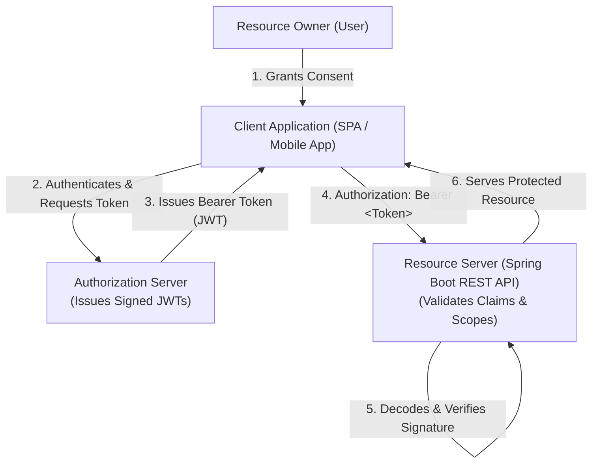
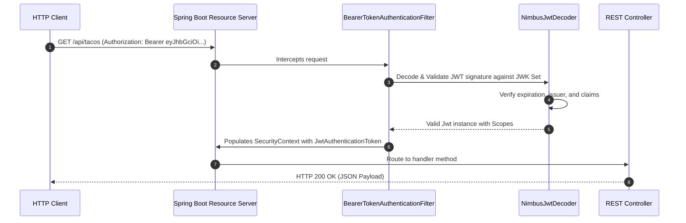

# Book Reading — Spring in Action (6th Ed), Chapter 8: Securing REST

---

## Executive Overview

Chapter 8 of *Spring in Action (6th Edition)* by Craig Walls addresses the architectural challenges of securing distributed, machine-to-machine RESTful APIs. While Chapter 5 focused on session cookies and basic web security, Chapter 8 examines the transition to stateless token-based security using **OAuth 2**. Walls explains the limitations of HTTP Basic in distributed topologies, presents the foundational roles of OAuth 2 through the metaphor of a valet key, and demonstrates configuring a Spring Boot REST API as an **OAuth 2 Resource Server** validating cryptographically signed JWT bearer tokens.



---

## 1. The Valet Key Metaphor & Principle of Least Privilege

Craig Walls introduces API security using the analogy of a valet parking key:
- When you hand your car to a valet parking attendant, you do not hand over your house keys, trunk keys, or entire keychain; you provide a specialized "valet key" engineered strictly to open the driver door and operate the ignition.
- In distributed microservice architectures, client applications (web SPAs, third-party services, mobile devices) must never be entrusted with the user's master credentials.
- Security perimeters must enforce **Scoped, Delegated Trust**: granting a client application strictly the minimum permissions required to perform its function (**Principle of Least Privilege**).

---

## 2. Limitations of HTTP Basic in Distributed Systems

While HTTP Basic authentication is simple to configure, Walls outlines critical architectural limitations that render it unsuitable for multi-client distributed systems:

1. **Credential Proliferation**: With HTTP Basic, the client application must store the user's raw username and password in local memory or browser storage and transmit them in an `Authorization: Basic ...` header on every network call.
2. **Global Invalidation on Revocation**: If a single client application (e.g., a third-party reporting tool) is compromised, the user must change their actual account password, simultaneously terminating access for all legitimate clients.
3. **No Scoped Authority**: HTTP Basic is all-or-nothing; it cannot grant a client permission to read data while preventing write operations without creating duplicate user accounts.
4. **Third-Party Anti-Pattern**: Asking users to type their master credentials into a third-party client application violates modern identity governance.

---

## 3. The OAuth 2 Framework

To overcome the weaknesses of HTTP Basic, modern systems adopt the **OAuth 2 Authorization Framework** (RFC 6749).

### 3.1 The Four Core Roles

| Role | Responsibility | Example |
| :--- | :--- | :--- |
| **Resource Owner** | The entity capable of granting access to a protected resource (usually a human end-user). | The user logged into the application |
| **Client** | The third-party or client application requesting access on behalf of the Resource Owner. | Single-Page Application (Angular/React), Mobile App |
| **Authorization Server** | The trusted identity provider that authenticates the Resource Owner and issues access tokens. | Keycloak, Okta, Spring Authorization Server |
| **Resource Server** | The server hosting protected resources, capable of accepting and responding to protected requests using access tokens. | Our Spring Boot REST API (`/api/employees`) |

### 3.2 Scopes: Fine-Grained Delegated Authority

OAuth 2 tokens carry **scopes**—strings that define specific permissions granted by the user to the client application:
- `SCOPE_readTacos`: Permits querying and displaying tacos.
- `SCOPE_writeTacos`: Permits creating or modifying orders.
- `SCOPE_deleteTacos`: Restricted administrative deletion capability.

---

## 4. Configuring Spring Boot as an OAuth 2 Resource Server

In modern Spring Boot architectures, the REST API acts as an **OAuth 2 Resource Server**. It does not handle user login forms or credential storage; instead, it validates cryptographic signatures on incoming **Bearer Tokens (JSON Web Tokens - JWT)**.

### 4.1 Maven Build Dependency

```xml
<dependency>
    <groupId>org.springframework.boot</groupId>
    <artifactId>spring-boot-starter-oauth2-resource-server</artifactId>
</dependency>
```

### 4.2 Application Properties Configuration

Configure the Resource Server to trust the public key of the Authorization Server via the JWK (JSON Web Key) set URI:

```properties
spring.security.oauth2.resourceserver.jwt.jwk-set-uri=http://auth-server:9000/oauth2/jwks
```

### 4.3 Declaring the `SecurityFilterChain`

Craig Walls illustrates configuring endpoint access based on JWT token scopes:

```java
@Configuration
@EnableWebSecurity
public class RestSecurityConfig {

    @Bean
    public SecurityFilterChain securityFilterChain(HttpSecurity http) throws Exception {
        http
            .authorizeHttpRequests(authz -> authz
                .requestMatchers(HttpMethod.GET, "/api/tacos/**")
                    .hasAuthority("SCOPE_readTacos")
                .requestMatchers(HttpMethod.POST, "/api/tacos")
                    .hasAuthority("SCOPE_writeTacos")
                .requestMatchers(HttpMethod.DELETE, "/api/tacos/**")
                    .hasAuthority("SCOPE_deleteTacos")
                .anyRequest().authenticated()
            )
            .oauth2ResourceServer(oauth2 -> 
                oauth2.jwt(Customizer.withDefaults())
            );

        return http.build();
    }
}
```

### 4.4 How JWT Validation Operates Under the Hood



1. The client transmits the token: `Authorization: Bearer eyJhbGciOi...`.
2. `BearerTokenAuthenticationFilter` extracts the token string.
3. Spring's `JwtDecoder` verifies the cryptographic signature using the Authorization Server's public key, checks the expiration timestamp (`exp`), and ensures the issuer (`iss`) matches.
4. Token scopes (e.g., `readTacos`) are converted into Spring Security `GrantedAuthority` objects with the prefix `SCOPE_` (e.g., `SCOPE_readTacos`).
5. If the required scope is present, execution proceeds to the controller.

---

## 5. Architectural Comparison: HTTP Basic vs OAuth 2 JWT

| Dimension | HTTP Basic Authentication (Week 6 Lab) | OAuth 2 JWT Resource Server (Chapter 8) |
| :--- | :--- | :--- |
| **Credential Transmission** | Raw credentials Base64-encoded on every request | Short-lived signed cryptographic token |
| **Revocation Capability** | Requires changing user's master password | Token expiration (`exp`) or revocation list |
| **Authorization Granularity**| User Roles (`ROLE_EMPLOYEE`, `ROLE_ADMIN`) | Fine-grained Scopes (`SCOPE_read`, `SCOPE_write`) |
| **Architectural Topology** | Monoliths, internal microservices, simple CLI tools | Distributed microservices, public APIs, mobile apps |
| **Server State** | Authenticated via database lookup on every call | **Completely stateless**: validated via public key cryptography |

---

## 6. Key Takeaways for Enterprise Engineers

1. **Defense-in-Depth Evolution**: HTTP Basic with salted BCrypt database authentication is the appropriate baseline for internal microservices and rapid backend development.
2. **Decoupled Identity Management**: For distributed, multi-client ecosystems, decouple authentication entirely by adopting an Authorization Server issuing signed JWT tokens.
3. **Stateless Scalability**: Because JWTs are self-contained and cryptographically signed, Resource Servers validate incoming requests without querying an authentication database, enabling horizontal scalability.
