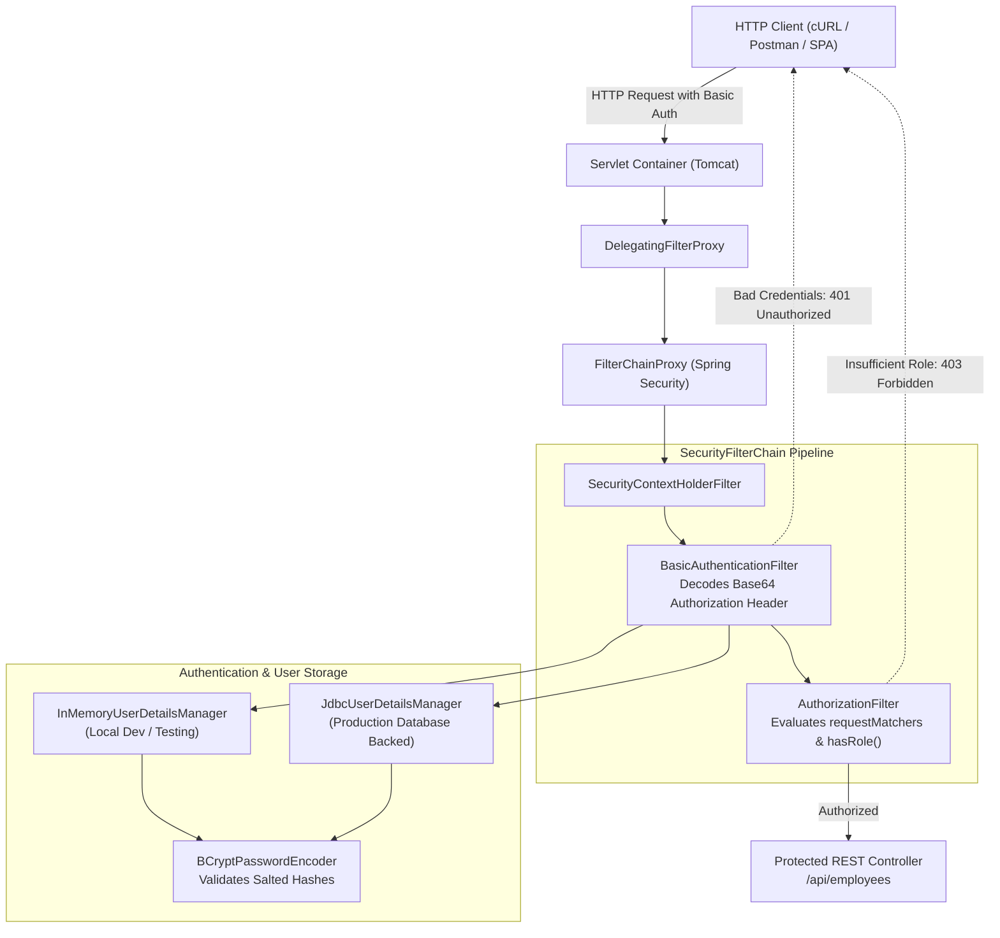

# Week 6 — Spring Security: Securing REST APIs & Role-Based Access Control

## Goal

Master Spring Security 6/7 core architecture and filter chains to construct robust, defense-in-depth security perimeters around RESTful web services. Understand stateless HTTP Basic authentication, password hashing using BCrypt with cryptographic salts, in-memory user provisioning, and database-backed JDBC authentication with fine-grained Role-Based Access Control (RBAC).

---

## :material-calendar: Week 6 Schedule

| Topic | Modules / Sections | Key Annotations / Concepts |
| :--- | :--- | :--- |
| **Spring Security Fundamentals & Filter Chain** | Modules 00–02 | `spring-boot-starter-security`, `SecurityFilterChain`, `DelegatingFilterProxy`, `FilterChainProxy` |
| **Stateless Configuration & CSRF Mechanics** | Module 02 | `authorizeHttpRequests`, `httpBasic()`, `csrf(csrf -> csrf.disable())`, HTTP 401 vs 403 |
| **In-Memory Users & Granular Route Authorization** | Modules 03–04 | `InMemoryUserDetailsManager`, `User.builder()`, `hasRole("EMPLOYEE")`, `hasRole("ADMIN")` |
| **Database Authentication with JDBC** | Module 05 | `JdbcUserDetailsManager`, standard `users` and `authorities` schemas, plain-text security risks |
| **Cryptographic Hashing with BCrypt & Custom Schemas** | Modules 06–07 | `BCryptPasswordEncoder`, work factors, salts, `setUsersByUsernameQuery()`, `setAuthoritiesByUsernameQuery()` |
| **Book Reading — Ch 5: Securing Spring** | Ch 5 (pp. 113–133) | `UserDetailsService`, `PasswordEncoder`, modern Lambda DSL `SecurityFilterChain` |
| **Book Reading — Ch 8: Securing REST** | Ch 8 (pp. 186–204) | Valet parking principle, limitations of Basic auth, OAuth 2.0 Resource Server, JWT tokens |

---

## :material-sitemap: Architectural Progression

---

## :material-folder-open: Week 6 Content

-   :material-note-text:{ .lg .middle } **Topic Notes — Part 1**

    ---

    Spring Security architecture, the Servlet filter chain, `DelegatingFilterProxy`, `SecurityFilterChain` bean declaration, Lambda DSL configuration, CSRF disabling rationale for stateless REST APIs, in-memory credential provisioning, and route authorization by HTTP method and role.

    [:octicons-arrow-right-24: Topic Notes Part 1](topic-notes-part1.md)

-   :material-note-text:{ .lg .middle } **Topic Notes — Part 2**

    ---

    Production database authentication, standard Spring Security JDBC relational schemas (`users` and `authorities`), BCrypt password hashing mechanics, salt generation, work factor resistance to brute force, and adapting non-standard custom database table schemas.

    [:octicons-arrow-right-24: Topic Notes Part 2](topic-notes-part2.md)

-   :material-book-open-variant:{ .lg .middle } **Book Reading — Ch 5: Securing Spring**

    ---

    Craig Walls on foundational Spring security architecture: configuring user credential stores (in-memory, JDBC, LDAP, and custom `UserDetailsService`), cryptographic password encoders (`BCryptPasswordEncoder`), and modern `SecurityFilterChain` bean configurations.

    [:octicons-arrow-right-24: Read Chapter 5 Notes](book-reading-ch5.md)

-   :material-book-open-variant:{ .lg .middle } **Book Reading — Ch 8: Securing REST**

    ---

    Craig Walls on securing distributed RESTful microservices: architectural limitations of HTTP Basic authentication, the Valet Parking security pattern, OAuth 2.0 Authorization Server vs Resource Server roles, and stateless JWT bearer token verification.

    [:octicons-arrow-right-24: Read Chapter 8 Notes](book-reading-ch8.md)

-   :material-flask:{ .lg .middle } **Lab Guide — Tiered Access REST Security Shield**

    ---

    Secure the Corporate Employee Directory REST API: configure a custom `SecurityFilterChain`, assign tiered roles (`EMPLOYEE`, `MANAGER`, `ADMIN`), store salted BCrypt passwords in MySQL, and verify 401 and 403 access control boundaries.

    [:octicons-arrow-right-24: Lab Guide](lab-guide.md)

-   :material-clipboard-check:{ .lg .middle } **Summary & Architecture Reference**

    ---

    Annotation matrix, Security filter chain lifecycle diagram, Roles vs Authorities mental model, HTTP security status codes reference, and BCrypt hash string anatomy.

    [:octicons-arrow-right-24: Summary](summary.md)

---

## :material-progress-check: Progress Tracker

- [ ] **Part 1:** Filter chain architecture, `SecurityFilterChain` Lambda DSL, CSRF mechanics, and in-memory RBAC
- [ ] **Part 2:** JDBC authentication, default schemas, BCrypt hashing internals, and custom query mapping
- [ ] **Book Reading — Ch 5:** Spring in Action Ch 5 (pp. 113–133) — Securing Spring & User Stores
- [ ] **Book Reading — Ch 8:** Spring in Action Ch 8 (pp. 186–204) — Securing REST & OAuth2/JWT
- [ ] **Lab Guide:** Tiered Access REST Security Shield implementation and verification
- [ ] **Summary:** Annotation reference, security flow diagrams, status codes, and BCrypt anatomy reviewed
