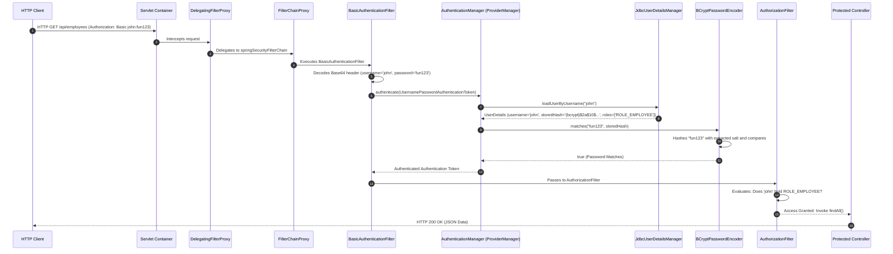
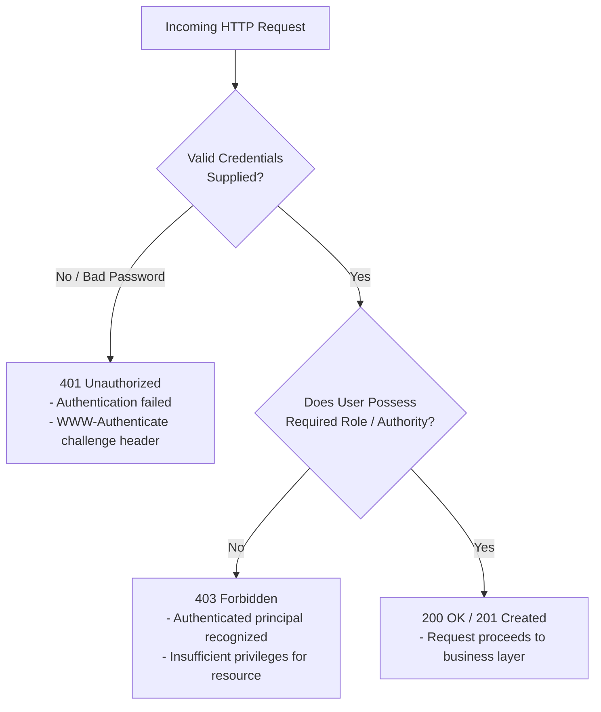

# Summary & Architecture Reference — Week 6: Stateless REST Security & RBAC

---

## 1. Annotation & Class Reference Matrix

| Class / Annotation | Package / Module | Role | Architectural Purpose | Low-Level Mechanism / Lifecycle Impact | Common Pitfall |
| :--- | :--- | :--- | :--- | :--- | :--- |
| `SecurityFilterChain` | `org.springframework.security.web` | Interface | Represents the ordered pipeline of security filters. | Registered as a Spring bean; `FilterChainProxy` matches requests against it. | Declaring multiple filter chains without configuring distinct `@Order` priorities. |
| `HttpSecurity` | `org.springframework.security.config.annotation.web.builders` | Builder | Fluent builder for configuring web-based security rules. | Compiles authorization rules, authentication mechanisms, and filter chains. | Chaining obsolete `.and()` methods instead of using the modern Spring Security 6/7 Lambda DSL. |
| `UserDetailsService` | `org.springframework.security.core.userdetails` | Interface | Core contract for retrieving user account records by username. | Invoked by authentication providers during credential verification. | Attempting to execute password verification inside `loadUserByUsername()` instead of returning the user record. |
| `UserDetailsManager` | `org.springframework.security.provisioning` | Interface | Extends `UserDetailsService` with user mutation operations. | Exposes `createUser()`, `updateUser()`, `deleteUser()`, `changePassword()`. | Using `InMemoryUserDetailsManager` in production clustered environments. |
| `JdbcUserDetailsManager`| `org.springframework.security.provisioning` | Class | Database-backed implementation of `UserDetailsManager` over JDBC. | Executes prepared statements against `users` and `authorities` tables using a `DataSource`. | Custom SQL queries missing the exact 3-column / 2-column projection contract. |
| `BCryptPasswordEncoder` | `org.springframework.security.crypto.bcrypt` | Class | Cryptographic password encoder utilizing the BCrypt algorithm. | Generates a 128-bit random salt and executes $2^N$ Eksblowfish key expansion rounds. | Storing raw plain-text passwords without algorithm prefixes or encoding. |
| `DelegatingPasswordEncoder`| `org.springframework.security.crypto.password` | Class | Master password encoder routing to specific algorithms via `{id}` prefix. | Inspects leading prefix (`{bcrypt}`, `{noop}`) to delegate to the matching encoder. | Omitting `{bcrypt}` prefix when storing raw BCrypt hashes in standard database tables. |

---

## 2. Spring Security Filter Chain Lifecycle



---

## 3. Roles vs Authorities Mental Model

| Dimension | Role (`hasRole`) | Authority (`hasAuthority`) |
| :--- | :--- | :--- |
| **Naming Convention** | Plain name: `"EMPLOYEE"`, `"ADMIN"` | Fully qualified string: `"ROLE_EMPLOYEE"`, `"READ_PRIVILEGE"` |
| **Framework Prefix** | Automatically prepends `ROLE_` behind the scenes | Evaluates the **exact literal string** without alteration |
| **Conceptual Scope** | Coarse-grained persona representing a job function | Fine-grained permission or action entitlement |
| **Code Equivalency** | `.hasRole("ADMIN")` | `.hasAuthority("ROLE_ADMIN")` |

!!! warning "Common Pitfall: Double Prefixing"
    If you write:
    ```java
    .requestMatchers("/admin/**").hasRole("ROLE_ADMIN") // BUG!
    ```
    Spring Security internally prepends `ROLE_`, searching for an authority named `ROLE_ROLE_ADMIN`. The check will fail for all users. Always omit the prefix when using `hasRole()`.

---

## 4. HTTP Security Status Codes Reference



---

## 5. BCrypt Hash String Anatomy Reference

```text
{bcrypt}$2a$10$qeS0HEh7urweMojsnwNAR.vcXJeXR1UcMRZ2WcGQl9YeuspUdgF.q
|______| |__| |__| |____________________| |______________________________|
   (1)   (2)  (3)           (4)                          (5)
```

1. **`{bcrypt}` Algorithm ID**: Signals `DelegatingPasswordEncoder` to invoke `BCryptPasswordEncoder`.
2. **`$2a$` Specification**: Identifies the BCrypt revision (fixes a minor 8-bit character collision bug in original `$2$`).
3. **`$10$` Work Factor Exponent**: Computational cost indicator ($2^{10} = 1,024$ key expansion rounds).
4. **22-Character Salt**: Base64-encoded 128-bit random salt defeating rainbow table attacks.
5. **31-Character Ciphertext**: Result of hashing the password with the salt and cost factor.

---

## 6. Database Schemas Quick Reference

### 6.1 Standard Schema

```sql
CREATE TABLE users (
  username varchar(50) NOT NULL PRIMARY KEY,
  password char(68) NOT NULL,
  enabled tinyint NOT NULL
);

CREATE TABLE authorities (
  username varchar(50) NOT NULL,
  authority varchar(50) NOT NULL,
  UNIQUE KEY authorities_idx_1 (username, authority),
  CONSTRAINT authorities_fk_1 FOREIGN KEY (username) REFERENCES users (username)
);
```

### 6.2 Custom Legacy Schema Adaptor Query

```java
jdbcUserDetailsManager.setUsersByUsernameQuery(
    "SELECT user_id, pw, active FROM members WHERE user_id = ?"
);
jdbcUserDetailsManager.setAuthoritiesByUsernameQuery(
    "SELECT user_id, role FROM roles WHERE user_id = ?"
);
```

---

## 7. Prerequisites for Week 7: Spring MVC Web & Form Validation

With backend data persistence and security established, the roadmap progresses to **Server-Side Rendered (SSR) Web Applications**:

1. **Spring MVC Architecture**: The complete `DispatcherServlet` request/response cycle, `Model`, and `ModelAndView`.
2. **Thymeleaf Template Engine**: Expression syntax (`${...}`, `*{...}`, `@{...}`), conditional rendering, and iteration.
3. **Form Model Binding**: Two-way binding between HTML form inputs and Java POJOs via `th:object` and `th:field`.
4. **Jakarta Bean Validation (JSR-380)**: Annotating domain fields with `@NotNull`, `@Size`, `@Min`, `@Max`, `@Pattern`, and capturing validation errors via `BindingResult`.
