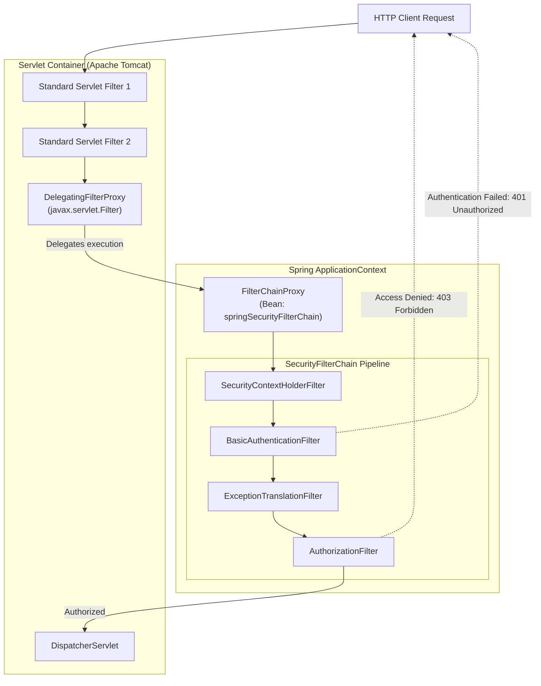
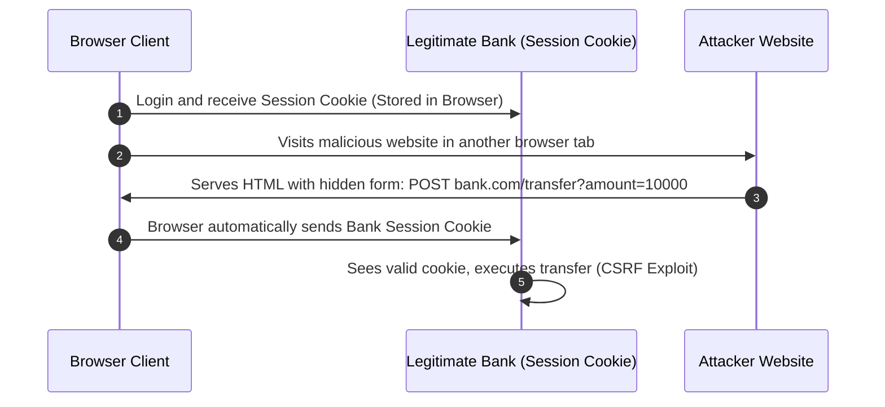
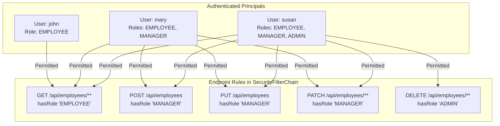
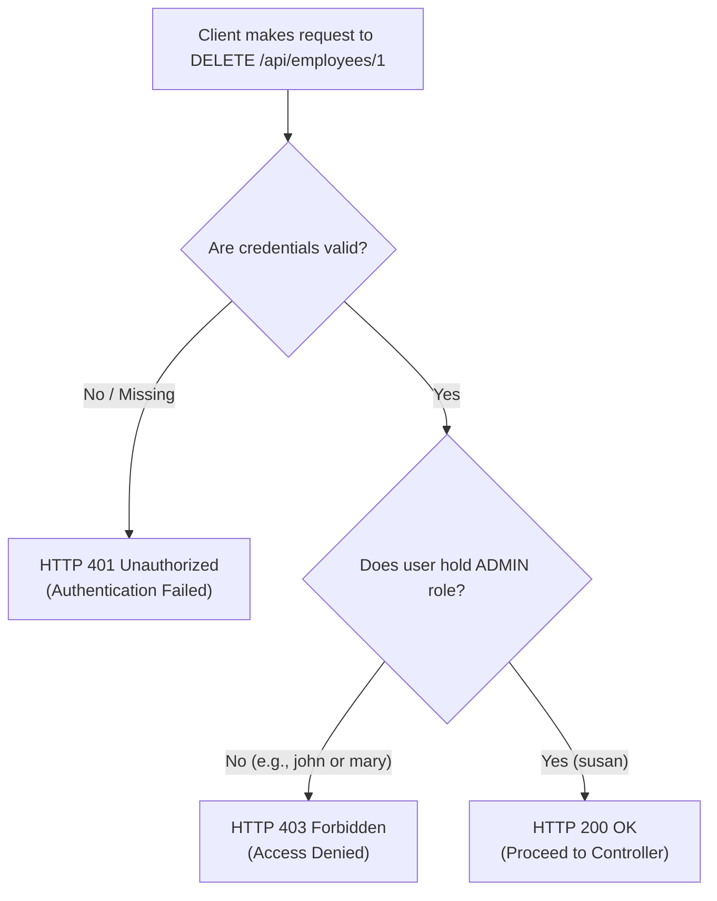

# Topic Notes — Part 1: Spring Security Architecture, Filter Chains, HTTP Basic & In-Memory RBAC

---

## 1. The Security Imperative & Spring Boot Defaults

In Weeks 4 and 5, we engineered fully functional RESTful APIs exposing CRUD capabilities over HTTP. However, in an unauthenticated architecture, any anonymous network client can invoke destructive endpoints:

```bash
# An anonymous actor deleting an executive record
curl -X DELETE http://localhost:8080/api/employees/1
```

To secure this perimeter, Spring Boot provides **Spring Security**, the enterprise standard for authentication, authorization, and protection against common application exploits.

### 1.1 Adding the Security Starter

Add the dependency to `pom.xml`:

```xml
<dependency>
    <groupId>org.springframework.boot</groupId>
    <artifactId>spring-boot-starter-security</artifactId>
</dependency>
```

### 1.2 Default Out-of-the-Box Behavior

The moment `spring-boot-starter-security` is placed on the classpath, Spring Boot auto-configures a default defense perimeter:

1. **Locks Down All Endpoints**: Every HTTP request requires authentication.
2. **Generates a Default User**: A default username named `user` is registered.
3. **Generates a Ephemeral Password**: A randomly generated security password is generated on startup and printed in the terminal console:
   ```text
   Using generated security password: 9f4a8b71-2e63-4819-bf9d-8c436b70129a
   ```
4. **Applies HTTP Basic & Form Login**: Browser requests are redirected to a default auto-generated login page; API clients receive an HTTP Basic challenge.

While convenient for local validation, this default configuration must be customized to enforce fine-grained role-based access control and production user provisioning.

---

## 2. Spring Security Core Architecture

Spring Security operates almost entirely within the standard Java Servlet container filter architecture.



### 2.1 The Bridge: `DelegatingFilterProxy`

The Servlet container (Tomcat, Jetty) has its own lifecycle independent of the Spring `ApplicationContext`. The Servlet container does not know about Spring beans.

To bridge this boundary, Spring provides `DelegatingFilterProxy`. It implements the standard `jakarta.servlet.Filter` interface, allowing Tomcat to register it. When an HTTP request enters `DelegatingFilterProxy.doFilter()`, it looks up a specialized bean named `springSecurityFilterChain` inside the Spring container and delegates execution to it.

### 2.2 The Coordinator: `FilterChainProxy`

The `springSecurityFilterChain` bean is an instance of `FilterChainProxy`. It holds a list of one or more `SecurityFilterChain` instances, matching incoming request URIs and invoking an ordered list of security filters.

### 2.3 The Core Security Filter Pipeline

Inside a typical `SecurityFilterChain`, filters execute sequentially:

1. **`SecurityContextHolderFilter`**: Loads previously established authentication (if any) from session or request cache into `SecurityContextHolder`.
2. **`BasicAuthenticationFilter`**: Inspects the HTTP `Authorization` request header for credentials formatted as `Basic <base64-encoded-string>`.
3. **`ExceptionTranslationFilter`**: Catches security exceptions (`AuthenticationException`, `AccessDeniedException`) and converts them into appropriate HTTP responses (`401` or `403`).
4. **`AuthorizationFilter`**: Evaluates whether the currently authenticated user possesses the required roles or authorities to access the matched URI.

---

## 3. Modern Security Configuration: The Lambda DSL

Prior to Spring Security 6 (Spring Boot 3), configuration relied on extending the deprecated `WebSecurityConfigurerAdapter` and authoring chained methods linked with `.and()`.

In modern Spring Security, configuration is purely **component-based** using the **Lambda DSL**:

```java
package com.luv2code.springboot.cruddemo.security;

import org.springframework.context.annotation.Bean;
import org.springframework.context.annotation.Configuration;
import org.springframework.http.HttpMethod;
import org.springframework.security.config.Customizer;
import org.springframework.security.config.annotation.web.builders.HttpSecurity;
import org.springframework.security.web.SecurityFilterChain;

@Configuration
public class DemoSecurityConfig {

    @Bean
    public SecurityFilterChain filterChain(HttpSecurity http) throws Exception {

        http.authorizeHttpRequests(configurer ->
                configurer
                        .requestMatchers(HttpMethod.GET, "/api/employees").hasRole("EMPLOYEE")
                        .requestMatchers(HttpMethod.GET, "/api/employees/**").hasRole("EMPLOYEE")
                        .requestMatchers(HttpMethod.POST, "/api/employees").hasRole("MANAGER")
                        .requestMatchers(HttpMethod.PUT, "/api/employees").hasRole("MANAGER")
                        .requestMatchers(HttpMethod.PATCH, "/api/employees/**").hasRole("MANAGER")
                        .requestMatchers(HttpMethod.DELETE, "/api/employees/**").hasRole("ADMIN")
        );

        // Enable HTTP Basic authentication
        http.httpBasic(Customizer.withDefaults());

        // Disable Cross-Site Request Forgery (CSRF)
        http.csrf(csrf -> csrf.disable());

        return http.build();
    }
}
```

### 3.1 Understanding HTTP Basic Authentication

When `http.httpBasic(Customizer.withDefaults())` is configured:

1. The client supplies credentials in the HTTP request header:
   ```http
   Authorization: Basic am9objp0ZXN0MTIz
   ```
2. The credential string is constructed by concatenating `username + ":" + password` and encoding it using **Base64**:
   `john:test123` $\rightarrow$ `am9objp0ZXN0MTIz`.
3. The server's `BasicAuthenticationFilter` intercepts the request, decodes the Base64 token, extracts `john` and `test123`, and authenticates against the configured `UserDetailsService`.

!!! warning "Base64 is Encoding, NOT Encryption"
    Base64 encoding is trivially reversible. An attacker on an unencrypted network can decode the authorization header in milliseconds. Therefore, **HTTP Basic authentication must ALWAYS execute over TLS/HTTPS** in production environments.

### 3.2 The CSRF Deep Dive: Why Disable It for Stateless REST APIs?

A common question among engineers is: **Why does the security configuration explicitly call `http.csrf(csrf -> csrf.disable())`?**

**Cross-Site Request Forgery (CSRF)** occurs when a malicious website causes a user's web browser to perform an unwanted action on a trusted site where the user is currently authenticated.



CSRF attacks rely on the browser's **ambient authority**—namely, that web browsers automatically attach session cookies to cross-origin requests.

#### Why Stateless REST APIs Do NOT Require CSRF Protection:
1. **No Session Cookies**: Stateless REST microservices authenticate every request explicitly via the `Authorization: Basic ...` or `Bearer <JWT>` header.
2. **No Ambient Attachment**: Browsers do *not* automatically attach custom `Authorization` headers to cross-site requests. A foreign website cannot forge an `Authorization` header on behalf of the user.
3. **If CSRF is left enabled on a REST API**: Spring Security expects an `X-CSRF-TOKEN` header on every state-mutating HTTP request (`POST`, `PUT`, `PATCH`, `DELETE`). Non-browser API clients (mobile apps, microservices, cURL) will receive an HTTP `403 Forbidden` error on all write operations.

Therefore, for stateless REST APIs, disabling CSRF is standard and secure.

---

## 4. In-Memory User Provisioning with `InMemoryUserDetailsManager`

To test authentication and role boundaries locally without spinning up a database, Spring Security provides `InMemoryUserDetailsManager`:

```java
@Bean
public InMemoryUserDetailsManager userDetailsManager() {

    UserDetails john = User.builder()
            .username("john")
            .password("{noop}test123")
            .roles("EMPLOYEE")
            .build();

    UserDetails mary = User.builder()
            .username("mary")
            .password("{noop}test123")
            .roles("EMPLOYEE", "MANAGER")
            .build();

    UserDetails susan = User.builder()
            .username("susan")
            .password("{noop}test123")
            .roles("EMPLOYEE", "MANAGER", "ADMIN")
            .build();

    return new InMemoryUserDetailsManager(john, mary, susan);
}
```

### 4.1 The `{noop}` Password Prefix

Notice the password declaration: `.password("{noop}test123")`.

Spring Security uses `DelegatingPasswordEncoder` to support multiple hashing algorithms simultaneously. The prefix enclosed in curly braces identifies the hashing algorithm used to store the password:

- `{noop}`: **No-Operation (Plain Text)** — used strictly for development and testing.
- `{bcrypt}`: **BCrypt Strong Hashing** — standard for production.
- `{pbkdf2}`: PBKDF2 with HMAC-SHA256.
- `{scrypt}`: SCrypt hashing.
- `{argon2}`: Argon2 password hashing.

If no prefix is provided and no default encoder is explicitly configured, Spring Security throws an `IllegalArgumentException: There is no PasswordEncoder mapped for the id "null"`.

---

## 5. Granular Route Authorization: Roles vs Authorities

### 5.1 Roles vs Authorities: The Mental Model

In Spring Security, the distinction between a **Role** and an **Authority** is a matter of naming convention:

- An **Authority** is a fine-grained, individual permission string (e.g., `READ_PRIVILEGE`, `DELETE_USER`).
- A **Role** is a coarse-grained group of permissions. By convention, Spring Security prefixes all roles with the string `ROLE_`.

When you declare:
```java
.roles("EMPLOYEE")
```
Spring Security internally creates a `GrantedAuthority` with the value:
```text
ROLE_EMPLOYEE
```

When authoring route rules in `filterChain`:
- `.hasRole("EMPLOYEE")`: Automatically prepends `ROLE_` and verifies that the user holds the authority `ROLE_EMPLOYEE`.
- `.hasAuthority("ROLE_EMPLOYEE")`: Evaluates the exact authority string without prepending anything.

### 5.2 Granular Method & Path Authorization Matrix

Our enterprise API enforces the following tiered access control model:



| HTTP Method | Endpoint Pattern | Authorized Role(s) | Permitted Users |
| :--- | :--- | :--- | :--- |
| `GET` | `/api/employees`, `/api/employees/**` | `EMPLOYEE` | `john`, `mary`, `susan` |
| `POST` | `/api/employees` | `MANAGER` | `mary`, `susan` |
| `PUT` | `/api/employees` | `MANAGER` | `mary`, `susan` |
| `PATCH` | `/api/employees/**` | `MANAGER` | `mary`, `susan` |
| `DELETE` | `/api/employees/**` | `ADMIN` | `susan` |

---

## 6. HTTP Security Status Codes: 401 Unauthorized vs 403 Forbidden

A critical architectural distinction in RESTful security lies between HTTP status codes **401** and **403**:

| Status Code | Meaning | Cause | Example Scenario |
| :--- | :--- | :--- | :--- |
| **`401 Unauthorized`** | Authentication Required | The client failed to authenticate (missing or bad credentials). | `curl -X GET /api/employees` without Authorization header, or using wrong password. |
| **`403 Forbidden`** | Authorization Refused | The client authenticated successfully, but lacks permission for this resource. | `john` (role `EMPLOYEE`) attempts to execute `DELETE /api/employees/1`. |


