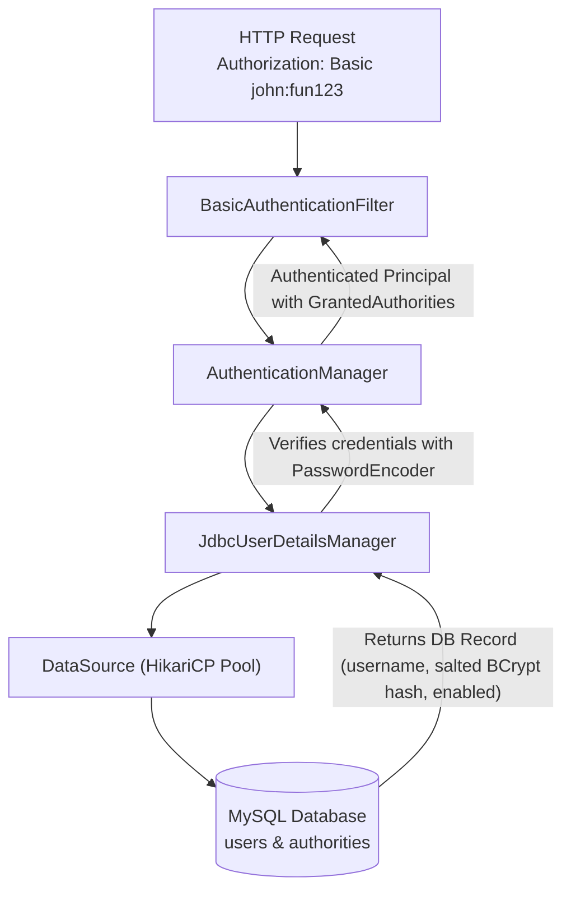
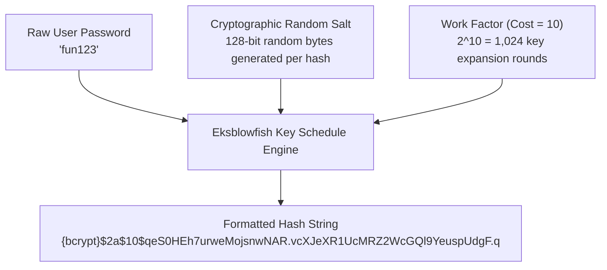
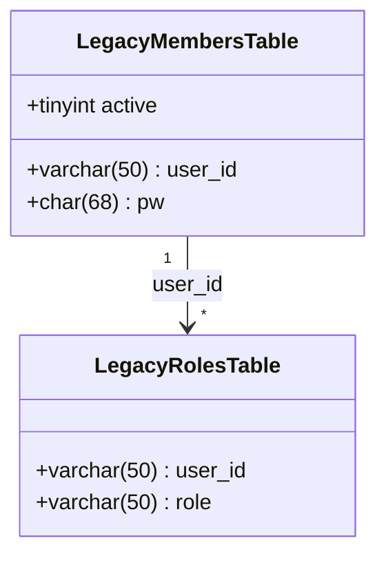

# Topic Notes — Part 2: Database Authentication, BCrypt Password Hashing, and Custom Schemas

---

## 1. Moving from In-Memory to Database Authentication

In Part 1, we implemented authentication using `InMemoryUserDetailsManager`. While effective for testing, in-memory credential storage is an architectural anti-pattern in production:
- **No Persistence**: Restarting the container evicts newly registered users or updated credentials.
- **No Horizontal Scalability**: Across a distributed cluster of microservice instances, in-memory user registries cannot maintain synchronized state.
- **Hardcoded Credentials**: Embedding user passwords in Java source code violates basic security and compliance standards (PCI-DSS, SOC 2, ISO 27001).

Production systems require authenticating credentials against a **relational database** via **JDBC**.



---

## 2. Spring Security Standard Relational Schema

Spring Security provides an out-of-the-box database schema convention. If you create tables adhering to this exact schema, Spring can execute authentication queries with zero custom SQL required.

### 2.1 The `users` Table

Stores user identity and account status:

```sql
CREATE TABLE `users` (
  `username` varchar(50) NOT NULL,
  `password` char(68) NOT NULL,
  `enabled` tinyint NOT NULL,
  PRIMARY KEY (`username`)
) ENGINE=InnoDB DEFAULT CHARSET=latin1;
```

- `username`: The unique primary key identifier.
- `password`: Sized to `char(68)` to accommodate the algorithm prefix (`{bcrypt}`) plus the standard 60-character BCrypt hash.
- `enabled`: A flag (`1` for active, `0` for disabled). If `enabled = 0`, Spring Security blocks authentication immediately with a `DisabledException`.

### 2.2 The `authorities` Table

Stores role and privilege mappings:

```sql
CREATE TABLE `authorities` (
  `username` varchar(50) NOT NULL,
  `authority` varchar(50) NOT NULL,
  UNIQUE KEY `authorities_idx_1` (`username`, `authority`),
  CONSTRAINT `authorities_ibfk_1` FOREIGN KEY (`username`) REFERENCES `users` (`username`)
) ENGINE=InnoDB DEFAULT CHARSET=latin1;
```

- Maintains a foreign key referencing `users(username)`.
- Defines a compound unique key `(username, authority)` to prevent duplicate role assignments.
- Authority values follow the `ROLE_` naming convention: `ROLE_EMPLOYEE`, `ROLE_MANAGER`, `ROLE_ADMIN`.

### 2.3 Spring Security Default Internal Queries

When using standard tables, `JdbcUserDetailsManager` automatically executes these built-in prepared statements:

```sql
-- 1. Load user by username
SELECT username, password, enabled FROM users WHERE username = ?

-- 2. Load authorities by username
SELECT username, authority FROM authorities WHERE username = ?
```

---

## 3. Cryptographic Hashing: The BCrypt Algorithm

Storing plain-text passwords in a database is fatal: a SQL injection breach or leaked database backup immediately compromises all user accounts.

### 3.1 Why Legacy Hashing (MD5, SHA-1, SHA-256) Fails

Junior engineers often assume that standard cryptographic digests like SHA-256 are sufficient. In modern security engineering, standard digests are completely insecure for password storage:

1. **Deterministic Hashing**: If two users have the password `password123`, their SHA-256 hashes are identical (`ef92b778...`).
2. **Rainbow Table Attacks**: Attackers pre-compute trillions of common password hashes in reverse lookup tables ("Rainbow Tables"), allowing instant plaintext recovery.
3. **Hardware Acceleration**: SHA-256 was engineered for high throughput. Modern consumer GPUs can calculate over **10 billion SHA-256 hashes per second**, enabling brute-force cracking of 8-character passwords in minutes.

### 3.2 What Makes BCrypt Secure

BCrypt, designed by Niels Provos and David Mazières in 1999 based on the Blowfish cipher, defeats these vulnerabilities through two cryptographic mechanisms:



1. **Automatic Unique Salt Generation**:
   - For every password hashed, BCrypt generates a fresh **128-bit cryptographically random salt**.
   - Even if two users choose the identical password `fun123`, their resulting BCrypt strings are completely different.
   - Rainbow tables are rendered completely useless.
2. **Tunable Work Factor (Cost Factor)**:
   - The cost factor $N$ (default is 10) dictates the computational cost by executing $2^N$ key expansion iterations ($2^{10} = 1,024$ rounds).
   - This intentionally slows down hash computation to ~100 milliseconds per evaluation.
   - For a legitimate user logging in once, 100ms is imperceptible. For an attacker attempting 10 billion guesses, 100ms per attempt makes brute force computationally impossible.
   - As hardware capabilities advance, the work factor can be adjusted upward (e.g., from 10 to 12) without altering database schemas.

### 3.3 Dissecting the BCrypt Hash String

A complete Spring Security BCrypt hash consists of five distinct structural parts:

```text
{bcrypt}$2a$10$qeS0HEh7urweMojsnwNAR.vcXJeXR1UcMRZ2WcGQl9YeuspUdgF.q
|______| |__| |__| |____________________| |______________________________|
   (1)   (2)  (3)           (4)                          (5)
```

1. **`{bcrypt}`**: Spring Security `DelegatingPasswordEncoder` algorithm identifier.
2. **`$2a$`**: BCrypt algorithm format specification.
3. **`$10$`**: The cost / work factor exponent ($2^{10} = 1024$ rounds).
4. **`qeS0HEh7urweMojsnwNAR.`**: The 22-character Base64-encoded random salt.
5. **`vcXJeXR1UcMRZ2WcGQl9YeuspUdgF.q`**: The 31-character Base64-encoded ciphertext hash.

### 3.4 Verification: Constant-Time Comparison

When a user logs in with plaintext password `fun123`:
1. Spring Security extracts the stored salt (`qeS0HEh7urweMojsnwNAR.`) and cost (`10`) directly from the stored hash.
2. It hashes the candidate password using that identical salt and cost factor.
3. It compares the newly generated hash with the stored hash using a **constant-time byte comparison** algorithm, preventing side-channel **timing attacks**.

---

## 4. Configuring `JdbcUserDetailsManager` with Standard Schemas

To configure Spring Security with standard JDBC tables, declare a `UserDetailsManager` bean injecting the auto-configured `DataSource`:

```java
package com.luv2code.springboot.cruddemo.security;

import org.springframework.context.annotation.Bean;
import org.springframework.context.annotation.Configuration;
import org.springframework.http.HttpMethod;
import org.springframework.security.config.Customizer;
import org.springframework.security.config.annotation.web.builders.HttpSecurity;
import org.springframework.security.provisioning.JdbcUserDetailsManager;
import org.springframework.security.provisioning.UserDetailsManager;
import org.springframework.security.web.SecurityFilterChain;

import javax.sql.DataSource;

@Configuration
public class DemoSecurityConfig {

    // Define UserDetailsManager bean injecting the application DataSource
    @Bean
    public UserDetailsManager userDetailsManager(DataSource dataSource) {
        return new JdbcUserDetailsManager(dataSource);
    }

    @Bean
    public SecurityFilterChain filterChain(HttpSecurity http) throws Exception {

        http.authorizeHttpRequests(configurer ->
                configurer
                        .requestMatchers(HttpMethod.GET, "/api/employees").hasRole("EMPLOYEE")
                        .requestMatchers(HttpMethod.GET, "/api/employees/**").hasRole("EMPLOYEE")
                        .requestMatchers(HttpMethod.POST, "/api/employees").hasRole("MANAGER")
                        .requestMatchers(HttpMethod.PUT, "/api/employees").hasRole("MANAGER")
                        .requestMatchers(HttpMethod.DELETE, "/api/employees/**").hasRole("ADMIN")
        );

        // HTTP Basic authentication
        http.httpBasic(Customizer.withDefaults());

        // Disable CSRF for stateless REST endpoints
        http.csrf(csrf -> csrf.disable());

        return http.build();
    }
}
```

### 4.1 SQL Seed Script

```sql
USE `employee_directory`;

DROP TABLE IF EXISTS `authorities`;
DROP TABLE IF EXISTS `users`;

CREATE TABLE `users` (
  `username` varchar(50) NOT NULL,
  `password` char(68) NOT NULL,
  `enabled` tinyint NOT NULL,
  PRIMARY KEY (`username`)
) ENGINE=InnoDB DEFAULT CHARSET=latin1;

-- Password for all users is: fun123
INSERT INTO `users` VALUES 
  ('john', '{bcrypt}$2a$10$qeS0HEh7urweMojsnwNAR.vcXJeXR1UcMRZ2WcGQl9YeuspUdgF.q', 1),
  ('mary', '{bcrypt}$2a$10$qeS0HEh7urweMojsnwNAR.vcXJeXR1UcMRZ2WcGQl9YeuspUdgF.q', 1),
  ('susan', '{bcrypt}$2a$10$qeS0HEh7urweMojsnwNAR.vcXJeXR1UcMRZ2WcGQl9YeuspUdgF.q', 1);

CREATE TABLE `authorities` (
  `username` varchar(50) NOT NULL,
  `authority` varchar(50) NOT NULL,
  UNIQUE KEY `authorities_idx_1` (`username`,`authority`),
  CONSTRAINT `authorities_ibfk_1` FOREIGN KEY (`username`) REFERENCES `users` (`username`)
) ENGINE=InnoDB DEFAULT CHARSET=latin1;

INSERT INTO `authorities` VALUES 
  ('john', 'ROLE_EMPLOYEE'),
  ('mary', 'ROLE_EMPLOYEE'),
  ('mary', 'ROLE_MANAGER'),
  ('susan', 'ROLE_EMPLOYEE'),
  ('susan', 'ROLE_MANAGER'),
  ('susan', 'ROLE_ADMIN');
```

---

## 5. Adapting Non-Standard Custom Database Schemas

In enterprise engineering, you frequently integrate with legacy production databases where table and column names do not match Spring Security conventions:



### 5.1 Custom SQL Query Mapping

`JdbcUserDetailsManager` provides explicit setter methods to override its default internal SQL queries:

```java
@Configuration
public class DemoSecurityConfig {

    @Bean
    public UserDetailsManager userDetailsManager(DataSource dataSource) {

        JdbcUserDetailsManager jdbcUserDetailsManager = new JdbcUserDetailsManager(dataSource);

        // Define custom query to retrieve user by username
        // Order of projection MUST be: username, password, enabled
        jdbcUserDetailsManager.setUsersByUsernameQuery(
                "SELECT user_id, pw, active FROM members WHERE user_id = ?"
        );

        // Define custom query to retrieve authorities by username
        // Order of projection MUST be: username, authority
        jdbcUserDetailsManager.setAuthoritiesByUsernameQuery(
                "SELECT user_id, role FROM roles WHERE user_id = ?"
        );

        return jdbcUserDetailsManager;
    }
    // ...
}
```

### 5.2 Strict Contract Rules for Custom Queries

!!! important "Query Column Projection Ordering"
    When authoring custom queries for `JdbcUserDetailsManager`, the column names in the database can be arbitrary, but the **SELECT column order and count must strictly match Spring Security's expectations**:
    
    1. **Users Query**: Exactly 3 columns in order:
       - Column 1: Username identifier (`user_id`)
       - Column 2: Encrypted password string (`pw`)
       - Column 3: Boolean/Integer enabled flag (`active`)
       - Parameter: Exactly one parameter placeholder (`?`) bound to the incoming username.
    
    2. **Authorities Query**: Exactly 2 columns in order:
       - Column 1: Username identifier (`user_id`)
       - Column 2: Authority or role string (`role`)
       - Parameter: Exactly one parameter placeholder (`?`) bound to the incoming username.

---

## 6. Architectural Summary & Production Best Practices

| Dimension | In-Memory (`InMemoryUserDetailsManager`) | JDBC Standard (`users`/`authorities`) | JDBC Custom Queries |
| :--- | :--- | :--- | :--- |
| **Persistence** | Ephemeral (wiped on restart) | Permanent relational storage | Permanent relational storage |
| **Schema Flexibility** | N/A (memory objects) | Strict (fixed table/column names) | Highly flexible (adapts legacy DBs) |
| **Password Encoding** | `{noop}` or `{bcrypt}` | **Mandatory `{bcrypt}`** | **Mandatory `{bcrypt}`** |
| **Use Case** | Unit testing, local development | New greenfield microservices | Legacy enterprise database migrations |

!!! caution "Production Best Practice: Work Factor Calibration"
    While cost factor 10 is standard, security compliance teams may mandate cost 12 or 14 for sensitive data (financial systems, healthcare). Always benchmark password hashing on your production CPU architecture to balance authentication latency against cryptographic resistance.
