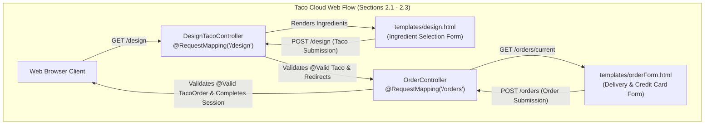

# Book Reading — Spring in Action (6th Ed.) Chapter 2: Developing Web Applications

> **Reference:** Craig Walls, *Spring in Action (6th Edition)*, Chapter 2: Developing Web Applications, Sections 2.1–2.3, pages 29–52.

---

## 1. Chapter Overview & Architectural Objectives

In Chapter 2, Craig Walls transitions from introductory setup to building the user-facing web tier of the canonical **Taco Cloud** enterprise application. The chapter establishes how Spring MVC delivers server-side rendered HTML applications, coordinates complex domain hierarchies across multiple view screens, and enforces declarative validation rules using the Jakarta Bean Validation standard.



---

## 2. Section 2.1: Displaying Information

The goal of Section 2.1 is presenting an ingredient palette for users to compose custom tacos. Walls emphasizes that ingredient catalogs change frequently; they must never be hardcoded into static HTML templates.

### 2.1 Domain Modeling

The domain model consists of three core components:
1. `Ingredient`: Represents an ingredient item with an ID, descriptive name, and an enum `Type` (`WRAP`, `PROTEIN`, `CHEESE`, `VEGGIES`, `SAUCE`).
2. `Taco`: Represents a custom taco entity composed of a name and a list of selected `Ingredient` objects.
3. `TacoOrder`: Represents the overarching customer purchase order, containing delivery details, payment information, and a list of custom `Taco` items.

```java
package tacos;

import lombok.Data;

@Data
public class Ingredient {
    private final String id;
    private final String name;
    private final Type type;

    public enum Type {
        WRAP, PROTEIN, CHEESE, VEGGIES, SAUCE
    }
}
```

### 2.2 The Design Controller

```java
package tacos.web;

import org.springframework.stereotype.Controller;
import org.springframework.ui.Model;
import org.springframework.web.bind.annotation.GetMapping;
import org.springframework.web.bind.annotation.ModelAttribute;
import org.springframework.web.bind.annotation.RequestMapping;
import org.springframework.web.bind.annotation.SessionAttributes;
import lombok.extern.slf4j.Slf4j;
import tacos.Ingredient;
import tacos.Ingredient.Type;
import tacos.Taco;
import tacos.TacoOrder;

import java.util.Arrays;
import java.util.List;
import java.util.stream.Collectors;

@Slf4j
@Controller
@RequestMapping("/design")
@SessionAttributes("tacoOrder")
public class DesignTacoController {

    @ModelAttribute
    public void addIngredientsToModel(Model model) {
        List<Ingredient> ingredients = Arrays.asList(
            new Ingredient("FLTO", "Flour Tortilla", Type.WRAP),
            new Ingredient("COTO", "Corn Tortilla", Type.WRAP),
            new Ingredient("GRBF", "Ground Beef", Type.PROTEIN),
            new Ingredient("CARN", "Carnitas", Type.PROTEIN),
            new Ingredient("TMTO", "Diced Tomatoes", Type.VEGGIES),
            new Ingredient("LETC", "Lettuce", Type.VEGGIES),
            new Ingredient("CHED", "Cheddar", Type.CHEESE),
            new Ingredient("JACK", "Monterrey Jack", Type.CHEESE),
            new Ingredient("SLSA", "Salsa", Type.SAUCE),
            new Ingredient("SRCR", "Sour Cream", Type.SAUCE)
        );

        Type[] types = Ingredient.Type.values();
        for (Type type : types) {
            model.addAttribute(type.toString().toLowerCase(),
                filterByType(ingredients, type));
        }
    }

    @ModelAttribute(name = "tacoOrder")
    public TacoOrder order() {
        return new TacoOrder();
    }

    @ModelAttribute(name = "taco")
    public Taco taco() {
        return new Taco();
    }

    @GetMapping
    public String showDesignForm() {
        return "design";
    }

    private Iterable<Ingredient> filterByType(List<Ingredient> ingredients, Type type) {
        return ingredients.stream()
            .filter(x -> x.getType().equals(type))
            .collect(Collectors.toList());
    }
}
```

### 2.3 Key Architectural Patterns Highlighted by Walls

1. **Method-Level `@ModelAttribute`**: The `addIngredientsToModel()` method is invoked **before** any request handler (`@GetMapping`) in the controller executes. This guarantees that model attributes (`wrap`, `protein`, `cheese`, etc.) are consistently available across all requests handled by this controller.
2. **Session Attributes with `@SessionAttributes("tacoOrder")`**: The `TacoOrder` object spans multiple HTTP requests (designing multiple tacos, followed by final checkout). By annotating the controller with `@SessionAttributes("tacoOrder")`, Spring maintains the `TacoOrder` instance in the HTTP session rather than discarding it at the end of a single request.
3. **The Spring Type Converter (`IngredientByIdConverter`)**:
   In the HTML form, checkboxes submit raw string codes (such as `"FLTO"`, `"GRBF"`). How does Spring convert these strings into typed `Ingredient` domain objects?
   Walls introduces the `Converter<String, Ingredient>` contract:
   ```java
   @Component
   public class IngredientByIdConverter implements Converter<String, Ingredient> {
       private Map<String, Ingredient> ingredientMap = new HashMap<>();

       public IngredientByIdConverter() {
           // Populates ingredientMap ...
       }

       @Override
       public Ingredient convert(String id) {
           return ingredientMap.get(id);
       }
   }
   ```
   Spring's `ConversionService` automatically discovers any bean implementing `Converter` and applies it transparently during form data binding!

---

## 3. Section 2.2: Processing Form Submissions

Once the customer selects ingredients, submits the taco, and proceeds to checkout, the application must process two distinct form submissions.

### 3.1 Handling Taco Design Submission

```java
@PostMapping
public String processTaco(
        Taco taco,
        @ModelAttribute TacoOrder tacoOrder) {

    tacoOrder.addTaco(taco);
    log.info("Processing taco: {}", taco);

    return "redirect:/orders/current";
}
```

- `taco`: Populated from the form submission.
- `@ModelAttribute TacoOrder tacoOrder`: Retrieved directly from the HTTP session (managed via `@SessionAttributes`).
- `return "redirect:/orders/current"`: Implements the **Post-Redirect-Get (PRG)** pattern. Instead of rendering a view directly from a `POST` handler, Spring sends an HTTP 302 Redirect to a `GET` endpoint, preventing duplicate form submissions if the user refreshes the browser.

### 3.2 Handling Order Checkout and Completing the Session

```java
package tacos.web;

import org.springframework.stereotype.Controller;
import org.springframework.web.bind.annotation.GetMapping;
import org.springframework.web.bind.annotation.PostMapping;
import org.springframework.web.bind.annotation.RequestMapping;
import org.springframework.web.bind.annotation.SessionAttributes;
import org.springframework.web.bind.support.SessionStatus;
import lombok.extern.slf4j.Slf4j;
import tacos.TacoOrder;

@Slf4j
@Controller
@RequestMapping("/orders")
@SessionAttributes("tacoOrder")
public class OrderController {

    @GetMapping("/current")
    public String orderForm() {
        return "orderForm";
    }

    @PostMapping
    public String processOrder(TacoOrder order, SessionStatus sessionStatus) {
        log.info("Order submitted: {}", order);

        // Reset session state so subsequent orders start with a fresh TacoOrder
        sessionStatus.setComplete();

        return "redirect:/";
    }
}
```

- `SessionStatus.setComplete()`: Instructs Spring to remove the `tacoOrder` attribute from the HTTP session. The order lifecycle is terminated, and a subsequent visit to `/design` will instantiate a fresh order.

---

## 4. Section 2.3: Validating Form Input

In Section 2.3, Craig Walls demonstrates what happens when bad or malicious input reaches the controller: users submit empty taco names, select zero ingredients, or enter invalid credit card numbers.

Walls explains why imperative validation logic (`if (taco.getName() == null) ...`) is an anti-pattern: it bloats controller code, obscures business orchestration, and creates code duplication across different entry points.

### 4.1 Applying Declarative Validation Constraints

Walls leverages Jakarta Bean Validation (JSR-380) and Hibernate Validator via `spring-boot-starter-validation`.

#### Constraints on `Taco`:
```java
package tacos;

import java.util.List;
import jakarta.validation.constraints.NotNull;
import jakarta.validation.constraints.Size;
import lombok.Data;

@Data
public class Taco {

    @NotNull
    @Size(min = 5, message = "Name must be at least 5 characters long")
    private String name;

    @NotNull
    @Size(min = 1, message = "You must choose at least 1 ingredient")
    private List<Ingredient> ingredients;
}
```

#### Constraints on `TacoOrder`:
```java
package tacos;

import jakarta.validation.constraints.Digits;
import jakarta.validation.constraints.NotBlank;
import jakarta.validation.constraints.Pattern;
import org.hibernate.validator.constraints.CreditCardNumber;
import lombok.Data;
import java.util.ArrayList;
import java.util.List;

@Data
public class TacoOrder {

    @NotBlank(message = "Delivery name is required")
    private String deliveryName;

    @NotBlank(message = "Street is required")
    private String deliveryStreet;

    @NotBlank(message = "City is required")
    private String deliveryCity;

    @NotBlank(message = "State is required")
    private String deliveryState;

    @NotBlank(message = "Zip code is required")
    private String deliveryZip;

    // Hibernate Validator constraint verifying Luhn algorithm checksum
    @CreditCardNumber(message = "Not a valid credit card number")
    private String ccNumber;

    // Enforces MM/YY formatting with slash delimiter
    @Pattern(regexp = "^(0[1-9]|1[0-2])([\\/])([2-9][0-9])$",
             message = "Must be formatted MM/YY")
    private String ccExpiration;

    // Enforces exact 3-digit CVV number
    @Digits(integer = 3, fraction = 0, message = "Invalid CVV")
    private String ccCVV;

    private List<Taco> tacos = new ArrayList<>();

    public void addTaco(Taco taco) {
        this.tacos.add(taco);
    }
}
```

### 4.2 Enforcing Validation in Controllers via `@Valid` and `Errors`

Spring MVC intercepts the submitted payload and executes validation when the handler parameter is annotated with `@Valid`:

```java
@PostMapping
public String processTaco(
        @Valid Taco taco,
        Errors errors,
        @ModelAttribute TacoOrder tacoOrder) {

    if (errors.hasErrors()) {
        // Validation failed: Re-render design template with error indicators
        return "design";
    }

    tacoOrder.addTaco(taco);
    log.info("Processing taco: {}", taco);

    return "redirect:/orders/current";
}
```

```java
@PostMapping
public String processOrder(
        @Valid TacoOrder order,
        Errors errors,
        SessionStatus sessionStatus) {

    if (errors.hasErrors()) {
        return "orderForm";
    }

    log.info("Order submitted: {}", order);
    sessionStatus.setComplete();

    return "redirect:/";
}
```

!!! note "Errors vs BindingResult"
    In Spring MVC, `org.springframework.validation.BindingResult` is an interface that directly extends `org.springframework.validation.Errors`. Craig Walls uses `Errors` in *Spring in Action*, whereas Chad Darby uses `BindingResult`. Both provide `.hasErrors()`, `.getAllErrors()`, and `.getFieldError()`.

### 4.3 Rendering Validation Feedback in Thymeleaf

To display error feedback adjacent to invalid input fields, Walls uses Thymeleaf's `#fields` object and `th:errors` attribute:

```html
<!-- Taco Name Input with Validation Feedback -->
<label for="name">Name your taco:</label>
<input type="text" th:field="*{name}" />
<span class="validationError"
      th:if="${#fields.hasErrors('name')}"
      th:errors="*{name}">Name Error</span>

<!-- Ingredients Checkbox List with Validation Feedback -->
<span class="validationError"
      th:if="${#fields.hasErrors('ingredients')}"
      th:errors="*{ingredients}">Ingredient Error</span>

<!-- Credit Card Number Input with Luhn Check Feedback -->
<label for="ccNumber">Credit Card #: </label>
<input type="text" th:field="*{ccNumber}" />
<span class="validationError"
      th:if="${#fields.hasErrors('ccNumber')}"
      th:errors="*{ccNumber}">CC Num Error</span>
```

---

## 5. Architectural Synthesis: Walls' Web Foundations

| Architectural Concept | Craig Walls' Explanation (*Spring in Action*) | Industry Best Practice |
| :--- | :--- | :--- |
| **Model Pre-Population** | `@ModelAttribute` placed directly on a method runs before every `@GetMapping` handler. | Clean pattern for populating shared catalogs and static reference data. |
| **Session Scoping** | `@SessionAttributes("tacoOrder")` preserves state across multi-step wizard flows without database round-trips. | Must be explicitly finalized via `SessionStatus.setComplete()` to avoid memory leaks. |
| **Type Conversion** | Custom `Converter<S, T>` automatically transforms form request parameters into rich domain models. | Prefer `Converter` over manual parsing in controllers or services. |
| **Form Submission Pattern** | Post-Redirect-Get (PRG) pattern (`return "redirect:/path"`). | Mandatory for all state-mutating HTTP `POST` handlers to prevent duplicate submissions. |
| **Declarative Validation** | Jakarta Bean Validation constraints (`@NotBlank`, `@Size`, `@CreditCardNumber`). | Decouples validation logic from business orchestration and ensures consistent reusability. |
