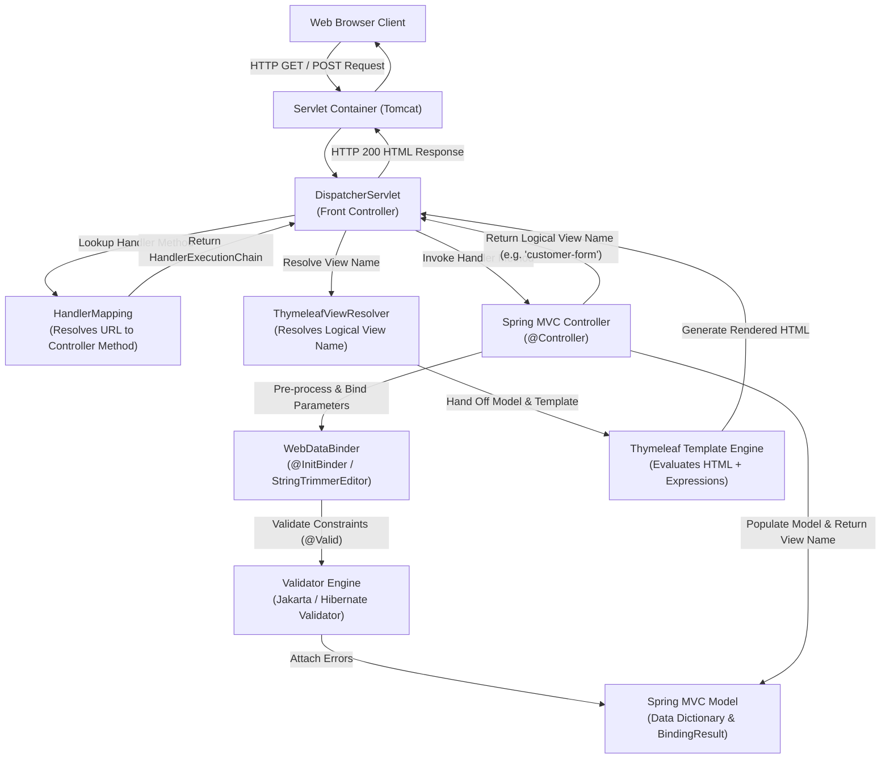

# Week 7 — Spring MVC Web Architecture, Thymeleaf & Form Validation

## Goal

Master the foundational architecture of server-side rendered web applications using Spring MVC and Thymeleaf. Demystify the internal request lifecycle governed by the `DispatcherServlet` front controller, explore bidirectional form data binding using typed form-backing beans, sanitize user inputs via `@InitBinder` and `StringTrimmerEditor`, enforce declarative integrity constraints using Jakarta Bean Validation (JSR-380), and develop custom constraint annotations backed by reusable `ConstraintValidator` implementations.

---

## :material-calendar: Week 7 Schedule

| Topic | Modules / Sections | Key Annotations / Concepts |
| :--- | :--- | :--- |
| **Spring MVC Fundamentals & Thymeleaf** | Modules 01–06 | `spring-boot-starter-thymeleaf`, `@Controller`, `Model`, `@RequestParam`, `@GetMapping`, `@PostMapping` |
| **Bidirectional Form Model Binding** | Modules 07–13 | Form-backing objects, `th:object`, `th:field`, `<select>`, `<input type="radio">`, `<input type="checkbox">`, `@Value("${...}")` |
| **Jakarta Bean Validation Core Constraints** | Modules 14–17 | `spring-boot-starter-validation`, `@Valid`, `BindingResult`, `@NotNull`, `@Size`, `@Min`, `@Max`, `@Pattern` |
| **Input Sanitization & Error Handling** | Modules 18–19 | `@InitBinder`, `WebDataBinder`, `StringTrimmerEditor`, type conversion errors, `messages.properties` |
| **Custom Constraint Engineering** | Module 20 | `@Constraint`, `ConstraintValidator`, custom annotations (`@CourseCode`, `@CorporateEmail`), validation payloads |
| **Book Reading — Chapter 2: Developing Web Applications** | Ch 2 (pp. 29–52) | Displaying model data, processing form submissions, Jakarta Validation in Taco Cloud |

---

## :material-sitemap: Architectural Progression

---

## :material-folder-open: Week 7 Content

-   :material-note-text:{ .lg .middle } **Topic Notes — Part 1: Web Architecture & Form Binding**

    ---

    Spring MVC front controller pattern, `DispatcherServlet` internal processing lifecycle, `@Controller` vs `@RestController`, `Model` contract, request parameters vs model attributes, Thymeleaf engine syntax (`${...}`, `@{...}`, `*{...}`), and bidirectional form controls (text fields, dropdown selects, radio buttons, and checkboxes populated from property files).

    [:octicons-arrow-right-24: Topic Notes Part 1](topic-notes-part1.md)

-   :material-note-text:{ .lg .middle } **Topic Notes — Part 2: Bean Validation & Custom Constraints**

    ---

    Jakarta Bean Validation (JSR-380) architecture, standard constraints (`@NotNull`, `@Size`, `@Min`, `@Max`, `@Pattern`), `BindingResult` parameter ordering rules, Thymeleaf error rendering tags, whitespace bypass prevention with `@InitBinder` and `StringTrimmerEditor`, type mismatch message resolution, and authoring custom validation annotations from scratch.

    [:octicons-arrow-right-24: Topic Notes Part 2](topic-notes-part2.md)

-   :material-book-open-variant:{ .lg .middle } **Book Reading — Spring in Action Ch 2**

    ---

    Craig Walls on developing web applications: presenting model data in the browser, processing form submissions, and declaring input constraints with Jakarta Bean Validation in the Taco Cloud application.

    [:octicons-arrow-right-24: Read Chapter 2 Notes](book-reading.md)

-   :material-flask:{ .lg .middle } **Lab Guide — Corporate Registration Portal**

    ---

    Construct an employee onboarding and benefits enrollment web portal: implement dynamic property-driven form controls, enforce whitespace normalization, declare validation rules on salary and postal code, and build a custom `@CorporateEmail` constraint validator.

    [:octicons-arrow-right-24: Lab Guide](lab-guide.md)

-   :material-clipboard-check:{ .lg .middle } **Summary & Architecture Reference**

    ---

    Comprehensive annotation matrix, `DispatcherServlet` sequence diagram, form data binding comparison table, validation constraint catalog, and type mismatch error code resolution mechanics.

    [:octicons-arrow-right-24: Summary](summary.md)

---

## :material-progress-check: Progress Tracker

- [ ] **Part 1:** Spring MVC front controller architecture, request parameters, and Thymeleaf bidirectional form binding
- [ ] **Part 2:** Jakarta Bean Validation, `@InitBinder` whitespace trimming, type mismatch messages, and custom `@CourseCode` constraint
- [ ] **Book Reading:** Spring in Action Ch 2 (pp. 29–52) — Developing Web Applications & Form Validation
- [ ] **Lab Guide:** Corporate Registration Portal & Custom Validation implementation and MockMvc test suite
- [ ] **Summary:** Annotation reference, request lifecycle sequence diagram, and validation constraint catalog reviewed
