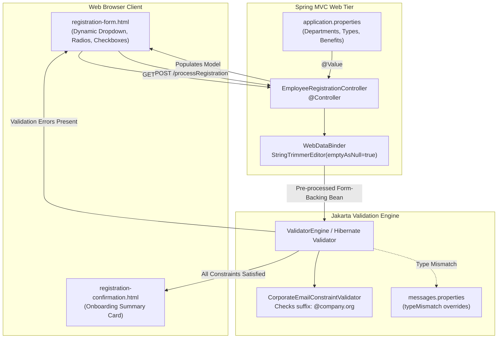

# Lab Guide — Corporate Registration Portal with Custom Constraint Validation

> **Lab Repository:** [:material-github: 7amo10/Spring-Labs — Week-07-Corporate-Registration-Portal](https://github.com/7amo10/Spring-Labs/tree/main/Week-07-Corporate-Registration-Portal)  
> **Source Reference:** `Sources/Spring/Labs/Week-07-Lab-Guide.tex`

---

## 1. Enterprise Scenario & Architectural Objective

You are a Principal Software Engineer designing an internal employee onboarding and benefits enrollment portal for a multinational corporation. The HR operations department requires a public web-based registration gateway where newly hired personnel register their profile, select their corporate department, choose their employment classification, and enroll in elective health and wellness benefit packages.

The system must satisfy strict data governance, integrity, and security standards:
1. **Input Normalization**: Accidental or deliberate whitespace-only inputs must be normalized to `null` before validation to eliminate whitespace validation bypasses.
2. **Declarative Structural Constraints**: Mandatory fields (names, postal codes, compensation boundaries) must be enforced via standard Jakarta Bean Validation constraints.
3. **Domain Suffix Enforcement**: Corporate email addresses must adhere to enterprise domain policy, requiring a custom `@CorporateEmail` constraint verifying that email addresses strictly terminate with `@company.org`.
4. **Dynamic Property-Driven UI Controls**: Department selections, employment classifications, and elective benefit packages must not be hardcoded in HTML or Java classes; they must be dynamically populated from `application.properties`.
5. **Resilient User Feedback**: Non-numeric submissions into compensation fields must produce clean, localized error messages rather than exposing Java runtime stack traces.



---

## 2. Component Architecture & File Tree

The project is structured under package `com.spring.lab.mvc`:

```text
Week-07-Corporate-Registration-Portal/
├── pom.xml
├── src/
│   ├── main/
│   │   ├── java/com/spring/lab/mvc/
│   │   │   ├── RegistrationApplication.java
│   │   │   ├── controller/
│   │   │   │   └── EmployeeRegistrationController.java
│   │   │   ├── model/
│   │   │   │   └── EmployeeRegistration.java
│   │   │   └── validation/
│   │   │       ├── CorporateEmail.java
│   │   │       └── CorporateEmailConstraintValidator.java
│   │   └── resources/
│   │       ├── application.properties
│   │       ├── messages.properties
│   │       └── templates/
│   │           ├── registration-form.html
│   │           └── registration-confirmation.html
│   └── test/
│       └── java/com/spring/lab/mvc/
│           └── EmployeeRegistrationControllerTest.java
```

---

## 3. Form Model & Validation Rules Matrix

| Field | UI Control Type | Bound Property Type | Validation Constraint Rules |
| :--- | :--- | :--- | :--- |
| `firstName` | Text Input | `String` | Optional field; whitespace trimmed to `null` |
| `lastName` | Text Input | `String` | `@NotNull(message = "is required")`, `@Size(min = 1, message = "is required")` |
| `corporateEmail`| Text Input | `String` | `@NotNull(message = "is required")`, `@CorporateEmail(domain = "@company.org", message = "must end with @company.org")` |
| `postalCode` | Text Input | `String` | `@NotNull(message = "is required")`, `@Pattern(regexp = "^[a-zA-Z0-9]{5}$", message = "must be exactly 5 alphanumeric characters")` |
| `salary` | Text Input | `Integer` | `@NotNull(message = "is required")`, `@Min(value = 30000, message = "salary must be at least $30,000")`, `@Max(value = 250000, message = "salary cannot exceed $250,000")` |
| `department` | Dropdown Select | `String` | Selected from dynamic list `${departments}` (`Engineering`, `Product`, `Human Resources`, `Finance`, `Legal`) |
| `employmentType`| Radio Buttons | `String` | Selected from dynamic list `${employmentTypes}` (`Full-Time`, `Part-Time`, `Contractor`) |
| `selectedBenefits`| Multi-Checkboxes | `List<String>` | Selected from dynamic list `${benefits}` (`Health Insurance`, `Dental Coverage`, `Vision Care`, `401k Matching`, `Gym Stipend`) |

---

## 4. Step-by-Step Implementation Guide

### Step 1: Maven Dependencies (`pom.xml`)

Ensure your Maven build includes `spring-boot-starter-web`, `spring-boot-starter-thymeleaf`, and explicitly declares `spring-boot-starter-validation`:

```xml
<dependencies>
    <!-- Spring MVC & Embedded Tomcat -->
    <dependency>
        <groupId>org.springframework.boot</groupId>
        <artifactId>spring-boot-starter-web</artifactId>
    </dependency>

    <!-- Thymeleaf Server-Side Templating -->
    <dependency>
        <groupId>org.springframework.boot</groupId>
        <artifactId>spring-boot-starter-thymeleaf</artifactId>
    </dependency>

    <!-- Jakarta Bean Validation (Hibernate Validator) -->
    <dependency>
        <groupId>org.springframework.boot</groupId>
        <artifactId>spring-boot-starter-validation</artifactId>
    </dependency>

    <!-- Spring Boot Test & MockMvc -->
    <dependency>
        <groupId>org.springframework.boot</groupId>
        <artifactId>spring-boot-starter-test</artifactId>
        <scope>test</scope>
    </dependency>
</dependencies>
```

---

### Step 2: Custom Constraint Definition (`@CorporateEmail`)

Create the annotation interface under `com.spring.lab.mvc.validation`:

```java
package com.spring.lab.mvc.validation;

import jakarta.validation.Constraint;
import jakarta.validation.Payload;

import java.lang.annotation.ElementType;
import java.lang.annotation.Retention;
import java.lang.annotation.RetentionPolicy;
import java.lang.annotation.Target;

@Constraint(validatedBy = CorporateEmailConstraintValidator.class)
@Target({ElementType.METHOD, ElementType.FIELD})
@Retention(RetentionPolicy.RUNTIME)
public @interface CorporateEmail {

    // Configurable corporate domain suffix
    String domain() default "@company.org";

    // Default error message
    String message() default "must end with @company.org";

    // Required Bean Validation groups contract
    Class<?>[] groups() default {};

    // Required Bean Validation payload contract
    Class<? extends Payload>[] payload() default {};
}
```

Implement the corresponding validator:

```java
package com.spring.lab.mvc.validation;

import jakarta.validation.ConstraintValidator;
import jakarta.validation.ConstraintValidatorContext;

public class CorporateEmailConstraintValidator implements ConstraintValidator<CorporateEmail, String> {

    private String domainSuffix;

    @Override
    public void initialize(CorporateEmail corporateEmail) {
        this.domainSuffix = corporateEmail.domain();
    }

    @Override
    public boolean isValid(String email, ConstraintValidatorContext context) {
        if (email == null) {
            // Null checking is the responsibility of @NotNull
            return true;
        }
        return email.toLowerCase().endsWith(domainSuffix.toLowerCase());
    }
}
```

---

### Step 3: Form-Backing Model (`EmployeeRegistration.java`)

```java
package com.spring.lab.mvc.model;

import com.spring.lab.mvc.validation.CorporateEmail;
import jakarta.validation.constraints.Max;
import jakarta.validation.constraints.Min;
import jakarta.validation.constraints.NotNull;
import jakarta.validation.constraints.Pattern;
import jakarta.validation.constraints.Size;

import java.util.ArrayList;
import java.util.List;

public class EmployeeRegistration {

    private String firstName;

    @NotNull(message = "is required")
    @Size(min = 1, message = "is required")
    private String lastName;

    @NotNull(message = "is required")
    @CorporateEmail(domain = "@company.org", message = "must end with @company.org")
    private String corporateEmail;

    @NotNull(message = "is required")
    @Pattern(regexp = "^[a-zA-Z0-9]{5}$", message = "must be exactly 5 alphanumeric characters")
    private String postalCode;

    @NotNull(message = "is required")
    @Min(value = 30000, message = "salary must be at least $30,000")
    @Max(value = 250000, message = "salary cannot exceed $250,000")
    private Integer salary;

    private String department;
    private String employmentType;
    private List<String> selectedBenefits = new ArrayList<>();

    public EmployeeRegistration() {
    }

    // Getters and Setters
    public String getFirstName() { return firstName; }
    public void setFirstName(String firstName) { this.firstName = firstName; }

    public String getLastName() { return lastName; }
    public void setLastName(String lastName) { this.lastName = lastName; }

    public String getCorporateEmail() { return corporateEmail; }
    public void setCorporateEmail(String corporateEmail) { this.corporateEmail = corporateEmail; }

    public String getPostalCode() { return postalCode; }
    public void setPostalCode(String postalCode) { this.postalCode = postalCode; }

    public Integer getSalary() { return salary; }
    public void setSalary(Integer salary) { this.salary = salary; }

    public String getDepartment() { return department; }
    public void setDepartment(String department) { this.department = department; }

    public String getEmploymentType() { return employmentType; }
    public void setEmploymentType(String employmentType) { this.employmentType = employmentType; }

    public List<String> getSelectedBenefits() { return selectedBenefits; }
    public void setSelectedBenefits(List<String> selectedBenefits) { this.selectedBenefits = selectedBenefits; }
}
```

---

### Step 4: Configuration & Localized Messages

#### `src/main/resources/application.properties`:
```properties
# Dynamic options for form controls
corporate.departments=Engineering,Product,Human Resources,Finance,Legal
corporate.employmentTypes=Full-Time,Part-Time,Contractor
corporate.benefits=Health Insurance,Dental Coverage,Vision Care,401k Matching,Gym Stipend
```

#### `src/main/resources/messages.properties`:
```properties
# Override Spring internal type mismatch error code
typeMismatch.employee.salary=Invalid salary format. Please enter a valid whole number.
```

---

### Step 5: Web Controller (`EmployeeRegistrationController.java`)

```java
package com.spring.lab.mvc.controller;

import com.spring.lab.mvc.model.EmployeeRegistration;
import jakarta.validation.Valid;
import org.springframework.beans.factory.annotation.Value;
import org.springframework.beans.propertyeditors.StringTrimmerEditor;
import org.springframework.stereotype.Controller;
import org.springframework.ui.Model;
import org.springframework.validation.BindingResult;
import org.springframework.web.bind.WebDataBinder;
import org.springframework.web.bind.annotation.GetMapping;
import org.springframework.web.bind.annotation.InitBinder;
import org.springframework.web.bind.annotation.ModelAttribute;
import org.springframework.web.bind.annotation.PostMapping;

import java.util.List;

@Controller
public class EmployeeRegistrationController {

    @Value("${corporate.departments}")
    private List<String> departments;

    @Value("${corporate.employmentTypes}")
    private List<String> employmentTypes;

    @Value("${corporate.benefits}")
    private List<String> benefits;

    @InitBinder
    public void initBinder(WebDataBinder dataBinder) {
        StringTrimmerEditor stringTrimmerEditor = new StringTrimmerEditor(true);
        dataBinder.registerCustomEditor(String.class, stringTrimmerEditor);
    }

    @GetMapping("/register")
    public String showRegistrationForm(Model theModel) {
        theModel.addAttribute("employee", new EmployeeRegistration());
        populateFormOptions(theModel);
        return "registration-form";
    }

    @PostMapping("/processRegistration")
    public String processRegistration(
            @Valid @ModelAttribute("employee") EmployeeRegistration theEmployee,
            BindingResult theBindingResult,
            Model theModel) {

        if (theBindingResult.hasErrors()) {
            populateFormOptions(theModel);
            return "registration-form";
        }

        return "registration-confirmation";
    }

    private void populateFormOptions(Model theModel) {
        theModel.addAttribute("departments", departments);
        theModel.addAttribute("employmentTypes", employmentTypes);
        theModel.addAttribute("benefits", benefits);
    }
}
```

---

### Step 6: View Layer (`registration-form.html`)

```html
<!DOCTYPE html>
<html lang="en" xmlns:th="http://www.thymeleaf.org">
<head>
    <meta charset="UTF-8">
    <title>Corporate Employee Onboarding Portal</title>
    <style>
        body { font-family: -apple-system, BlinkMacSystemFont, "Segoe UI", Roboto, sans-serif; margin: 30px; }
        .form-group { margin-bottom: 16px; }
        label { display: block; font-weight: bold; margin-bottom: 4px; }
        .error { color: #d32f2f; font-size: 0.85em; font-weight: bold; margin-left: 8px; }
        .field-input { width: 300px; padding: 6px; }
    </style>
</head>
<body>

<h2>Corporate Employee Onboarding Portal</h2>
<p><em>Fields marked with (*) are mandatory.</em></p>

<form th:action="@{/processRegistration}" th:object="${employee}" method="POST">

    <div class="form-group">
        <label>First Name (Optional):</label>
        <input type="text" th:field="*{firstName}" class="field-input" />
    </div>

    <div class="form-group">
        <label>Last Name (*):</label>
        <input type="text" th:field="*{lastName}" class="field-input" />
        <span th:if="${#fields.hasErrors('lastName')}" th:errors="*{lastName}" class="error"></span>
    </div>

    <div class="form-group">
        <label>Corporate Email (*):</label>
        <input type="text" th:field="*{corporateEmail}" class="field-input" />
        <span th:if="${#fields.hasErrors('corporateEmail')}" th:errors="*{corporateEmail}" class="error"></span>
    </div>

    <div class="form-group">
        <label>Postal Code (*):</label>
        <input type="text" th:field="*{postalCode}" class="field-input" />
        <span th:if="${#fields.hasErrors('postalCode')}" th:errors="*{postalCode}" class="error"></span>
    </div>

    <div class="form-group">
        <label>Starting Base Salary (*):</label>
        <input type="text" th:field="*{salary}" class="field-input" />
        <span th:if="${#fields.hasErrors('salary')}" th:errors="*{salary}" class="error"></span>
    </div>

    <div class="form-group">
        <label>Department:</label>
        <select th:field="*{department}">
            <option th:each="dept : ${departments}" th:value="${dept}" th:text="${dept}"></option>
        </select>
    </div>

    <div class="form-group">
        <label>Employment Classification:</label>
        <span th:each="type : ${employmentTypes}">
            <input type="radio" th:field="*{employmentType}" th:value="${type}" />
            <span th:text="${type}"></span> &nbsp;
        </span>
    </div>

    <div class="form-group">
        <label>Elective Corporate Benefits:</label>
        <span th:each="benefit : ${benefits}">
            <input type="checkbox" th:field="*{selectedBenefits}" th:value="${benefit}" />
            <span th:text="${benefit}"></span> &nbsp;
        </span>
    </div>

    <button type="submit">Submit Registration</button>
</form>

</body>
</html>
```

---

## 5. Automated MockMvc Integration Testing

Create `src/test/java/com/spring/lab/mvc/EmployeeRegistrationControllerTest.java` to verify all form paths:

```java
package com.spring.lab.mvc;

import org.junit.jupiter.api.DisplayName;
import org.junit.jupiter.api.Test;
import org.springframework.beans.factory.annotation.Autowired;
import org.springframework.boot.test.autoconfigure.web.servlet.AutoConfigureMockMvc;
import org.springframework.boot.test.context.SpringBootTest;
import org.springframework.test.web.servlet.MockMvc;

import static org.hamcrest.Matchers.containsString;
import static org.springframework.test.web.servlet.request.MockMvcRequestBuilders.get;
import static org.springframework.test.web.servlet.request.MockMvcRequestBuilders.post;
import static org.springframework.test.web.servlet.result.MockMvcResultMatchers.*;

@SpringBootTest
@AutoConfigureMockMvc
public class EmployeeRegistrationControllerTest {

    @Autowired
    private MockMvc mockMvc;

    @Test
    @DisplayName("GET /register renders form with dynamic property lists")
    void shouldRenderRegistrationForm() throws Exception {
        mockMvc.perform(get("/register"))
                .andExpect(status().isOk())
                .andExpect(view().name("registration-form"))
                .andExpect(model().attributeExists("employee", "departments", "employmentTypes", "benefits"))
                .andExpect(content().string(containsString("Corporate Employee Onboarding Portal")));
    }

    @Test
    @DisplayName("POST /processRegistration succeeds with valid input")
    void shouldSucceedWithValidInput() throws Exception {
        mockMvc.perform(post("/processRegistration")
                .param("firstName", "Arthur")
                .param("lastName", "Dent")
                .param("corporateEmail", "adent@company.org")
                .param("postalCode", "90210")
                .param("salary", "75000")
                .param("department", "Engineering")
                .param("employmentType", "Full-Time")
                .param("selectedBenefits", "Health Insurance", "401k Matching"))
                .andExpect(status().isOk())
                .andExpect(view().name("registration-confirmation"))
                .andExpect(model().hasNoErrors());
    }

    @Test
    @DisplayName("POST /processRegistration rejects whitespace-only lastName")
    void shouldRejectWhitespaceLastName() throws Exception {
        mockMvc.perform(post("/processRegistration")
                .param("lastName", "   ")
                .param("corporateEmail", "test@company.org")
                .param("postalCode", "12345")
                .param("salary", "50000"))
                .andExpect(status().isOk())
                .andExpect(view().name("registration-form"))
                .andExpect(model().attributeHasFieldErrors("employee", "lastName"));
    }

    @Test
    @DisplayName("POST /processRegistration rejects invalid email domain")
    void shouldRejectInvalidEmailDomain() throws Exception {
        mockMvc.perform(post("/processRegistration")
                .param("lastName", "Smith")
                .param("corporateEmail", "jsmith@gmail.com")
                .param("postalCode", "12345")
                .param("salary", "60000"))
                .andExpect(status().isOk())
                .andExpect(view().name("registration-form"))
                .andExpect(model().attributeHasFieldErrorCode("employee", "corporateEmail", "CorporateEmail"));
    }

    @Test
    @DisplayName("POST /processRegistration rejects non-numeric salary with localized message")
    void shouldHandleSalaryTypeMismatch() throws Exception {
        mockMvc.perform(post("/processRegistration")
                .param("lastName", "Smith")
                .param("corporateEmail", "jsmith@company.org")
                .param("postalCode", "12345")
                .param("salary", "seventy-thousand"))
                .andExpect(status().isOk())
                .andExpect(view().name("registration-form"))
                .andExpect(content().string(containsString("Invalid salary format. Please enter a valid whole number.")));
    }
}
```

---

## 6. Verification Checklist

- [ ] Project builds cleanly via `mvn clean compile`.
- [ ] Navigating to `http://localhost:8080/register` displays all input elements.
- [ ] Submitting empty required fields displays red validation error text without crashing.
- [ ] Submitting `"   "` for last name is trimmed to `null` and rejected by `@NotNull`.
- [ ] Submitting an email ending in `@gmail.com` trips `@CorporateEmail`.
- [ ] Submitting `"abc"` into Salary renders our custom message from `messages.properties`.
- [ ] All 5 `MockMvc` integration test cases pass green.
