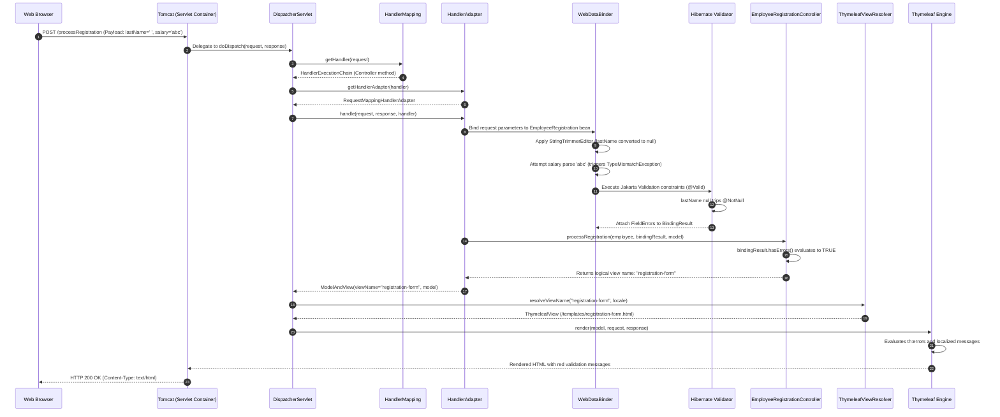
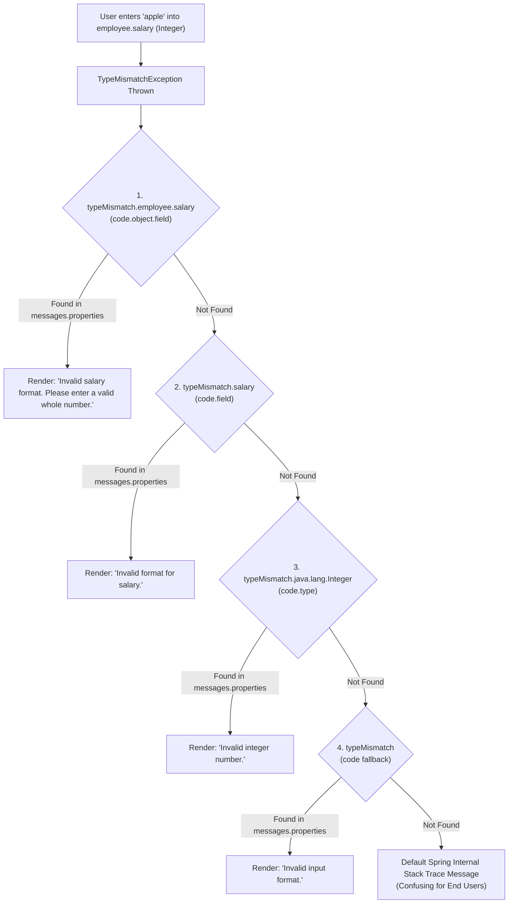

# Summary & Architecture Reference — Week 7: Spring MVC & Bean Validation

---

## 1. Annotation & Class Reference Matrix

| Class / Annotation | Package / Module | Role | Architectural Purpose | Low-Level Mechanism / Lifecycle Impact | Common Pitfall |
| :--- | :--- | :--- | :--- | :--- | :--- |
| **`DispatcherServlet`** | `org.springframework.web.servlet` | Central Class | Front Controller intercepting all HTTP requests. | Coordinates `HandlerMapping`, `HandlerAdapter`, and `ViewResolver` pipelines. | Attempting to configure manually in Spring Boot instead of letting auto-configuration wire it. |
| **`@Controller`** | `org.springframework.stereotype` | Stereotype Annotation | Identifies a Spring bean as a web presentation controller. | Return strings are interpreted as logical view names routed to `ViewResolver`. | Using `@RestController` by mistake, which renders raw view name strings instead of HTML. |
| **`Model`** | `org.springframework.ui` | Interface | Key-value data dictionary exposed to views. | Passed to view template engines (Thymeleaf, FreeMarker) for DOM expression evaluation. | Storing heavy database connection handles or HTTP session state directly in the model. |
| **`@RequestParam`** | `org.springframework.web.bind.annotation` | Parameter Annotation | Binds an HTTP query parameter or form field to a method argument. | Invokes `ConversionService` to coerce strings to typed Java primitives or wrappers. | Missing `required = false` when an optional query parameter is omitted, triggering HTTP 400. |
| **`@ModelAttribute`** | `org.springframework.web.bind.annotation` | Method / Parameter | Binds incoming form payload to a JavaBean, or exposes reference data to the model. | On methods: executes before any handler. On parameters: binds request fields via setters. | Forgetting no-arg constructor on the form-backing bean, breaking reflection instantiation. |
| **`@InitBinder`** | `org.springframework.web.bind.annotation` | Method Annotation | Initializes and customizes the `WebDataBinder` for the controller. | Registers custom `PropertyEditor` instances (e.g. `StringTrimmerEditor`) before binding occurs. | Not setting `emptyAsNull = true`, allowing whitespace strings to pass `@NotNull` checks. |
| **`StringTrimmerEditor`** | `org.springframework.beans.propertyeditors` | PropertyEditor | Strips leading/trailing whitespace and converts empty strings to `null`. | Normalizes raw user input strings before Jakarta constraints are evaluated. | Forgetting to register for `String.class`, allowing whitespace validation bypasses. |
| **`@Valid`** | `jakarta.validation` | Constraint Trigger | Triggers validation of the annotated argument via standard Bean Validation. | Invokes configured `Validator` (Hibernate Validator); records errors in `BindingResult`. | Placing `Model` or other arguments between `@Valid` bean and its `BindingResult`. |
| **`BindingResult`** | `org.springframework.validation` | Interface | Extends `Errors`; holds results of validation and type conversion. | Passed to controller method; examined via `.hasErrors()` to decide redirect vs re-render. | Forgetting to check `.hasErrors()`, allowing invalid entities to proceed to business logic. |
| **`@Constraint`** | `jakarta.validation` | Meta-Annotation | Marks a custom annotation as a Jakarta validation constraint. | Links the annotation to its backing `ConstraintValidator` implementation class. | Forgetting to declare mandatory `message()`, `groups()`, and `payload()` contract methods. |
| **`ConstraintValidator`** | `jakarta.validation` | Interface | Defines the contract for executing custom constraint logic. | `initialize()` reads annotation parameters; `isValid()` evaluates incoming values. | Returning `false` for `null` values on format validators instead of letting `@NotNull` handle it. |

---

## 2. Spring MVC Request Processing Lifecycle

---

## 3. Form-Backing Data Binding Comparison Matrix

| UI Control Type | Standard HTML Tag | Thymeleaf Binding Attribute | Java Model Property Type | Wire Parameter Representation |
| :--- | :--- | :--- | :--- | :--- |
| **Text Input** | `<input type="text">` | `th:field="*{lastName}"` | `String` | `lastName=Smith` |
| **Password Input** | `<input type="password">` | `th:field="*{password}"` | `String` | `password=Secret123` |
| **Select Dropdown** | `<select>` | `th:field="*{department}"` | `String` (or Enum / Entity) | `department=Engineering` |
| **Radio Button Group** | `<input type="radio">` | `th:field="*{employmentType}"` | `String` (or Enum) | `employmentType=Full-Time` |
| **Single Checkbox** | `<input type="checkbox">` | `th:field="*{agreedToTerms}"` | `boolean` or `Boolean` | `agreedToTerms=on` (or `true`) |
| **Multi-Select Checkboxes** | `<input type="checkbox">` | `th:field="*{selectedBenefits}"` | `List<String>` or `Set<T>` | `selectedBenefits=Health&selectedBenefits=Dental` |
| **Text Area** | `<textarea>` | `th:field="*{biography}"` | `String` | `biography=Experienced+engineer...` |
| **Hidden Field** | `<input type="hidden">` | `th:field="*{id}"` | `Long`, `Integer`, `UUID` | `id=101` |

---

## 4. Jakarta Bean Validation Constraint Catalog

| Constraint | Null Behavior | Supported Target Types | Typical Enterprise Use Case |
| :--- | :--- | :--- | :--- |
| **`@NotNull`** | Disallows `null` | Any reference type (`Object`) | Foreign keys, numerical IDs, mandatory selections |
| **`@NotEmpty`** | Disallows `null` & size $0$ | `CharSequence`, `Collection`, `Map`, Array | Shopping cart items, recipient lists |
| **`@NotBlank`** | Disallows `null` & whitespace-only | `CharSequence` (String) | Customer names, street addresses, passwords |
| **`@Size`** | Considers `null` valid | `CharSequence`, `Collection`, `Map`, Array | Username length (`[3, 20]`), batch sizes |
| **`@Min` / `@Max`** | Considers `null` valid | Numbers (`byte`, `int`, `long`, `BigDecimal`) | Age boundaries, salary ranges, order item quantities |
| **`@Pattern`** | Considers `null` valid | `CharSequence` (String) | Postal codes, tax IDs, phone numbers, SKUs |
| **`@Email`** | Considers `null` valid | `CharSequence` (String) | User login emails, notification addresses |
| **`@Digits`** | Considers `null` valid | Numbers, `CharSequence` | Currency decimals (`integer = 6, fraction = 2`) |
| **`@Positive` / `@PositiveOrZero`** | Considers `null` valid | Numerical types | Bank account deposits, stock units |
| **`@Past` / `@PastOrPresent`** | Considers `null` valid | `LocalDate`, `Instant`, `Date` | Date of birth, transaction timestamps |
| **`@Future` / `@FutureOrPresent`** | Considers `null` valid | `LocalDate`, `Instant`, `Date` | Policy expiration dates, scheduled appointment times |

!!! tip "The Null Contract Principle"
    Notice that almost all formatting constraints (`@Size`, `@Min`, `@Pattern`, `@Email`) **consider `null` valid**. This is intentional design: it allows fields to be optional. If a field is mandatory, you must explicitly combine it with `@NotNull` or `@NotBlank`.

---

## 5. Type Mismatch Resolution & MessageSource Hierarchy

When a user submits a non-numeric string into a numerical bean property, Spring intercepts the resulting `TypeMismatchException` and constructs an ordered hierarchy of error codes evaluated against `messages.properties`:

### Best Practice Configuration:
Always specify `typeMismatch.<object>.<field>` in `src/main/resources/messages.properties` for all numerical and date-formatted inputs to guarantee a professional user experience.
