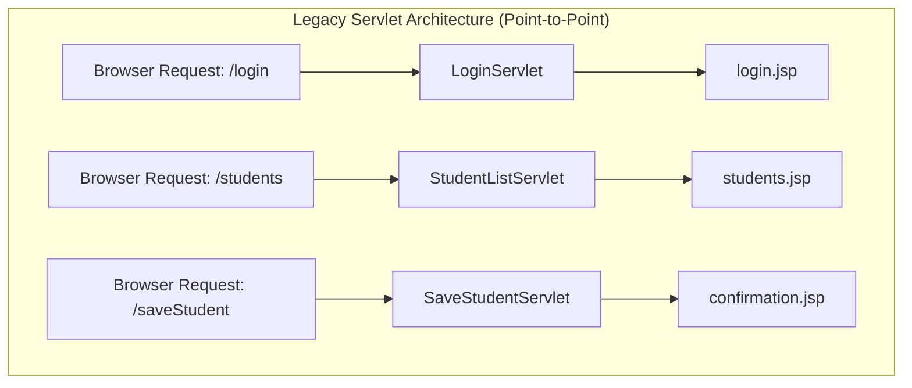
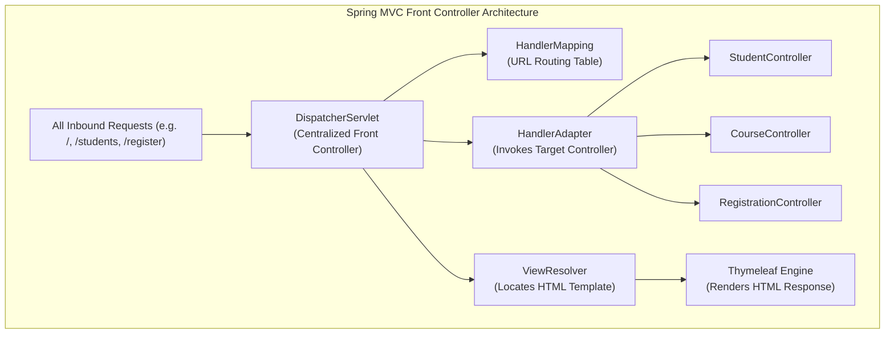
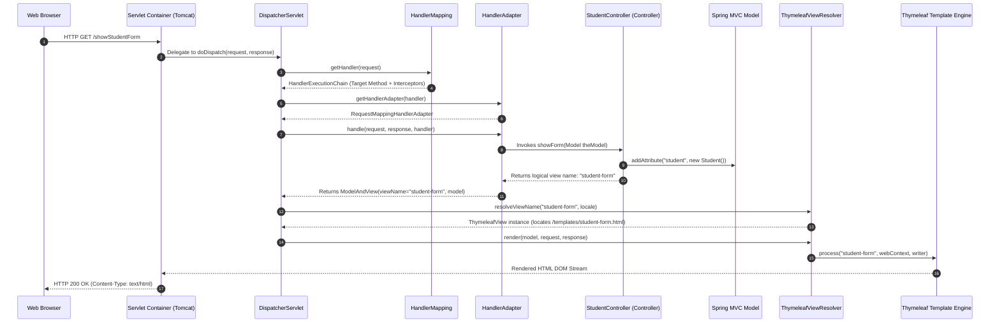
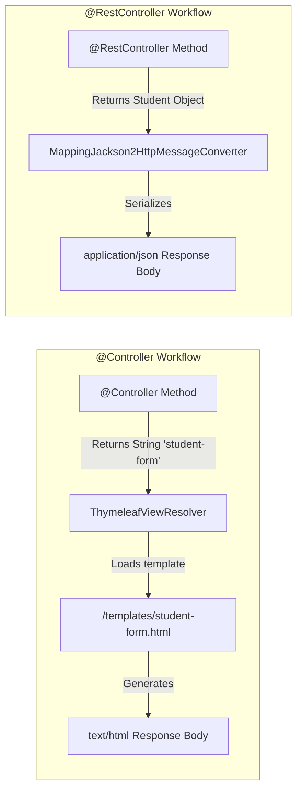
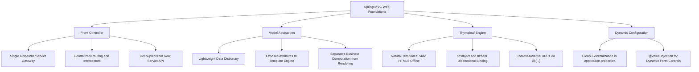

# Topic Notes — Part 1: Spring MVC Web Architecture, Request Lifecycle & Thymeleaf Form Binding

---

## 1. The Evolution from Servlets to Spring MVC: The Front Controller Pattern

In early Java enterprise web architectures, web applications were constructed directly atop the Java Servlet API. Each distinct URL route or action required authoring and registering a dedicated `HttpServlet` class inside `web.xml` (or via `@WebServlet`):



### 1.1 Structural Deficiencies of Legacy Servlets

1. **Boilerplate Explosion**: Every servlet had to manually extract parameters (`request.getParameter()`), execute string-to-number type conversions, instantiate domain objects, and call service classes.
2. **Duplicated Cross-Cutting Concerns**: Authentication checks, encoding filters, request logging, and error handling had to be redundantly applied or managed through cumbersome chains of Servlet Filters.
3. **Tight Coupling to Servlet API**: Handlers were tightly coupled to `HttpServletRequest` and `HttpServletResponse`, rendering automated unit testing virtually impossible without heavy mocking frameworks or in-container test runners.
4. **Scattered Navigation Logic**: Forwarding and redirection directives (`request.getRequestDispatcher().forward(request, response)`) were hardcoded across dozens of disparate servlet classes.

### 1.2 The Front Controller Architectural Solution

Spring MVC solves this systemic design flaw by implementing the **Front Controller** enterprise design pattern (Martin Fowler, *Patterns of Enterprise Application Architecture*). A single centralized servlet—the `DispatcherServlet`—acts as the master gateway for all incoming HTTP traffic.



| Architectural Dimension | Legacy Java Servlets (`HttpServlet`) | Modern Spring MVC (`@Controller`) |
| :--- | :--- | :--- |
| **Entry Point** | Dispersed across dozens of individual servlets | Single centralized `DispatcherServlet` front controller |
| **Routing Mechanism** | Static `web.xml` servlet-mappings or `@WebServlet` | Declarative annotations (`@GetMapping`, `@PostMapping`, `@RequestMapping`) |
| **Parameter Handling** | Manual untyped `request.getParameter("id")` parsing | Typed automatic binding (`@RequestParam`, `@PathVariable`, `@ModelAttribute`) |
| **Separation of Concerns** | Controllers often contained HTML generation logic | Strict separation: Controller processes logic, `Model` holds data, `View` renders UI |
| **Testability** | Requires mock Servlet context or container | Plain Old Java Objects (POJOs) tested via standard JUnit or `MockMvc` |

---

## 2. The `DispatcherServlet` Internal Request Processing Pipeline

The `DispatcherServlet` is the beating heart of Spring MVC. It inherits from `org.springframework.web.servlet.FrameworkServlet`, which in turn extends standard `jakarta.servlet.http.HttpServlet`. When an HTTP request enters the web application container (Apache Tomcat), the container delegates execution to the `DispatcherServlet.doService()` method, which calls `doDispatch()`.

### 2.1 The 10-Stage Request Lifecycle



### 2.2 Deep Dive into Pipeline Collaborators

1. **`HandlerMapping`**: Inspects incoming HTTP requests (URL, HTTP method, headers) and determines which handler should process it. In modern Spring Boot applications, `RequestMappingHandlerMapping` scans beans for `@RequestMapping` and `@GetMapping`/`@PostMapping` annotations to construct an in-memory routing table.
2. **`HandlerExecutionChain`**: Wraps the target handler method along with an ordered list of `HandlerInterceptor` instances (which execute pre-processing and post-processing filters, such as locale resolution, theme resolution, or security auditing).
3. **`HandlerAdapter`**: Employs the Adapter design pattern. Because controller handler methods can have arbitrary method signatures, parameter types, and return types, the `RequestMappingHandlerAdapter` is responsible for invoking the method, resolving its parameters via `HandlerMethodArgumentResolver`, and handling return values via `HandlerMethodReturnValueHandler`.
4. **`Model` / `ModelMap`**: A Java Map abstraction holding the attributes that need to be exposed to the view template during rendering.
5. **`ViewResolver`**: Converts a logical view name string (such as `"student-form"`) into an actual physical `View` object (such as `ThymeleafView`), which resolves template locations like `classpath:/templates/student-form.html`.

!!! important "No DispatcherServlet Configuration Needed in Spring Boot"
    In legacy Spring Framework, `DispatcherServlet` had to be declared in `web.xml` or via `WebApplicationInitializer`. In Spring Boot, `DispatcherServletAutoConfiguration` automatically detects embedded Tomcat, registers `DispatcherServlet`, and maps it to the root path (`/`).

---

## 3. `@Controller` vs `@RestController`: Architectural Distinction

A foundational distinction in Spring architecture is the divergence between server-side HTML rendering (`@Controller`) and stateless RESTful API endpoints (`@RestController`):

```java
// Server-Side View Controller (Spring MVC)
@Controller
public class StudentController {
    @GetMapping("/showStudentForm")
    public String showForm(Model theModel) {
        theModel.addAttribute("student", new Student());
        return "student-form"; // Resolves to /templates/student-form.html
    }
}

// RESTful Web Service Controller (Spring Web)
@RestController
@RequestMapping("/api/students")
public class StudentRestController {
    @GetMapping("/{id}")
    public Student getStudent(@PathVariable int id) {
        return studentService.findById(id); // Serialized directly to JSON
    }
}
```



### 3.1 The `@ResponseBody` Meta-Annotation

Under the hood:
```java
@Target(ElementType.TYPE)
@Retention(RetentionPolicy.RUNTIME)
@Documented
@Controller
@ResponseBody
public @interface RestController {
    // ...
}
```

- In a `@Controller`, returning a `String` directs Spring's `ViewNameMethodReturnValueHandler` to locate a view template.
- In a `@RestController`, the `@ResponseBody` annotation intercepts the return value via `RequestResponseBodyMethodProcessor`. It completely bypasses the `ViewResolver` pipeline and invokes Jackson's `ObjectMapper` to write serialized JSON directly into the `HttpServletResponse` output stream.

!!! warning "The Accidental JSON Response Trap"
    If you annotate an MVC controller with `@RestController` and return `"student-form"`, Spring will **not** render your HTML template. Instead, it will return an HTTP 200 response with raw plain text `"student-form"` directly to the browser! Always use `@Controller` for Thymeleaf view applications.

---

## 4. The Spring MVC `Model` Interface: Passing Data to Views

The `org.springframework.ui.Model` interface serves as the communication bus between the controller and the view template. It is an abstraction over a map of key-value pairs:

```java
package com.luv2code.springboot.thymeleafdemo.controller;

import org.springframework.stereotype.Controller;
import org.springframework.ui.Model;
import org.springframework.web.bind.annotation.GetMapping;

import java.util.Date;

@Controller
public class DemoController {

    @GetMapping("/hello")
    public String sayHello(Model theModel) {
        // Add attribute to the model: name-value pair
        theModel.addAttribute("theDate", new java.util.Date());

        return "helloworld"; // Logical view name
    }
}
```

In the corresponding Thymeleaf template (`src/main/resources/templates/helloworld.html`):

```html
<!DOCTYPE html>
<html xmlns:th="http://www.thymeleaf.org">
<head>
    <title>Thymeleaf Demo</title>
    <link rel="stylesheet" th:href="@{/css/demo.css}" />
</head>
<body>
    <p th:text="'Server time is ' + ${theDate}" class="funny" />
</body>
</html>
```

### 4.1 `Model` vs `ModelMap` vs `ModelAndView`

Over successive Spring releases, three distinct abstractions have existed for managing model attributes:

1. **`Model` (Recommended)**: A lightweight, interface-driven container. Cleanest for test mocking and method injection.
2. **`ModelMap`**: An implementation of `LinkedHashMap<String, Object>` providing map manipulation methods.
3. **`ModelAndView`**: Legacy container combining both model data and the logical view name into a single return object (`return new ModelAndView("helloworld", "theDate", new Date());`). Rarely used in modern Spring Boot codebases.

---

## 5. Handling Inbound Request Data: `HttpServletRequest` vs `@RequestParam`

When processing form submissions, controllers must extract inbound user inputs. Spring MVC provides two approaches: the legacy low-level servlet approach and the idiomatic declarative Spring approach.

### 5.1 Low-Level Approach: `HttpServletRequest`

```java
@RequestMapping("/processFormVersionTwo")
public String letsShoutDude(HttpServletRequest request, Model model) {
    // Read raw parameter string from request
    String theName = request.getParameter("studentName");

    // Perform business logic
    theName = (theName != null) ? theName.toUpperCase() : "";
    String result = "Yo! " + theName;

    // Place computed result onto model
    model.addAttribute("message", result);

    return "helloworld";
}
```

### 5.2 Idiomatic Spring Approach: `@RequestParam`

```java
@PostMapping("/processFormVersionThree")
public String processFormVersionThree(
        @RequestParam("studentName") String theName,
        Model model) {

    // Transform and bind
    theName = theName.toUpperCase();
    String result = "Hey My Friend from v3! " + theName;

    model.addAttribute("message", result);

    return "helloworld";
}
```

### 5.3 Architectural Advantages of `@RequestParam`

- **Type Conversion**: Spring's `ConversionService` automatically coerces incoming string parameters to target types (e.g., `int`, `boolean`, `LocalDate`, `UUID`).
- **Null Safety & Defaults**: Supports `required = false` and `defaultValue = "Guest"`:
  ```java
  @GetMapping("/greet")
  public String greetUser(@RequestParam(name = "user", required = false, defaultValue = "Anonymous") String user) { ... }
  ```
- **Testability**: Handler methods can be executed in plain unit tests by simply invoking `controller.processFormVersionThree("john", model)` without instantiating mock servlet request objects.

### 5.4 HTTP `GET` vs HTTP `POST` Form Submissions

```html
<!-- Submitting via GET: Query string appended to URL -->
<form action="/processForm" method="GET">
    <input type="text" name="studentName" />
    <input type="submit" />
</form>

<!-- Submitting via POST: Form data placed in HTTP request payload -->
<form th:action="@{/processStudentForm}" th:object="${student}" method="POST">
    <!-- ... -->
</form>
```

| Dimension | HTTP `GET` Form Submission | HTTP `POST` Form Submission |
| :--- | :--- | :--- |
| **Payload Location** | Appended to URL as query string (`?studentName=John`) | Encapsulated in HTTP Request Body |
| **Data Size Limits** | Restricted by web server URL length limits (~2048 to 8192 chars) | Effectively unbounded (governed by `spring.servlet.multipart.max-request-size`) |
| **Security & Privacy** | Form data visible in browser URL bar, browser history, and server access logs | Data not exposed in URL bar or access logs (must still use TLS/HTTPS) |
| **Idempotence & Caching** | Idempotent; responses can be safely cached; bookmarkable | Non-idempotent; triggers browser "Confirm Form Resubmission" on reload |
| **Spring Annotation** | `@GetMapping` | `@PostMapping` |

---

## 6. Thymeleaf Templating Engine Architecture

Thymeleaf is a modern server-side Java template engine designed specifically for web and standalone environments. Unlike legacy JSP (JavaServer Pages), Thymeleaf champions the concept of **Natural Templates**.

### 6.1 The Natural Templating Philosophy

A Natural Template is valid HTML that can be opened directly in a browser (e.g., by double-clicking the `.html` file on disk). Static prototype data is displayed when opened directly; dynamic server-side expressions replace the static values only when processed by the Spring MVC engine:

```html
<!-- Natural Template: Browsers display 'Doe' when offline; Spring renders ${student.lastName} -->
<p>Student Last Name: <span th:text="${student.lastName}">Doe</span></p>
```

### 6.2 The Five Thymeleaf Expression Dialects

Thymeleaf categorizes expression semantics via distinct syntactic prefixes:

| Expression Type | Syntax | Purpose | Example |
| :--- | :--- | :--- | :--- |
| **Variable Expressions** | `${...}` | Evaluates OGNL or Spring EL expressions on the `Model` dictionary. | `${student.firstName}` |
| **Selection Expressions** | `*{...}` | Evaluates expressions relative to a pre-selected target object (`th:object`). | `*{lastName}` |
| **Message Expressions** | `#{...}` | Resolves internationalized strings from external resource bundles (`messages.properties`). | `#{label.student.title}` |
| **Link URL Expressions** | `@{...}` | Constructs context-relative URLs, automatically prepending the servlet context path. | `@{/processForm}` |
| **Fragment Expressions** | `~{...}` | References reusable template fragments for modular headers, footers, and sidebars. | `~{fragments/nav :: navbar}` |

### 6.3 Resource Organization in Spring Boot

Spring Boot establishes clear directory boundaries for web assets:

- `src/main/resources/templates/`: Private view templates (e.g., `student-form.html`). These files are **never** served directly as static files; they must pass through the `ThymeleafViewResolver`.
- `src/main/resources/static/`: Public static assets (CSS, JavaScript, images, web fonts). Directly accessible via the browser at `/css/style.css` or `/images/logo.png`.

---

## 7. Bidirectional Form Data Binding: The Form-Backing Bean

In enterprise applications, forms often contain dozens of fields. Extracting parameters one-by-one via `@RequestParam` is unmaintainable. Spring MVC solves this through **Bidirectional Form Model Binding** using a **Form-Backing Bean**.

```mermaid
flowchart TD
    subgraph Step1["1. GET Request: Initialization"]
        CTRL["StudentController.showForm()"] -->|"Creates new Student()<br/>addAttribute('student', student)"| MODEL["Spring MVC Model"]
        MODEL -->|"th:object='${student}'"| FORM["student-form.html"]
    end

    subgraph Step2["2. POST Request: Form Submission"]
        USER["User fills input fields and clicks Submit"] -->|"POST /processStudentForm<br/>Payload: firstName=Alice, country=France..."| TOMCAT["Servlet Container"]
        TOMCAT --> DS["DispatcherServlet"]
        DS -->|"WebDataBinder binds payload to setters"| BEAN["Student Instance (Populated)"]
        BEAN -->|"Delivered via @ModelAttribute('student')"| HANDLER["StudentController.processForm()"]
    end
```



### 7.1 Setting Up the Form-Backing Object

The model object is a standard JavaBean with default no-argument constructor, private fields, and standard public getters and setters:

```java
package com.luv2code.springboot.thymeleafdemo.model;

import java.util.List;

public class Student {

    private String firstName;
    private String lastName;
    private String country;
    private String favoriteLanguage;
    private List<String> favoriteSystems;

    public Student() {
    }

    // Standard Getters and Setters
    public String getFirstName() { return firstName; }
    public void setFirstName(String firstName) { this.firstName = firstName; }

    public String getLastName() { return lastName; }
    public void setLastName(String lastName) { this.lastName = lastName; }

    public String getCountry() { return country; }
    public void setCountry(String country) { this.country = country; }

    public String getFavoriteLanguage() { return favoriteLanguage; }
    public void setFavoriteLanguage(String favoriteLanguage) { this.favoriteLanguage = favoriteLanguage; }

    public List<String> getFavoriteSystems() { return favoriteSystems; }
    public void setFavoriteSystems(List<String> favoriteSystems) { this.favoriteSystems = favoriteSystems; }
}
```

### 7.2 The Controller Initializer & Processor

```java
package com.luv2code.springboot.thymeleafdemo.controller;

import com.luv2code.springboot.thymeleafdemo.model.Student;
import org.springframework.beans.factory.annotation.Value;
import org.springframework.stereotype.Controller;
import org.springframework.ui.Model;
import org.springframework.web.bind.annotation.GetMapping;
import org.springframework.web.bind.annotation.ModelAttribute;
import org.springframework.web.bind.annotation.PostMapping;

import java.util.List;

@Controller
public class StudentController {

    @Value("${countries}")
    private List<String> countries;

    @Value("${languages}")
    private List<String> languages;

    @Value("${systems}")
    private List<String> systems;

    @GetMapping("/showStudentForm")
    public String showForm(Model theModel) {
        // Create a new student instance as the form-backing bean
        Student theStudent = new Student();

        theModel.addAttribute("student", theStudent);
        theModel.addAttribute("countries", countries);
        theModel.addAttribute("languages", languages);
        theModel.addAttribute("systems", systems);

        return "student-form";
    }

    @PostMapping("/processStudentForm")
    public String processForm(@ModelAttribute("student") Student theStudent) {
        // Inbound form data is automatically bound to theStudent object
        System.out.println("Processing student: " + theStudent.getFirstName() + " " + theStudent.getLastName());
        return "student-confirmation";
    }
}
```

### 7.3 Deep Dive: The HTML Form Controls

Let's examine how each HTML input control is wired using Thymeleaf in `student-form.html`:

```html
<!DOCTYPE html>
<html lang="en" xmlns:th="http://www.thymeleaf.org">
<head>
    <meta charset="UTF-8">
    <title>Student Registration Form</title>
</head>
<body>

<h3>Student Registration Form</h3>

<!-- th:object binds the entire form to the model attribute named 'student' -->
<form th:action="@{/processStudentForm}" th:object="${student}" method="POST">

    <!-- 1. Text Fields -->
    First name: <input type="text" th:field="*{firstName}" />
    <br><br>

    Last name: <input type="text" th:field="*{lastName}" />
    <br><br>

    <!-- 2. Dropdown List (<select>) -->
    Country:
    <select th:field="*{country}">
        <option th:each="tempCountry : ${countries}"
                th:value="${tempCountry}"
                th:text="${tempCountry}" />
    </select>
    <br><br>

    <!-- 3. Radio Buttons -->
    Favorite Programming Language:
    <input type="radio" th:field="*{favoriteLanguage}"
                        th:each="tempLang : ${languages}"
                        th:value="${tempLang}"
                        th:text="${tempLang}" />
    <br><br>

    <!-- 4. Multi-Select Checkboxes -->
    Favorite Operating Systems:
    <input type="checkbox" th:field="*{favoriteSystems}"
                           th:each="tempSystem : ${systems}"
                           th:value="${tempSystem}"
                           th:text="${tempSystem}" />
    <br><br>

    <input type="submit" value="Submit" />

</form>
</body>
</html>
```

### 7.4 What Happens Internally with `th:field`?

When Thymeleaf encounters `th:field="*{firstName}"`:
1. It looks up the enclosing `th:object="${student}"`.
2. It generates `id="firstName"`.
3. It generates `name="firstName"` (matching the property name for HTTP parameter binding).
4. It reads the current property value via `student.getFirstName()` and generates `value="..."`.
5. For checkboxes and radio buttons, it automatically determines whether `checked="checked"` must be added by comparing the control's value against the bean's current property state!

---

## 8. Dynamic Property Injection via `@Value`

Hardcoding UI option lists (such as countries, languages, departments) inside Java controller source code or HTML templates violates Clean Architecture principles. When a new country or department is introduced, the codebase would require recompilation and redeployment.

### 8.1 Configuring Lists in `application.properties`

Spring Boot natively parses comma-delimited string properties into typed `java.util.List<String>` collections:

```properties
# src/main/resources/application.properties
countries=Brazil,France,Germany,India,Mexico,Spain,United States
languages=Go,Java,Python,Rust,TypeScript
systems=Linux,macOS,Microsoft Windows,Android OS,iOS
```

### 8.2 Injecting with Spring's `@Value`

```java
@Controller
public class StudentController {

    @Value("${countries}")
    private List<String> countries;

    @Value("${languages}")
    private List<String> languages;

    @Value("${systems}")
    private List<String> systems;

    // ...
}
```

During bean creation, Spring's `AutowiredAnnotationBeanPostProcessor` injects the parsed collections directly into the controller fields. In `showForm()`, these lists are added as model attributes so that Thymeleaf's `th:each` can iterate over them dynamically.

---

## 9. Architectural Takeaways for Senior Engineers



1. **Avoid Servlet API Pollution**: Never import `jakarta.servlet.http.HttpServletRequest` into your controller handler methods unless dealing with raw low-level streaming or legacy filter bridges. Use `@RequestParam` or typed form-backing beans.
2. **Favor Bidirectional Model Binding**: Always use `th:object` with typed JavaBeans. This guarantees compile-time type safety, automated formatting, seamless error reflection, and automatic re-population of submitted values on validation failure.
3. **Thymeleaf is Server-Side**: Remember that Thymeleaf executes completely on the server before a single byte of HTML is streamed to the browser. The browser receives purely standard HTML5, CSS, and vanilla DOM elements.
