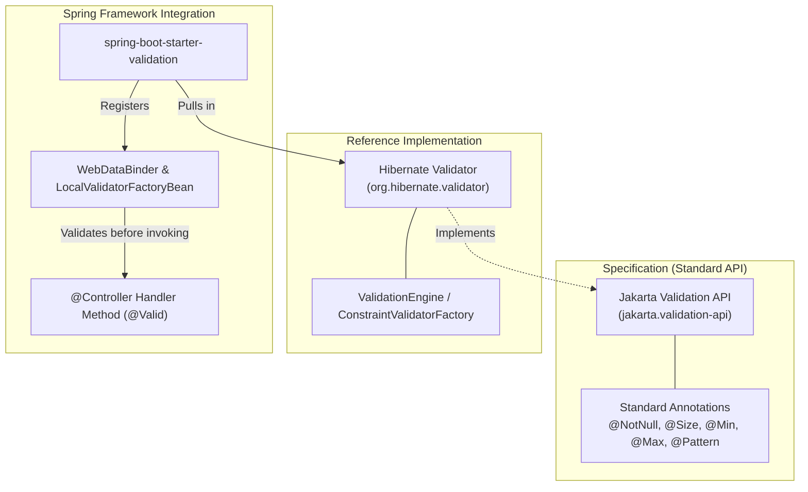
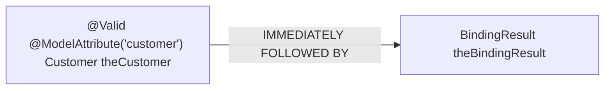
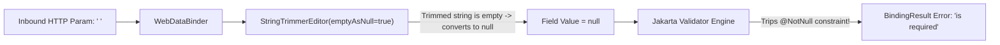
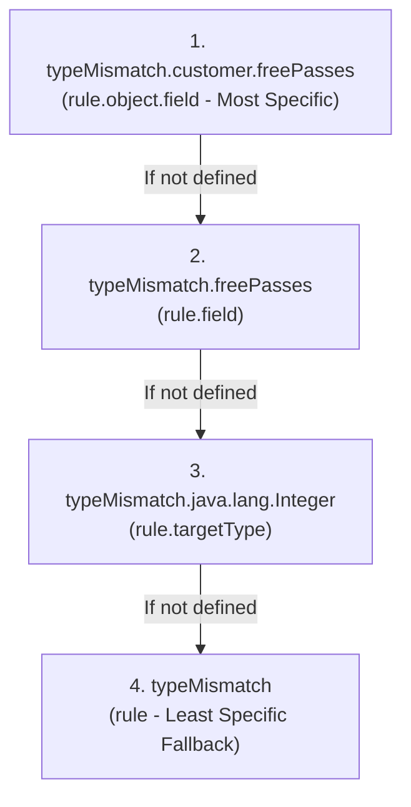
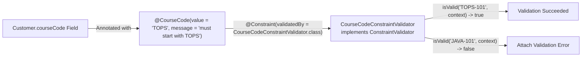

# Topic Notes — Part 2: Jakarta Bean Validation & Custom Constraint Engineering

---

## 1. The Architecture of Jakarta Bean Validation (JSR-380)

In enterprise web applications, input validation is the primary line of defense protecting domain entities and downstream database persistence from corrupt, incomplete, or malicious data.

Validation logic can easily become tangled with controller orchestration if written imperatively using scattered `if-else` branches. Spring MVC eliminates this through deep integration with the **Jakarta Bean Validation specification** (originally JSR-303, updated to JSR-349 and JSR-380).



### 1.1 Specification vs Implementation

- **The Specification (`jakarta.validation:jakarta.validation-api`)**: Defines the standard interfaces (`Validator`, `ConstraintValidator`, `ConstraintValidatorContext`) and foundational constraint annotations. It contains zero execution logic.
- **The Implementation (`org.hibernate.validator:hibernate-validator`)**: The industry-standard reference implementation that executes constraint algorithms, performs reflection, and formats error interpolation.
- **Spring Boot Starter (`spring-boot-starter-validation`)**: Starting in Spring Boot 2.3+, validation is no longer bundled by default in `spring-boot-starter-web`. It must be explicitly declared in `pom.xml`:

```xml
<dependency>
    <groupId>org.springframework.boot</groupId>
    <artifactId>spring-boot-starter-validation</artifactId>
</dependency>
```

### 1.2 Core Built-In Validation Constraints

| Constraint Annotation | Supported Data Types | Validation Rule / Behavior | Example Declaration |
| :--- | :--- | :--- | :--- |
| **`@NotNull`** | Any Object | Target must not be `null`. **Allows empty string `""` or whitespace `" "`.** | `@NotNull(message = "is required")` |
| **`@NotEmpty`** | `CharSequence`, `Collection`, `Map`, Array | Must not be `null` and its length/size must be $> 0$. | `@NotEmpty(message = "must not be empty")` |
| **`@NotBlank`** | `CharSequence` (String) | Must not be `null`, and its trimmed length must be $> 0$. | `@NotBlank(message = "cannot be blank")` |
| **`@Size`** | `CharSequence`, `Collection`, `Map`, Array | Length or collection size must fall within `[min, max]`. | `@Size(min = 2, max = 50)` |
| **`@Min`** | Numerical (`byte`, `short`, `int`, `long`, `BigInteger`) | Value must be $\ge$ specified minimum value. | `@Min(value = 0, message = "must be >= 0")` |
| **`@Max`** | Numerical (`byte`, `short`, `int`, `long`, `BigInteger`) | Value must be $\le$ specified maximum value. | `@Max(value = 10, message = "must be <= 10")` |
| **`@Pattern`** | `CharSequence` (String) | Value must match the specified regular expression. | `@Pattern(regexp = "^[a-zA-Z0-9]{5}$")` |
| **`@Email`** | `CharSequence` (String) | Must conform to valid RFC email address syntax. | `@Email(message = "invalid email format")` |

---

## 2. Controller Integration: `@Valid` and `BindingResult`

To trigger validation during form submission, the model parameter inside the controller handler method must be annotated with `jakarta.validation.Valid` (or Spring's `@Validated`). Immediately following the model parameter, Spring must inject a `org.springframework.validation.BindingResult`:

```java
package com.luv2code.springdemo.mvc;

import jakarta.validation.Valid;
import org.springframework.stereotype.Controller;
import org.springframework.ui.Model;
import org.springframework.validation.BindingResult;
import org.springframework.web.bind.annotation.GetMapping;
import org.springframework.web.bind.annotation.ModelAttribute;
import org.springframework.web.bind.annotation.PostMapping;

@Controller
public class CustomerController {

    @GetMapping("/")
    public String showForm(Model theModel) {
        theModel.addAttribute("customer", new Customer());
        return "customer-form";
    }

    @PostMapping("/processForm")
    public String processForm(
            @Valid @ModelAttribute("customer") Customer theCustomer,
            BindingResult theBindingResult) {

        System.out.println("Binding results: " + theBindingResult.toString());

        if (theBindingResult.hasErrors()) {
            // Validation failed: Re-render original form with error messages
            return "customer-form";
        }
        else {
            // Validation succeeded: Proceed to confirmation screen
            return "customer-confirmation";
        }
    }
}
```

### 2.1 The Critical Parameter Ordering Rule

In Spring MVC, the position of `BindingResult` in the method signature is **strictly enforced**:



!!! caution "The BindingResult Placement Trap"
    The `BindingResult` parameter **MUST immediately follow** the model attribute being validated. If you insert another parameter in between (e.g., `Customer theCustomer, Model theModel, BindingResult theBindingResult`), Spring MVC will throw a fatal `IllegalStateException` or `BindException` before your method executes! Spring binds parameters sequentially; it requires the `BindingResult` adjacent to the bean whose errors it records.

### 2.2 Re-Rendering vs Redirecting on Validation Failure

When `theBindingResult.hasErrors()` evaluates to `true`:
1. The controller returns the logical view name `"customer-form"` (forwarding to the view, **not** redirecting).
2. The `Customer` instance with its user-submitted values and the associated `BindingResult` remain in the request scope.
3. Thymeleaf receives the model and re-populates the input controls with the user's previously entered text while rendering localized error strings adjacent to the offending fields.

---

## 3. Thymeleaf Validation Feedback Rendering

To display field-level validation errors, Thymeleaf provides specialized utility expressions and tags:

```html
<!DOCTYPE html>
<html lang="en" xmlns:th="http://www.thymeleaf.org">
<head>
    <meta charset="UTF-8">
    <title>Customer Registration Form</title>
    <style>
        .error { color: red; font-size: 0.9em; font-style: italic; }
    </style>
</head>
<body>

<i>Fill out the form. Asterisk (*) means required.</i>
<br><br>

<form th:action="@{/processForm}" th:object="${customer}" method="POST">

    <!-- Last Name Field -->
    Last name (*): <input type="text" th:field="*{lastName}" />

    <!-- Error message rendered conditionally if validation failed -->
    <span th:if="${#fields.hasErrors('lastName')}"
          th:errors="*{lastName}"
          class="error"></span>
    <br><br>

    <!-- Free Passes (Integer Field) -->
    Free passes: <input type="text" th:field="*{freePasses}" />

    <span th:if="${#fields.hasErrors('freePasses')}"
          th:errors="*{freePasses}"
          class="error"></span>
    <br><br>

    <!-- Postal Code (Regex Pattern) -->
    Postal Code: <input type="text" th:field="*{postalCode}" />

    <span th:if="${#fields.hasErrors('postalCode')}"
          th:errors="*{postalCode}"
          class="error"></span>
    <br><br>

    <input type="submit" value="Submit" />

</form>

</body>
</html>
```

### 3.1 Thymeleaf Error Tag Semantics

- `${#fields.hasErrors('lastName')}`: Evaluates to `true` if `BindingResult` contains any `FieldError` associated with the property `lastName`.
- `th:errors="*{lastName}"`: Retrieves the error message string from the `BindingResult` and inserts it as the inner text of the `<span>`.
- Automatic value persistence: Because the input control uses `th:field="*{lastName}"`, Thymeleaf automatically renders `value="User's previous input"`. The user never loses their typed content when validation fails.

---

## 4. The Whitespace Trap & Input Normalization with `@InitBinder`

A notorious vulnerability in naive web form implementations is the **Whitespace Bypass Bug**.

Suppose a model defines:
```java
@NotNull(message = "is required")
@Size(min = 1, message = "is required")
private String lastName;
```

If a user enters four space characters (`"    "`) and clicks Submit:
1. Is `"    "` null? **No.**
2. Is the length of `"    "` $\ge 1$? **Yes (length is 4).**
3. **Result:** Validation passes! An empty whitespace record is written to the database.

### 4.1 The Solution: `@InitBinder` and `StringTrimmerEditor`

Spring MVC provides `@InitBinder` methods to customize the `WebDataBinder` instance responsible for translating incoming HTTP request parameters into Java types.

```java
@Controller
public class CustomerController {

    // Register a custom property editor to trim leading and trailing whitespace
    @InitBinder
    public void initBinder(WebDataBinder dataBinder) {
        // StringTrimmerEditor(true): true indicates empty strings should be trimmed to null
        StringTrimmerEditor stringTrimmerEditor = new StringTrimmerEditor(true);

        dataBinder.registerCustomEditor(String.class, stringTrimmerEditor);
    }

    // ...
}
```



### 4.2 How `StringTrimmerEditor(true)` Works

- When `emptyAsNull` is set to `true`:
  1. The editor strips all leading and trailing whitespace from the inbound parameter.
  2. If the resulting string has a length of $0$ (i.e., it contained only whitespace), the editor normalizes it to `null`.
  3. The `null` value is assigned to the bean property.
  4. The `@NotNull` constraint immediately detects the `null` and correctly rejects the submission!

---

## 5. Numerical Parsing & Type Mismatch Resolution via `messages.properties`

Handling numerical inputs presents two distinct architectural traps: primitive vs object wrappers, and type conversion failures.

### 5.1 The `int` vs `Integer` Trap

Consider validating an integer field:
```java
// Anti-pattern: Primitive int
@NotNull(message = "is required")
private int freePasses;
```

If the user leaves the input field blank:
- An empty string `""` cannot be converted to primitive `int`. Spring defaults the value to `0` or throws a conversion exception before `@NotNull` is ever evaluated.
- To allow the field to be truly optional or to enforce `@NotNull` when left blank, **always use the object wrapper `Integer`**:

```java
@NotNull(message = "is required")
@Min(value = 0, message = "must be greater than or equal to zero")
@Max(value = 10, message = "must be less than or equal to 10")
private Integer freePasses;
```

### 5.2 The Type Mismatch Problem

What happens if the user enters the word `"apple"` into the `freePasses` text box?

1. The `DispatcherServlet` invokes `WebDataBinder`.
2. Spring attempts to parse `"apple"` into an `Integer` via `Integer.parseInt()`.
3. Java throws a `NumberFormatException`.
4. Spring catches the exception and logs a `TypeMismatchException`.
5. Spring places a default error message into `BindingResult`:
   ```text
   Failed to convert property value of type 'java.lang.String' to required type 'java.lang.Integer' for property 'freePasses'; nested exception is java.lang.NumberFormatException: For input string: "apple"
   ```
6. **Result:** An ugly, confusing stack trace message is exposed directly to the end user on the web page.

### 5.3 Overriding Error Codes in `messages.properties`

When a `TypeMismatchException` occurs, Spring checks the application's `MessageSource` for custom message keys following a strict resolution hierarchy:



To provide clean, professional feedback, create `src/main/resources/messages.properties`:

```properties
# src/main/resources/messages.properties
typeMismatch.customer.freePasses=Invalid number. Please enter digits only.
```

When Spring encounters a type mismatch on the `freePasses` property of the `customer` bean, it replaces the internal exception string with our clean localized message.

---

## 6. Custom Constraint Engineering: Building Annotations & Validators from Scratch

While standard constraints cover basic boundaries, enterprise applications require complex domain rules (e.g., verifying that a course code starts with `"LUV"`, or that an employee email strictly ends with `@company.org`).

Creating a custom validation rule requires two coordinated components:
1. A **Custom Java Annotation** (declaring metadata, parameters, and error message).
2. A **`ConstraintValidator` Implementation** (executing the business validation logic).



### 6.1 Step 1: Defining the `@CourseCode` Annotation

```java
package com.luv2code.springdemo.mvc.validation;

import jakarta.validation.Constraint;
import jakarta.validation.Payload;

import java.lang.annotation.ElementType;
import java.lang.annotation.Retention;
import java.lang.annotation.RetentionPolicy;
import java.lang.annotation.Target;

// Link annotation to its backing validator class
@Constraint(validatedBy = CourseCodeConstraintValidator.class)
// Target can be placed on methods (getters) or fields
@Target({ElementType.METHOD, ElementType.FIELD})
// Retain annotation at runtime for reflection by Hibernate Validator
@Retention(RetentionPolicy.RUNTIME)
public @interface CourseCode {

    // 1. Define custom parameter with default value
    public String value() default "LUV";

    // 2. Define default error message
    public String message() default "must start with LUV";

    // 3. Define default validation groups (mandatory contract)
    public Class<?>[] groups() default {};

    // 4. Define default payload payloads (mandatory contract)
    public Class<? extends Payload>[] payload() default {};
}
```

#### Mandatory Contract Attributes

The Jakarta Bean Validation specification requires that **every constraint annotation must define `message()`, `groups()`, and `payload()`**:
- `groups()`: Allows grouping validation constraints (e.g., validating only a subset of fields during draft creation vs final submission).
- `payload()`: Allows clients of the API to assign custom severity levels or metadata objects (e.g., `Severity.WARNING`, `Severity.CRITICAL`).

### 6.2 Step 2: Implementing `CourseCodeConstraintValidator`

```java
package com.luv2code.springdemo.mvc.validation;

import jakarta.validation.ConstraintValidator;
import jakarta.validation.ConstraintValidatorContext;

public class CourseCodeConstraintValidator implements ConstraintValidator<CourseCode, String> {

    private String coursePrefix;

    @Override
    public void initialize(CourseCode theCourseCode) {
        // Read the prefix value configured on the annotation instance
        coursePrefix = theCourseCode.value();
    }

    @Override
    public boolean isValid(String theCode, ConstraintValidatorContext theConstraintValidatorContext) {

        boolean result;

        if (theCode != null) {
            result = theCode.startsWith(coursePrefix);
        }
        else {
            // Null check contract: if field is optional, return true.
            // If required, combine with @NotNull on the model field!
            result = true;
        }

        return result;
    }
}
```

!!! tip "Architectural Principle: Separation of Null Checking"
    Notice that `isValid()` returns `true` when `theCode == null`. This adheres to the Single Responsibility Principle: custom constraints should only validate format, not nullability. If the field is mandatory, the developer should annotate the field with both `@NotNull` and `@CourseCode`. This allows `@CourseCode` to be reused on optional fields without falsely rejecting `null`.

### 6.3 Step 3: Applying the Custom Constraint to the Domain Model

```java
public class Customer {

    // ... other fields ...

    // Applies custom constraint with overridden prefix and message
    @CourseCode(value = "TOPS", message = "must start with TOPS")
    private String courseCode;

    public String getCourseCode() { return courseCode; }
    public void setCourseCode(String courseCode) { this.courseCode = courseCode; }
}
```

When the user submits `"TOPS-123"`, the validator's `isValid()` evaluates `true`. If the user submits `"LUV-123"`, it returns `false`, and the customized error message `"must start with TOPS"` is attached to `BindingResult`.

---

## 7. Architectural Summary for Senior Engineers

```mermaid
flowchart TD
    ROOT["Jakarta Bean Validation Architecture"]

    ROOT --> SPEC["Specification vs Implementation"]
    SPEC --> SPEC1["jakarta.validation-api Standard Interface"]
    SPEC --> SPEC2["Hibernate Validator Execution Engine"]
    SPEC --> SPEC3["spring-boot-starter-validation Autowiring"]

    ROOT --> EXEC["Controller Execution Rules"]
    EXEC --> EXEC1["@Valid Annotation Triggers Validation"]
    EXEC --> EXEC2["BindingResult Must Immediately Follow Bean"]
    EXEC --> EXEC3["th:errors Renders Localized Error Messages"]

    ROOT --> NORM["Input Normalization"]
    NORM --> NORM1["@InitBinder with StringTrimmerEditor"]
    NORM --> NORM2["emptyAsNull=true Converts Whitespace to null"]
    NORM --> NORM3["Prevents Validation Bypass on Empty Strings"]

    ROOT --> TYPE["Type Mismatch Handling"]
    TYPE --> TYPE1["Use Integer Wrapper Instead of Primitive int"]
    TYPE --> TYPE2["messages.properties Overrides Internal Exceptions"]

    ROOT --> CUST["Custom Constraint Engineering"]
    CUST --> CUST1["@Constraint Annotation with value, message, groups, payload"]
    CUST --> CUST2["ConstraintValidator Implementation Class"]
    CUST --> CUST3["Strict Separation of Format from Nullability"]
```



1. **Guard Against Whitespace Bypass**: Every web application receiving string inputs should configure `StringTrimmerEditor(true)` via `@InitBinder` or a `@ControllerAdvice` global binder.
2. **Never Expose Internal Type Mismatch Exceptions**: Always configure `messages.properties` with clean `typeMismatch` overrides to prevent raw Java exception strings from reaching end users.
3. **Respect Parameter Ordering**: Remember that `BindingResult` is position-dependent. Never break the adjacency between `@Valid @ModelAttribute` and its accompanying `BindingResult`.
