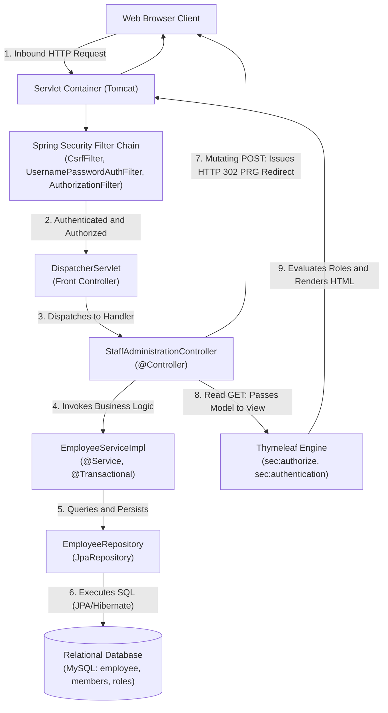

# Week 8 — Full-Stack Spring MVC CRUD & Form-Based Authentication

## Goal

Integrate Spring MVC presentation controllers, transactional service facades, and Spring Data JPA repositories into a production-grade full-stack web application. Implement the Post-Redirect-Get (PRG) pattern across entity mutations to prevent duplicate submission anomalies, configure custom Bootstrap 5 form-based authentication and logout pipelines, enforce synchronized Cross-Site Request Forgery (CSRF) defenses, establish multi-tiered Role-Based Access Control (RBAC), dynamically adapt UI elements using the Thymeleaf Spring Security 6 dialect, and secure user credentials in relational databases via `JdbcUserDetailsManager` and salted BCrypt password hashing.

---

## :material-calendar: Week 8 Schedule

| Topic | Modules / Sections | Key Annotations / Concepts |
| :--- | :--- | :--- |
| **Full-Stack Spring MVC CRUD Workflow** | Section 07 (Modules 01–02) | `@Controller`, `EmployeeService`, `EmployeeRepository`, `findAllByOrderByLastNameAsc()`, pre-populated form-backing bean |
| **The Post-Redirect-Get (PRG) Pattern** | Section 07 (Modules 02–04) | `@PostMapping("/save")`, `return "redirect:/employees/list"`, hidden ID field `<input type="hidden" th:field="*{id}" />` |
| **Custom Form-Based Authentication** | Section 08 (Modules 01–05) | `formLogin()`, `.loginPage()`, `.loginProcessingUrl()`, `param.error`, Bootstrap 5 card layout |
| **Session Invalidation & CSRF Protection** | Section 08 (Module 06) | `.logout()`, `param.logout`, Synchronizer Token Pattern, automatic `_csrf` injection in Thymeleaf |
| **Multi-Tier RBAC & Access Denied Routing** | Section 08 (Modules 07–09) | `hasRole("EMPLOYEE")`, `hasRole("MANAGER")`, `hasRole("ADMIN")`, `.accessDeniedPage("/access-denied")` |
| **Dynamic UI Adaptation with Security Dialect** | Section 08 (Module 10) | `thymeleaf-extras-springsecurity6`, `sec:authentication`, `sec:authorize="hasRole('ADMIN')"` |
| **Relational Database Authentication & BCrypt** | Section 08 (Modules 11–13) | `JdbcUserDetailsManager`, `setUsersByUsernameQuery()`, `setAuthoritiesByUsernameQuery()`, BCrypt salts & work factors |

---

## :material-sitemap: Architectural Progression

---

## :material-folder-open: Week 8 Content

-   :material-note-text:{ .lg .middle } **Topic Notes — Part 1: Full-Stack CRUD & The PRG Pattern**

    ---

    Unified multi-tier web application architecture, integrating Spring MVC controllers with JPA repositories, listing entities in responsive HTML tables, adding entities via pre-populated form-backing beans, update flows with hidden ID primary keys, safe deletion workflows, and eliminating duplicate form submission anomalies via the Post-Redirect-Get (PRG) pattern.

    [:octicons-arrow-right-24: Topic Notes Part 1](topic-notes-part1.md)

-   :material-note-text:{ .lg .middle } **Topic Notes — Part 2: Form-Based Security & Role-Based UI**

    ---

    Custom form-based authentication replacing HTTP Basic, Bootstrap 5 login interfaces, authentication failure parameters (`?error`), secure logout flows (`?logout`), CSRF synchronization mechanics, multi-tiered RBAC routing, custom HTTP 403 access-denied pages, dynamic UI rendering via the Thymeleaf Spring Security 6 dialect, and relational JDBC authentication with custom table schema mapping.

    [:octicons-arrow-right-24: Topic Notes Part 2](topic-notes-part2.md)

-   :material-flask:{ .lg .middle } **Lab Guide — Secure Enterprise Employee Administration Portal**

    ---

    Construct a full-stack staff administration portal: implement complete relational CRUD persistence backed by MySQL, secure routes with multi-tiered RBAC (`EMPLOYEE`, `MANAGER`, `ADMIN`), enforce the PRG redirect pattern, configure custom Bootstrap 5 login and 403 access-denied views, dynamically hide action buttons using Thymeleaf security tags, and verify security boundaries via MockMvc integration tests.

    [:octicons-arrow-right-24: Lab Guide](lab-guide.md)

-   :material-clipboard-check:{ .lg .middle } **Summary & Architecture Reference**

    ---

    Annotation matrix, complete PRG request lifecycle sequence diagram, form login authentication filter pipeline, comparison table between HTTP Basic and Form-Based Authentication, Thymeleaf Spring Security dialect reference, and custom JDBC authentication query contracts.

    [:octicons-arrow-right-24: Summary](summary.md)

---

## :material-progress-check: Progress Tracker

- [ ] **Part 1:** Full-Stack Spring MVC CRUD architecture, hidden primary key binding, and the Post-Redirect-Get (PRG) pattern
- [ ] **Part 2:** Custom form-based login, CSRF defenses, multi-tier RBAC, Thymeleaf security dialect, and custom JDBC authentication
- [ ] **Lab Guide:** Secure Enterprise Employee Administration Portal implementation, database seeding, and MockMvc test suite
- [ ] **Summary:** Annotation reference, PRG sequence diagram, authentication comparison matrix, and security tag catalog reviewed
