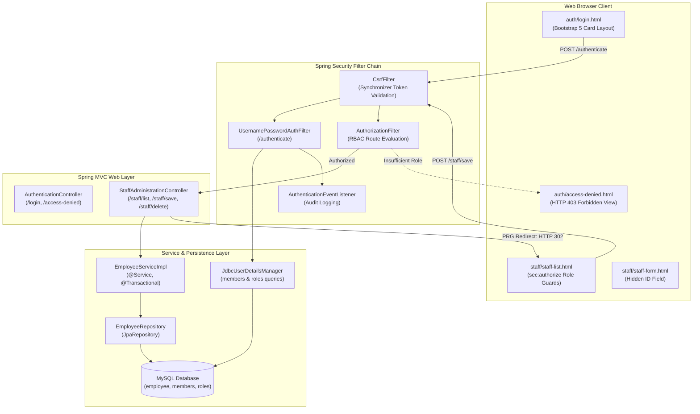

# Lab Guide — Secure Enterprise Employee Administration Portal

> **Lab Repository:** [:material-github: 7amo10/Spring-Labs — Week-08-Secure-Employee-Administration-Portal](https://github.com/7amo10/Spring-Labs/tree/main/Week-08-Secure-Employee-Administration-Portal)  
> **Source Reference:** `Sources/Spring/Labs/Week-08-Lab-Guide.tex`

---

## 1. Enterprise Scenario & Architectural Objective

You are a Principal Software Architect tasked with constructing an internal staff administration portal for a regulated corporate enterprise. The HR operations and compliance departments require a centralized web application allowing managers and human resources administrators to view employee records, register newly hired staff, update existing profiles, and remove offboarded employees.

The system must satisfy stringent enterprise security, operational integrity, and user-experience guidelines:
1. **Full-Stack Relational Architecture**: Integrated multi-tier web application combining Spring MVC controllers, transactional service facades, Spring Data JPA repositories, and MySQL relational persistence.
2. **Post-Redirect-Get (PRG) Workflow**: All state-mutating requests (`POST /staff/save` and `POST /staff/delete`) must issue an HTTP 302/303 redirect to prevent duplicate submissions on browser refresh.
3. **Relational Database Authentication**: Credential authentication backed by relational database tables (`members` and `roles`) using `JdbcUserDetailsManager` and salted BCrypt cryptographic password hashing.
4. **Custom Form-Based Authentication & Logout**: Replace basic HTTP authentication with branded Bootstrap 5 login views, handling login failure parameters (`?error`), session invalidation, and logout confirmation (`?logout`).
5. **Multi-Tier Role-Based Access Control (RBAC)**: Segment application paths into three distinct authorization tiers:
   - `ROLE_EMPLOYEE`: Read-only directory viewing rights on `/staff/list`.
   - `ROLE_MANAGER`: Read and write rights; authorized to add new employees and update existing profiles.
   - `ROLE_ADMIN`: Full administrative authority including employee deletion rights on `/staff/delete`.
6. **Dynamic UI Adaptation**: Use the Thymeleaf Spring Security 6 dialect (`sec:authorize`) to conditionally hide administrative buttons from unauthorized personnel, while backend filters enforce strict security boundaries.
7. **Synchronized CSRF Protection**: Enforce anti-CSRF token verification across all form submissions.



---

## 2. Component Architecture & File Tree

The project is structured under package `com.spring.lab.admin`:

```text
Week-08-Secure-Employee-Administration-Portal/
├── pom.xml
├── src/
│   ├── main/
│   │   ├── java/com/spring/lab/admin/
│   │   │   ├── AdminPortalApplication.java
│   │   │   ├── config/
│   │   │   │   └── SecurityConfig.java
│   │   │   ├── controller/
│   │   │   │   ├── AuthenticationController.java
│   │   │   │   └── StaffAdministrationController.java
│   │   │   ├── entity/
│   │   │   │   └── Employee.java
│   │   │   ├── repository/
│   │   │   │   └── EmployeeRepository.java
│   │   │   ├── service/
│   │   │   │   ├── EmployeeService.java
│   │   │   │   └── EmployeeServiceImpl.java
│   │   │   └── listener/
│   │   │       └── AuthenticationEventListener.java
│   │   └── resources/
│   │       ├── application.properties
│   │       └── templates/
│   │           ├── auth/
│   │           │   ├── login.html
│   │           │   └── access-denied.html
│   │           └── staff/
│   │               ├── staff-list.html
│   │               └── staff-form.html
│   └── test/
│       └── java/com/spring/lab/admin/
│           └── StaffAdministrationSecurityTest.java
```

---

## 3. Role-Based Authorization & Endpoint Matrix

| Endpoint Route | HTTP Method | Minimum Required Role | Functional Description | PRG Redirect |
| :--- | :--- | :--- | :--- | :--- |
| `/login` | `GET` | Public (`permitAll`) | Custom Bootstrap 5 login page | No |
| `/authenticate` | `POST` | Public (`permitAll`) | Spring Security login processing URL | Redirects to `/staff/list` |
| `/logout` | `POST` | Authenticated | Session invalidation and cookie clearing | Redirects to `/login?logout` |
| `/access-denied` | `GET` | Authenticated | Custom HTTP 403 Forbidden error page | No |
| `/staff/list` | `GET` | `ROLE_EMPLOYEE` | Responsive staff directory sorted by last name | No |
| `/staff/addForm` | `GET` | `ROLE_MANAGER` | Blank staff creation form with model-backed binding | No |
| `/staff/editForm` | `GET` | `ROLE_MANAGER` | Pre-populated modification form with hidden primary key | No |
| `/staff/save` | `POST` | `ROLE_MANAGER` | Persists entity (insert or update) | **Yes $\rightarrow$ `/staff/list`** |
| `/staff/delete` | `POST` | `ROLE_ADMIN` | Deletes entity by ID | **Yes $\rightarrow$ `/staff/list`** |

---

## 4. Step-by-Step Implementation Guide

### Step 1: Maven Dependencies (`pom.xml`)

Include starters for Web, Thymeleaf, Spring Security, Thymeleaf Security 6 dialect, Spring Data JPA, and MySQL driver:

```xml
<dependencies>
    <!-- Spring MVC & Tomcat -->
    <dependency>
        <groupId>org.springframework.boot</groupId>
        <artifactId>spring-boot-starter-web</artifactId>
    </dependency>

    <!-- Thymeleaf Templating Engine -->
    <dependency>
        <groupId>org.springframework.boot</groupId>
        <artifactId>spring-boot-starter-thymeleaf</artifactId>
    </dependency>

    <!-- Spring Security -->
    <dependency>
        <groupId>org.springframework.boot</groupId>
        <artifactId>spring-boot-starter-security</artifactId>
    </dependency>

    <!-- Thymeleaf Spring Security 6 Dialect -->
    <dependency>
        <groupId>org.thymeleaf.extras</groupId>
        <artifactId>thymeleaf-extras-springsecurity6</artifactId>
    </dependency>

    <!-- Spring Data JPA & Hibernate -->
    <dependency>
        <groupId>org.springframework.boot</groupId>
        <artifactId>spring-boot-starter-data-jpa</artifactId>
    </dependency>

    <!-- MySQL JDBC Driver -->
    <dependency>
        <groupId>com.mysql</groupId>
        <artifactId>mysql-connector-j</artifactId>
        <scope>runtime</scope>
    </dependency>

    <!-- Spring Boot Test & MockMvc -->
    <dependency>
        <groupId>org.springframework.boot</groupId>
        <artifactId>spring-boot-starter-test</artifactId>
        <scope>test</scope>
    </dependency>
    <dependency>
        <groupId>org.springframework.security</groupId>
        <artifactId>spring-security-test</artifactId>
        <scope>test</scope>
    </dependency>
</dependencies>
```

---

### Step 2: Database Schemas & Credential Seeding

Execute the DDL script to create the enterprise schemas and seed users with BCrypt hashes (password is `fun123`):

```sql
CREATE DATABASE IF NOT EXISTS `employee_directory`;
USE `employee_directory`;

-- Employee Directory Table
DROP TABLE IF EXISTS `employee`;
CREATE TABLE `employee` (
  `id` int NOT NULL AUTO_INCREMENT,
  `first_name` varchar(45) DEFAULT NULL,
  `last_name` varchar(45) DEFAULT NULL,
  `email` varchar(45) DEFAULT NULL,
  `department` varchar(45) DEFAULT NULL,
  PRIMARY KEY (`id`)
) ENGINE=InnoDB AUTO_INCREMENT=1 DEFAULT CHARSET=latin1;

-- Security Members Table
DROP TABLE IF EXISTS `members`;
CREATE TABLE `members` (
  `user_id` varchar(50) NOT NULL,
  `pw` char(68) NOT NULL,
  `active` tinyint NOT NULL,
  PRIMARY KEY (`user_id`)
) ENGINE=InnoDB DEFAULT CHARSET=latin1;

-- Security Roles Table
DROP TABLE IF EXISTS `roles`;
CREATE TABLE `roles` (
  `user_id` varchar(50) NOT NULL,
  `role` varchar(50) NOT NULL,
  UNIQUE KEY `authorities5_idx_1` (`user_id`,`role`),
  CONSTRAINT `authorities5_ibfk_1` FOREIGN KEY (`user_id`) REFERENCES `members` (`user_id`)
) ENGINE=InnoDB DEFAULT CHARSET=latin1;

-- Seed BCrypt Hashed Passwords ({bcrypt}$2a$10$...)
INSERT INTO `members` VALUES
('john', '{bcrypt}$2a$10$qeS0HEh7urweMoEDnwNAR.Lu4nmrkKGBxUkxeFl50DU23qm.ngIOq', 1),
('mary', '{bcrypt}$2a$10$qeS0HEh7urweMoEDnwNAR.Lu4nmrkKGBxUkxeFl50DU23qm.ngIOq', 1),
('susan', '{bcrypt}$2a$10$qeS0HEh7urweMoEDnwNAR.Lu4nmrkKGBxUkxeFl50DU23qm.ngIOq', 1);

INSERT INTO `roles` VALUES
('john', 'ROLE_EMPLOYEE'),
('mary', 'ROLE_EMPLOYEE'),
('mary', 'ROLE_MANAGER'),
('susan', 'ROLE_EMPLOYEE'),
('susan', 'ROLE_MANAGER'),
('susan', 'ROLE_ADMIN');
```

---

### Step 3: Persistence Tier & Service Facade

#### `Employee.java` Entity:
```java
package com.spring.lab.admin.entity;

import jakarta.persistence.*;

@Entity
@Table(name = "employee")
public class Employee {

    @Id
    @GeneratedValue(strategy = GenerationType.IDENTITY)
    @Column(name = "id")
    private int id;

    @Column(name = "first_name")
    private String firstName;

    @Column(name = "last_name")
    private String lastName;

    @Column(name = "email")
    private String email;

    @Column(name = "department")
    private String department;

    public Employee() {}

    public Employee(String firstName, String lastName, String email, String department) {
        this.firstName = firstName;
        this.lastName = lastName;
        this.email = email;
        this.department = department;
    }

    // Getters and Setters ...
    public int getId() { return id; }
    public void setId(int id) { this.id = id; }
    public String getFirstName() { return firstName; }
    public void setFirstName(String firstName) { this.firstName = firstName; }
    public String getLastName() { return lastName; }
    public void setLastName(String lastName) { this.lastName = lastName; }
    public String getEmail() { return email; }
    public void setEmail(String email) { this.email = email; }
    public String getDepartment() { return department; }
    public void setDepartment(String department) { this.department = department; }
}
```

#### `EmployeeRepository.java`:
```java
package com.spring.lab.admin.repository;

import java.util.List;
import org.springframework.data.jpa.repository.JpaRepository;
import com.spring.lab.admin.entity.Employee;

public interface EmployeeRepository extends JpaRepository<Employee, Integer> {
    List<Employee> findAllByOrderByLastNameAsc();
}
```

#### `EmployeeServiceImpl.java`:
```java
package com.spring.lab.admin.service;

import java.util.List;
import org.springframework.stereotype.Service;
import org.springframework.transaction.annotation.Transactional;
import com.spring.lab.admin.entity.Employee;
import com.spring.lab.admin.repository.EmployeeRepository;

@Service
public class EmployeeServiceImpl implements EmployeeService {

    private final EmployeeRepository employeeRepository;

    public EmployeeServiceImpl(EmployeeRepository theEmployeeRepository) {
        this.employeeRepository = theEmployeeRepository;
    }

    @Override
    public List<Employee> findAll() {
        return employeeRepository.findAllByOrderByLastNameAsc();
    }

    @Override
    public Employee findById(int theId) {
        return employeeRepository.findById(theId)
                .orElseThrow(() -> new RuntimeException("Did not find employee id - " + theId));
    }

    @Override
    @Transactional
    public Employee save(Employee theEmployee) {
        return employeeRepository.save(theEmployee);
    }

    @Override
    @Transactional
    public void deleteById(int theId) {
        employeeRepository.deleteById(theId);
    }
}
```

---

### Step 4: Security Configuration (`SecurityConfig.java`)

```java
package com.spring.lab.admin.config;

import javax.sql.DataSource;
import org.springframework.context.annotation.Bean;
import org.springframework.context.annotation.Configuration;
import org.springframework.security.config.annotation.web.builders.HttpSecurity;
import org.springframework.security.provisioning.JdbcUserDetailsManager;
import org.springframework.security.provisioning.UserDetailsManager;
import org.springframework.security.web.SecurityFilterChain;

@Configuration
public class SecurityConfig {

    @Bean
    public UserDetailsManager userDetailsManager(DataSource dataSource) {
        JdbcUserDetailsManager jdbcUserDetailsManager = new JdbcUserDetailsManager(dataSource);

        // Custom schema queries for members and roles
        jdbcUserDetailsManager.setUsersByUsernameQuery(
                "select user_id, pw, active from members where user_id=?");
        jdbcUserDetailsManager.setAuthoritiesByUsernameQuery(
                "select user_id, role from roles where user_id=?");

        return jdbcUserDetailsManager;
    }

    @Bean
    public SecurityFilterChain filterChain(HttpSecurity http) throws Exception {

        http.authorizeHttpRequests(configurer ->
                configurer
                        .requestMatchers("/login", "/css/**", "/js/**").permitAll()
                        .requestMatchers("/staff/list").hasRole("EMPLOYEE")
                        .requestMatchers("/staff/addForm", "/staff/editForm", "/staff/save").hasRole("MANAGER")
                        .requestMatchers("/staff/delete").hasRole("ADMIN")
                        .anyRequest().authenticated()
        )
        .formLogin(form ->
                form
                        .loginPage("/login")
                        .loginProcessingUrl("/authenticate")
                        .defaultSuccessUrl("/staff/list", true)
                        .permitAll()
        )
        .logout(logout ->
                logout
                        .logoutUrl("/logout")
                        .logoutSuccessUrl("/login?logout")
                        .permitAll()
        )
        .exceptionHandling(configurer ->
                configurer.accessDeniedPage("/access-denied")
        );

        return http.build();
    }
}
```

---

### Step 5: Web Controllers with Post-Redirect-Get (PRG)

#### `AuthenticationController.java`:
```java
package com.spring.lab.admin.controller;

import org.springframework.stereotype.Controller;
import org.springframework.web.bind.annotation.GetMapping;

@Controller
public class AuthenticationController {

    @GetMapping("/login")
    public String showLoginPage() {
        return "auth/login";
    }

    @GetMapping("/access-denied")
    public String showAccessDenied() {
        return "auth/access-denied";
    }

    @GetMapping("/")
    public String redirectToStaffList() {
        return "redirect:/staff/list";
    }
}
```

#### `StaffAdministrationController.java`:
```java
package com.spring.lab.admin.controller;

import java.util.List;
import org.springframework.stereotype.Controller;
import org.springframework.ui.Model;
import org.springframework.web.bind.annotation.*;
import com.spring.lab.admin.entity.Employee;
import com.spring.lab.admin.service.EmployeeService;

@Controller
@RequestMapping("/staff")
public class StaffAdministrationController {

    private final EmployeeService employeeService;

    public StaffAdministrationController(EmployeeService theEmployeeService) {
        this.employeeService = theEmployeeService;
    }

    @GetMapping("/list")
    public String listEmployees(Model theModel) {
        List<Employee> theEmployees = employeeService.findAll();
        theModel.addAttribute("employees", theEmployees);
        return "staff/staff-list";
    }

    @GetMapping("/addForm")
    public String showAddForm(Model theModel) {
        theModel.addAttribute("employee", new Employee());
        return "staff/staff-form";
    }

    @GetMapping("/editForm")
    public String showEditForm(@RequestParam("employeeId") int theId, Model theModel) {
        Employee theEmployee = employeeService.findById(theId);
        theModel.addAttribute("employee", theEmployee);
        return "staff/staff-form";
    }

    @PostMapping("/save")
    public String saveEmployee(@ModelAttribute("employee") Employee theEmployee) {
        employeeService.save(theEmployee);
        // Post-Redirect-Get Pattern: Issue HTTP 302 redirect
        return "redirect:/staff/list";
    }

    @PostMapping("/delete")
    public String deleteEmployee(@RequestParam("employeeId") int theId) {
        employeeService.deleteById(theId);
        // Post-Redirect-Get Pattern: Issue HTTP 302 redirect
        return "redirect:/staff/list";
    }
}
```

---

### Step 6: View Layer & Thymeleaf Security Dialect

#### `src/main/resources/templates/staff/staff-list.html`:
```html
<!DOCTYPE HTML>
<html lang="en" xmlns:th="http://www.thymeleaf.org"
      xmlns:sec="http://www.thymeleaf.org/extras/spring-security">
<head>
    <meta charset="utf-8">
    <meta name="viewport" content="width=device-width, initial-scale=1">
    <link href="https://cdn.jsdelivr.net/npm/bootstrap@5.2.2/dist/css/bootstrap.min.css" rel="stylesheet">
    <title>Enterprise Staff Directory</title>
</head>
<body>
<div class="container mt-4">
    <div class="d-flex justify-content-between align-items-center mb-3">
        <h3>Staff Administration Portal</h3>
        <div>
            Logged in: <strong sec:authentication="name"></strong>
            (<span sec:authentication="principal.authorities"></span>)
            <form th:action="@{/logout}" method="POST" class="d-inline ms-3">
                <button type="submit" class="btn btn-outline-danger btn-sm">Logout</button>
            </form>
        </div>
    </div>
    <hr>

    <!-- Add Employee Button: Visible only to Managers and Admins -->
    <div sec:authorize="hasAnyRole('MANAGER', 'ADMIN')" class="mb-3">
        <a th:href="@{/staff/addForm}" class="btn btn-primary btn-sm">Add New Staff Member</a>
    </div>

    <table class="table table-bordered table-striped table-hover">
        <thead class="table-dark">
            <tr>
                <th>Last Name</th>
                <th>First Name</th>
                <th>Department</th>
                <th>Corporate Email</th>
                <th sec:authorize="hasAnyRole('MANAGER', 'ADMIN')">Actions</th>
            </tr>
        </thead>
        <tbody>
            <tr th:each="tempEmployee : ${employees}">
                <td th:text="${tempEmployee.lastName}"></td>
                <td th:text="${tempEmployee.firstName}"></td>
                <td th:text="${tempEmployee.department}"></td>
                <td th:text="${tempEmployee.email}"></td>
                <td sec:authorize="hasAnyRole('MANAGER', 'ADMIN')">
                    <!-- Update Button -->
                    <a th:href="@{/staff/editForm(employeeId=${tempEmployee.id})}"
                       class="btn btn-info btn-sm">Edit</a>

                    <!-- Delete Button: Visible strictly to Admins -->
                    <form sec:authorize="hasRole('ADMIN')" th:action="@{/staff/delete}" method="POST"
                          class="d-inline"
                          onsubmit="return confirm('Are you sure you want to permanently delete this employee?');">
                        <input type="hidden" name="employeeId" th:value="${tempEmployee.id}" />
                        <button type="submit" class="btn btn-danger btn-sm">Delete</button>
                    </form>
                </td>
            </tr>
        </tbody>
    </table>
</div>
</body>
</html>
```

#### `src/main/resources/templates/staff/staff-form.html`:
```html
<!DOCTYPE HTML>
<html lang="en" xmlns:th="http://www.thymeleaf.org">
<head>
    <meta charset="utf-8">
    <meta name="viewport" content="width=device-width, initial-scale=1">
    <link href="https://cdn.jsdelivr.net/npm/bootstrap@5.2.2/dist/css/bootstrap.min.css" rel="stylesheet">
    <title>Staff Member Details</title>
</head>
<body>
<div class="container mt-4">
    <h3>Staff Profile Details</h3>
    <hr>

    <form th:action="@{/staff/save}" th:object="${employee}" method="POST" class="col-md-6">
        <!-- Hidden primary key field to distinguish INSERT vs UPDATE -->
        <input type="hidden" th:field="*{id}" />

        <div class="mb-3">
            <label class="form-label">First Name</label>
            <input type="text" th:field="*{firstName}" class="form-control" required />
        </div>

        <div class="mb-3">
            <label class="form-label">Last Name</label>
            <input type="text" th:field="*{lastName}" class="form-control" required />
        </div>

        <div class="mb-3">
            <label class="form-label">Department</label>
            <input type="text" th:field="*{department}" class="form-control" required />
        </div>

        <div class="mb-3">
            <label class="form-label">Corporate Email</label>
            <input type="email" th:field="*{email}" class="form-control" required />
        </div>

        <button type="submit" class="btn btn-success">Save Record</button>
        <a th:href="@{/staff/list}" class="btn btn-secondary ms-2">Cancel</a>
    </form>
</div>
</body>
</html>
```

#### `src/main/resources/templates/auth/login.html`:
```html
<!DOCTYPE HTML>
<html lang="en" xmlns:th="http://www.thymeleaf.org">
<head>
    <meta charset="utf-8">
    <meta name="viewport" content="width=device-width, initial-scale=1">
    <link href="https://cdn.jsdelivr.net/npm/bootstrap@5.2.2/dist/css/bootstrap.min.css" rel="stylesheet">
    <title>Enterprise Security Portal Login</title>
</head>
<body class="bg-light">
<div class="container d-flex justify-content-center align-items-center vh-100">
    <div class="card shadow p-4" style="width: 400px;">
        <h4 class="card-title text-center mb-4">Enterprise Login</h4>

        <!-- Contextual Failure Alert -->
        <div th:if="${param.error}" class="alert alert-danger" role="alert">
            Invalid username or password.
        </div>

        <!-- Contextual Logout Confirmation -->
        <div th:if="${param.logout}" class="alert alert-success" role="alert">
            You have been securely logged out.
        </div>

        <form th:action="@{/authenticate}" method="POST">
            <div class="mb-3">
                <label class="form-label">Username</label>
                <input type="text" name="username" class="form-control" required autofocus />
            </div>

            <div class="mb-3">
                <label class="form-label">Password</label>
                <input type="password" name="password" class="form-control" required />
            </div>

            <button type="submit" class="btn btn-primary w-100">Sign In</button>
        </form>
    </div>
</div>
</body>
</html>
```

---

## 5. Automated MockMvc Security Integration Tests

Create `src/test/java/com/spring/lab/admin/StaffAdministrationSecurityTest.java`:

```java
package com.spring.lab.admin;

import org.junit.jupiter.api.DisplayName;
import org.junit.jupiter.api.Test;
import org.springframework.beans.factory.annotation.Autowired;
import org.springframework.boot.test.autoconfigure.web.servlet.AutoConfigureMockMvc;
import org.springframework.boot.test.context.SpringBootTest;
import org.springframework.security.test.context.support.WithMockUser;
import org.springframework.test.web.servlet.MockMvc;

import static org.springframework.security.test.web.servlet.request.SecurityMockMvcRequestPostProcessors.csrf;
import static org.springframework.test.web.servlet.request.MockMvcRequestBuilders.get;
import static org.springframework.test.web.servlet.request.MockMvcRequestBuilders.post;
import static org.springframework.test.web.servlet.result.MockMvcResultMatchers.*;

@SpringBootTest
@AutoConfigureMockMvc
public class StaffAdministrationSecurityTest {

    @Autowired
    private MockMvc mockMvc;

    @Test
    @DisplayName("Unauthenticated request to /staff/list redirects to login")
    void unauthenticatedRedirectsToLogin() throws Exception {
        mockMvc.perform(get("/staff/list"))
                .andExpect(status().is3xxRedirection())
                .andExpect(redirectedUrlPattern("**/login"));
    }

    @Test
    @DisplayName("Employee role can view staff directory list")
    @WithMockUser(username = "john", roles = {"EMPLOYEE"})
    void employeeCanViewList() throws Exception {
        mockMvc.perform(get("/staff/list"))
                .andExpect(status().isOk())
                .andExpect(view().name("staff/staff-list"));
    }

    @Test
    @DisplayName("Employee role is forbidden from accessing add form (HTTP 403 / access-denied)")
    @WithMockUser(username = "john", roles = {"EMPLOYEE"})
    void employeeForbiddenFromAddForm() throws Exception {
        mockMvc.perform(get("/staff/addForm"))
                .andExpect(status().is3xxRedirection())
                .andExpect(redirectedUrl("/access-denied"));
    }

    @Test
    @DisplayName("Manager role can access add form")
    @WithMockUser(username = "mary", roles = {"EMPLOYEE", "MANAGER"})
    void managerCanAccessAddForm() throws Exception {
        mockMvc.perform(get("/staff/addForm"))
                .andExpect(status().isOk())
                .andExpect(view().name("staff/staff-form"));
    }

    @Test
    @DisplayName("Manager role is forbidden from deleting staff member")
    @WithMockUser(username = "mary", roles = {"EMPLOYEE", "MANAGER"})
    void managerForbiddenFromDelete() throws Exception {
        mockMvc.perform(post("/staff/delete").param("employeeId", "1").with(csrf()))
                .andExpect(status().is3xxRedirection())
                .andExpect(redirectedUrl("/access-denied"));
    }

    @Test
    @DisplayName("Admin role can delete staff member and receives PRG redirect")
    @WithMockUser(username = "susan", roles = {"EMPLOYEE", "MANAGER", "ADMIN"})
    void adminCanDeleteWithPRGRedirect() throws Exception {
        mockMvc.perform(post("/staff/delete").param("employeeId", "1").with(csrf()))
                .andExpect(status().is3xxRedirection())
                .andExpect(redirectedUrl("/staff/list"));
    }

    @Test
    @DisplayName("Post mutation fails with 403 if CSRF token is missing")
    @WithMockUser(username = "susan", roles = {"ADMIN"})
    void postWithoutCsrfTokenIsRejected() throws Exception {
        mockMvc.perform(post("/staff/delete").param("employeeId", "1"))
                .andExpect(status().isForbidden());
    }
}
```

---

## 6. Verification Checklist

- [ ] Database initialized with `employee`, `members`, and `roles` tables.
- [ ] Application starts on port 8080 without bean wiring errors.
- [ ] Visiting `http://localhost:8080/` redirects unauthenticated user to `/login`.
- [ ] Submitting bad password displays red "Invalid username or password" alert.
- [ ] Logging in as `john` displays directory, but Add and Delete buttons are absent.
- [ ] Logging in as `mary` displays Add and Edit buttons, but Delete buttons are absent.
- [ ] Logging in as `susan` displays all administrative controls.
- [ ] Saving an employee issues an HTTP 302 PRG redirect to `/staff/list`.
- [ ] Refreshing the page after saving does NOT trigger browser resubmission alerts.
- [ ] Logging out redirects to `/login?logout` with green success confirmation alert.
- [ ] All 7 `MockMvc` integration security test cases pass green.
