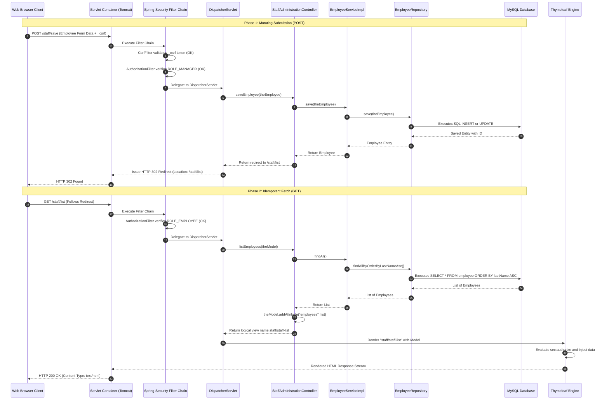
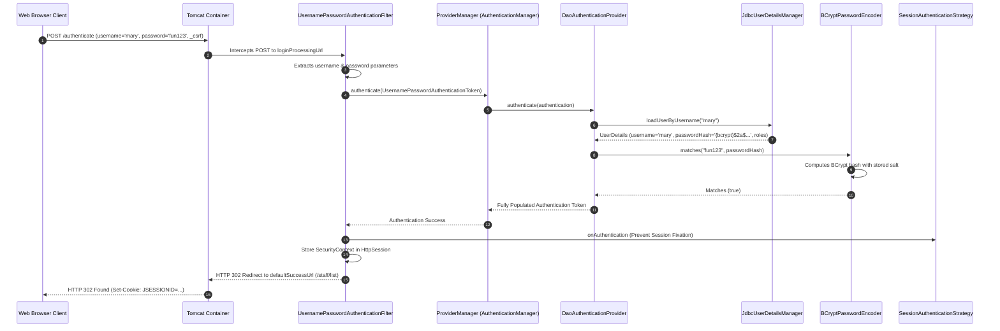
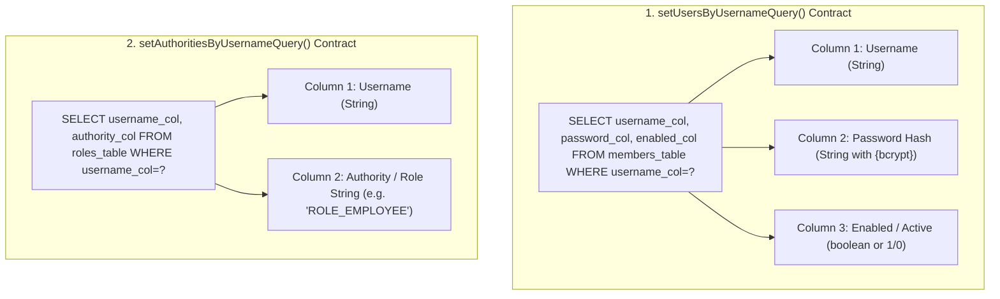

# Summary & Architecture Reference — Week 8: Spring MVC CRUD & Form-Based Security

---

## 1. Annotation & Class Reference Matrix

| Class / Annotation | Module / Package | Architectural Role | Enterprise Purpose | Low-Level Mechanism / Lifecycle Impact | Common Senior Pitfall |
| :--- | :--- | :--- | :--- | :--- | :--- |
| **`@Controller`** | `org.springframework.stereotype` | Presentation Bean | Declares web controller serving server-side rendered HTML views. | Handler return strings resolve to logical view names via `ViewResolver`. | Using `@RestController`, which serializes return strings directly to plain text response bodies. |
| **`SecurityFilterChain`** | `org.springframework.security.web` | Configuration Bean | Defines the ordered filter pipeline governing web access. | Evaluated by `FilterChainProxy` on every incoming HTTP request. | Disabling CSRF in session-based form applications, exposing the system to forgery exploits. |
| **`formLogin()`** | `org.springframework.security.config` | DSL Method | Replaces HTTP Basic with stateful form-based authentication. | Injects `UsernamePasswordAuthenticationFilter` into the filter pipeline. | Creating an unnecessary controller endpoint for `loginProcessingUrl`. |
| **`UsernamePasswordAuthenticationFilter`** | `org.springframework.security.web.authentication` | Security Filter | Intercepts `POST` requests to `loginProcessingUrl`. | Extracts `username` and `password`, delegates to `AuthenticationManager`, creates `SecurityContext`. | Using GET method for login submission, leaking credentials into server access logs. |
| **`CsrfFilter`** | `org.springframework.security.web.csrf` | Security Filter | Guards state-mutating requests (`POST`, `PUT`, `DELETE`) with CSRF tokens. | Validates submitted `_csrf` token against session-stored token. | Using plain HTML `<form action="...">` without `th:action`, omitting the token and causing 403 errors. |
| **`LogoutFilter`** | `org.springframework.security.web.authentication.logout` | Security Filter | Intercepts `POST /logout` to invalidate the session. | Destroys `HttpSession`, wipes `SecurityContextHolder`, deletes `JSESSIONID` cookie. | Allowing `GET` logout, leaving users vulnerable to third-party image tag logout triggers. |
| **`JdbcUserDetailsManager`** | `org.springframework.security.provisioning` | Credential Manager | Queries database credentials over JDBC `DataSource`. | Executes configured user and authority queries with prepared statements. | Mapping queries with missing or misordered column projections. |
| **`JpaRepository`** | `org.springframework.data.jpa.repository` | Persistence Interface | Provides full CRUD and derived sorting queries. | Generates dynamic runtime proxies backed by `SimpleJpaRepository`. | Omitting the hidden ID in forms, causing updates to trigger SQL `INSERT` instead of `UPDATE`. |
| **`sec:authorize`** | `org.thymeleaf.extras.springsecurity6` | Dialect Attribute | Conditionally evaluates SpEL expressions on the active principal. | Renders DOM element only if SpEL expression evaluates to `true`. | Assuming `sec:authorize` provides security without configuring backend route rules. |
| **`sec:authentication`** | `org.thymeleaf.extras.springsecurity6` | Dialect Attribute | Extracts properties from the current `Authentication` principal. | Injects principal username or authorities directly into tag body. | Attempting to access non-existent properties on custom `UserDetails` objects. |

---

## 2. Post-Redirect-Get (PRG) Complete Lifecycle Sequence Diagram



---

## 3. Form Login Authentication Filter Execution Flow



---

## 4. Architectural Comparison: HTTP Basic vs Form-Based Authentication

| Dimension | HTTP Basic Authentication | Form-Based Authentication |
| :--- | :--- | :--- |
| **Primary Architecture** | Stateless REST APIs / Microservices | Stateful Server-Side Rendered Web Portals |
| **User Interface** | Unstyled, browser-native pop-up modal | Custom branded HTML / CSS (Bootstrap 5) |
| **Session Model** | Stateless (`STATELESS` session creation) | Stateful (`IF_REQUIRED` or `ALWAYS` session creation) |
| **Credential Lifetime** | Transmitted on every single HTTP request | Transmitted once during login; session cookie thereafter |
| **Logout Capabilities** | Difficult / non-standard in browsers | Clean `POST /logout` invalidating session & cookies |
| **CSRF Requirement** | Disabled (`csrf.disable()`) | **Strictly Enabled** (Mandatory for session cookies) |
| **Unauthorized Outcome** | Sends `WWW-Authenticate: Basic` $\rightarrow$ Browser popup | Issues HTTP 302 redirect to custom `/login` page |
| **Spring DSL Hook** | `http.httpBasic(Customizer.withDefaults())` | `http.formLogin(form -> form.loginPage(...))` |

---

## 5. Thymeleaf Spring Security 6 Dialect Reference

```html
<!DOCTYPE html>
<html xmlns:th="http://www.thymeleaf.org"
      xmlns:sec="http://www.thymeleaf.org/extras/spring-security">
```

| Tag Expression | Type | Purpose | Example |
| :--- | :--- | :--- | :--- |
| **`sec:authentication="name"`** | Attribute | Outputs authenticated username | `<span sec:authentication="name"></span>` |
| **`sec:authentication="principal.username"`** | Attribute | Outputs username from `UserDetails` | `<span sec:authentication="principal.username"></span>` |
| **`sec:authentication="principal.authorities"`** | Attribute | Outputs list of granted authorities | `<span sec:authentication="principal.authorities"></span>` |
| **`sec:authorize="hasRole('ADMIN')"`** | Conditional | Renders element if principal has `ROLE_ADMIN` | `<div sec:authorize="hasRole('ADMIN')">...</div>` |
| **`sec:authorize="hasAnyRole('MGR','ADM')"`** | Conditional | Renders if principal holds any listed role | `<div sec:authorize="hasAnyRole('MANAGER','ADMIN')">` |
| **`sec:authorize="isAuthenticated()"`** | Conditional | Renders element if user is logged in | `<div sec:authorize="isAuthenticated()">...</div>` |
| **`sec:authorize="isAnonymous()"`** | Conditional | Renders element if user is a guest | `<div sec:authorize="isAnonymous()">...</div>` |
| **`sec:authorize="hasAuthority('DELETE')"`** | Conditional | Renders element matching exact authority | `<button sec:authorize="hasAuthority('DELETE')">` |

---

## 6. Custom JDBC Authentication Query Contracts

When adapting non-standard relational databases, `JdbcUserDetailsManager` requires strict compliance with projection contracts:



### Reference Configuration:
```java
@Bean
public UserDetailsManager userDetailsManager(DataSource dataSource) {
    JdbcUserDetailsManager jdbcUserDetailsManager = new JdbcUserDetailsManager(dataSource);
    
    // Exact 3-column projection contract
    jdbcUserDetailsManager.setUsersByUsernameQuery(
        "select user_id, pw, active from members where user_id=?");
        
    // Exact 2-column projection contract
    jdbcUserDetailsManager.setAuthoritiesByUsernameQuery(
        "select user_id, role from roles where user_id=?");
        
    return jdbcUserDetailsManager;
}
```
