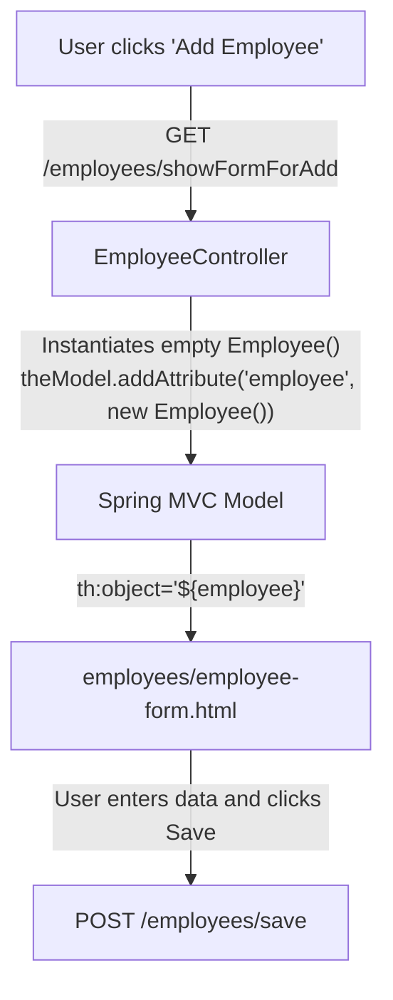
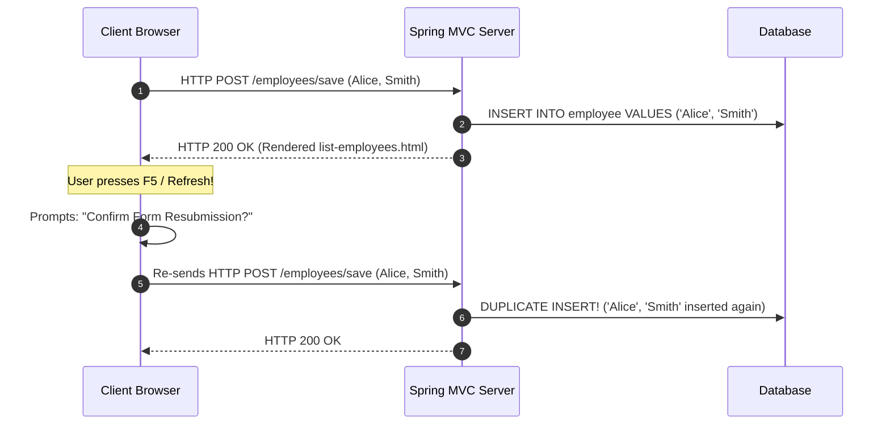
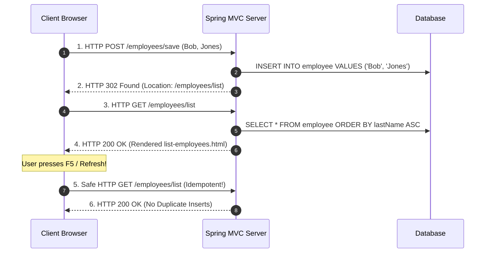
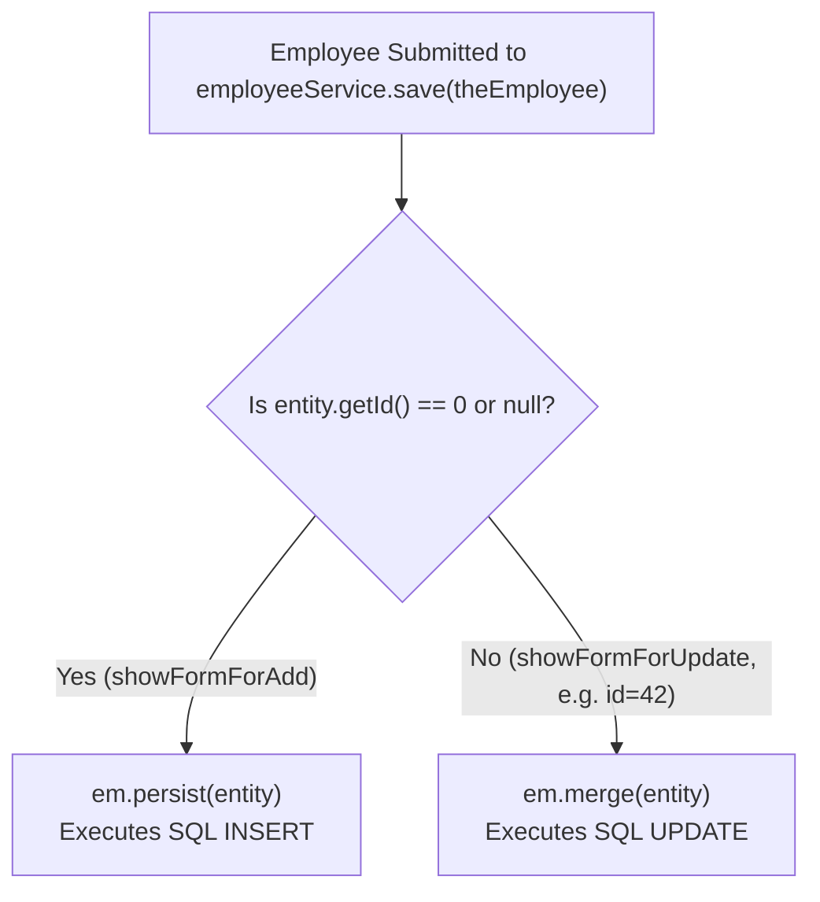
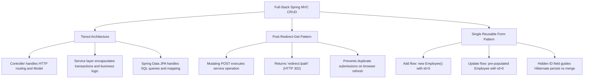

# Topic Notes — Part 1: Full-Stack Spring MVC CRUD & The Post-Redirect-Get (PRG) Pattern

---

## 1. The Multi-Tier Full-Stack Spring MVC Architecture

In enterprise web applications, building an end-to-end CRUD (Create, Read, Update, Delete) capability requires orchestrating multiple architectural layers with strict boundaries of responsibility.

A naive design directly wires web presentation controllers to JPA repositories or raw entity managers. In contrast, an enterprise-grade architecture establishes four decoupled tiers:

```mermaid
flowchart LR
    subgraph PresentationTier["Presentation Tier (Web MVC)"]
        UI["Thymeleaf Templates<br/>(list-employees.html, employee-form.html)"]
        CTRL["EmployeeController<br/>(@Controller)"]
    end

    subgraph ServiceTier["Service Tier (Business Facade)"]
        SVC["EmployeeService Interface"]
        SVC_IMPL["EmployeeServiceImpl<br/>(@Service, @Transactional)"]
    end

    subgraph PersistenceTier["Persistence Tier (Data Access)"]
        REPO["EmployeeRepository<br/>(JpaRepository<Employee, Integer>)"]
    end

    subgraph DataTier["Data Tier (RDBMS)"]
        DB[("MySQL Database<br/>(employee table)")]
    end

    UI ---|"HTTP Requests / HTML Rendering"| CTRL
    CTRL -->|"Calls Business Operations"| SVC
    SVC --- SVC_IMPL
    SVC_IMPL -->|"Calls Persistence Methods"| REPO
    REPO -->|"Executes SQL via Hibernate/JPA"| DB
```



### 1.1 Architectural Responsibilities per Layer

| Architectural Tier | Spring Components | Primary Responsibility | Isolation Rule |
| :--- | :--- | :--- | :--- |
| **Presentation Tier** | `@Controller`, Thymeleaf templates | Handles HTTP request routing, parameter extraction, model binding, and view resolution. | Must **never** execute database transactions or contain business domain rules. |
| **Service Tier** | `@Service`, `@Transactional` | Encapsulates business logic, enforces validation invariants, and orchestrates transactions. | Decouples the presentation controllers from data access technologies. |
| **Persistence Tier** | `@Repository`, `JpaRepository` | Executes CRUD operations, derived query methods, and JPQL queries against relational entities. | Must **never** handle HTTP request/response objects or web session state. |
| **Data Tier** | Relational DB (MySQL, PostgreSQL) | ACID-compliant storage of normalized enterprise domain data. | Isolated behind the JPA Object-Relational Mapping (ORM) layer. |

---

## 2. Reading and Listing Entities with Sorting

Displaying database entities in a clean, sorted tabular view is the foundational read operation of full-stack web applications.

### 2.1 The Repository Layer: Derived Sorting Query

Instead of writing manual JPQL or sorting collections in memory in Java, Spring Data JPA allows declaring derived sorting queries directly in the repository interface:

```java
package com.luv2code.springboot.thymeleafdemo.dao;

import java.util.List;
import org.springframework.data.jpa.repository.JpaRepository;
import com.luv2code.springboot.thymeleafdemo.entity.Employee;

public interface EmployeeRepository extends JpaRepository<Employee, Integer> {

    // Spring Data JPA parses method name: 'findAll By OrderBy LastName Asc'
    // Translates to: SELECT e FROM Employee e ORDER BY e.lastName ASC
    public List<Employee> findAllByOrderByLastNameAsc();
}
```

### 2.2 The Service Facade

The service facade mediates between the web controller and the repository:

```java
package com.luv2code.springboot.thymeleafdemo.service;

import java.util.List;
import org.springframework.stereotype.Service;
import com.luv2code.springboot.thymeleafdemo.dao.EmployeeRepository;
import com.luv2code.springboot.thymeleafdemo.entity.Employee;

@Service
public class EmployeeServiceImpl implements EmployeeService {

    private final EmployeeRepository employeeRepository;

    public EmployeeServiceImpl(EmployeeRepository theEmployeeRepository) {
        this.employeeRepository = theEmployeeRepository;
    }

    @Override
    public List<Employee> findAll() {
        return employeeRepository.findAllByOrderByLastNameAsc();
    }

    @Override
    public Employee findById(int theId) {
        return employeeRepository.findById(theId)
                .orElseThrow(() -> new RuntimeException("Did not find employee id - " + theId));
    }

    @Override
    public Employee save(Employee theEmployee) {
        return employeeRepository.save(theEmployee);
    }

    @Override
    public void deleteById(int theId) {
        employeeRepository.deleteById(theId);
    }
}
```

### 2.3 The Web Controller Handler

```java
@Controller
@RequestMapping("/employees")
public class EmployeeController {

    private final EmployeeService employeeService;

    public EmployeeController(EmployeeService theEmployeeService) {
        this.employeeService = theEmployeeService;
    }

    @GetMapping("/list")
    public String listEmployees(Model theModel) {
        // Retrieve sorted entities from service layer
        List<Employee> theEmployees = employeeService.findAll();

        // Populate model dictionary for Thymeleaf rendering
        theModel.addAttribute("employees", theEmployees);

        return "employees/list-employees"; // Resolves to /templates/employees/list-employees.html
    }
}
```

### 2.4 Rendering the Tabular View in Thymeleaf

In `src/main/resources/templates/employees/list-employees.html`:

```html
<!DOCTYPE HTML>
<html lang="en" xmlns:th="http://www.thymeleaf.org">
<head>
    <meta charset="utf-8">
    <meta name="viewport" content="width=device-width, initial-scale=1">
    <link href="https://cdn.jsdelivr.net/npm/bootstrap@5.2.2/dist/css/bootstrap.min.css" rel="stylesheet">
    <title>Employee Directory</title>
</head>
<body>
<div class="container mt-4">
    <h3>Employee Directory</h3>
    <hr>

    <!-- Button to trigger Add Form -->
    <a th:href="@{/employees/showFormForAdd}" class="btn btn-primary btn-sm mb-3">
        Add Employee
    </a>

    <table class="table table-bordered table-striped">
        <thead class="table-dark">
            <tr>
                <th>First Name</th>
                <th>Last Name</th>
                <th>Email</th>
                <th>Action</th>
            </tr>
        </thead>
        <tbody>
            <!-- Iterate over employees model attribute -->
            <tr th:each="tempEmployee : ${employees}">
                <td th:text="${tempEmployee.firstName}" />
                <td th:text="${tempEmployee.lastName}" />
                <td th:text="${tempEmployee.email}" />
                <td>
                    <!-- Update Action Link -->
                    <a th:href="@{/employees/showFormForUpdate(employeeId=${tempEmployee.id})}"
                       class="btn btn-info btn-sm">Update</a>

                    <!-- Delete Action Link with confirmation prompt -->
                    <a th:href="@{/employees/delete(employeeId=${tempEmployee.id})}"
                       class="btn btn-danger btn-sm"
                       onclick="if (!(confirm('Are you sure you want to delete this employee?'))) return false">
                        Delete
                    </a>
                </td>
            </tr>
        </tbody>
    </table>
</div>
</body>
</html>
```

---

## 3. The Creation (Add) Flow & Form-Backing Model

To capture new employee records, the presentation tier uses an empty form-backing bean:



### 3.1 Controller Handler for Add

```java
@GetMapping("/showFormForAdd")
public String showFormForAdd(Model theModel) {
    // Create empty model attribute to bind form data
    Employee theEmployee = new Employee();

    theModel.addAttribute("employee", theEmployee);

    return "employees/employee-form";
}
```

---

## 4. The Post-Redirect-Get (PRG) Pattern

One of the most critical design patterns in full-stack web development is the **Post-Redirect-Get (PRG)** pattern.

### 4.1 The Duplicate Form Submission Hazard (Anti-Pattern)

Consider what happens if a controller processes a `POST` submission and immediately returns a view name:

```java
// ANTI-PATTERN: Direct view forwarding on mutating POST
@PostMapping("/save")
public String saveEmployee(@ModelAttribute("employee") Employee theEmployee, Model model) {
    employeeService.save(theEmployee);
    model.addAttribute("employees", employeeService.findAll());
    return "employees/list-employees"; // FORWARD TO VIEW DIRECTLY!
}
```



When the user refreshes their browser, the browser repeats the last executed HTTP request. Because the last request was a `POST`, the entire form submission repeats, causing **duplicate database records** or duplicate financial transactions!

### 4.2 The Solution: Post-Redirect-Get (PRG) Workflow

The PRG pattern introduces an explicit HTTP redirect step between state-mutating requests (`POST`) and view rendering (`GET`):

```java
// IDIOMATIC PATTERN: Post-Redirect-Get
@PostMapping("/save")
public String saveEmployee(@ModelAttribute("employee") Employee theEmployee) {
    // 1. Mutate application state
    employeeService.save(theEmployee);

    // 2. Issue HTTP 302 Redirect to a safe idempotent GET endpoint
    return "redirect:/employees/list";
}
```



### 4.3 Why PRG is Mandatory for Senior Engineers

1. **Idempotent Refreshing**: The browser's active URL is `/employees/list`. Refreshing the page executes a safe, read-only HTTP `GET` request.
2. **Clean Browser History & Bookmarks**: Users can safely bookmark or share the resulting URL without triggering submission warnings.
3. **Eliminates Accidental Multi-Clicks**: Even on poor network connections, the redirect cleanly decouples data mutation from page rendering.

---

## 5. The Update Flow & The Hidden Primary Key Binding

An elegant architectural technique in Spring MVC is using a **single HTML form template** (`employee-form.html`) to service both **creation (Add)** and **modification (Update)** workflows.

### 5.1 Controller Handler for Update

```java
@GetMapping("/showFormForUpdate")
public String showFormForUpdate(@RequestParam("employeeId") int theId, Model theModel) {
    // Fetch the existing entity from database
    Employee theEmployee = employeeService.findById(theId);

    // Pre-populate the model with existing entity state
    theModel.addAttribute("employee", theEmployee);

    // Re-use the exact same form template!
    return "employees/employee-form";
}
```

### 5.2 The Crucial Hidden Form Field

In `employee-form.html`, the form defines:

```html
<form action="#" th:action="@{/employees/save}"
                 th:object="${employee}" method="POST">

    <!-- CRITICAL: Hidden form field to preserve the Entity ID -->
    <input type="hidden" th:field="*{id}" />

    <div class="mb-3">
        <label class="form-label">First Name</label>
        <input type="text" th:field="*{firstName}" class="form-control" />
    </div>

    <div class="mb-3">
        <label class="form-label">Last Name</label>
        <input type="text" th:field="*{lastName}" class="form-control" />
    </div>

    <div class="mb-3">
        <label class="form-label">Email</label>
        <input type="text" th:field="*{email}" class="form-control" />
    </div>

    <button type="submit" class="btn btn-info col-2">Save</button>
</form>
```

### 5.3 How Hibernate Differentiates INSERT vs UPDATE

When the form is submitted to `@PostMapping("/save")`, Spring binds the form fields into an `Employee` instance and calls `employeeService.save(theEmployee)`.

Inside Spring Data JPA's `SimpleJpaRepository`:

```java
@Transactional
@Override
public <S extends T> S save(S entity) {
    if (entityInformation.isNew(entity)) {
        // id is 0 or null -> New Entity -> SQL INSERT
        em.persist(entity);
        return entity;
    } else {
        // id != 0 -> Existing Entity -> SQL UPDATE
        return em.merge(entity);
    }
}
```



!!! caution "The Missing Hidden ID Bug"
    If you forget `<input type="hidden" th:field="*{id}" />`, the submitted `Employee` object will have its `id` defaulted to `0`. When `employeeService.save()` is called, Hibernate treats it as a new entity and executes an SQL `INSERT`, duplicating the record and leaving the original row untouched!

---

## 6. The Delete Flow: Safe Entity Removal & Confirmation Guards

Entity deletion requires careful handling to prevent accidental data loss.

### 6.1 The Action Link with Client-Side Confirmation

In `list-employees.html`:

```html
<a th:href="@{/employees/delete(employeeId=${tempEmployee.id})}"
   class="btn btn-danger btn-sm"
   onclick="if (!(confirm('Are you sure you want to delete this employee?'))) return false">
    Delete
</a>
```

- When clicked, JavaScript displays a native browser confirmation modal (`confirm(...)`).
- If the user cancels, the handler returns `false`, aborting navigation.
- If confirmed, the browser navigates to the delete route.

### 6.2 Controller Delete Handler with PRG

```java
@GetMapping("/delete")
public String delete(@RequestParam("employeeId") int theId) {
    // Remove entity via service facade
    employeeService.deleteById(theId);

    // Issue PRG redirect to refresh the directory list
    return "redirect:/employees/list";
}
```

!!! tip "Enterprise Security Note: GET vs POST for Mutations"
    While Chad Darby uses `@GetMapping("/delete")` with query parameters for simplicity, production enterprise standards dictate that all state-mutating operations should use HTTP `POST` wrapped in an HTML `<form>` protected by a CSRF token. This prevents web crawler bots (search engine spiders or browser pre-fetch accelerators) from inadvertently triggering deletions when crawling hyperlinks!

---

## 7. Architectural Summary for Senior Engineers



1. **Enforce Layer Isolation**: Never inject `EmployeeRepository` directly into `EmployeeController`. Always pass through a transactional `EmployeeService` facade.
2. **Always Use PRG for State Mutations**: Every `POST` handler that mutates data must terminate with `return "redirect:..."`.
3. **Preserve Identity via Hidden Fields**: When reusing forms for edit operations, always verify that the entity's primary key is bound via `<input type="hidden" th:field="*{id}" />`.
