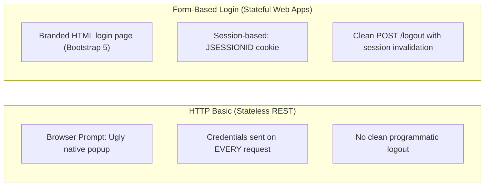
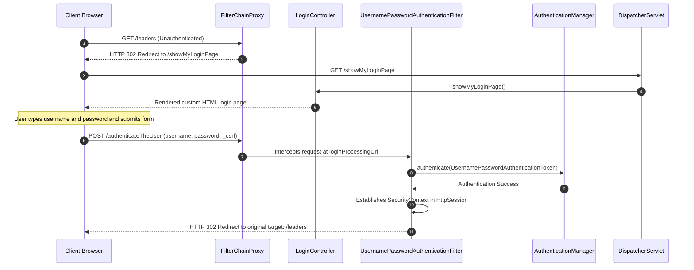
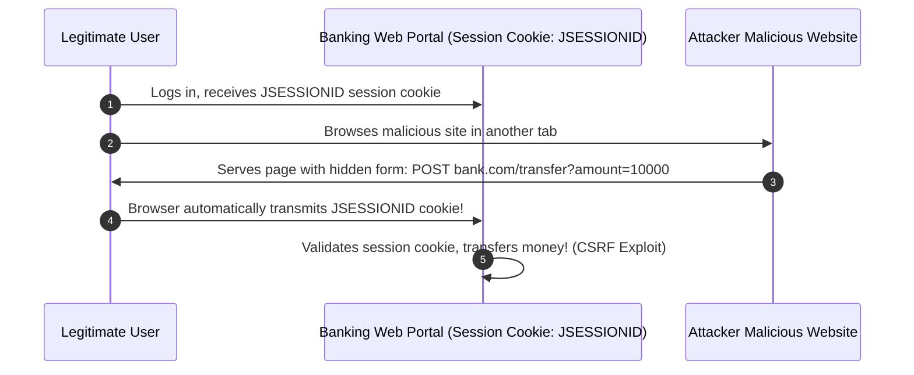
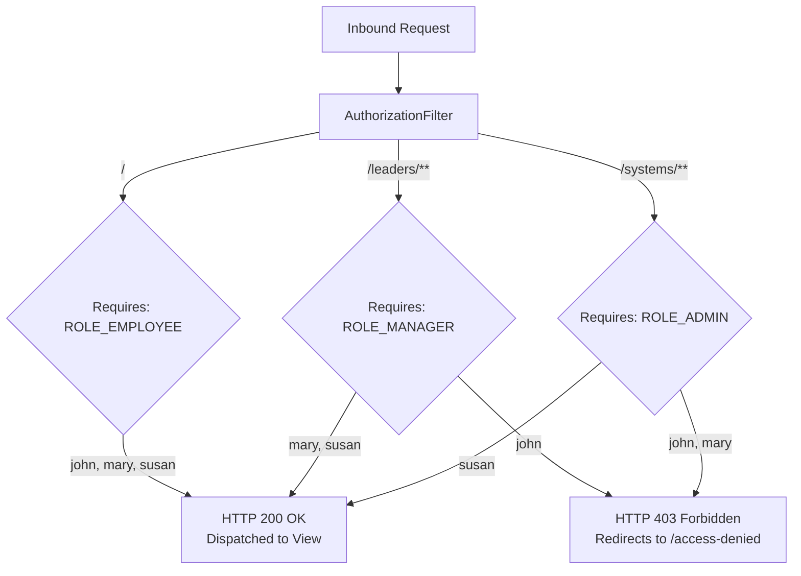

# Topic Notes — Part 2: Form-Based Authentication, CSRF & Role-Based UI Rendering

---

## 1. Transitioning from HTTP Basic to Form-Based Authentication

In Week 6, we secured stateless RESTful microservices using HTTP Basic authentication. However, HTTP Basic is architecturally unsuitable for server-side rendered web applications:



| Dimension | HTTP Basic Authentication (REST) | Form-Based Authentication (Web MVC) |
| :--- | :--- | :--- |
| **User Experience** | Un-stylable browser-native modal popup | Customized, branded HTML login page |
| **Session Model** | Stateless (no session cookie; credentials in header) | Stateful (`HttpSession` tracked via `JSESSIONID` cookie) |
| **Credential Lifetime** | Credentials cached by browser; difficult to invalidate | Clean session destruction on logout |
| **CSRF Requirement** | Disabled (`csrf.disable()`) | **Strictly Enabled** (mandatory for session cookie protection) |
| **Spring DSL** | `http.httpBasic(Customizer.withDefaults())` | `http.formLogin(Customizer.withDefaults())` |

---

## 2. Custom Login Page Architecture & Configuration

When you invoke `.formLogin()`, Spring Security by default generates an unbranded, internal login page. In enterprise systems, we must supply a custom branded login interface.



### 2.1 The Custom Login Controller

We author a dedicated controller to serve the login template:

```java
package com.luv2code.springboot.demosecurity.controller;

import org.springframework.stereotype.Controller;
import org.springframework.web.bind.annotation.GetMapping;

@Controller
public class LoginController {

    @GetMapping("/showMyLoginPage")
    public String showMyLoginPage() {
        return "fancy-login"; // Resolves to /templates/fancy-login.html
    }
}
```

### 2.2 Configuring the `SecurityFilterChain` Lambda DSL

```java
@Configuration
public class DemoSecurityConfig {

    @Bean
    public SecurityFilterChain filterChain(HttpSecurity http) throws Exception {

        http.authorizeHttpRequests(configurer ->
                        configurer
                                .requestMatchers("/").hasRole("EMPLOYEE")
                                .requestMatchers("/leaders/**").hasRole("MANAGER")
                                .requestMatchers("/systems/**").hasRole("ADMIN")
                                .anyRequest().authenticated()
                )
                .formLogin(form ->
                        form
                                .loginPage("/showMyLoginPage")
                                .loginProcessingUrl("/authenticateTheUser")
                                .permitAll()
                )
                .logout(logout -> logout.permitAll()
                )
                .exceptionHandling(configurer ->
                        configurer.accessDeniedPage("/access-denied")
                );

        return http.build();
    }
}
```

### 2.3 Understanding `loginProcessingUrl("/authenticateTheUser")`

A frequent point of confusion among engineers is: **Where is the controller method for `/authenticateTheUser`?**

There is **no controller method**. Spring Security's `UsernamePasswordAuthenticationFilter` intercepts all HTTP `POST` requests targeted at `loginProcessingUrl("/authenticateTheUser")`. The filter:
1. Extracts `username` and `password` request parameters.
2. Constructs a `UsernamePasswordAuthenticationToken`.
3. Delegates to `AuthenticationManager` to verify the credentials against the configured `UserDetailsService`.
4. Saves the resulting `Authentication` principal into the `SecurityContext` associated with the user's `HttpSession`.
5. Issues an HTTP 302 redirect back to the originally requested resource.

### 2.4 Handling Authentication Failures: The `?error` Parameter

When authentication fails (e.g., bad password), Spring Security automatically redirects back to `/showMyLoginPage?error`.

In Thymeleaf, we detect this query parameter using the `${param.error}` expression:

```html
<!-- Display contextual alert only when login fails -->
<div th:if="${param.error}" class="alert alert-danger col-xs-offset-1 col-xs-10">
    <i>Sorry! You entered an invalid username or password.</i>
</div>
```

---

## 3. Session Invalidation & Secure Logout Mechanics

In session-based web applications, logging out requires invalidating the server-side `HttpSession`, wiping the `SecurityContext`, and removing client session cookies.

### 3.1 Why Logout Must Be an HTTP POST

!!! warning "Security Vulnerability: GET Logout"
    Never configure logout over HTTP `GET`. If logout is mapped to a `GET` request, an attacker on a third-party website can place `` on a page. When an authenticated user visits that page, their browser automatically makes a `GET` request, logging them out involuntarily without their knowledge! Spring Security strictly enforces that logout must be an HTTP `POST` request protected by CSRF tokens.

### 3.2 The Thymeleaf Logout Form

```html
<!-- Add a secure logout button -->
<form action="#" th:action="@{/logout}" method="POST">
    <input type="submit" value="Logout" class="btn btn-outline-primary" />
</form>
```

When submitted:
1. Spring Security's `LogoutFilter` intercepts `POST /logout`.
2. Invalidates the user's `HttpSession`.
3. Clears the `SecurityContextHolder`.
4. Removes the `JSESSIONID` cookie.
5. Redirects the browser to `/showMyLoginPage?logout`.

### 3.3 Confirming Logout in the UI

```html
<!-- Display contextual alert only when logged out successfully -->
<div th:if="${param.logout}" class="alert alert-success col-xs-offset-1 col-xs-10">
    <i>You have been successfully logged out.</i>
</div>
```

---

## 4. CSRF Protection: The Synchronizer Token Pattern

In Week 6, we disabled CSRF because REST clients use stateless authorization headers. In full-stack web applications, **CSRF protection must remain strictly enabled**.

### 4.1 How Cross-Site Request Forgery (CSRF) Works



Because browsers automatically attach session cookies to cross-origin requests, any malicious site can forge a state-mutating request.

### 4.2 The Synchronizer Token Defense

Spring Security prevents this via the **Synchronizer Token Pattern**:
1. When a session is established, Spring generates a cryptographically random, unpredictable token.
2. Every HTML form rendered by the application must include this token as a hidden field.
3. When the form is submitted, Spring's `CsrfFilter` compares the submitted token against the session token.
4. If an attacker submits a forged form from another site, they cannot know or guess the token; `CsrfFilter` rejects the request with an **HTTP 403 Forbidden** error.

### 4.3 Thymeleaf Automated CSRF Injection

When you use Thymeleaf's context-aware link syntax `th:action="@{/process}"`, Thymeleaf automatically inserts the hidden CSRF input field into the rendered HTML:

```html
<!-- Your template source code -->
<form action="#" th:action="@{/employees/save}" method="POST">
    <!-- ... fields ... -->
</form>
```

```html
<!-- What Thymeleaf generates in the browser DOM -->
<form action="/employees/save" method="POST">
    <!-- AUTOMATICALLY INJECTED BY THYMELEAF -->
    <input type="hidden" name="_csrf" value="e68d5b84-48f1-4db8-b570-98fc1c0a218d" />
    <!-- ... fields ... -->
</form>
```

!!! important "The Plain HTML Action Trap"
    If you author a form using standard HTML `action="/employees/save"` instead of Thymeleaf `th:action="@{/employees/save}"`, Thymeleaf **will not** inject the `_csrf` token. When submitted, Spring Security will reject the request with HTTP `403 Forbidden`! Always use `th:action`.

---

## 5. Multi-Tier Role-Based Access Control (RBAC) & Custom 403 Routing

Enterprise portals enforce tiered access models across different organizational roles:



### 5.1 Route Configuration Rules

```java
.authorizeHttpRequests(configurer ->
        configurer
                .requestMatchers("/").hasRole("EMPLOYEE")
                .requestMatchers("/leaders/**").hasRole("MANAGER")
                .requestMatchers("/systems/**").hasRole("ADMIN")
                .anyRequest().authenticated()
)
```

### 5.2 Custom Access Denied Page

If an employee with role `EMPLOYEE` attempts to navigate to `/leaders`, Spring Security defaults to a white-label 403 error page. We configure a custom access-denied page:

```java
.exceptionHandling(configurer ->
        configurer.accessDeniedPage("/access-denied")
)
```

In `LoginController`:
```java
@GetMapping("/access-denied")
public String showAccessDenied() {
    return "access-denied"; // Resolves to /templates/access-denied.html
}
```

---

## 6. Dynamic UI Rendering with Thymeleaf Spring Security 6 Dialect

Hiding buttons and links from unauthorized users creates a clean, intuitive user experience. We achieve this using the **Thymeleaf Spring Security 6 Dialect** (`thymeleaf-extras-springsecurity6`).

### 6.1 Maven Dependency

```xml
<dependency>
    <groupId>org.thymeleaf.extras</groupId>
    <artifactId>thymeleaf-extras-springsecurity6</artifactId>
</dependency>
```

### 6.2 Declaring the Security Namespace

In your Thymeleaf templates, declare the `sec` XML namespace:

```html
<!DOCTYPE html>
<html xmlns:th="http://www.thymeleaf.org"
      xmlns:sec="http://www.thymeleaf.org/extras/spring-security">
```

### 6.3 Rendering Principal Identity & Roles

To display who is currently logged in:

```html
<p>
    User: <span sec:authentication="principal.username"></span>
    <br>
    Role(s): <span sec:authentication="principal.authorities"></span>
</p>
```

### 6.4 Conditional Action Controls with `sec:authorize`

```html
<!-- Rendered strictly for users with ROLE_MANAGER -->
<div sec:authorize="hasRole('MANAGER')">
    <p><a th:href="@{/leaders}">Leadership Meeting Portal</a></p>
</div>

<!-- Rendered strictly for users with ROLE_ADMIN -->
<div sec:authorize="hasRole('ADMIN')">
    <p><a th:href="@{/systems}">IT Systems Administration</a></p>
</div>
```

In our Staff Directory table:
```html
<!-- Add Button: Visible only to Managers and Admins -->
<div sec:authorize="hasAnyRole('MANAGER', 'ADMIN')">
    <a th:href="@{/employees/showFormForAdd}" class="btn btn-primary mb-3">Add Employee</a>
</div>

<!-- Delete Button: Visible strictly to Admins -->
<td sec:authorize="hasRole('ADMIN')">
    <a th:href="@{/employees/delete(employeeId=${tempEmployee.id})}" class="btn btn-danger btn-sm">Delete</a>
</td>
```

!!! tip "Defense-in-Depth Architectural Principle"
    Hiding a button in the UI using `sec:authorize` is **purely a user-experience enhancement**, NOT a security perimeter. A clever user can still submit an HTTP `POST` or `GET` request directly via cURL or browser developer tools. True security is enforced exclusively by the backend `SecurityFilterChain` rules. Always implement both!

---

## 7. Production Database Authentication via JDBC (`JdbcUserDetailsManager`)

In production environments, user credentials must reside in relational databases with cryptographic password hashing.

### 7.1 Custom Relational Schema Mapping

When integrating with existing corporate databases, user accounts and roles rarely conform to Spring Security's default `users` and `authorities` table names.

Suppose our database defines:
- Table `members`: columns `user_id`, `pw`, `active`
- Table `roles`: columns `user_id`, `role`

We adapt `JdbcUserDetailsManager` using custom parameterized queries:

```java
@Configuration
public class DemoSecurityConfig {

    @Bean
    public UserDetailsManager userDetailsManager(DataSource dataSource) {

        JdbcUserDetailsManager jdbcUserDetailsManager = new JdbcUserDetailsManager(dataSource);

        // 1. Query to retrieve user authentication record
        // Expected projection: username, password, enabled
        jdbcUserDetailsManager.setUsersByUsernameQuery(
                "select user_id, pw, active from members where user_id=?");

        // 2. Query to retrieve user role authorities
        // Expected projection: username, authority
        jdbcUserDetailsManager.setAuthoritiesByUsernameQuery(
                "select user_id, role from roles where user_id=?");

        return jdbcUserDetailsManager;
    }

    // ... SecurityFilterChain ...
}
```

### 7.2 BCrypt Cryptographic Hashing

All passwords stored in the `members.pw` column must be hashed using salted BCrypt with the `{bcrypt}` prefix:

```sql
INSERT INTO `members` VALUES
('john', '{bcrypt}$2a$10$qeS0HEh7urweMoEDnwNAR.Lu4nmrkKGBxUkxeFl50DU23qm.ngIOq', 1),
('mary', '{bcrypt}$2a$10$qeS0HEh7urweMoEDnwNAR.Lu4nmrkKGBxUkxeFl50DU23qm.ngIOq', 1),
('susan', '{bcrypt}$2a$10$qeS0HEh7urweMoEDnwNAR.Lu4nmrkKGBxUkxeFl50DU23qm.ngIOq', 1);

INSERT INTO `roles` VALUES
('john', 'ROLE_EMPLOYEE'),
('mary', 'ROLE_EMPLOYEE'),
('mary', 'ROLE_MANAGER'),
('susan', 'ROLE_EMPLOYEE'),
('susan', 'ROLE_MANAGER'),
('susan', 'ROLE_ADMIN');
```

During login:
1. `JdbcUserDetailsManager` executes the SQL query using the supplied username.
2. `BCryptPasswordEncoder` extracts the embedded salt from the stored hash.
3. Computes the hash of the raw user password and verifies equality in constant time, defeating rainbow tables and timing attacks.

---

## 8. Architectural Summary for Senior Engineers

```mermaid
flowchart TD
    ROOT["Stateful Spring MVC Security"]

    ROOT --> FORM["Form Authentication"]
    FORM --> F1["Custom login controller & Bootstrap template"]
    FORM --> F2["loginProcessingUrl intercepted by Filter"]
    FORM --> F3["Failure redirect with ?error parameter"]

    ROOT --> CSRF["CSRF Protection"]
    CSRF --> C1["Mandatory for session-cookie web portals"]
    CSRF --> C2["Synchronizer token pattern"]
    CSRF --> C3["Thymeleaf th:action auto-injects _csrf"]

    ROOT --> UI["Thymeleaf Security Dialect"]
    UI --> U1["sec:authentication displays active principal"]
    UI --> U2["sec:authorize conditionally renders UI buttons"]
    UI --> U3["Defense-in-depth: UI hiding + backend filter rules"]

    ROOT --> JDBC["Database Credentials"]
    JDBC --> J1["JdbcUserDetailsManager targeting DataSource"]
    JDBC --> J2["Custom SQL projection queries"]
    JDBC --> J3["Salted BCrypt password verification"]
```



1. **Never Disable CSRF on Session-Based Portals**: If the browser tracks authentication via cookies, CSRF must be active.
2. **Always Use POST for Logout**: Protects against cross-site image tag request forgery.
3. **Practice Defense-in-Depth**: Never rely on `sec:authorize` alone to restrict actions; enforce authorization at the `SecurityFilterChain` layer.
