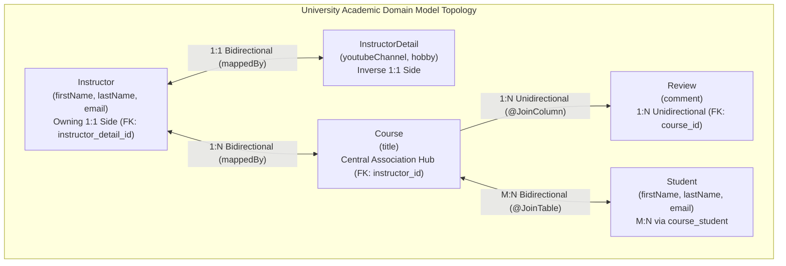

# Week 9 — Advanced JPA & Hibernate: Relational Topologies & Fetch Optimization

## Goal

Master advanced Object-Relational Mapping (ORM) topologies using Jakarta Persistence (JPA) and Hibernate in Spring Boot. Architect complex domain relationships across all cardinalities: one-to-one (symmetrical bidirectional vs unidirectional), one-to-many / many-to-one bidirectional graphs, one-to-many unidirectional collection associations with join columns, and many-to-many bidirectional networks backed by dedicated join tables. Configure fine-grained cascade strategies, enforce explicit programmatic dissociation workflows prior to entity removal, navigate lazy loading proxy boundaries to prevent `LazyInitializationException`, and eliminate the catastrophic N+1 select query problem using JPQL `JOIN FETCH` optimizations.

---

## :material-calendar: Week 9 Schedule

| Topic | Modules / Sections | Key Annotations / Concepts |
| :--- | :--- | :--- |
| **One-to-One Topologies & Cascade Strategies** | Modules 01–06 | `@OneToOne`, `@JoinColumn`, `mappedBy`, `CascadeType.ALL` vs selective cascades, child deletion & dissociation |
| **One-to-Many / Many-to-One Bidirectional Graphs** | Modules 07–14 | `@OneToMany`, `@ManyToOne`, foreign key ownership, bidirectional convenience synchronization methods |
| **Fetch Strategies & The N+1 Select Problem** | Modules 08–10 | `FetchType.EAGER` vs `FetchType.LAZY`, JPA default fetch types, `LazyInitializationException`, proxy hydration |
| **JPQL JOIN FETCH Optimization** | Module 10 | Eliminating N+1 queries, single-statement Cartesian graph retrieval, `JOIN FETCH` vs separate queries |
| **One-to-Many Unidirectional Associations** | Modules 15–17 | Course $\rightarrow$ Reviews mapping, parent-level `@JoinColumn`, lifecycle delegation with `CascadeType.ALL` |
| **Many-to-Many Bidirectional Networks** | Modules 18–23 | `@ManyToMany`, `@JoinTable`, join column vs inverse join column, peer preservation, safe deletion without cascading |

---

## :material-sitemap: Architectural Progression

---

## :material-folder-open: Week 9 Content

-   :material-note-text:{ .lg .middle } **Topic Notes — Part 1: One-to-One & One-to-Many Topologies**

    ---

    Relational entity mappings, foreign key columns, `@OneToOne` unidirectional and bidirectional associations, the `mappedBy` contract, fine-tuning cascade types (`ALL`, `PERSIST`, `MERGE`, `REMOVE`, `REFRESH`, `DETACH`), child-only deletion mechanics, and `@OneToMany` / `@ManyToOne` bidirectional synchronization with convenience helper methods.

    [:octicons-arrow-right-24: Topic Notes Part 1](topic-notes-part1.md)

-   :material-note-text:{ .lg .middle } **Topic Notes — Part 2: Fetch Strategies, The N+1 Problem & JOIN FETCH**

    ---

    In-depth analysis of JPA fetch strategies (`FetchType.EAGER` vs `FetchType.LAZY`), default fetch type rules, the mechanics of Hibernate proxies, diagnosing and resolving `LazyInitializationException`, the mathematical explosion of the N+1 select query problem, and single-roundtrip optimization via JPQL `JOIN FETCH`.

    [:octicons-arrow-right-24: Topic Notes Part 2](topic-notes-part2.md)

-   :material-note-text:{ .lg .middle } **Topic Notes — Part 3: Unidirectional Collections & Many-to-Many Networks**

    ---

    One-to-many unidirectional relationships (`Course` $\rightarrow$ `Review`), foreign key management without back-references, full lifecycle delegation with `CascadeType.ALL`, many-to-many associations (`Course` $\leftrightarrow$ `Student`), `@JoinTable` anatomy, peer entity protection, and strict dissociation workflows during deletion.

    [:octicons-arrow-right-24: Topic Notes Part 3](topic-notes-part3.md)

-   :material-flask:{ .lg .middle } **Lab Guide — University Academic Domain Model**

    ---

    Construct a production-grade academic enrollment and faculty management domain: implement all four relational topologies using Jakarta Persistence and MySQL, write programmatic dissociation workflows for parent and child entities, execute single-query `JOIN FETCH` operations, and verify constraints with 11 automated integration tests.

    [:octicons-arrow-right-24: Lab Guide](lab-guide.md)

-   :material-clipboard-check:{ .lg .middle } **Summary & Architecture Reference**

    ---

    JPA mapping annotation matrix, default fetch types reference, cascade propagation comparison, N+1 query elimination benchmark, join table structural schema, and programmatic entity dissociation checklist.

    [:octicons-arrow-right-24: Summary](summary.md)

---

## :material-progress-check: Progress Tracker

- [ ] **Part 1:** One-to-One and One-to-Many bidirectional mappings, cascade types, and child dissociation workflows
- [ ] **Part 2:** FetchType.EAGER vs LAZY, `LazyInitializationException` anatomy, and eliminating N+1 with `JOIN FETCH`
- [ ] **Part 3:** One-to-Many unidirectional mapping and Many-to-Many join tables with peer entity preservation
- [ ] **Lab Guide:** University Academic Domain Model implementation, dissociation DAO methods, and test verification
- [ ] **Summary:** Annotation reference, cascade propagation rules, and fetch strategy cheatsheet reviewed
