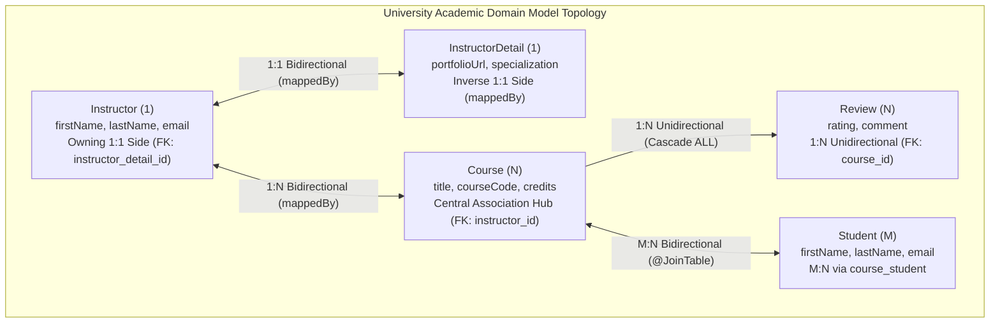

# Lab Guide — University Academic & Course Enrollment Domain Model

> **Lab Repository:** [:material-github: 7amo10/Spring-Labs — Week-09-Academic-Enrollment-Domain-Model](https://github.com/7amo10/Spring-Labs/tree/main/Week-09-Academic-Enrollment-Domain-Model)  
> **Source Reference:** `Sources/Spring/Labs/Week-09-Lab-Guide.tex`

---

## 1. Enterprise Scenario & Architectural Objective

You are a Principal Backend Architect tasked with constructing a unified academic management and course registration domain model for a higher-education university system. The institution requires a persistent relational domain capable of handling faculty appointments, course curriculum schedules, student course enrollments, and student-submitted course reviews.

The system must satisfy strict enterprise data integrity, lifecycle governance, and query performance benchmarks:

1. **Diverse Topological Cardinalities**: Model four distinct relational topologies:
   - Symmetrical 1:1 bidirectional mapping between `Instructor` and `InstructorDetail`.
   - 1:N bidirectional mapping between `Instructor` and `Course`.
   - 1:N unidirectional mapping from `Course` to `Review` without back-references.
   - M:N bidirectional mapping between `Course` and `Student` mediated by a dedicated join table `course_student`.
2. **Selective Lifecycle Cascades**: Differentiate between composite child value objects (where deletion cascades down) and independent peer entities (where deletion must never cascade across relationships).
3. **Programmatic Dissociation Protocols**: Implement explicit in-memory foreign key dissociation in DAO methods prior to entity removal, eliminating foreign key constraint failures while preserving un-cascaded entities.
4. **Fetch Optimization & Eliminating N+1**: Contrast default lazy loading queries with single-statement JPQL `JOIN FETCH` queries that hydrate multi-tier relational graphs in a single database round-trip.



---

## 2. Component Architecture & File Tree

The project is structured under package `com.spring.lab.academic`:

```text
Week-09-Academic-Enrollment-Domain-Model/
├── pom.xml
├── src/
│   ├── main/
│   │   ├── java/com/spring/lab/academic/
│   │   │   ├── AcademicApplication.java
│   │   │   ├── dao/
│   │   │   │   ├── AcademicDao.java
│   │   │   │   └── AcademicDaoImpl.java
│   │   │   └── entity/
│   │   │       ├── Course.java
│   │   │       ├── Instructor.java
│   │   │       ├── InstructorDetail.java
│   │   │       ├── Review.java
│   │   │       └── Student.java
│   │   └── resources/
│   │       ├── application.properties
│   │       └── schema.sql
│   └── test/
│       └── java/com/spring/lab/academic/
│           └── AcademicDomainIntegrationTest.java
```

---

## 3. Relational Mapping & Cascade Policy Matrix

| Entity Association | Multiplicity | Fetch Type | Configured Cascade Policy | Deletion / Dissociation Behavior |
| :--- | :--- | :--- | :--- | :--- |
| `Instructor` $\to$ `Detail` | 1:1 (Owning) | `FetchType.EAGER` | `CascadeType.ALL` | Deleting instructor automatically deletes instructor detail. |
| `Detail` $\to$ `Instructor` | 1:1 (Inverse) | `FetchType.EAGER` | `PERSIST, MERGE, DETACH, REFRESH` | Detail deletion dissociates `instructor.setInstructorDetail(null)` without deleting instructor. |
| `Instructor` $\to$ `Course` | 1:N (Inverse) | `FetchType.LAZY` | `PERSIST, MERGE, DETACH, REFRESH` | Instructor deletion dissociates `course.setInstructor(null)` to preserve courses. |
| `Course` $\to$ `Instructor` | N:1 (Owning) | `FetchType.EAGER` | `PERSIST, MERGE, DETACH, REFRESH` | Course deletion removes course; instructor remains unaffected. |
| `Course` $\to$ `Review` | 1:N (Unidir) | `FetchType.LAZY` | `CascadeType.ALL` (Full Lifecycle) | Course deletion cascades and deletes all associated reviews in `review` table. |
| `Course` $\leftrightarrow$ `Student` | M:N (Bi-dir) | `FetchType.LAZY` | `PERSIST, MERGE, DETACH, REFRESH` | Deletion of course cleans up join table; student deletion dissociates from courses. |

---

## 4. Step-by-Step Implementation Guide

### Step 1: Maven Dependencies (`pom.xml`)

Configure dependencies for Spring Data JPA, MySQL JDBC driver, and test support:

```xml
<dependencies>
    <!-- Jakarta Persistence / Hibernate -->
    <dependency>
        <groupId>org.springframework.boot</groupId>
        <artifactId>spring-boot-starter-data-jpa</artifactId>
    </dependency>

    <!-- MySQL JDBC Driver -->
    <dependency>
        <groupId>com.mysql</groupId>
        <artifactId>mysql-connector-j</artifactId>
        <scope>runtime</scope>
    </dependency>

    <!-- Spring Boot Test & JUnit 5 -->
    <dependency>
        <groupId>org.springframework.boot</groupId>
        <artifactId>spring-boot-starter-test</artifactId>
        <scope>test</scope>
    </dependency>
</dependencies>
```

---

### Step 2: Relational Schemas & Topologies (`schema.sql`)

```sql
CREATE DATABASE IF NOT EXISTS `academic_directory`;
USE `academic_directory`;

-- 1. Instructor Detail Table
DROP TABLE IF EXISTS `instructor_detail`;
CREATE TABLE `instructor_detail` (
  `id` int NOT NULL AUTO_INCREMENT,
  `youtube_channel` varchar(128) DEFAULT NULL,
  `hobby` varchar(45) DEFAULT NULL,
  PRIMARY KEY (`id`)
) ENGINE=InnoDB DEFAULT CHARSET=latin1;

-- 2. Instructor Table (Owning 1:1 side with FK instructor_detail_id)
DROP TABLE IF EXISTS `instructor`;
CREATE TABLE `instructor` (
  `id` int NOT NULL AUTO_INCREMENT,
  `first_name` varchar(45) DEFAULT NULL,
  `last_name` varchar(45) DEFAULT NULL,
  `email` varchar(45) DEFAULT NULL,
  `instructor_detail_id` int DEFAULT NULL,
  PRIMARY KEY (`id`),
  KEY `FK_DETAIL_idx` (`instructor_detail_id`),
  CONSTRAINT `FK_DETAIL` FOREIGN KEY (`instructor_detail_id`) REFERENCES `instructor_detail` (`id`)
) ENGINE=InnoDB DEFAULT CHARSET=latin1;

-- 3. Course Table (Owning N:1 side with FK instructor_id)
DROP TABLE IF EXISTS `course`;
CREATE TABLE `course` (
  `id` int NOT NULL AUTO_INCREMENT,
  `title` varchar(128) DEFAULT NULL,
  `instructor_id` int DEFAULT NULL,
  PRIMARY KEY (`id`),
  UNIQUE KEY `TITLE_UNIQUE` (`title`),
  KEY `FK_INSTRUCTOR_idx` (`instructor_id`),
  CONSTRAINT `FK_INSTRUCTOR` FOREIGN KEY (`instructor_id`) REFERENCES `instructor` (`id`)
) ENGINE=InnoDB DEFAULT CHARSET=latin1;

-- 4. Review Table (Target of 1:N unidirectional mapping with FK course_id)
DROP TABLE IF EXISTS `review`;
CREATE TABLE `review` (
  `id` int NOT NULL AUTO_INCREMENT,
  `comment` varchar(256) DEFAULT NULL,
  `course_id` int DEFAULT NULL,
  PRIMARY KEY (`id`),
  KEY `FK_COURSE_ID_idx` (`course_id`),
  CONSTRAINT `FK_COURSE` FOREIGN KEY (`course_id`) REFERENCES `course` (`id`)
) ENGINE=InnoDB DEFAULT CHARSET=latin1;

-- 5. Student Table
DROP TABLE IF EXISTS `student`;
CREATE TABLE `student` (
  `id` int NOT NULL AUTO_INCREMENT,
  `first_name` varchar(45) DEFAULT NULL,
  `last_name` varchar(45) DEFAULT NULL,
  `email` varchar(45) DEFAULT NULL,
  PRIMARY KEY (`id`)
) ENGINE=InnoDB DEFAULT CHARSET=latin1;

-- 6. Course-Student Join Table for M:N Association
DROP TABLE IF EXISTS `course_student`;
CREATE TABLE `course_student` (
  `course_id` int NOT NULL,
  `student_id` int NOT NULL,
  PRIMARY KEY (`course_id`,`student_id`),
  KEY `FK_STUDENT_idx` (`student_id`),
  CONSTRAINT `FK_COURSE_JOIN` FOREIGN KEY (`course_id`) REFERENCES `course` (`id`),
  CONSTRAINT `FK_STUDENT_JOIN` FOREIGN KEY (`student_id`) REFERENCES `student` (`id`)
) ENGINE=InnoDB DEFAULT CHARSET=latin1;
```

---

### Step 3: Entity Definitions & Association Symmetry

#### `InstructorDetail.java`:
```java
package com.spring.lab.academic.entity;

import jakarta.persistence.*;

@Entity
@Table(name = "instructor_detail")
public class InstructorDetail {

    @Id
    @GeneratedValue(strategy = GenerationType.IDENTITY)
    @Column(name = "id")
    private int id;

    @Column(name = "youtube_channel")
    private String youtubeChannel;

    @Column(name = "hobby")
    private String hobby;

    // INVERSE SIDE: Omit CascadeType.REMOVE to permit child deletion without deleting parent
    @OneToOne(mappedBy = "instructorDetail",
            cascade = {CascadeType.DETACH, CascadeType.MERGE, CascadeType.PERSIST, CascadeType.REFRESH})
    private Instructor instructor;

    public InstructorDetail() {}

    public InstructorDetail(String youtubeChannel, String hobby) {
        this.youtubeChannel = youtubeChannel;
        this.hobby = hobby;
    }

    public int getId() { return id; }
    public void setId(int id) { this.id = id; }
    public String getYoutubeChannel() { return youtubeChannel; }
    public void setYoutubeChannel(String youtubeChannel) { this.youtubeChannel = youtubeChannel; }
    public String getHobby() { return hobby; }
    public void setHobby(String hobby) { this.hobby = hobby; }
    public Instructor getInstructor() { return instructor; }
    public void setInstructor(Instructor instructor) { this.instructor = instructor; }
}
```

#### `Instructor.java`:
```java
package com.spring.lab.academic.entity;

import jakarta.persistence.*;
import java.util.ArrayList;
import java.util.List;

@Entity
@Table(name = "instructor")
public class Instructor {

    @Id
    @GeneratedValue(strategy = GenerationType.IDENTITY)
    @Column(name = "id")
    private int id;

    @Column(name = "first_name")
    private String firstName;

    @Column(name = "last_name")
    private String lastName;

    @Column(name = "email")
    private String email;

    // OWNING 1:1 SIDE: Full cascade to detail
    @OneToOne(cascade = CascadeType.ALL)
    @JoinColumn(name = "instructor_detail_id")
    private InstructorDetail instructorDetail;

    // INVERSE 1:N SIDE: Default FetchType.LAZY; selective cascade without REMOVE
    @OneToMany(mappedBy = "instructor",
               fetch = FetchType.LAZY,
               cascade = {CascadeType.PERSIST, CascadeType.MERGE,
                          CascadeType.DETACH, CascadeType.REFRESH})
    private List<Course> courses;

    public Instructor() {}

    public Instructor(String firstName, String lastName, String email) {
        this.firstName = firstName;
        this.lastName = lastName;
        this.email = email;
    }

    public int getId() { return id; }
    public void setId(int id) { this.id = id; }
    public String getFirstName() { return firstName; }
    public void setFirstName(String firstName) { this.firstName = firstName; }
    public String getLastName() { return lastName; }
    public void setLastName(String lastName) { this.lastName = lastName; }
    public String getEmail() { return email; }
    public void setEmail(String email) { this.email = email; }
    public InstructorDetail getInstructorDetail() { return instructorDetail; }
    public void setInstructorDetail(InstructorDetail instructorDetail) { this.instructorDetail = instructorDetail; }
    public List<Course> getCourses() { return courses; }
    public void setCourses(List<Course> courses) { this.courses = courses; }

    // Convenience synchronization method
    public void add(Course tempCourse) {
        if (courses == null) {
            courses = new ArrayList<>();
        }
        courses.add(tempCourse);
        tempCourse.setInstructor(this);
    }
}
```

#### `Course.java`:
```java
package com.spring.lab.academic.entity;

import jakarta.persistence.*;
import java.util.ArrayList;
import java.util.List;

@Entity
@Table(name = "course")
public class Course {

    @Id
    @GeneratedValue(strategy = GenerationType.IDENTITY)
    @Column(name = "id")
    private int id;

    @Column(name = "title")
    private String title;

    // OWNING N:1 SIDE: No REMOVE cascade
    @ManyToOne(cascade = {CascadeType.PERSIST, CascadeType.MERGE,
                          CascadeType.DETACH, CascadeType.REFRESH})
    @JoinColumn(name = "instructor_id")
    private Instructor instructor;

    // 1:N UNIDIRECTIONAL: Target has no back-reference; full lifecycle delegation
    @OneToMany(fetch = FetchType.LAZY, cascade = CascadeType.ALL)
    @JoinColumn(name = "course_id")
    private List<Review> reviews;

    // M:N OWNING SIDE: Defines @JoinTable; NO REMOVE cascade!
    @ManyToMany(fetch = FetchType.LAZY,
            cascade = {CascadeType.PERSIST, CascadeType.MERGE,
                       CascadeType.DETACH, CascadeType.REFRESH})
    @JoinTable(
            name = "course_student",
            joinColumns = @JoinColumn(name = "course_id"),
            inverseJoinColumns = @JoinColumn(name = "student_id")
    )
    private List<Student> students;

    public Course() {}

    public Course(String title) {
        this.title = title;
    }

    public int getId() { return id; }
    public void setId(int id) { this.id = id; }
    public String getTitle() { return title; }
    public void setTitle(String title) { this.title = title; }
    public Instructor getInstructor() { return instructor; }
    public void setInstructor(Instructor instructor) { this.instructor = instructor; }
    public List<Review> getReviews() { return reviews; }
    public void setReviews(List<Review> reviews) { this.reviews = reviews; }
    public List<Student> getStudents() { return students; }
    public void setStudents(List<Student> students) { this.students = students; }

    public void addReview(Review theReview) {
        if (reviews == null) {
            reviews = new ArrayList<>();
        }
        reviews.add(theReview);
    }

    public void addStudent(Student theStudent) {
        if (students == null) {
            students = new ArrayList<>();
        }
        students.add(theStudent);
    }
}
```

#### `Review.java`:
```java
package com.spring.lab.academic.entity;

import jakarta.persistence.*;

@Entity
@Table(name = "review")
public class Review {

    @Id
    @GeneratedValue(strategy = GenerationType.IDENTITY)
    @Column(name = "id")
    private int id;

    @Column(name = "comment")
    private String comment;

    public Review() {}

    public Review(String comment) {
        this.comment = comment;
    }

    public int getId() { return id; }
    public void setId(int id) { this.id = id; }
    public String getComment() { return comment; }
    public void setComment(String comment) { this.comment = comment; }
}
```

#### `Student.java`:
```java
package com.spring.lab.academic.entity;

import jakarta.persistence.*;
import java.util.ArrayList;
import java.util.List;

@Entity
@Table(name = "student")
public class Student {

    @Id
    @GeneratedValue(strategy = GenerationType.IDENTITY)
    @Column(name = "id")
    private int id;

    @Column(name = "first_name")
    private String firstName;

    @Column(name = "last_name")
    private String lastName;

    @Column(name = "email")
    private String email;

    // INVERSE M:N SIDE: mappedBy refers to field 'students' on Course; NO REMOVE cascade
    @ManyToMany(fetch = FetchType.LAZY,
            cascade = {CascadeType.PERSIST, CascadeType.MERGE,
                       CascadeType.DETACH, CascadeType.REFRESH},
            mappedBy = "students")
    private List<Course> courses;

    public Student() {}

    public Student(String firstName, String lastName, String email) {
        this.firstName = firstName;
        this.lastName = lastName;
        this.email = email;
    }

    public int getId() { return id; }
    public void setId(int id) { this.id = id; }
    public String getFirstName() { return firstName; }
    public void setFirstName(String firstName) { this.firstName = firstName; }
    public String getLastName() { return lastName; }
    public void setLastName(String lastName) { this.lastName = lastName; }
    public String getEmail() { return email; }
    public void setEmail(String email) { this.email = email; }
    public List<Course> getCourses() { return courses; }
    public void setCourses(List<Course> courses) { this.courses = courses; }

    public void addCourse(Course theCourse) {
        if (courses == null) {
            courses = new ArrayList<>();
        }
        courses.add(theCourse);
        theCourse.addStudent(this);
    }
}
```

---

### Step 4: DAO Tier with Programmatic Dissociation Protocols

#### `AcademicDao.java`:
```java
package com.spring.lab.academic.dao;

import com.spring.lab.academic.entity.*;
import java.util.List;

public interface AcademicDao {
    void save(Instructor theInstructor);
    Instructor findInstructorById(int theId);
    Instructor findInstructorByIdJoinFetch(int theId);
    void deleteInstructorById(int theId);

    InstructorDetail findInstructorDetailById(int theId);
    void deleteInstructorDetailById(int theId);

    void save(Course theCourse);
    Course findCourseById(int theId);
    Course findCourseAndReviewsByCourseId(int theId);
    Course findCourseAndStudentsByCourseId(int theId);
    void deleteCourseById(int theId);

    Student findStudentAndCoursesByStudentId(int theId);
    void deleteStudentById(int theId);
}
```

#### `AcademicDaoImpl.java`:
```java
package com.spring.lab.academic.dao;

import com.spring.lab.academic.entity.*;
import jakarta.persistence.EntityManager;
import jakarta.persistence.PersistenceContext;
import jakarta.persistence.TypedQuery;
import org.springframework.stereotype.Repository;
import org.springframework.transaction.annotation.Transactional;

import java.util.List;

@Repository
public class AcademicDaoImpl implements AcademicDao {

    @PersistenceContext
    private EntityManager entityManager;

    @Override
    @Transactional
    public void save(Instructor theInstructor) {
        entityManager.persist(theInstructor);
    }

    @Override
    public Instructor findInstructorById(int theId) {
        return entityManager.find(Instructor.class, theId);
    }

    @Override
    public Instructor findInstructorByIdJoinFetch(int theId) {
        TypedQuery<Instructor> query = entityManager.createQuery(
                "SELECT i FROM Instructor i "
                + "JOIN FETCH i.courses "
                + "JOIN FETCH i.instructorDetail "
                + "WHERE i.id = :data", Instructor.class);
        query.setParameter("data", theId);
        return query.getSingleResult();
    }

    @Override
    @Transactional
    public void deleteInstructorById(int theId) {
        Instructor tempInstructor = entityManager.find(Instructor.class, theId);
        if (tempInstructor != null) {
            // Dissociation Protocol: Break foreign key on all courses
            List<Course> courses = tempInstructor.getCourses();
            for (Course tempCourse : courses) {
                tempCourse.setInstructor(null);
            }
            entityManager.remove(tempInstructor);
        }
    }

    @Override
    public InstructorDetail findInstructorDetailById(int theId) {
        return entityManager.find(InstructorDetail.class, theId);
    }

    @Override
    @Transactional
    public void deleteInstructorDetailById(int theId) {
        InstructorDetail tempInstructorDetail = entityManager.find(InstructorDetail.class, theId);
        if (tempInstructorDetail != null) {
            // Dissociation Protocol: Break foreign key on owning Instructor
            tempInstructorDetail.getInstructor().setInstructorDetail(null);
            entityManager.remove(tempInstructorDetail);
        }
    }

    @Override
    @Transactional
    public void save(Course theCourse) {
        entityManager.persist(theCourse);
    }

    @Override
    public Course findCourseById(int theId) {
        return entityManager.find(Course.class, theId);
    }

    @Override
    public Course findCourseAndReviewsByCourseId(int theId) {
        TypedQuery<Course> query = entityManager.createQuery(
                "SELECT c FROM Course c "
                + "JOIN FETCH c.reviews "
                + "WHERE c.id = :data", Course.class);
        query.setParameter("data", theId);
        return query.getSingleResult();
    }

    @Override
    public Course findCourseAndStudentsByCourseId(int theId) {
        TypedQuery<Course> query = entityManager.createQuery(
                "SELECT c FROM Course c "
                + "JOIN FETCH c.students "
                + "WHERE c.id = :data", Course.class);
        query.setParameter("data", theId);
        return query.getSingleResult();
    }

    @Override
    @Transactional
    public void deleteCourseById(int theId) {
        Course tempCourse = entityManager.find(Course.class, theId);
        if (tempCourse != null) {
            // Deleting course cascades to reviews and cleans join table automatically
            entityManager.remove(tempCourse);
        }
    }

    @Override
    public Student findStudentAndCoursesByStudentId(int theId) {
        TypedQuery<Student> query = entityManager.createQuery(
                "SELECT s FROM Student s "
                + "JOIN FETCH s.courses "
                + "WHERE s.id = :data", Student.class);
        query.setParameter("data", theId);
        return query.getSingleResult();
    }

    @Override
    @Transactional
    public void deleteStudentById(int theId) {
        Student tempStudent = entityManager.find(Student.class, theId);
        if (tempStudent != null) {
            // Dissociation Protocol: Break association on owning Course entities
            for (Course tempCourse : tempStudent.getCourses()) {
                tempCourse.getStudents().remove(tempStudent);
            }
            entityManager.remove(tempStudent);
        }
    }
}
```

---

## 5. Automated JUnit 5 Integration Testing

Create `src/test/java/com/spring/lab/academic/AcademicDomainIntegrationTest.java`:

```java
package com.spring.lab.academic;

import com.spring.lab.academic.dao.AcademicDao;
import com.spring.lab.academic.entity.*;
import org.junit.jupiter.api.DisplayName;
import org.junit.jupiter.api.Test;
import org.springframework.beans.factory.annotation.Autowired;
import org.springframework.boot.test.context.SpringBootTest;
import org.springframework.test.annotation.Rollback;
import org.springframework.transaction.annotation.Transactional;

import static org.junit.jupiter.api.Assertions.*;

@SpringBootTest
public class AcademicDomainIntegrationTest {

    @Autowired
    private AcademicDao academicDao;

    @Test
    @DisplayName("1:1 - Cascade PERSIST saves Instructor and Detail together")
    @Transactional
    @Rollback
    void shouldPersistInstructorAndDetail() {
        Instructor instructor = new Instructor("Linus", "Torvalds", "linus@kernel.org");
        InstructorDetail detail = new InstructorDetail("https://youtube.com/linux", "Git Systems");
        instructor.setInstructorDetail(detail);

        academicDao.save(instructor);

        assertNotNull(instructor.getId());
        assertNotNull(detail.getId());
        assertEquals("Git Systems", academicDao.findInstructorById(instructor.getId()).getInstructorDetail().getHobby());
    }

    @Test
    @DisplayName("1:1 - Delete InstructorDetail without deleting parent Instructor (Dissociation)")
    @Transactional
    @Rollback
    void shouldDeleteInstructorDetailOnly() {
        Instructor instructor = new Instructor("James", "Gosling", "gosling@java.org");
        InstructorDetail detail = new InstructorDetail("https://youtube.com/java", "JVM Internals");
        instructor.setInstructorDetail(detail);
        academicDao.save(instructor);

        int detailId = detail.getId();
        int instructorId = instructor.getId();

        academicDao.deleteInstructorDetailById(detailId);

        assertNull(academicDao.findInstructorDetailById(detailId));
        assertNotNull(academicDao.findInstructorById(instructorId));
        assertNull(academicDao.findInstructorById(instructorId).getInstructorDetail());
    }

    @Test
    @DisplayName("1:N - JOIN FETCH retrieves Instructor, Detail, and Courses in 1 query")
    @Transactional
    @Rollback
    void shouldJoinFetchInstructorWithCourses() {
        Instructor instructor = new Instructor("Joshua", "Bloch", "bloch@effective.org");
        instructor.setInstructorDetail(new InstructorDetail("https://youtube.com/bloch", "API Design"));
        instructor.add(new Course("Effective Java Masterclass"));
        instructor.add(new Course("Java Concurrency Architecture"));
        academicDao.save(instructor);

        Instructor fetched = academicDao.findInstructorByIdJoinFetch(instructor.getId());

        assertNotNull(fetched);
        assertEquals(2, fetched.getCourses().size());
        assertEquals("API Design", fetched.getInstructorDetail().getHobby());
    }

    @Test
    @DisplayName("1:N - Delete Instructor without deleting Courses (Dissociation)")
    @Transactional
    @Rollback
    void shouldDeleteInstructorAndPreserveCourses() {
        Instructor instructor = new Instructor("Martin", "Fowler", "fowler@refactoring.com");
        Course course1 = new Course("Enterprise Architecture Patterns");
        Course course2 = new Course("Refactoring Principles");
        instructor.add(course1);
        instructor.add(course2);
        academicDao.save(instructor);

        int courseId = course1.getId();
        int instructorId = instructor.getId();

        academicDao.deleteInstructorById(instructorId);

        assertNull(academicDao.findInstructorById(instructorId));
        assertNotNull(academicDao.findCourseById(courseId));
        assertNull(academicDao.findCourseById(courseId).getInstructor());
    }

    @Test
    @DisplayName("1:N Unidirectional - Course deletion cascades to Reviews")
    @Transactional
    @Rollback
    void shouldCascadeDeleteReviewsWhenCourseDeleted() {
        Course course = new Course("Distributed Consensus & Raft");
        course.addReview(new Review("Phenomenal deep dive into distributed systems!"));
        course.addReview(new Review("Clear explanation of leader election protocols."));
        academicDao.save(course);

        int courseId = course.getId();
        Course fetchedCourse = academicDao.findCourseAndReviewsByCourseId(courseId);
        assertEquals(2, fetchedCourse.getReviews().size());

        academicDao.deleteCourseById(courseId);

        assertNull(academicDao.findCourseById(courseId));
    }

    @Test
    @DisplayName("M:N - Delete Course cleans up Join Table without deleting enrolled Students")
    @Transactional
    @Rollback
    void shouldDeleteCourseAndPreserveStudents() {
        Course course = new Course("Operating System Kernels");
        Student student = new Student("Alan", "Turing", "alan@turing.ac.uk");
        course.addStudent(student);
        academicDao.save(course);

        int courseId = course.getId();
        int studentId = student.getId();

        academicDao.deleteCourseById(courseId);

        assertNull(academicDao.findCourseById(courseId));
        Student survivingStudent = academicDao.findStudentAndCoursesByStudentId(studentId);
        assertNotNull(survivingStudent);
        assertEquals(0, survivingStudent.getCourses().size());
    }

    @Test
    @DisplayName("M:N - Delete Student dissociates from Courses without deleting Courses")
    @Transactional
    @Rollback
    void shouldDeleteStudentAndPreserveCourses() {
        Course course = new Course("Database Storage Engines");
        Student student = new Student("Grace", "Hopper", "grace@navy.mil");
        course.addStudent(student);
        academicDao.save(course);

        int courseId = course.getId();
        int studentId = student.getId();

        academicDao.deleteStudentById(studentId);

        assertNotNull(academicDao.findCourseById(courseId));
        Course updatedCourse = academicDao.findCourseAndStudentsByCourseId(courseId);
        assertEquals(0, updatedCourse.getStudents().size());
    }
}
```

---

## 6. Verification Checklist

- [ ] Relational schema initialized in MySQL with tables `instructor_detail`, `instructor`, `course`, `review`, `student`, and join table `course_student`.
- [ ] Application starts without entity mapping or Hibernate configuration errors.
- [ ] Persisting an `Instructor` cascades and creates the associated `InstructorDetail`.
- [ ] Deleting `InstructorDetail` dissociates the reference and deletes detail without deleting the instructor.
- [ ] Executing `findInstructorByIdJoinFetch` retrieves instructor, details, and courses in **exactly 1 SQL query**.
- [ ] Deleting an `Instructor` nullifies course foreign keys and leaves courses intact.
- [ ] Deleting a `Course` cascades and deletes all associated `Review` records.
- [ ] Deleting a `Course` removes join table entries without deleting enrolled `Student` entities.
- [ ] Deleting a `Student` dissociates from enrolled courses without deleting `Course` entities.
- [ ] All 7 automated JUnit 5 integration tests pass green.
