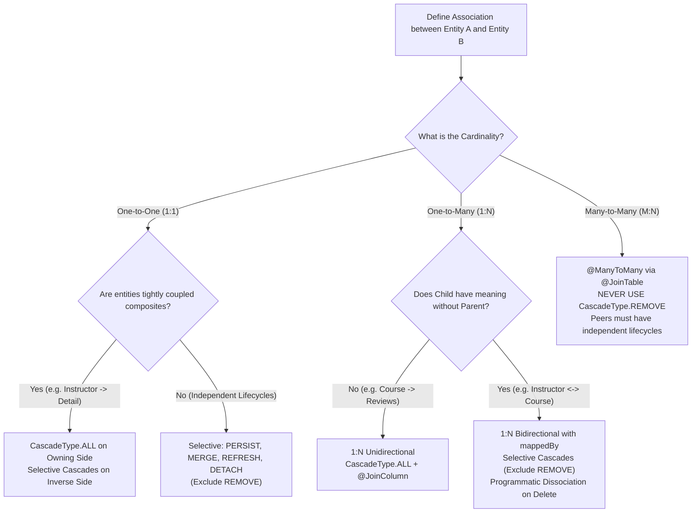
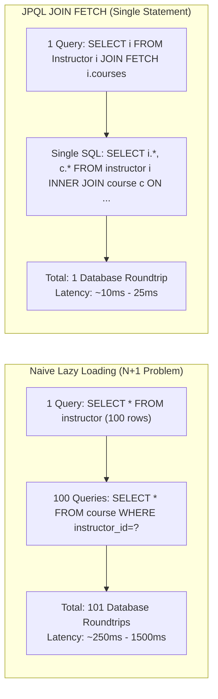
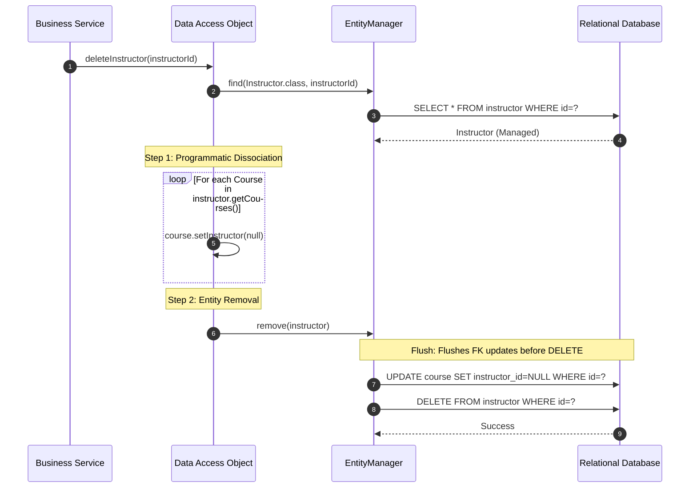

# Summary & Architecture Reference — Week 9: Advanced JPA Relational Topologies

---

## 1. JPA Mapping Annotation Matrix

| Annotation | Target Placement | Multiplicity | Default Fetch | Owning Side Declaration | Critical Attributes | Common Senior Pitfall |
| :--- | :--- | :--- | :--- | :--- | :--- | :--- |
| **`@OneToOne`** | Field / Getter | 1:1 | `FetchType.EAGER` | Placed on entity declaring `@JoinColumn` | `cascade`, `fetch`, `mappedBy`, `orphanRemoval` | Forgetting `mappedBy` on inverse side, generating duplicate foreign key columns. |
| **`@OneToMany`** | Collection Field | 1:N | `FetchType.LAZY` | Sits on inverse side (if bidirectional) | `mappedBy`, `cascade`, `fetch`, `orphanRemoval` | Changing to `FetchType.EAGER` to fix lazy exceptions, causing memory bloat and N+1. |
| **`@ManyToOne`** | Entity Field | N:1 | `FetchType.EAGER` | Always sits on owning side | `cascade`, `fetch`, `optional` | Applying `CascadeType.REMOVE`, accidentally deleting parent when child is removed. |
| **`@ManyToMany`** | Collection Field | M:N | `FetchType.LAZY` | Sits on entity declaring `@JoinTable` | `mappedBy`, `cascade`, `fetch` | Using `CascadeType.ALL` or `REMOVE`, deleting peer entities across the network. |
| **`@JoinColumn`** | Entity / Collection | Any Owning | N/A | Designates physical FK column | `name`, `referencedColumnName`, `nullable` | Omission on 1:N unidirectional mapping causes JPA to generate unwanted join table. |
| **`@JoinTable`** | Collection Field | M:N Owning | N/A | Maps dedicated intermediate table | `name`, `joinColumns`, `inverseJoinColumns` | Inverting `joinColumns` vs `inverseJoinColumns`, reversing relational foreign key links. |

---

## 2. Cascade Propagation & Relational Decision Matrix



---

## 3. Fetch Strategy Comparison: Default Rules vs JOIN FETCH

| Cardinality | JPA Default Fetch | Lazy Proxy Type | N+1 Risk? | Optimized Query Strategy |
| :--- | :--- | :--- | :--- | :--- |
| **`@OneToOne`** | `FetchType.EAGER` | ByteBuddy proxy (if optional lazy) | Low | `JOIN FETCH i.instructorDetail` |
| **`@ManyToOne`** | `FetchType.EAGER` | ByteBuddy proxy (if optional lazy) | Low | `JOIN FETCH c.instructor` |
| **`@OneToMany`** | `FetchType.LAZY` | `PersistentBag` / `PersistentSet` | **Critical** | `JOIN FETCH i.courses` |
| **`@ManyToMany`** | `FetchType.LAZY` | `PersistentBag` / `PersistentSet` | **Critical** | `JOIN FETCH c.students` |

---

## 4. The N+1 Query Problem: Performance Benchmark



### JPQL JOIN FETCH Syntax Cheatsheet:
```java
// Single Collection Fetch
"SELECT i FROM Instructor i JOIN FETCH i.courses WHERE i.id = :id"

// Multiple Joins (1:1 + 1:N)
"SELECT i FROM Instructor i JOIN FETCH i.courses JOIN FETCH i.instructorDetail WHERE i.id = :id"

// Left Outer Join Fetch (includes Instructors with ZERO courses)
"SELECT i FROM Instructor i LEFT JOIN FETCH i.courses WHERE i.id = :id"
```

---

## 5. Programmatic Entity Dissociation Protocol Checklist

When deleting entities that participate in associations without cascading removal, follow the **Dissociation Protocol** to avoid foreign key constraint failures:



### The 4 Dissociation Rules:
1. **1:1 Child Deletion (`InstructorDetail`)**:
   `detail.getInstructor().setInstructorDetail(null);`
   `entityManager.remove(detail);`
2. **1:N Parent Deletion (`Instructor` preserving `Courses`)**:
   `for (Course c : instructor.getCourses()) { c.setInstructor(null); }`
   `entityManager.remove(instructor);`
3. **M:N Inverse Deletion (`Student` preserving `Courses`)**:
   `for (Course c : student.getCourses()) { c.getStudents().remove(student); }`
   `entityManager.remove(student);`
4. **M:N Owner Deletion (`Course` preserving `Students`)**:
   `entityManager.remove(course);` (Hibernate automatically deletes join table rows).
