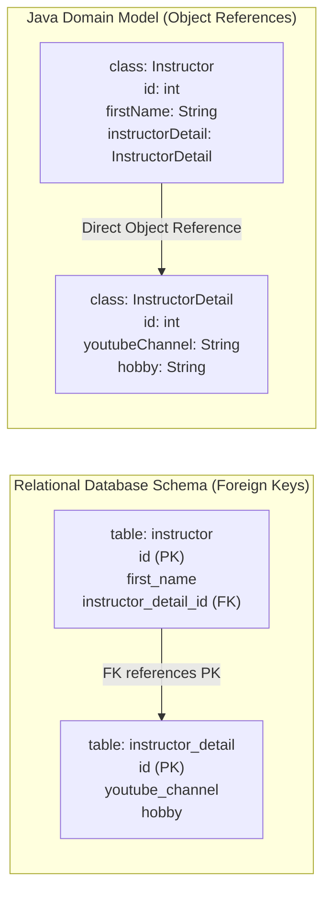
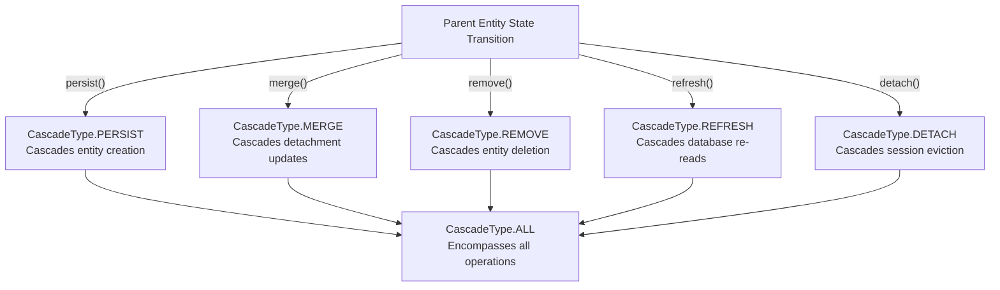
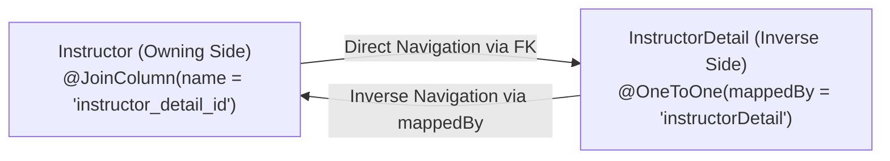
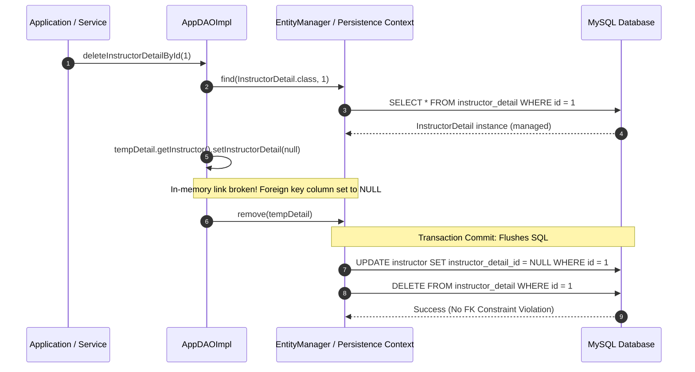
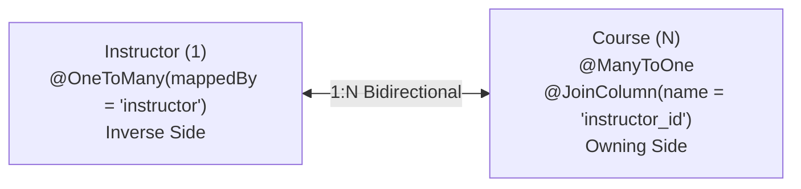
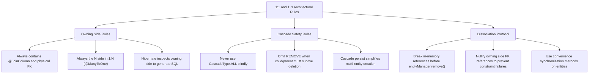

# Topic Notes — Part 1: One-to-One & One-to-Many Relational Topologies, Cascades & Dissociation

---

## 1. Object-Relational Impedance Mismatch in Entity Associations

In primitive data access designs, developers often mirror relational database tables by storing foreign keys as raw numerical fields inside Java entities:

```java
// ANTI-PATTERN: Modeling relational foreign keys as primitive values
@Entity
@Table(name = "instructor")
public class Instructor {
    @Id
    @GeneratedValue(strategy = GenerationType.IDENTITY)
    private int id;

    @Column(name = "instructor_detail_id")
    private int instructorDetailId; // Raw FK: Violates Object-Oriented principles!
}
```

This approach forces developers to execute manual secondary queries every time associated data is needed, defeating the purpose of an Object-Relational Mapping (ORM) framework. 

In idiomatic Jakarta Persistence (JPA), relational foreign key constraints are represented as **first-class object reference graphs**:



---

## 2. One-to-One (1:1) Unidirectional Mapping

A One-to-One relationship indicates that each instance of an entity is associated with exactly one instance of another entity.

### 2.1 The Owning Side Concept

In JPA, every bidirectional association has an **Owning Side** and an **Inverse (Referenced) Side**:

- **The Owning Side**: The entity that contains the physical foreign key column in its corresponding database table. In JPA annotations, the owning side declares the `@JoinColumn`.
- **The Inverse Side**: The entity mapped back to the owning side using the `mappedBy` attribute. It possesses no foreign key column in its physical table.

### 2.2 Entity Declaration

```java
package com.luv2code.cruddemo.entity;

import jakarta.persistence.*;

@Entity
@Table(name = "instructor")
public class Instructor {

    @Id
    @GeneratedValue(strategy = GenerationType.IDENTITY)
    @Column(name = "id")
    private int id;

    @Column(name = "first_name")
    private String firstName;

    @Column(name = "last_name")
    private String lastName;

    @Column(name = "email")
    private String email;

    // OWNING SIDE: Contains the physical foreign key column
    @OneToOne(cascade = CascadeType.ALL)
    @JoinColumn(name = "instructor_detail_id")
    private InstructorDetail instructorDetail;

    public Instructor() {}

    public Instructor(String firstName, String lastName, String email) {
        this.firstName = firstName;
        this.lastName = lastName;
        this.email = email;
    }

    // Getters and Setters
    public InstructorDetail getInstructorDetail() { return instructorDetail; }
    public void setInstructorDetail(InstructorDetail instructorDetail) {
        this.instructorDetail = instructorDetail;
    }
}
```

```java
package com.luv2code.cruddemo.entity;

import jakarta.persistence.*;

@Entity
@Table(name = "instructor_detail")
public class InstructorDetail {

    @Id
    @GeneratedValue(strategy = GenerationType.IDENTITY)
    @Column(name = "id")
    private int id;

    @Column(name = "youtube_channel")
    private String youtubeChannel;

    @Column(name = "hobby")
    private String hobby;

    public InstructorDetail() {}

    public InstructorDetail(String youtubeChannel, String hobby) {
        this.youtubeChannel = youtubeChannel;
        this.hobby = hobby;
    }

    // Getters and Setters ...
}
```

---

## 3. The CascadeType Taxonomy

The `cascade` attribute on JPA mapping annotations dictates whether state transitions performed on the parent entity are automatically propagated to target associated entities.



| Cascade Type | Underlying JPA / Hibernate Operation | Architectural Behavior |
| :--- | :--- | :--- |
| **`CascadeType.PERSIST`** | `EntityManager.persist()` | If the parent is persisted, the associated child is automatically persisted. |
| **`CascadeType.MERGE`** | `EntityManager.merge()` | If a detached parent is merged, modifications to the child are merged into the persistence context. |
| **`CascadeType.REMOVE`** | `EntityManager.remove()` | If the parent is deleted, Hibernate automatically executes SQL `DELETE` for the child entity. |
| **`CascadeType.REFRESH`** | `EntityManager.refresh()` | Re-reading the parent entity from the database causes the child entity to be re-read as well. |
| **`CascadeType.DETACH`** | `EntityManager.detach()` | Evicting the parent from the persistence context evicts the child entity. |
| **`CascadeType.ALL`** | All operations above | Propagates all lifecycle transitions from parent to child. |

### 3.1 Cascading Lifecycle Execution

When `@OneToOne(cascade = CascadeType.ALL)` is configured on `Instructor`:

```java
// Saving an Instructor automatically persists its InstructorDetail in 1 transaction
Instructor tempInstructor = new Instructor("Chad", "Darby", "darby@luv2code.com");
InstructorDetail tempDetail = new InstructorDetail("http://youtube.com/luv2code", "Coding");

tempInstructor.setInstructorDetail(tempDetail);

// Saves BOTH instructor and instructor_detail in database
appDAO.save(tempInstructor);
```

Hibernate generates the following SQL sequence:
```sql
-- 1. Insert child entity first to obtain generated primary key
INSERT INTO instructor_detail (hobby, youtube_channel) VALUES ('Coding', 'http://youtube.com/luv2code');

-- 2. Insert parent entity with foreign key referencing child primary key
INSERT INTO instructor (email, first_name, last_name, instructor_detail_id) VALUES ('darby@luv2code.com', 'Chad', 'Darby', 1);
```

---

## 4. One-to-One (1:1) Bidirectional Mapping & The `mappedBy` Contract

In a unidirectional 1:1 mapping, you can navigate from `Instructor` to `InstructorDetail`, but you cannot navigate from `InstructorDetail` back to `Instructor`.

To make the association bidirectional, we configure the inverse side:



### 4.1 Configuring the Inverse Side

```java
@Entity
@Table(name = "instructor_detail")
public class InstructorDetail {

    @Id
    @GeneratedValue(strategy = GenerationType.IDENTITY)
    @Column(name = "id")
    private int id;

    // INVERSE SIDE: mappedBy refers to the property name in Instructor class
    @OneToOne(mappedBy = "instructorDetail",
              cascade = CascadeType.ALL)
    private Instructor instructor;

    public Instructor getInstructor() { return instructor; }
    public void setInstructor(Instructor instructor) { this.instructor = instructor; }
}
```

!!! important "The mappedBy Rule"
    The value of `mappedBy` must **exactly match** the field name on the owning entity class (`private InstructorDetail instructorDetail;`), **NOT** the database column name (`instructor_detail_id`). Declaring `mappedBy` tells Hibernate: *"Do not create a foreign key column on my table; look at the property on the other entity to determine the relationship."*

---

## 5. Child-Only Deletion & Programmatic Dissociation

Consider a common enterprise requirement: **Delete the `InstructorDetail` without deleting the associated `Instructor`.**

If `InstructorDetail` is declared with `CascadeType.ALL`, invoking `entityManager.remove(instructorDetail)` will cascade and delete the `Instructor` as well! 

Furthermore, if you omit `CascadeType.REMOVE` but attempt to delete the detail directly:
```sql
DELETE FROM instructor_detail WHERE id = 1;
```
The database rejects the statement with an error:
```text
ERROR 1451 (23000): Cannot delete or update a parent row: a foreign key constraint fails
(`instructor`, CONSTRAINT `FK_DETAIL` FOREIGN KEY (`instructor_detail_id`) REFERENCES `instructor_detail` (`id`))
```

Because the `instructor` row still holds `instructor_detail_id = 1`, the foreign key constraint is violated!

### 5.1 Step 1: Configure Selective Cascades on the Inverse Side

Exclude `CascadeType.REMOVE` from the inverse entity:

```java
@Entity
@Table(name = "instructor_detail")
public class InstructorDetail {

    // Selective cascades: PERSIST, MERGE, DETACH, REFRESH (NO REMOVE)
    @OneToOne(mappedBy = "instructorDetail",
            cascade = {CascadeType.DETACH, CascadeType.MERGE, CascadeType.PERSIST, CascadeType.REFRESH})
    private Instructor instructor;

    // ...
}
```

### 5.2 Step 2: Programmatic Dissociation in the DAO

Before removing the entity, you **must break the bidirectional relationship in memory**:

```java
@Repository
public class AppDAOImpl implements AppDAO {

    @PersistenceContext
    private EntityManager entityManager;

    @Override
    @Transactional
    public void deleteInstructorDetailById(int theId) {

        // 1. Retrieve the child entity from the persistence context
        InstructorDetail tempInstructorDetail = entityManager.find(InstructorDetail.class, theId);

        // 2. CRITICAL: Break the bidirectional link on the owning entity
        tempInstructorDetail.getInstructor().setInstructorDetail(null);

        // 3. Delete the child entity
        entityManager.remove(tempInstructorDetail);
    }
}
```



---

## 6. One-to-Many / Many-to-One (1:N) Bidirectional Topologies

The most ubiquitous association in enterprise relational databases is the One-to-Many / Many-to-One relationship (e.g., One `Instructor` conducts Many `Course` offerings).



### 6.1 The Relational Law of Foreign Key Placement

In relational database theory, a foreign key can only reference a single row. Therefore, **the foreign key MUST reside on the `N` (Many) table (`course`)**. 

As a direct consequence in JPA:

- The `@ManyToOne` side (`Course`) is **always the Owning Side** and defines `@JoinColumn(name = "instructor_id")`.
- The `@OneToMany` side (`Instructor`) is **always the Inverse Side** and defines `mappedBy = "instructor"`.

### 6.2 Entity Implementation

#### The Owning Side (`Course.java`):
```java
package com.luv2code.cruddemo.entity;

import jakarta.persistence.*;

@Entity
@Table(name = "course")
public class Course {

    @Id
    @GeneratedValue(strategy = GenerationType.IDENTITY)
    @Column(name = "id")
    private int id;

    @Column(name = "title")
    private String title;

    // OWNING SIDE: Contains foreign key instructor_id
    // DO NOT cascade delete: deleting a course must never delete the instructor!
    @ManyToOne(cascade = {CascadeType.PERSIST, CascadeType.MERGE,
                          CascadeType.DETACH, CascadeType.REFRESH})
    @JoinColumn(name = "instructor_id")
    private Instructor instructor;

    public Course() {}

    public Course(String title) {
        this.title = title;
    }

    public int getId() { return id; }
    public void setId(int id) { this.id = id; }
    public String getTitle() { return title; }
    public void setTitle(String title) { this.title = title; }
    public Instructor getInstructor() { return instructor; }
    public void setInstructor(Instructor instructor) { this.instructor = instructor; }
}
```

#### The Inverse Side (`Instructor.java`):
```java
@Entity
@Table(name = "instructor")
public class Instructor {

    // ... id, name, email, instructorDetail ...

    // INVERSE SIDE: mappedBy matches field name 'instructor' on Course
    // Default fetch type for collections is FetchType.LAZY
    @OneToMany(mappedBy = "instructor",
               fetch = FetchType.LAZY,
               cascade = {CascadeType.PERSIST, CascadeType.MERGE,
                          CascadeType.DETACH, CascadeType.REFRESH})
    private List<Course> courses;

    public List<Course> getCourses() { return courses; }
    public void setCourses(List<Course> courses) { this.courses = courses; }

    // Convenience synchronization method
    public void add(Course tempCourse) {
        if (courses == null) {
            courses = new ArrayList<>();
        }
        courses.add(tempCourse);
        tempCourse.setInstructor(this);
    }
}
```

---

## 7. Bidirectional Synchronization & Convenience Methods

In an active Java application, maintaining bidirectional associations in memory is entirely the developer's responsibility. 

If you execute:
```java
// BUG: One-sided association assignment
instructor.getCourses().add(course);
```
Without setting `course.setInstructor(instructor)`, the owning side (`Course`) never knows it has an instructor! Because Hibernate inspects the **owning side** to generate SQL statements, it will insert the course with `instructor_id = NULL`!

### 7.1 Symmetrical Helper Method

To guarantee bidirectional consistency, always provide a convenience synchronization method on the parent:

```java
public void add(Course tempCourse) {
    if (courses == null) {
        courses = new ArrayList<>();
    }
    // Synchronize both sides of the object graph in memory
    courses.add(tempCourse);
    tempCourse.setInstructor(this);
}
```

Now, calling `tempInstructor.add(tempCourse)` guarantees both in-memory pointers are set synchronously.

---

## 8. Safe Deletion Workflows in One-to-Many Graphs

A senior engineer must distinguish between two fundamentally different deletion requirements:

### Case 1: Deleting a Course
When a course is cancelled, the instructor must remain intact.

- **Rule**: On `Course.instructor`, ensure `CascadeType.REMOVE` is **absent**.
- Execution:
  ```java
  @Override
  @Transactional
  public void deleteCourseById(int theId) {
      Course tempCourse = entityManager.find(Course.class, theId);
      entityManager.remove(tempCourse); // Deletes course; instructor remains intact
  }
  ```

### Case 2: Deleting an Instructor While Preserving Courses
An instructor leaves the university, but their courses must be retained and reassigned to other faculty.

- If you call `entityManager.remove(tempInstructor)` directly, the database foreign key constraint (`course.instructor_id -> instructor.id`) will trigger a foreign key violation!
- **Solution**: Break the foreign key associations programmatically before removing the instructor:

```java
@Override
@Transactional
public void deleteInstructorById(int theId) {

    // 1. Retrieve the instructor
    Instructor tempInstructor = entityManager.find(Instructor.class, theId);

    // 2. Fetch associated courses
    List<Course> courses = tempInstructor.getCourses();

    // 3. Break foreign key associations on the owning side
    for (Course tempCourse : courses) {
        tempCourse.setInstructor(null);
    }

    // 4. Delete the instructor
    entityManager.remove(tempInstructor);
}
```

Hibernate flushes:
```sql
-- Step 1: Nullify foreign keys on all courses
UPDATE course SET instructor_id = NULL WHERE id = 10;
UPDATE course SET instructor_id = NULL WHERE id = 11;

-- Step 2: Delete parent instructor
DELETE FROM instructor WHERE id = 1;
DELETE FROM instructor_detail WHERE id = 1;
```

---

## 9. Architectural Takeaways for Senior Engineers



1. **Physical FK Dictates the Owning Side**: Never place `@JoinColumn` on the `1` side of a 1:N bidirectional mapping. The `N` side (`@ManyToOne`) is the owner.
2. **Selective Cascades Prevent Accidental Deletions**: Avoid `CascadeType.ALL` on non-composite entities. If an associated entity has an independent business lifecycle, restrict cascades to `{PERSIST, MERGE, DETACH, REFRESH}`.
3. **Always Dissociate Before Deletion**: When deleting entities that participate in bidirectional relationships without cascading delete, you must explicitly nullify references on the owning side to prevent foreign key constraint violations.
