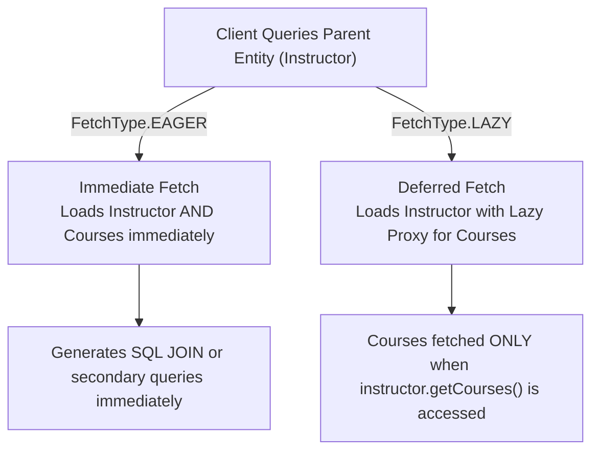
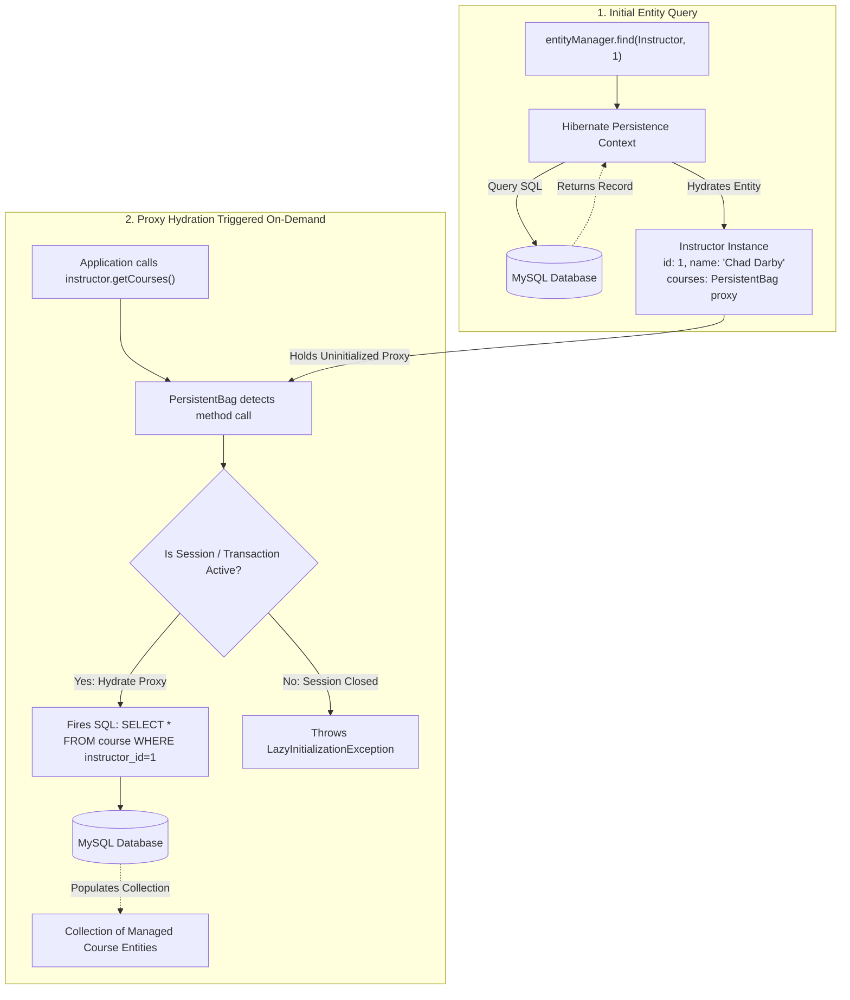
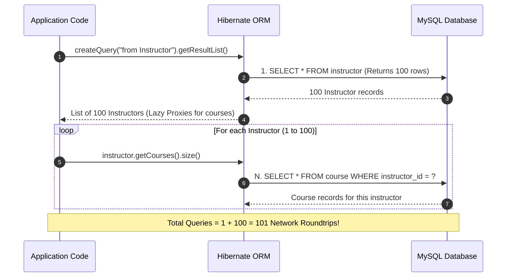
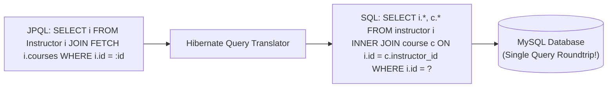
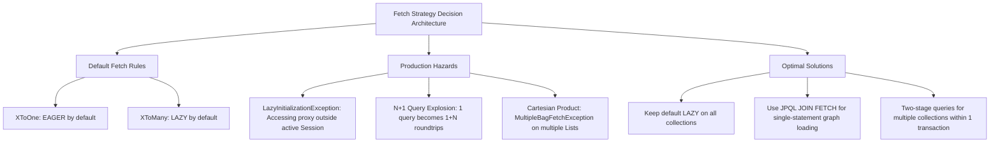

# Topic Notes — Part 2: Fetch Strategies, The N+1 Query Problem & JPQL JOIN FETCH Optimization

---

## 1. The Anatomy of JPA Fetch Strategies

When an entity participates in an Object-Relational relationship, should the associated entities be loaded from the database immediately when the parent is retrieved, or should loading be deferred until the application explicitly requests them?

Jakarta Persistence defines two foundational fetch strategies via the `jakarta.persistence.FetchType` enumeration:



| Fetch Strategy | Configuration | Runtime Mechanism | Performance Impact |
| :--- | :--- | :--- | :--- |
| **`FetchType.EAGER`** | `@OneToMany(fetch = FetchType.EAGER)` | Associated entities are fetched immediately along with the root entity. | May trigger massive, unexpected SQL joins and excessive memory consumption. |
| **`FetchType.LAZY`** | `@OneToMany(fetch = FetchType.LAZY)` | Associated entities are represented as uninitialized proxy placeholders; retrieved on-demand. | Highly efficient initial load; requires an open persistence context when accessed. |

---

## 2. JPA Default Fetch Types: The Architectural Rules

A critical requirement for senior Java engineers is memorizing the default fetch types dictated by the Jakarta Persistence specification:

| Relationship Annotation | Default Fetch Type | Rationale |
| :--- | :--- | :--- |
| **`@OneToOne`** | **`FetchType.EAGER`** | Single target entity; low cardinality overhead. |
| **`@ManyToOne`** | **`FetchType.EAGER`** | Single target entity; low cardinality overhead. |
| **`@OneToMany`** | **`FetchType.LAZY`** | Collection of entities; eager loading could retrieve thousands of rows. |
| **`@ManyToMany`** | **`FetchType.LAZY`** | Collection of entities; eager loading could pull an entire database graph. |

!!! important "The Default Rule of Thumb"
    - **All `XToOne` mappings default to `FetchType.EAGER`** (`@OneToOne`, `@ManyToOne`).
    - **All `XToMany` mappings default to `FetchType.LAZY`** (`@OneToMany`, `@ManyToMany`).

---

## 3. The Mechanics of Lazy Loading & Hibernate Proxies

How does Hibernate implement lazy loading in Java?

When an entity with lazy associations is loaded from the database, Hibernate does not populate the collection with real domain entities. Instead, Hibernate dynamically subclasses the target type at runtime using bytecode enhancement (Byte Buddy) to create a **Proxy Object** (or initializes a `PersistentBag` collection wrapper):



### 3.1 The Dreaded `LazyInitializationException`

If your application attempts to access a lazy collection after the underlying Hibernate `Session` / `EntityManager` has closed (e.g., in a presentation controller, a view template, or an asynchronous worker thread), Hibernate crashes with:

```text
org.hibernate.LazyInitializationException: failed to lazily initialize a collection of role:
com.luv2code.cruddemo.entity.Instructor.courses: could not initialize proxy - no Session
```

### 3.2 Demonstrating the Proxy Failure

```java
// Controller or Service boundary without active transaction
Instructor tempInstructor = appDAO.findInstructorById(1);

// EntityManager closes here! Session is TERMINATED.

// CRASH: Attempting to read lazy collection outside persistence context
System.out.println("Courses: " + tempInstructor.getCourses()); 
// -> Throws LazyInitializationException!
```

!!! caution "The 'Open Session in View' (OSIV) Anti-Pattern"
    In Spring Boot web applications, `spring.jpa.open-in-view` defaults to `true`. This keeps the database connection open throughout the entire view rendering lifecycle. While OSIV masks `LazyInitializationException` by allowing Thymeleaf to trigger lazy queries in the view, it is an enterprise anti-pattern: it ties up pooled database connections during slow network transmission and causes hidden queries to execute unpredictably during HTML serialization. In high-throughput architectures, OSIV should be disabled (`spring.jpa.open-in-view=false`).

---

## 4. The Catastrophic N+1 Select Query Problem

The most pervasive performance defect in ORM-based enterprise systems is the **N+1 Select Query Problem**.

### 4.1 How N+1 Occurs

Suppose you have 100 instructors in the database, each with multiple courses. You write a standard query to retrieve all instructors and iterate through their courses:

```java
// 1. Initial query to load all instructors
List<Instructor> instructors = entityManager.createQuery("from Instructor", Instructor.class)
                                            .getResultList();

// 2. Iterate and access the courses collection
for (Instructor instructor : instructors) {
    System.out.println(instructor.getFirstName() + " teaches " + instructor.getCourses().size() + " courses.");
}
```

What SQL statements does Hibernate execute against the database?

```sql
-- Query 1 (The '1' Query): Retrieves all 100 instructors
SELECT * FROM instructor;

-- Queries 2 through 101 (The 'N' Queries): Fired individually for EVERY instructor!
SELECT * FROM course WHERE instructor_id = 1;
SELECT * FROM course WHERE instructor_id = 2;
SELECT * FROM course WHERE instructor_id = 3;
...
SELECT * FROM course WHERE instructor_id = 100;
```



### 4.2 The Performance Impact of N+1

- If there are $N = 100$ records, the database must process **101 individual queries**.
- If there are $N = 1,000$ records, the database processes **1,001 individual queries**.
- Each query incurs network latency, connection acquisition overhead, SQL parsing, and transaction lock negotiation. Under high concurrent load, this degrades response times from milliseconds to seconds and exhausts database connection pools.

---

## 5. Why Eager Loading Does NOT Solve N+1

A common novice reflex is changing the mapping from `LAZY` to `EAGER`:

```java
// FLAWED ATTEMPT: Changing fetch to EAGER
@OneToMany(mappedBy = "instructor", fetch = FetchType.EAGER)
private List<Course> courses;
```

**Why this fails:**

1. When you execute a JPQL query such as `SELECT i FROM Instructor i`, the JPQL parser translates the query into `SELECT * FROM instructor`.
2. Hibernate retrieves the 100 instructors.
3. Because `courses` is marked `EAGER`, Hibernate realizes it cannot return until courses are loaded.
4. **Hibernate immediately fires 100 additional `SELECT` statements in the background!**
5. You still execute $1 + N = 101$ queries, but now you have lost the ability to defer loading when courses are not needed!

---

## 6. The Architectural Solution: JPQL `JOIN FETCH`

The idiomatic, production-grade resolution to the N+1 problem is **JPQL `JOIN FETCH`**.

### 6.1 What is `JOIN FETCH`?

`JOIN FETCH` is a JPA query instruction that commands the persistence provider to retrieve the parent entity and its associated lazy collections **together in a single SQL statement using an SQL `INNER JOIN` (or `LEFT JOIN`)**:



### 6.2 DAO Implementation

In `AppDAOImpl.java`:

```java
@Repository
public class AppDAOImpl implements AppDAO {

    @PersistenceContext
    private EntityManager entityManager;

    @Override
    public Instructor findInstructorByIdJoinFetch(int theId) {

        // JPQL query using JOIN FETCH on both courses and instructorDetail
        TypedQuery<Instructor> query = entityManager.createQuery(
                "SELECT i FROM Instructor i "
                + "JOIN FETCH i.courses "
                + "JOIN FETCH i.instructorDetail "
                + "WHERE i.id = :data", Instructor.class);

        query.setParameter("data", theId);

        // Executes exactly ONE single SQL query with joins!
        Instructor instructor = query.getSingleResult();

        return instructor;
    }
}
```

### 6.3 Generated SQL Output

When `findInstructorByIdJoinFetch(1)` executes, Hibernate issues a single query:

```sql
SELECT 
    i.id AS instructor_id,
    i.email,
    i.first_name,
    i.last_name,
    d.id AS detail_id,
    d.hobby,
    d.youtube_channel,
    c.id AS course_id,
    c.title
FROM instructor i
INNER JOIN instructor_detail d ON i.instructor_detail_id = d.id
INNER JOIN course c ON i.id = c.instructor_id
WHERE i.id = 1;
```

### 6.4 Why `JOIN FETCH` is Superior

1. **Exactly 1 Database Round-trip**: Network latency is incurred once, regardless of how many courses the instructor has.
2. **Persistence Context Hydration**: Hibernate automatically constructs the `Instructor` instance, instantiates the `InstructorDetail`, builds the `courses` collection, and sets bidirectional references in memory.
3. **Safe Detachment**: Because `courses` is fully initialized, the resulting `Instructor` object can be detached, passed across service and web controller boundaries, and serialized to JSON or rendered in Thymeleaf without throwing `LazyInitializationException`!

---

## 7. The Cartesian Product Trap & `MultipleBagFetchException`

While `JOIN FETCH` is exceptionally powerful, senior engineers must be vigilant regarding multiple collection fetches.

### 7.1 What Happens When You Fetch Multiple Collections?

Suppose an `Instructor` has:
- A `List<Course> courses` (e.g., 5 courses)
- A `List<Department> departments` (e.g., 3 departments)

If you attempt to execute:
```java
// DANGEROUS: Fetching two List collections simultaneously
"SELECT i FROM Instructor i JOIN FETCH i.courses JOIN FETCH i.departments WHERE i.id = :id"
```

Hibernate will throw a fatal initialization error:
```text
org.hibernate.loader.MultipleBagFetchException: cannot simultaneously fetch multiple bags:
[com.luv2code.cruddemo.entity.Instructor.courses, com.luv2code.cruddemo.entity.Instructor.departments]
```

### 7.2 The Cartesian Product Problem

In relational SQL, joining a table with 5 rows and another table with 3 rows produces a Cartesian product of $5 \times 3 = 15$ result set rows. If an entity has three collections with 10 items each, the query returns $10 \times 10 \times 10 = 1,000$ duplicate rows!

### 7.3 Architectural Solutions for Multiple Collections

1. **Use `java.util.Set` Instead of `java.util.List`**:
   In JPA terminology, a `List` without ordering is a **Bag** (which allows duplicates). A `Set` enforces uniqueness. Hibernate allows multiple `Set` collections in a `JOIN FETCH` because it can deduplicate rows in memory (though the Cartesian product SQL transfer overhead remains).
2. **Two-Stage Targeted Queries (Recommended for Large Collections)**:
   Keep collections as `List`, leave them as `FetchType.LAZY`, and fetch them using two targeted queries within the same `@Transactional` boundary:
   ```java
   // Query 1: Load Instructor and Courses into Persistence Context
   Instructor instructor = entityManager.createQuery(
       "SELECT i FROM Instructor i JOIN FETCH i.courses WHERE i.id = :id", Instructor.class)
       .setParameter("id", theId)
       .getSingleResult();

   // Query 2: Load and initialize Departments into the same Persistence Context
   entityManager.createQuery(
       "SELECT i FROM Instructor i JOIN FETCH i.departments WHERE i = :instructor", Instructor.class)
       .setParameter("instructor", instructor)
       .getSingleResult();
   ```
   Because both queries execute inside the same `EntityManager`, Hibernate hydrates the existing managed `Instructor` instance in memory without executing a Cartesian product!

---

## 8. Architectural Summary for Senior Engineers



1. **Always Default to `FetchType.LAZY` for Collections**: Never change `@OneToMany` or `@ManyToMany` to `EAGER` to fix a `LazyInitializationException`.
2. **Eliminate N+1 with `JOIN FETCH`**: Whenever you know a use case requires an entity and its associated collection, write a dedicated repository query utilizing `JOIN FETCH`.
3. **Beware of Cartesian Multiplications**: Never join multiple unbounded collection bags in a single query. Separate the fetches across targeted queries within the same transactional context.
