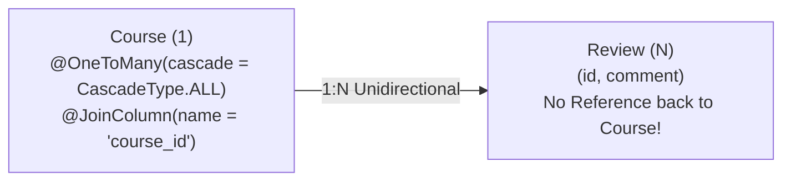
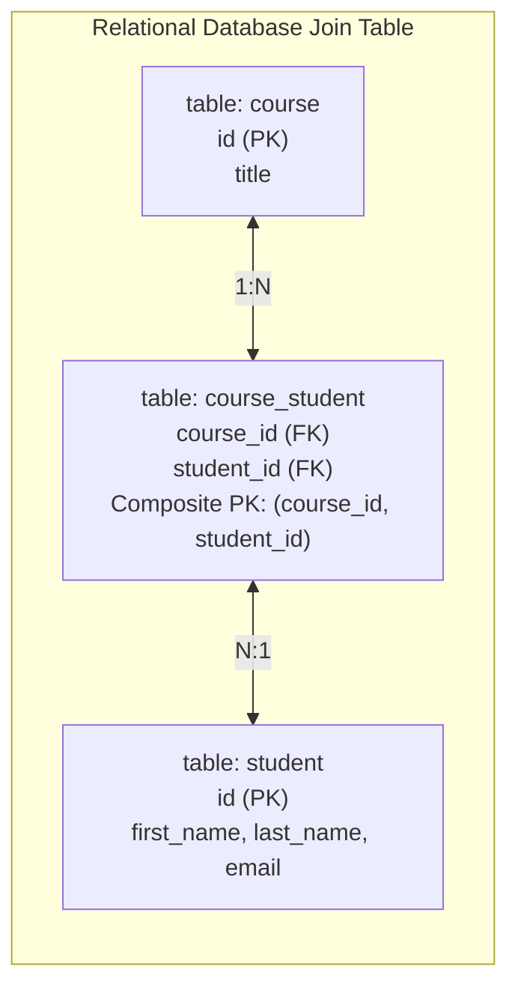
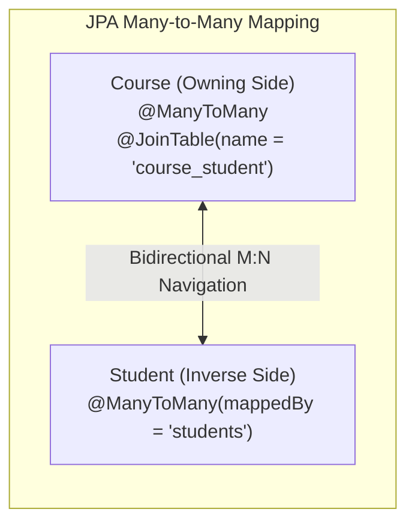
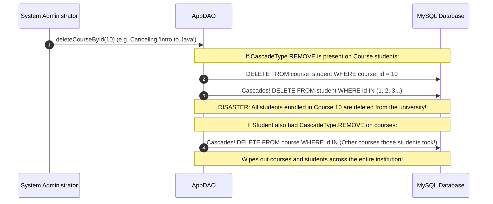
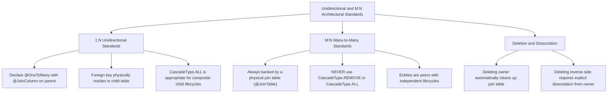

# Topic Notes — Part 3: Unidirectional Collections & Many-to-Many Join Tables

---

## 1. One-to-Many (1:N) Unidirectional Topologies

In Part 1, we implemented the One-to-Many bidirectional association between `Instructor` and `Course`, where both entities maintained references to each other.

However, many enterprise domain relationships are inherently **unidirectional**:
- A `Course` has multiple `Review` comments.
- A review belongs exclusively to a course, but a `Review` domain object has no independent reason to reference the `Course` (e.g., reviews are strictly read or rendered in the context of their course).



### 1.1 The Foreign Key Paradox in Unidirectional Collections

In a relational database, the foreign key column `course_id` **must physically reside in the `review` table**. 

However, in Java, `Review` has no `course` field! How does JPA know which column in `review` links back to `Course`?

### 1.2 The `@JoinColumn` on `@OneToMany`

To establish a 1:N unidirectional mapping without a join table, JPA requires placing the `@JoinColumn` directly on the `@OneToMany` collection in the parent entity:

```java
package com.luv2code.cruddemo.entity;

import jakarta.persistence.*;
import java.util.ArrayList;
import java.util.List;

@Entity
@Table(name = "course")
public class Course {

    @Id
    @GeneratedValue(strategy = GenerationType.IDENTITY)
    @Column(name = "id")
    private int id;

    @Column(name = "title")
    private String title;

    // 1:N Unidirectional mapping to Review
    // @JoinColumn tells Hibernate: 'The review table contains foreign key course_id'
    @OneToMany(fetch = FetchType.LAZY, cascade = CascadeType.ALL)
    @JoinColumn(name = "course_id")
    private List<Review> reviews;

    public Course() {}

    public Course(String title) {
        this.title = title;
    }

    public List<Review> getReviews() { return reviews; }
    public void setReviews(List<Review> reviews) { this.reviews = reviews; }

    // Convenience method
    public void addReview(Review theReview) {
        if (reviews == null) {
            reviews = new ArrayList<>();
        }
        reviews.add(theReview);
    }
}
```

```java
package com.luv2code.cruddemo.entity;

import jakarta.persistence.*;

@Entity
@Table(name = "review")
public class Review {

    @Id
    @GeneratedValue(strategy = GenerationType.IDENTITY)
    @Column(name = "id")
    private int id;

    @Column(name = "comment")
    private String comment;

    public Review() {}

    public Review(String comment) {
        this.comment = comment;
    }

    public int getId() { return id; }
    public void setId(int id) { this.id = id; }
    public String getComment() { return comment; }
    public void setComment(String comment) { this.comment = comment; }
}
```

!!! warning "The Omitted @JoinColumn Hazard"
    If you declare `@OneToMany` without `@JoinColumn` (and without `mappedBy`), JPA does **not** create a foreign key column in the child table. Instead, JPA defaults to generating an unnecessary intermediate join table (`course_reviews`)! Always explicitly declare `@JoinColumn(name = "course_id")` for unidirectional collections.

### 1.3 Full Lifecycle Delegation with `CascadeType.ALL`

Unlike relationships between peer entities, reviews are **child value objects** that cannot exist independently of their course. If a course is deleted, all its reviews should be deleted.

Because `Course` specifies `cascade = CascadeType.ALL`:
```java
@Override
@Transactional
public void deleteCourseById(int theId) {
    Course tempCourse = entityManager.find(Course.class, theId);
    entityManager.remove(tempCourse); // Cascades and deletes all reviews in review table!
}
```

Hibernate executes:
```sql
-- Step 1: Cascade delete all reviews referencing this course
DELETE FROM review WHERE course_id = 10;

-- Step 2: Delete parent course
DELETE FROM course WHERE id = 10;
```

---

## 2. Many-to-Many (M:N) Relational Topologies

A Many-to-Many relationship indicates that multiple instances of an entity are associated with multiple instances of another entity (e.g., a `Course` has Many `Student` enrollments, and a `Student` can enroll in Many `Course` offerings).



### 2.1 The Relational Law of Many-to-Many

In relational database theory, it is physically impossible to model an M:N association directly between two tables using simple foreign keys. 

To resolve an M:N relationship, the relational model decomposes the association into **two 1:N relationships** bridged by a dedicated **Join Table** (associative entity) containing composite foreign keys referencing both participating tables.

---

## 3. The JPA `@ManyToMany` & `@JoinTable` Architecture

JPA encapsulates the complexity of the underlying join table using the `@ManyToMany` and `@JoinTable` annotations.



### 3.1 The Owning Side (`Course.java`): Defining `@JoinTable`

```java
package com.luv2code.cruddemo.entity;

import jakarta.persistence.*;
import java.util.ArrayList;
import java.util.List;

@Entity
@Table(name = "course")
public class Course {

    // ... id, title, instructor, reviews ...

    @ManyToMany(fetch = FetchType.LAZY,
            cascade = {CascadeType.PERSIST, CascadeType.MERGE,
                       CascadeType.DETACH, CascadeType.REFRESH})
    @JoinTable(
            name = "course_student",
            joinColumns = @JoinColumn(name = "course_id"),
            inverseJoinColumns = @JoinColumn(name = "student_id")
    )
    private List<Student> students;

    public List<Student> getStudents() { return students; }
    public void setStudents(List<Student> students) { this.students = students; }

    // Convenience method
    public void addStudent(Student theStudent) {
        if (students == null) {
            students = new ArrayList<>();
        }
        students.add(theStudent);
    }
}
```

#### Anatomy of `@JoinTable`:
- `name = "course_student"`: Identifies the physical join table in MySQL.
- `joinColumns = @JoinColumn(name = "course_id")`: Identifies the foreign key column in the join table referencing the **owning entity's primary key** (`Course.id`).
- `inverseJoinColumns = @JoinColumn(name = "student_id")`: Identifies the foreign key column in the join table referencing the **inverse entity's primary key** (`Student.id`).

### 3.2 The Inverse Side (`Student.java`): Declaring `mappedBy`

```java
package com.luv2code.cruddemo.entity;

import jakarta.persistence.*;
import java.util.ArrayList;
import java.util.List;

@Entity
@Table(name = "student")
public class Student {

    @Id
    @GeneratedValue(strategy = GenerationType.IDENTITY)
    @Column(name = "id")
    private int id;

    @Column(name = "first_name")
    private String firstName;

    @Column(name = "last_name")
    private String lastName;

    @Column(name = "email")
    private String email;

    // INVERSE SIDE: mappedBy points to field name 'students' on Course
    @ManyToMany(fetch = FetchType.LAZY,
            cascade = {CascadeType.PERSIST, CascadeType.MERGE,
                       CascadeType.DETACH, CascadeType.REFRESH},
            mappedBy = "students")
    private List<Course> courses;

    public List<Course> getCourses() { return courses; }
    public void setCourses(List<Course> courses) { this.courses = courses; }

    // Convenience helper method
    public void addCourse(Course theCourse) {
        if (courses == null) {
            courses = new ArrayList<>();
        }
        courses.add(theCourse);
        theCourse.addStudent(this); // Symmetrically synchronize both sides
    }
}
```

---

## 4. The Peer Entity Preservation Rule in Many-to-Many

A foundational architectural rule in enterprise ORM design is the **Peer Entity Preservation Rule**:

!!! caution "NEVER Use CascadeType.REMOVE or CascadeType.ALL in @ManyToMany"
    In a Many-to-Many relationship, participating entities are **peers with independent lifecycles**. A student is not an internal component of a course, and a course is not an internal component of a student.

### 4.1 The Catastrophic Cascading Deletion Scenario

Consider what happens if you configure `CascadeType.ALL` or `CascadeType.REMOVE` on `@ManyToMany`:



### 4.2 The Safe Cascade Rule for `@ManyToMany`

Strictly limit cascades on `@ManyToMany` associations to non-destructive operations:
```java
cascade = {CascadeType.PERSIST, CascadeType.MERGE, CascadeType.DETACH, CascadeType.REFRESH}
```

---

## 5. Safe Deletion & Dissociation Protocols in Many-to-Many

Because `CascadeType.REMOVE` is omitted, how do we delete a course or a student without leaving orphaned foreign keys or triggering constraint violations?

### 5.1 Deleting a Course (The Owning Side)

When deleting a `Course`:

- Because `Course` is the owning side declaring `@JoinTable`, Hibernate automatically intercepts the deletion.
- Hibernate deletes all rows in the join table `course_student` referencing `course_id`.
- The `student` records remain completely untouched in the `student` table!

```java
@Override
@Transactional
public void deleteCourseById(int theId) {
    Course tempCourse = entityManager.find(Course.class, theId);
    entityManager.remove(tempCourse);
}
```

Hibernate flushes:
```sql
-- Step 1: Remove associations in join table
DELETE FROM course_student WHERE course_id = 10;

-- Step 2: Delete course reviews (from 1:N cascade)
DELETE FROM review WHERE course_id = 10;

-- Step 3: Delete course
DELETE FROM course WHERE id = 10;
-- Notice: Table `student` is completely UNTOUCHED!
```

### 5.2 Deleting a Student (The Inverse Side Dissociation Protocol)

When deleting a `Student`, a critical subtlety arises:

- `Student` is the **inverse side** (`mappedBy = "students"`).
- Hibernate does not automatically manage join table updates when modifying or deleting inverse entities directly.
- If you call `entityManager.remove(tempStudent)` while foreign keys in `course_student` still reference `tempStudent.id`, MySQL will reject the operation with a foreign key constraint violation!

#### The Dissociation Implementation:
Before removing the student, you **must explicitly dissociate the student from all enrolled courses**:

```java
@Override
@Transactional
public void deleteStudentById(int theId) {

    // 1. Retrieve the student from persistence context
    Student tempStudent = entityManager.find(Student.class, theId);

    if (tempStudent != null) {

        // 2. Fetch the courses collection
        List<Course> courses = tempStudent.getCourses();

        // 3. Break association on the OWNING SIDE of the relationship
        for (Course tempCourse : courses) {
            tempCourse.getStudents().remove(tempStudent);
        }

        // 4. Now delete the student
        entityManager.remove(tempStudent);
    }
}
```

Hibernate executes:
```sql
-- Step 1: Remove student from join table by updating owning side
DELETE FROM course_student WHERE course_id = 10 AND student_id = 1;
DELETE FROM course_student WHERE course_id = 11 AND student_id = 1;

-- Step 2: Delete student row from student table
DELETE FROM student WHERE id = 1;
```

---

## 6. Architectural Summary for Senior Engineers



1. **Explicit `@JoinColumn` on Unidirectional `@OneToMany`**: Always provide `@JoinColumn(name = "parent_id")` on unidirectional collections to prevent Hibernate from generating unnecessary join tables.
2. **Strict Cascade Boundaries on `@ManyToMany`**: Restrict cascades to `{PERSIST, MERGE, DETACH, REFRESH}`. Never propagate deletions across peer networks.
3. **Dissociate Inverse Side Before Deletion**: When removing entities from the inverse side of an association, iterate over the associated owning entities and remove references to allow clean join table cleanup.
